[Русский](./README.ru.md) | **English**

# How to test an audio amplifier with a square wave

**Published:** 2017-01-29  
**Category:** Repair and testing  
**Tags:** measurements  
**Original:** https://audiogeek.ru/kak-proverit-uselitel-meandrom/

---

Sometimes you build an amplifier with your own hands, switch it on, it sings... and joy knows no bounds :-) but then the euphoria passes and you realize that something is somehow off. Or friends bring one for you to check, or you just want to evaluate the amplifier you have been listening to music through for several years. If you need to test an audio amplifier, a square wave can tell you a great deal about it, or rather not the wave itself but what its shape becomes after passing through the amplifier under test.

A ***square wave*** (meander) is a periodic rectangular signal. What distinguishes a square wave from a general rectangular signal is that its duty cycle is 0.5.

It is true that rectangular signals can neither show much nor give an exact quantitative assessment of the parameters of an audio amplifier under test. What they show can only be rated "little", "a lot" or "not quite". But even that assessment is very useful, especially since everything is so clear and simple. This way you can not only check that the amplifier works, but also judge the linearity of its frequency response and the quality of the amplifier from the shape of the output signal.

To evaluate an amplifier a single square wave generator running at a fixed frequency of 1 kHz is enough. The internet is full of circuits for such generators. You will also need an oscilloscope to display the signal.

This method lets you test any amplifiers, whether for loudspeakers or headphone amplifiers, built on any components, be it tubes, transistors or chips.

## **Test circuit and method**

The output of the amplifier under test is loaded with a resistive load equal to the rated load of 4, 8, 16 or 32 Ω and able to dissipate the amplifier's rated output power.

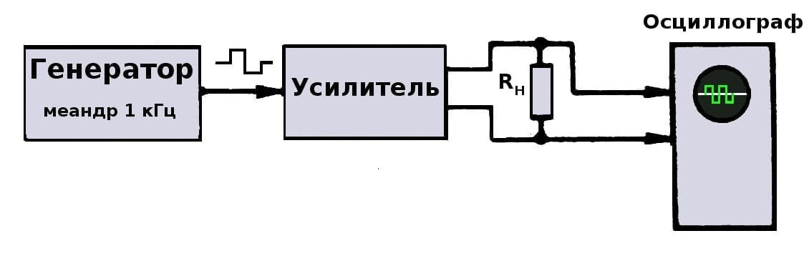

The generator output is connected to the amplifier's line input. The generator output level is set so that, with the amplifier's volume control partially open, the signal at the oscilloscope input has an amplitude of 1–2 volts. For this kind of measurement it is not recommended to open the volume control fully, so as not to saturate the amplifier's transistor stages.

The quality of the rectangular signal, in particular its edges, is not critical, because any distortion introduced by the amplifier will be clearly visible on the oscillogram.

A square wave has a frequency spectrum rich in harmonics and, truth be told, to reproduce it perfectly the upper limit of the amplifier's frequency range would theoretically have to lie somewhere at infinity; only then would the signal edges be perfectly square.

In practice, if some frequencies are not passed at all or are passed worse, the shape of the output signal changes. The shape also changes if phase distortion arises between some frequencies or bands of frequencies in the spectrum, or if the amplifier introduces large nonlinear distortion, or oscillates.

## **Possible results at the amplifier output**

The figures collect oscillograms of typical cases of distortion of a square wave as it passes through an audio amplifier

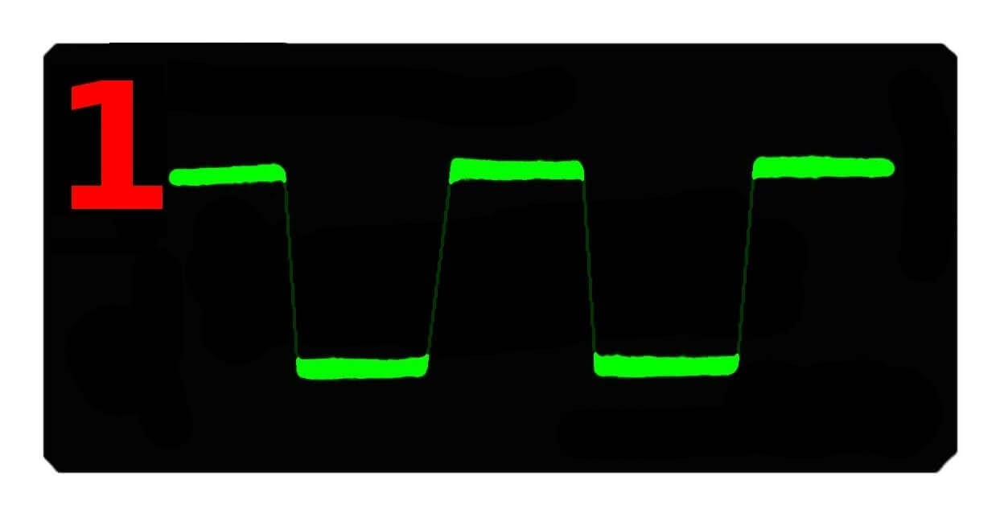

**1** - the original 1 kHz square wave fed to the amplifier input. The edges are not perfectly square, but that is good enough.

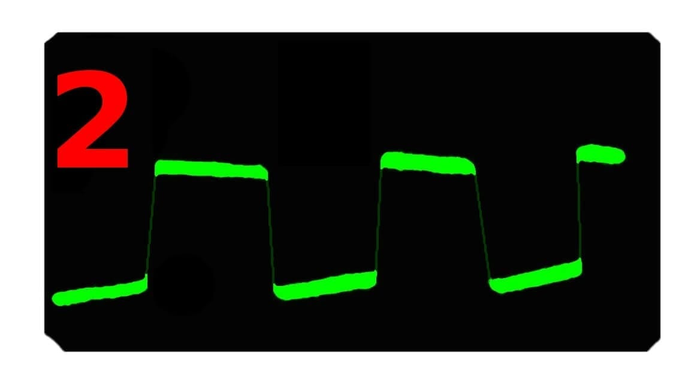

**2** - the signal of an amplifier with a linear response. The slight tilt is caused by a rolloff in the infrasonic region, below 20 Hz. This kind of oscillogram may indicate an infrasonic filter. If the amplifier is from a turntable, it has a rumble filter.

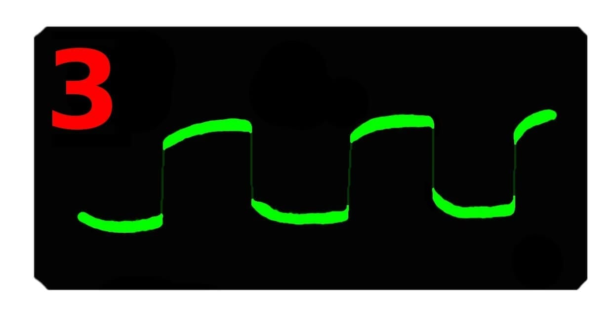

**3** - weak attenuation at high frequencies. About 3 dB at 10 kHz

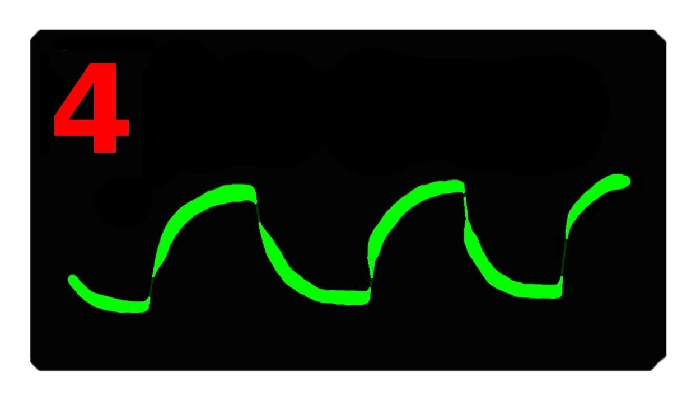

**4** - significant attenuation at high frequencies. −6 dB at 3 kHz and −15 dB at 20 kHz

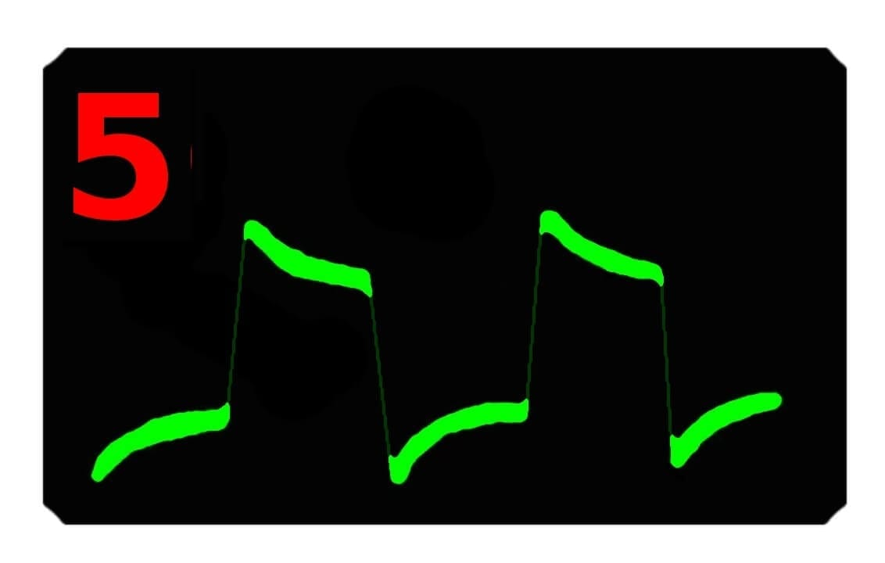

**5** - high-frequency boost. 6 dB at 10 kHz

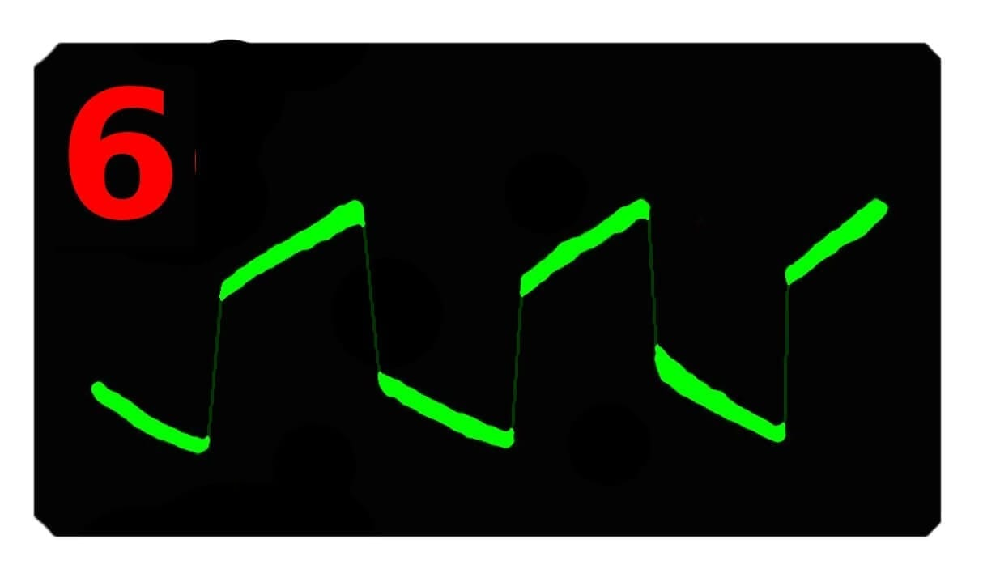

**6** - low-frequency boost of 15 dB at 15–50 Hz

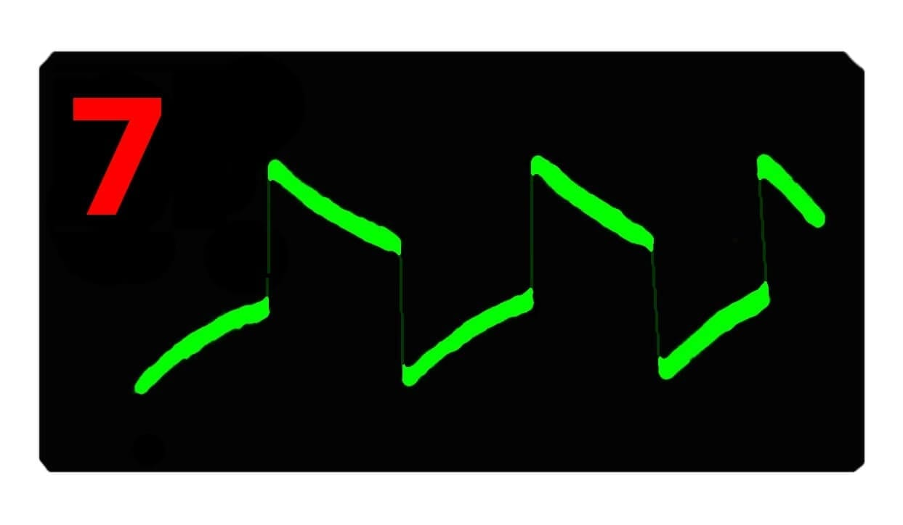

**7** - low-frequency attenuation. −15 dB at 15–50 Hz

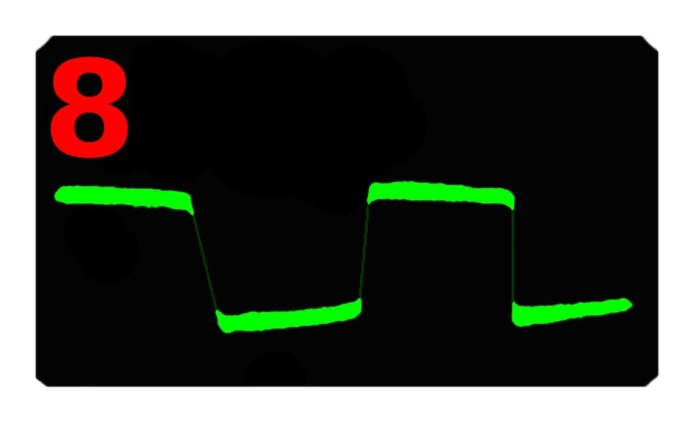

**8** - a healthy amplifier with a linear response. A loudspeaker is connected to the output.

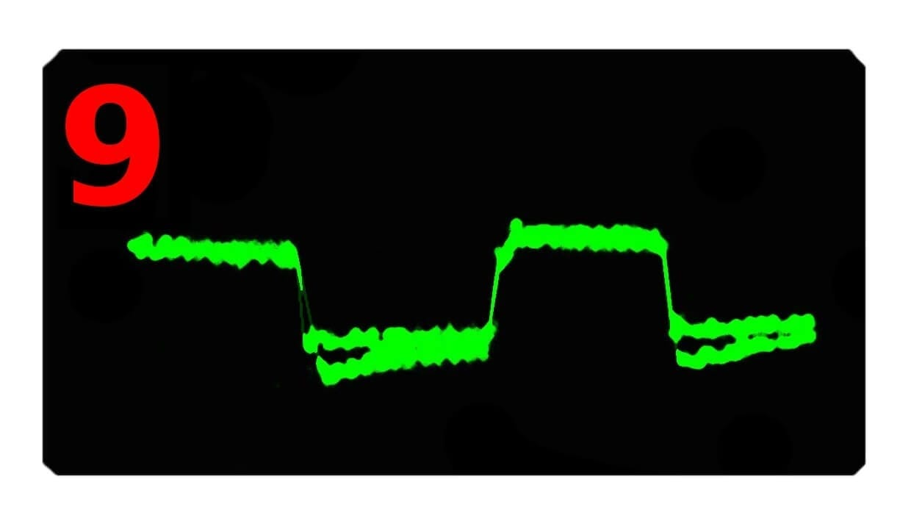

**9** - an oscillating amplifier loaded with a loudspeaker.

For easier comparison:

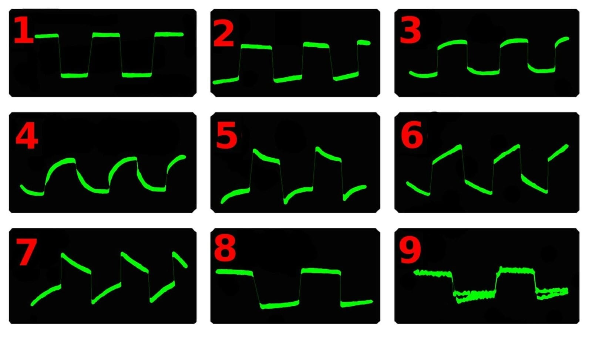

If the amplifier has tone controls, set them to the linear position during the test. If you then see a picture like figures 3 and 4, it most likely points to wrongly chosen time constants of the associated RC networks (capacitor too small or resistor too low in value).

The cause of attenuation at low frequencies may be insufficient capacitance of the capacitors at the amplifier's input and output.

With a two-channel oscilloscope it is very useful to compare how identical the two stereo channels are, to check the accuracy of dual stereo potentiometers and the identity of filters, and also to compare them with a reference signal.

*Originally written for [AudioGeek.ru](https://audiogeek.ru). Translated from Russian.*
