[English](./README.md) | **Русский**

# Как проверить усилитель звука сигналом прямоугольной формы

**Дата:** 2017-01-29  
**Рубрики:** Ремонт и проверка техники  
**Метки:** измерения  
**Оригинал:** https://audiogeek.ru/kak-proverit-uselitel-meandrom/

---

Иногда бывает, что собрал своими руками усилитель, запустил, запело...  радости нет предела :-) но потом эйфория проходит и приходит понимание, что как-то что-то не так. Или, например, принесли знакомые проверить, да или просто захотелось оценить свой усилитель через который уже несколько лет музыка слушается. Если требуется проверить усилитель звука, то очень многое об усилителе может рассказать меандр, вернее даже не сам он, а то, каким станет его форма после прохождения исследуемого усилителя.

***Меандр*** - это периодический сигнал прямоугольной формы. Отличие меандра от просто прямоугольного сигнала в том, что его скважность равна 0,5 .

Верно то, что сигналы прямоугольной формы не могут ни показать многого, ни дать точную количественную оценку параметров исследуемого аудио усилителя. То, что они выражают можно только оценить как ‘мало’, ’много’ или ‘не совсем’. Но и эта оценка очень полезна, тем более что все очень наглядно и просто. Таким образом можно не только проверить усилитель на работоспособность, но и по виду сигнала на выходе усилителя оценить степень линейности АЧХ и качество усилителя.

Для оценки усилителя достаточно располагать одним генератором прямоугольных сигналов, работающим на фиксированной частоте 1кГц. В интернете полно схем подобных генераторов. Так же потребуется осциллограф для визуального отображения сигнала.

Данная методика позволяет проверять любые усилители, как для акустических систем, так и усилители для наушников, реализованные на любой элементной базе будь то лампы, транзисторы или микросхемы.

## **Схема и методика проверки**

Выход испытываемого усилителя нагружается активным сопротивлением, равным номинальной нагрузке 4, 8,16 или 32 Ом и способным рассеивать номинальную выходную мощность усилителя.

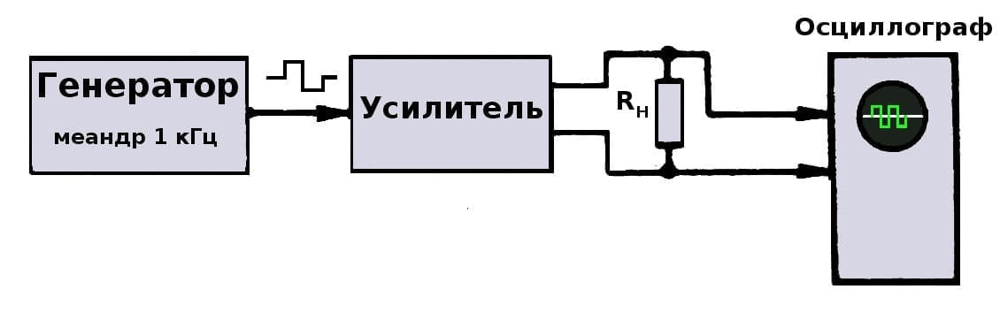

Выход генератора подключается к линейному входу усилителя. Выходной  уровень генератора подбирается так, чтобы при частично открытом регуляторе громкости усилителя на входе осциллографа получился сигнал, амплитудой 1-2 вольта. Не рекомендуется при таком виде измерений полностью открывать регулятор громкости, чтобы не допускать насыщения транзисторных каскадов усилителя.

Качество сигнала прямоугольной формы, в частности его фронтов не является критичным, т.к. при наличии искажений, вносимых усилителем это будет отчетливо видно на осциллограмме.

Сигнал прямоугольной формы имеет частотный спектр богатый гармониками и, по правде говоря, теоретически, для идеального его воспроизведения необходимо чтобы верхняя граница частотного диапазона усилителя располагалась где-то в бесконечности, в таком случае фронты сигнала будут идеально прямоугольными.

На практике же если некоторые частоты не пропускаются совсем или пропускаются хуже, то форма сигнала на выходе видоизменяется. Форма так же изменяется, если между некоторыми частотами или полосами частот в спектре получаются фазовые искажения, или если усилитель вносит большие нелинейные искажения, или самовозбуждается.

## **Возможные варианты на выходе усилителя**

На рисунках собраны и показаны осциллограммы типичных случаев искажения прямоугольного сигнала при его прохождении через усилитель звука

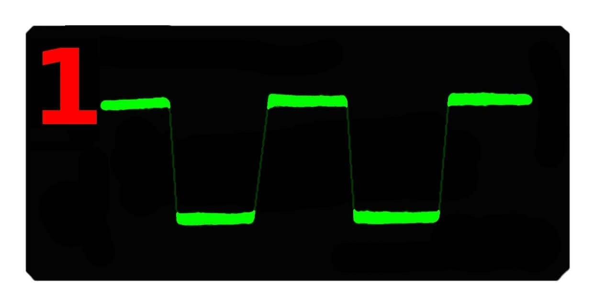

**1** - исходный сигнал прямоугольной формы частотой 1 кГц, подаваемый на вход усилителя. Фронты не идеально прямоугольные, но и этого достаточно.

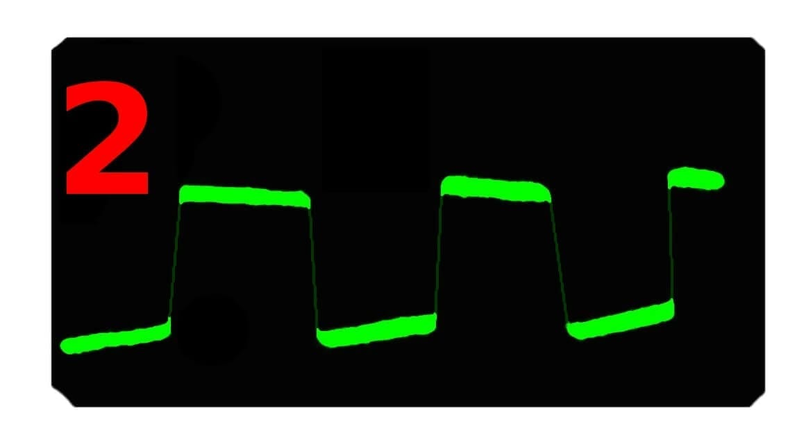

**2** - сигнал усилителя с линейной характеристикой. Легкий наклон вызван спадом в области инфразвука, ниже 20Гц. Такой вид осциллограммы может свидетельствовать о наличии фильтра инфразвука. Если усилитель от винилового проигрывателя то в нем имеется рокот фильтр.

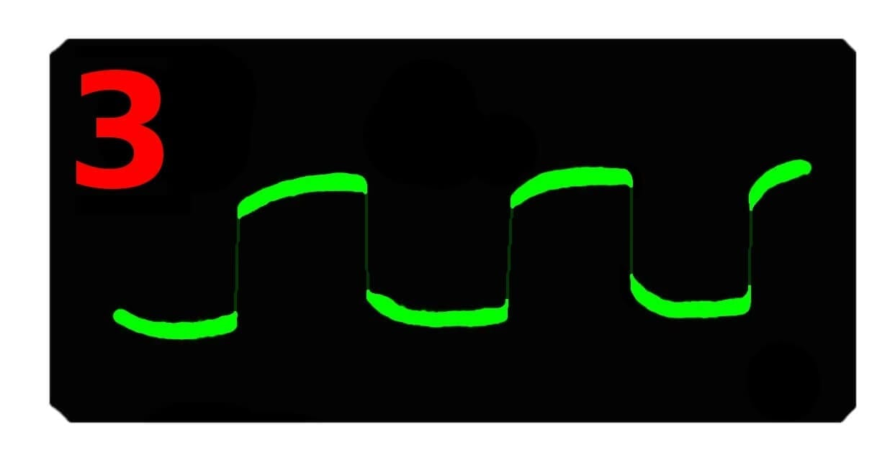

**3** -  слабое затухание в области высоких частот. Приблизительно 3 дБ на 10кГц

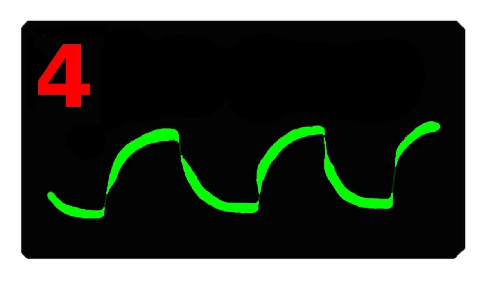

**4** - значительное затухание на высоких частотах. -6 дБ на 3кГЦ и -15дБ на 20кГц

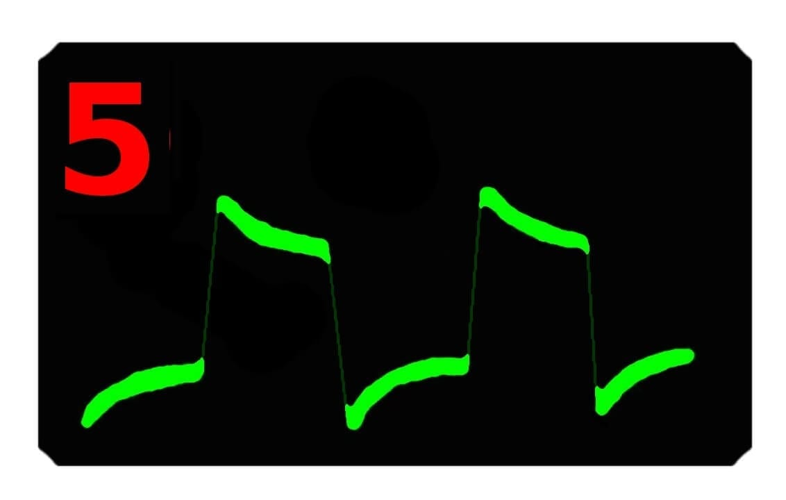

**5** - подъем высоких частот. 6дБ на 10 кГц

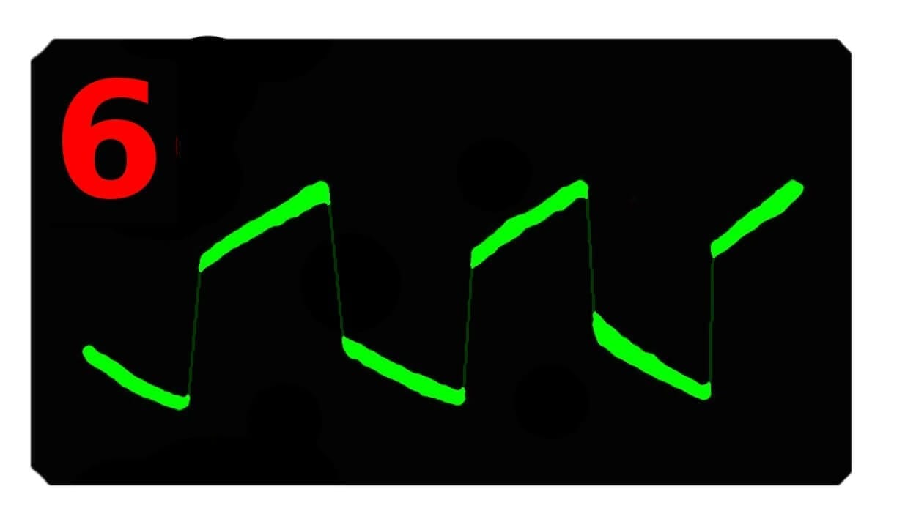

**6** - подъем низких частот 15 дБ на частотах 15-50 Гц

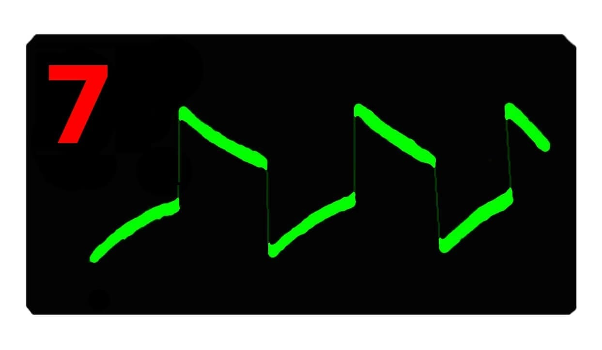

**7** - затухание низких частот. -15 дБ на частотах 15-50 Гц

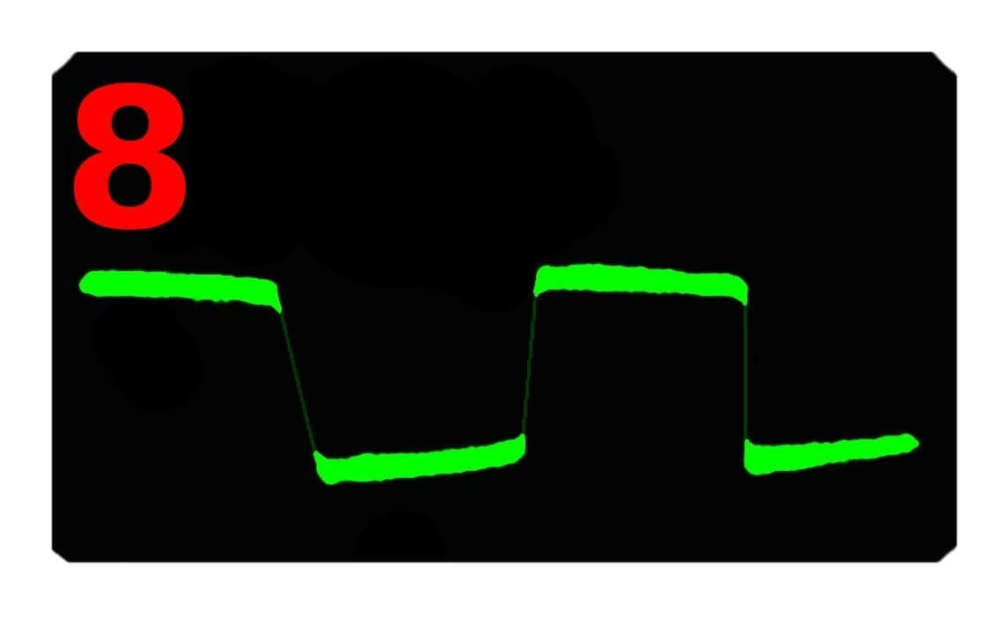

**8** - исправный усилитель с линейной характеристикой. На выходе подключен громкоговоритель.

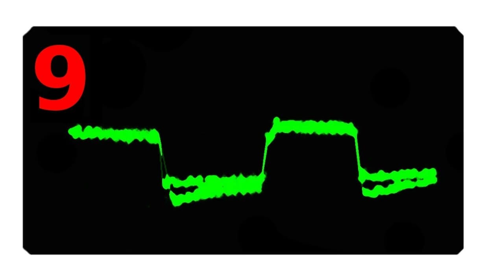

**9** - самовозбуждающийся усилитель, нагруженный громкоговорителем.

Для более наглядного сравнения:

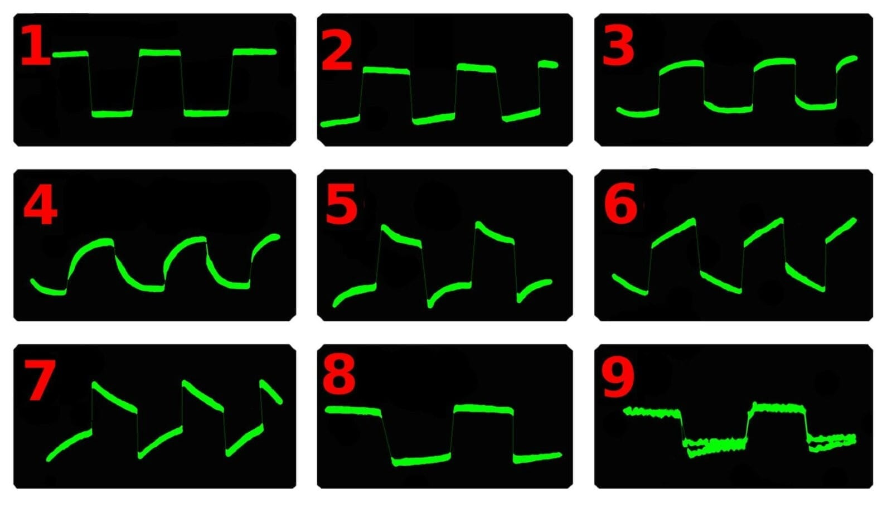

Если на усилителе имеются регуляторы тембра то во время оценки следует выставить их в положение линейной характеристики. Если при этом наблюдаются картина как на рисунках 3 и 4 то это с большей вероятностью говорит о неправильно подобранных постоянных связанных RC-цепей(недостаточная емкость конденсатора либо мало  сопротивление резистора)

Причиной затухания на низких частотах может быть недостаточная емкости конденсаторов по входу и выходу усилителя.

При наличии двухканального осциллографа очень полезна сравнительная оценка идентичности двух стереоканалов и точности сдвоенных стереопотенциометров, идентичности фильтров, а также проводить их сравнение с эталонным сигналом.
