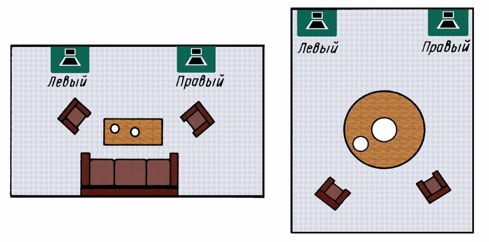
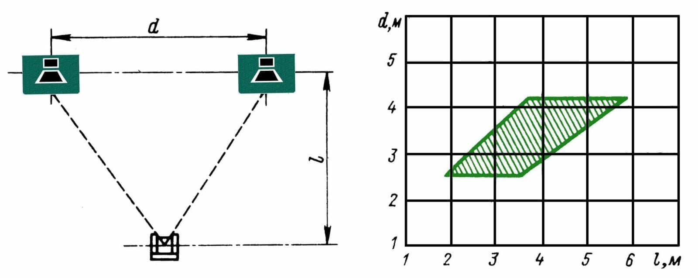
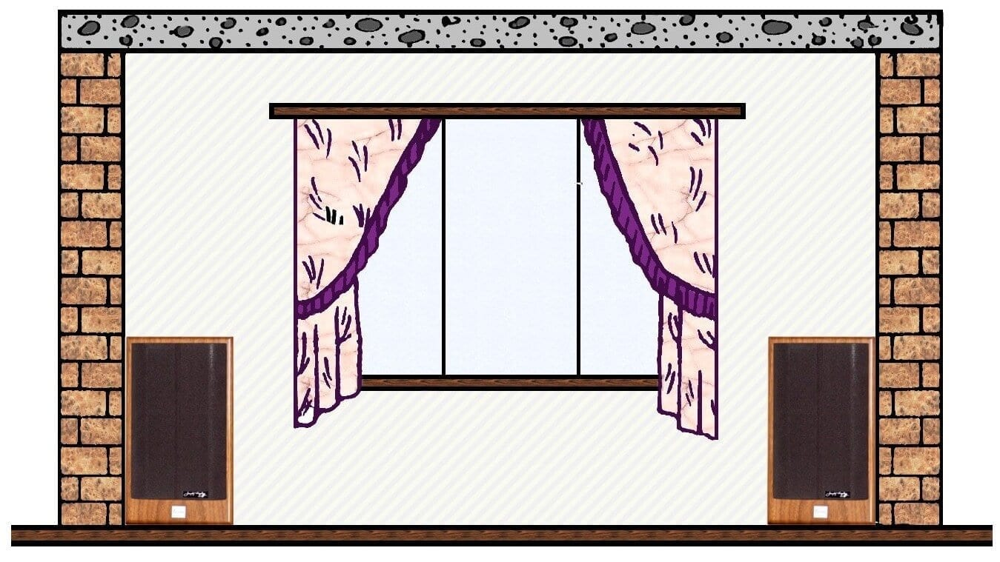
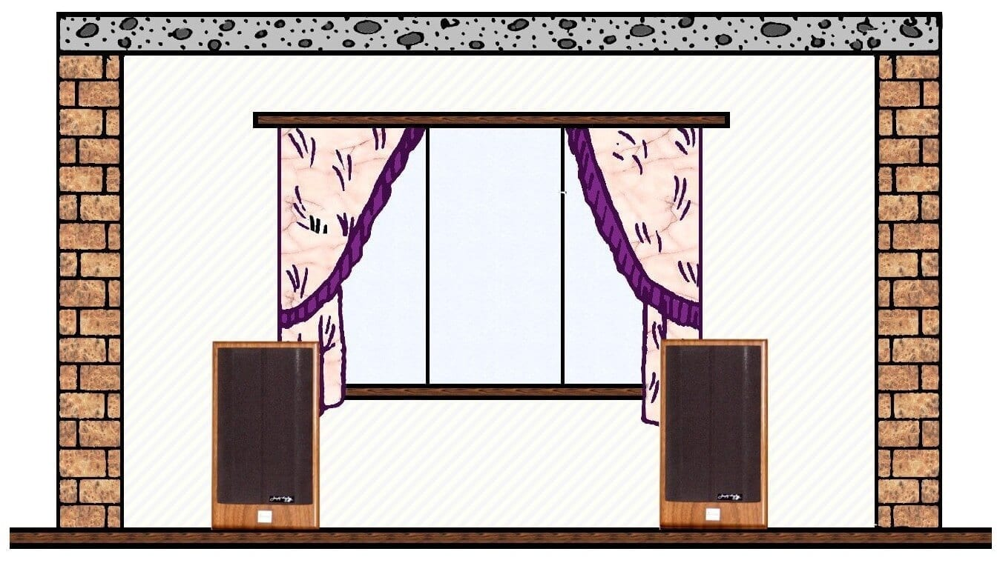
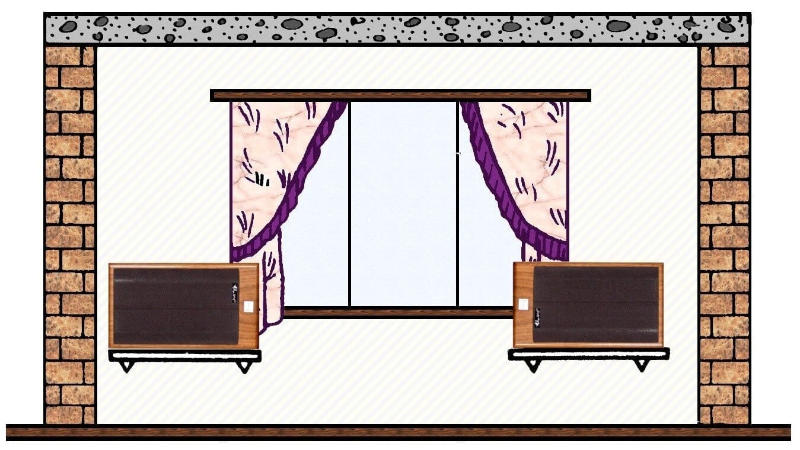

[Русский](./README.ru.md) | **English**

# How to place loudspeakers properly in a room

**Category:** Speaker basics  
**Tags:** sound quality  
**Original:** https://audiogeek.ru/kak-razmestit-as-v-komnate/

---

After buying or building loudspeakers, people usually do not think much about how and where to put them. But when choosing a place for speakers, keep in mind that the correctness of the stereo effect, the elimination of the room's acoustic defects and good emphasis of low and high frequencies depend strongly on their placement. Besides that, aesthetic considerations and the opinions of the rest of the family must be taken into account...

For definiteness: strictly speaking, "***columns***" are loudspeaker systems with several ***identical*** drivers installed. Columns are used to get high sound power when sounding cinemas, concert halls, stadiums and the like. For simplicity, though, this article uses "speaker" to mean a loudspeaker system with several drivers for different frequency ranges.

## **How to place speakers properly**

There are no strictly established rules for placing loudspeakers in a room, only general recommendations and established facts. Whatever speakers you have, the receiver of the sound is always the ear in the end, and it is the ear's demands and preferences that must be satisfied first.

You can only learn how to place speakers properly by placing them many times. The following guidelines serve only as a landmark for action and to save time.

## **How the shape of the room affects speaker placement**

First of all, think about the shape of the room in which the speakers will be placed. It is good if the room is square. Then there is no dilemma about which wall to put them against, the long one or the short one. But in our homes a square room is a great rarity, so we will have to suffer a bit :)

If the speakers are placed against the short wall, it emphasizes low frequencies, i.e. bass. Often even too much. Unpleasant resonance effects like droning rumble or ringing may also appear. This is especially pronounced when the room is very elongated. In that case placement along the long wall is preferable.

If the speakers are placed against the long wall, this may give an impression of weakened low frequencies, but it will eliminate the unpleasant resonance effects.

The distance between the speakers, let us call it ***d***, is usually 2–3.5 meters. It depends on the distance to the listening position ***l***. To get a correct stereo effect, the listener should always be at the corresponding point of the stereo zone. However, ***l*** is limited by the dimensions of the room.

The possibilities for changing the two quantities ***d*** and ***l*** are limited by the shaded zone on the diagram. If, for example, the room allows choosing ***d*** equal to 3.5 m, the listening position can be 2.5–4 meters from the wall.

## Vertical placement

Speakers can be placed both vertically and horizontally.

With vertical placement, the high-frequency drivers should be at the top. Low-frequency sound vibrations spread best along the bottom, and as the frequency rises it is desirable to raise the radiators. So if you have a 2.1 system, the subwoofer should be on the floor, and the satellites (mid/high-frequency radiators) are best placed no lower than table level.

With horizontal placement, the high-frequency drivers are better placed on the inner side, because of the narrow directivity of HF drivers, to bring them closer to the center line of the room. The opposite arrangement is acceptable too, though, and will widen the soundstage, which is relevant for modern digital music.

And even that is not all! ))

If the speakers are pressed tightly into the corners of the room, low frequencies are emphasized to the maximum.

If the amount of bass is greatly overstated and there is droning, move the speakers away from the corners.

Even stronger attenuation of low frequencies can be obtained by lifting the speakers to some height above the floor.

Extremely loud bass results when the back panel of the speaker is moved away from the wall. Such boost is unnatural and should not be allowed.

And finally, during all your experiments with speaker placement it is recommended to turn your back to them. It has long been established in psychoacoustics that appearance has a strong effect, and if you do not like the arrangement visually, you will most likely not like the sound either.

*Originally written for [AudioGeek.ru](https://audiogeek.ru). Translated from Russian.*
