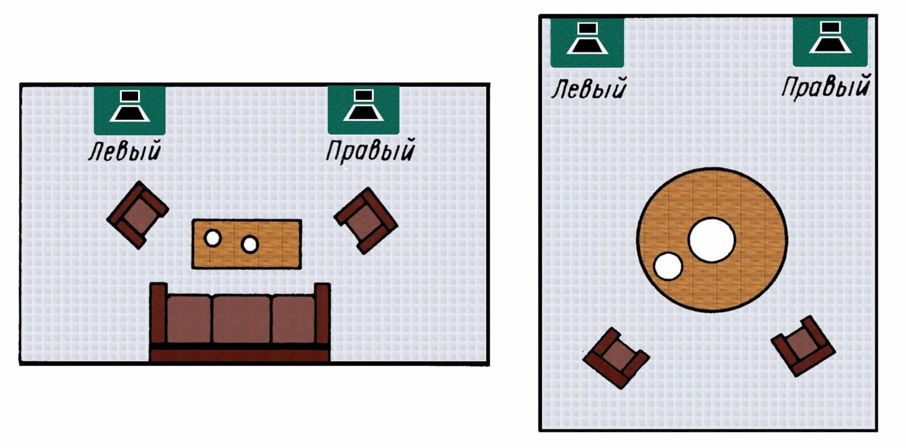
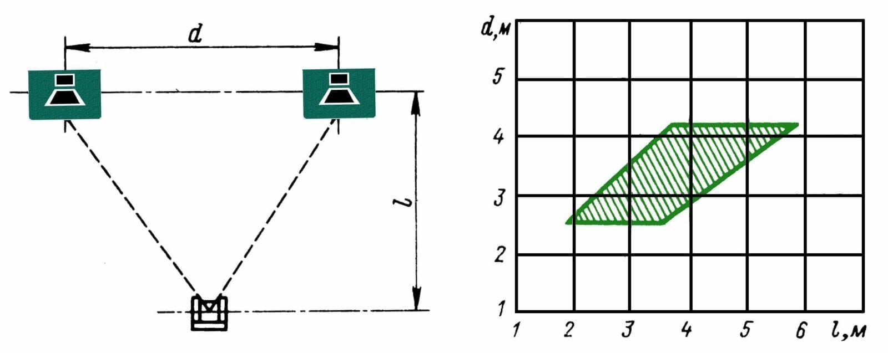
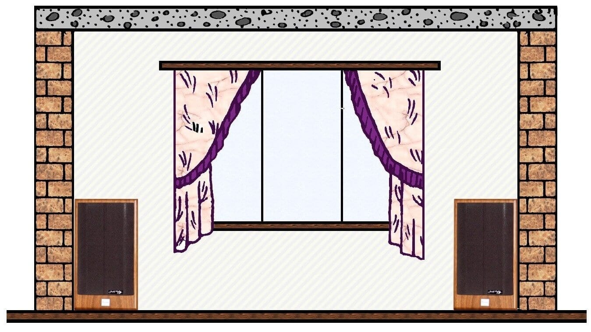
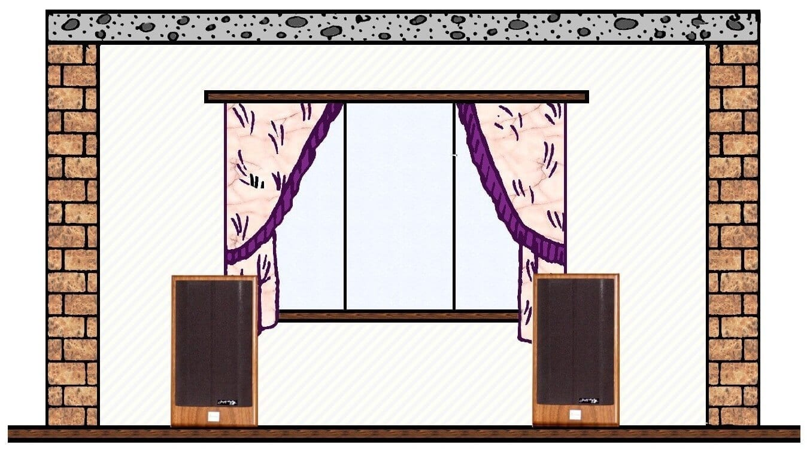
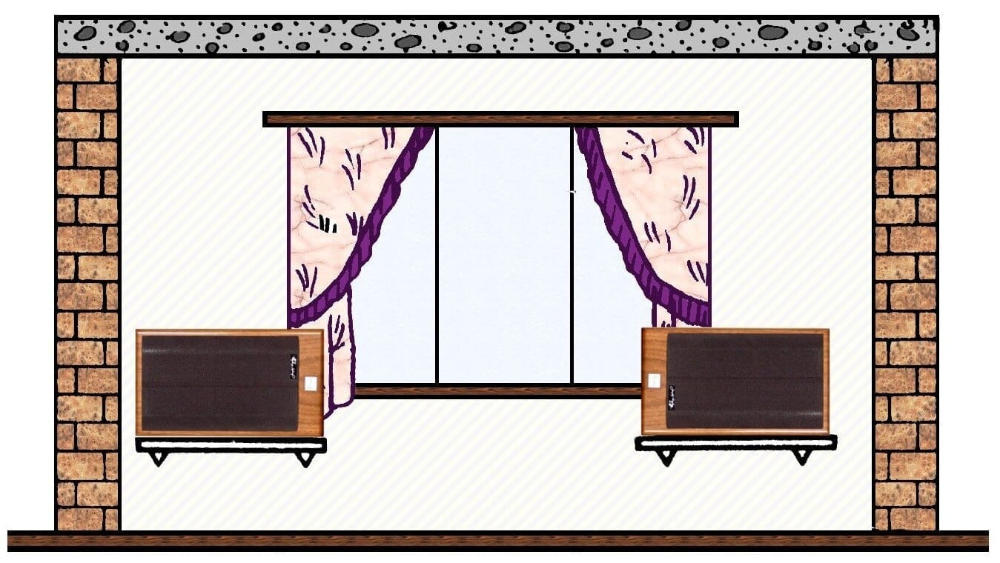

[English](./README.md) | **Русский**

# Как правильно разместить акустическую систему в комнате

**Дата:** 2017-03-20  
**Рубрики:** Общие вопросы по АС  
**Метки:** качество звука  
**Оригинал:** https://audiogeek.ru/kak-razmestit-as-v-komnate/

---

Купив либо изготовив акустические системы или по простому - колонки, обычно не сильно задумываются о том как и куда их ставить. Однако при выборе места для акустических систем следует учитывать, что от правильности их расположения сильно зависит правильность создаваемого стереоэффекта, устранение акустических дефектов помещения, хорошее подчеркивание низких и высоких частот. Помимо этого стоит еще учитывать эстетическими соображения и мнения остальных членов семьи...

Для определенности стоит сказать, что по терминологии ‘***колонки***’ это акустические системы, в которых установлено по несколько ***одинаковых*** излучающих головок. Используются колонки для получения больших звуковых мощностей при озвучивании кинотеатров, концертных залов, стадионов и т.п. Однако для упрощения в статье под колонкой понимается акустическая система с несколькими излучателями на разные диапазоны частот.

## **Как правильно расставить колонки**

Не существует никаких строго установленных правил размещения акустических систем в помещении, есть только общие рекомендации и установленные факты. Какие бы колонки у вас не были, в конечном итоге приемником звука всегда является ухо и, в первую очередь, необходимо удовлетворять именно его запросы и предпочтения.

Понять как правильно расставить акустические системы можно только путем неоднократной их расстановки. Следующие указания служат лишь ориентиром для действий и экономии времени.

## **Влияние формы комнаты на расстановку АС**

Прежде всего следует подумать о форме помещения, в котором будет размещена акустическая система. Хорошо, если комната квадратная. В этом случае не возникнет дилеммы у какой стены лучше ставить, у длинной или у короткой. Но в наших домах квадратная комната - большая редкость, поэтому немного помучаемся)

Если акустика размещается у короткой стены, то это способствует подчеркиванию низких частот, т.е. басов. Зачастую даже излишнему подчеркиванию. Так же могут проявляется неприятные резонансные явления похожие на гудящий грохот или звон. Особо сильно это проявляется при значительной вытянутости помещения. В таком случае предпочтительнее расстановка у длинной стены.

Если же расставить колонки у длинной стены, то это может вызвать ощущение затухания низких частот, но устранит неприятные резонансные явления.

Расстояние межу акустическими системами, обозначим его как ***d***, обычно составляет 2-3,5 метра. Оно зависит от расстояния до места прослушивания ***l***. Для создания правильного стереоэффекта желательно, чтобы слушатель всегда находился в соответствующей точке стерео зоны. Однако ***l*** ограничивается размерами комнаты.

Возможности изменения двух величин ***d*** и ***l*** ограничены заштрихованной зоной на диаграмме. Если, например комната позволяет выбрать расстояние ***d*** равным 3,5м, то место прослушивания может находиться в 2,5-4 метрах от стены.

## Расположение по вертикали

Акустические системы могут располагаться как вертикально так и горизонтально.

При вертикальном расположении акустических систем, высокочастотные громкоговорители должны располагаться в верхней части. Низкочастотные звуковые колебания лучше всего распространяются по низу, а с ростом частоты желателен подъем излучателей. Поэтом, если у вас система 2.1 то сабвуфер должен располагаться на полу, а сателлиты (СЧ-ВЧ излучатели) лучше располагать не ниже, чем на уровне стола.

При горизонтальном расположении колонок, высокочастотные громкоговорители лучше располагать с внутренней стороны, по причини узкой направленности ВЧ головок для их более близкого расположения к осевой линии комнаты. Однако допустимо и обратное расположение, которое приведет к расширению звуковой сцены что актуально для современной цифровой музыки.

И даже это еще не все))

Если акустические системы плотно прижаты к углам комнаты, то максимально подчеркиваются низкие частоты.

Если количество НЧ сильно завышено и наблюдается гудение, то следует отодвинуть колонки от углов.

Еще более сильное затухание низких частот можно получить, если поднять системы на некоторую высоту от пола.

Чрезвычайно громкое звучание НЧ получается при удалении задней стенки акустической системы от стенки. Такое усиление неестественно и не должно допускаться.

И напоследок, во время всех экспериментов с расстановкой акустики рекомендуется поворачиваться к ней спиной. В психоакустике уже давно было установлено, что внешний вид оказывает сильное воздействие и если вам не нравится такая расстановка внешне, то с большей вероятностью вам не понравится и звук .
