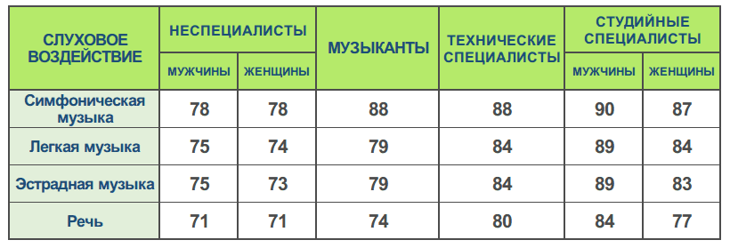
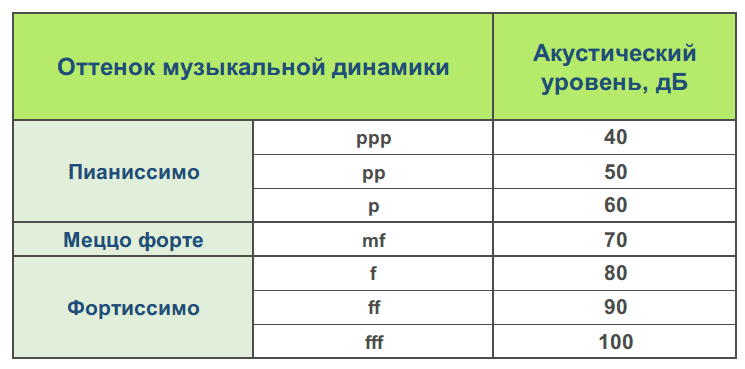
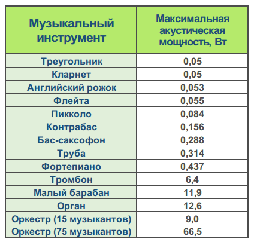
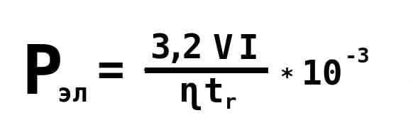
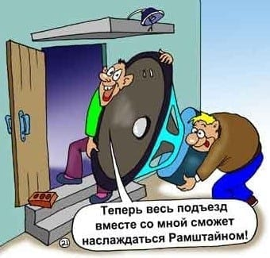

[Русский](./README.ru.md) | **English**

# How much amplifier and speaker power you really need at home

**Published:** 2017-02-10  
**Category:** Speaker basics  
**Tags:** sound quality  
**Original:** https://audiogeek.ru/kakaya-moshnost-realno-nujna-dlya-doma/

---

We are all used to the thunderous thousands of watts promised by makers of Chinese boomboxes. Well, let their love of zeros stay with them, and today we will find out how much speaker and amplifier power is really needed and how many watts are enough to fill your home with sound...

The choice of listening volume depends both on the preferences of the music lover himself and on the tastes of his neighbors. But if we approach the problem more scientifically, we should tell the neighbors that the answer will not be in their favor. Especially if their musical tastes differ from yours :-)

The range of intensities perceived by the ear, from the threshold of hearing to the threshold of pain, is 140 dB. That is a huge interval. Of course nobody in their right mind would listen to music at volumes close to either threshold, and the power of the speakers and amplifier should not be small, but to hear certain components of the sound they need to have a sufficient intensity level.

## **Research results**

Many studies have been carried out to determine the preferred sound level for listeners of different social composition, age and sex when reproducing musical works of various genres and performing forces in living spaces of normal size. Some summary results are shown in the table (figures in dB):

Clearly, many factors affect these figures, which can blur and alter the statistics. What is noteworthy here is that people who work with music professionally need higher volume levels. I do not know whether this is tied to the demands of the profession or is an occupational disease.

If you are familiar with musical terminology: to get the desired dynamics of an orchestra, a sound level of 80 dB is needed at forte (f), 90 dB at fortissimo (ff) and 100 dB at forte-fortissimo (fff). Below 80 dB the dynamics are insufficient, and above 100 dB it would be madness... These high sound pressure levels apply only at moments of peak power.

According to averaged experimental data, the acoustic levels at various dynamics of musical performance correspond to the values in the table.

## **The power of musical instruments**

Have you ever wondered what power musical instruments "put out"? The next table gives the acoustic power radiated by various musical instruments. Note that this is acoustic, not electrical power. A piano, for example, produces 0.4 W of acoustic power, which corresponds to 8 W of electrical power at 5% efficiency.

The table shows that the largest ratio of acoustic powers (between the triangle and the large orchestra) is over 1000. A big number, but in fact it is not that much for our ear. An orchestra of 75 players affects the ear only 8 times more strongly than a triangle.

## **Calculating the recommended power**

There is a simple formula for easily calculating the minimum recommended electrical power (W) for a room of volume V (m³) at a chosen sound level I (dB) and reverberation time in the room tr (s)

*η is the loudspeaker efficiency in %.*

Since we all live in rooms of roughly the same size, we will use average values for the calculation. Take the room volume as 50 m³, assume we will listen to a symphony orchestra in all its glory, so the sound level is I = 100 dB (maximum), and take the loudspeaker efficiency as 5% (an average value by modern standards). Then we get Pel = 3.2/tr

For a living space of that volume the reverberation time is 0.75 s. Accordingly, the minimum electrical power needed from your audio chain should be 4.2 W (for stereo, 2.1 watts per channel).

However, as everyone knows, companies making both high-quality and mass-market amplifiers, and in fact any amplifiers, advertise them with higher powers: 50, 100 and even 200 watts. Of course this power remains underused in a room, but it allows wider playback dynamics and lower signal distortion.

## **Conclusion**

Now it is worth returning to reality and saying that 100 dB is a very high sound level for a living space. Health authorities set a limit of 80 dB, and above that limit the ear is exposed to unpleasant sensations that can lead to temporary damage. Although it was said that 100 dB is reached only at peak moments, to listen to music at such a level it is advisable to live far from your neighbors. In the mountains, for example, or on your own island, or best of all to go to a concert hall. Or invite the orchestra to your island ;)

*Originally written for [AudioGeek.ru](https://audiogeek.ru). Translated from Russian.*
