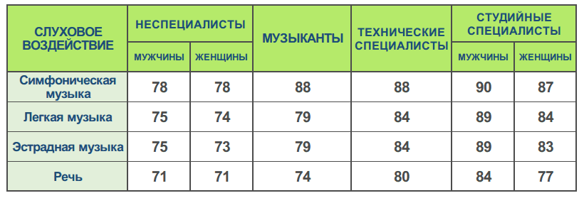
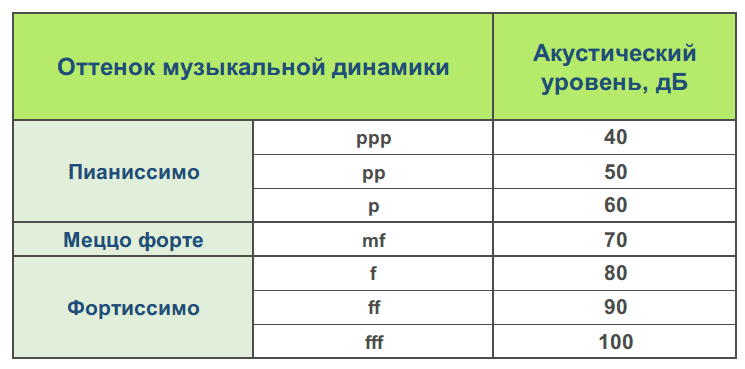
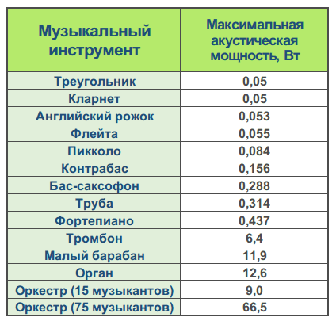
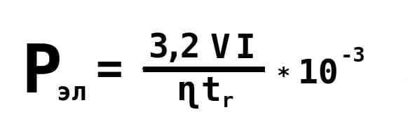
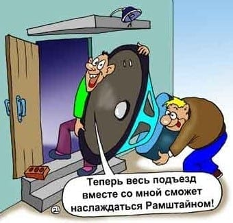

[English](./README.md) | **Русский**

# Какая мощность усилителя и колонок реально нужна для дома

**Рубрики:** Общие вопросы по АС  
**Метки:** качество звука  
**Оригинал:** https://audiogeek.ru/kakaya-moshnost-realno-nujna-dlya-doma/

---

Все уже привыкли к громогласным тысячам ватт, которые нам обещают производители китайских бумбоксов. Ну что ж их любовь к ноликам пусть остается с ними, а мы сегодня выясним какая мощность колонок и усилителя действительно нужна и сколько же ватт хватит для озвучивания вашего жилища...

Выбор громкости для прослушивания обусловлен как пристрастиями самого меломана, так и вкусами его соседей. Но если подходить более научно к поставленной проблеме, то соседям стоит сказать, что ответ будет не в их пользу. Особенно, если их музыкальные предпочтения не совпадают с вашими :-)

Диапазон интенсивностей, воспринимаемых ухом от порога слышимости до болевого порога составляет 140 дБ. Это огромный интервал. Разумеется никто в здравом уме не станет слушать музыку на громкостях близких к одному из порогов, да и мощность колонок и усилителя должны быть не маленьким, но для того чтобы расслышать определенные составляющие звука необходимо, чтобы они имели достаточный уровень интенсивности.

## **Результаты исследований**

Было проведено много исследований по определению предпочтительного уровня громкости звука для слушателей разного социального состава, возраста и пола при воспроизведении разнообразных по жанру и исполнительскому составу музыкальных произведений в жилых помещениях нормальных размеров. Некоторые обобщенные результаты представлены в таблице (цифры даны в дБ):

Понятно, что на данные показатели влияет множество факторов, которые могут спутать и видоизменить статистику. Примечательно здесь то, что людям профессионально занимающимся музыкой требуются более высокие уровни громкости. Уж не знаю связанно это с требованиями профессии или же это профессиональная болезнь.

Если вам знакома музыкальная терминология, то стоит сказать, что для получения желаемой динамики оркестра, необходимо на форте (f) создать уровень звука 80дБ, на фортиссимо (ff) - 90дБ и на форте-фортиссимо (fff) - 100дБ. Ниже 80дБ динамика не достаточна, а выше 100дБ будет уже безумие... Эти высокие уровни звукового давления справедливы только в моменты пиковой мощности.

По усредненным экспериментальным данным, акустические уровни при различной динамике музыкального исполнения соответствуют величинам, указанным в таблице.

## **Мощность музыкальных инструментов**

А вы когда-нибудь задумывались, какую мощность “выдают” музыкальные инструменты? В следующей таблице представлены данные акустических мощностей, излучаемых различными музыкальными инструментами. Обращаю ваше внимание, что это акустическая, а не электрическая мощность. Фортепиано, например создает 0,4 Вт акустической мощности, а это есть 8 Вт электрической мощности, при КПД 5%.

Из таблицы следует, что самое большое отношение акустических мощностей (между треугольником и большим оркестром) составляет свыше 1000. Большая цифра, но на самом деле это не особенно то и много для нашего уха. Оркестр из 75 исполнителей воздействует на ухо только в 8 раз сильнее, чем треугольник.

## **Расчет рекомендуемой мощности**

Есть несложная формула по которой можно легко посчитать минимальную рекомендуемую электрическую мощность (Вт) для помещения объемом V (м3) при выбранном уровне звука I(дБ) и времени реверберации в помещении tr(c)

*η- КПД громкоговорителя в %.*

Т.к. Все мы живем в примерное одинакового размера помещениях, то для расчетов возьмем средние величины. Объем помещения примем равным 50 м3, слушать мы будем симфонический оркестр во всей его красе, так что звуковой уровень I=100дБ (максимальный), а КПД громкоговорителя возьмем 5%(среднее значение, по современным меркам). В таком случае получим Pэл=3,2/tr

Для жилого помещения подобного объема время реверберации составляет 0,75с. Соответственно необходимая минимальная электрическая мощность вашего звукового тракта должна быть 4,2 Вт(В случае стерео по 2,1 ватта на канал).

Однако всем известно, что фирмы выпускающие как высококачественные так и массовые усилители, да и вообще любые, рекламируют их с более высокими мощностями - 50, 100 и даже 200 ватт. Разумеется эти мощностью остаются недоиспользованными в условиях комнаты, но позволяют достигать более широкой динамики воспроизведения и меньшего уровня искажений сигнала.

## **Заключение**

А теперь стоит вернуться к реальности и сказать, что 100дБ это очень большое значение уровня звука для жилого помещения. Минздрав ставит предел в 80дБ, сверх этого предела ухо подверженно неприятным ощущениям, которые могут привести к временны повреждениям. Хоть и говорилось, что 100дБ достигается только в пиковые моменты, для прослушивания музыки на таком уровне желательно жить подальше от соседей. Например в горах или на собственном острове, а лучше всего пойти в концертный зал. Ну или пригласить оркестр к себе на остров)

*Материал подготовлен исключительно для сайта [AudioGeek.ru](https://github.com/SkyTrip-13/AudioGeek)*
