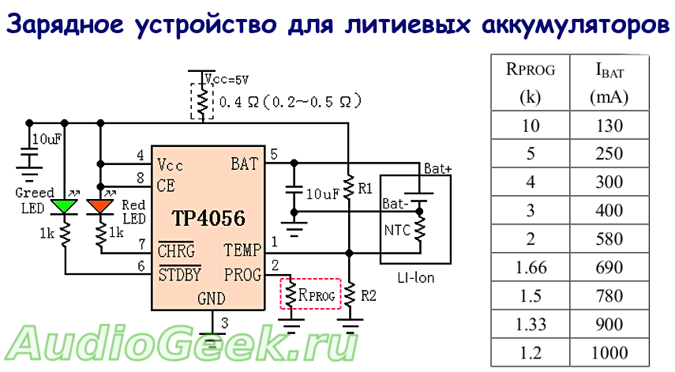
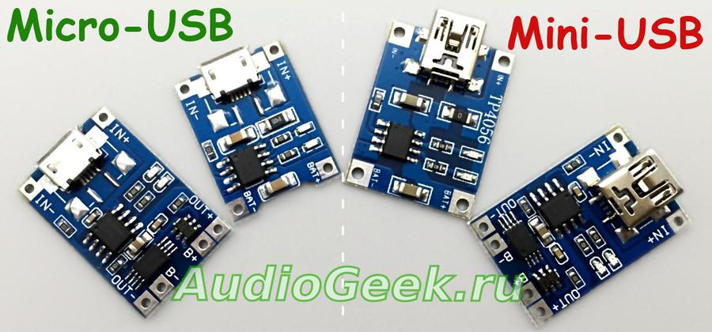
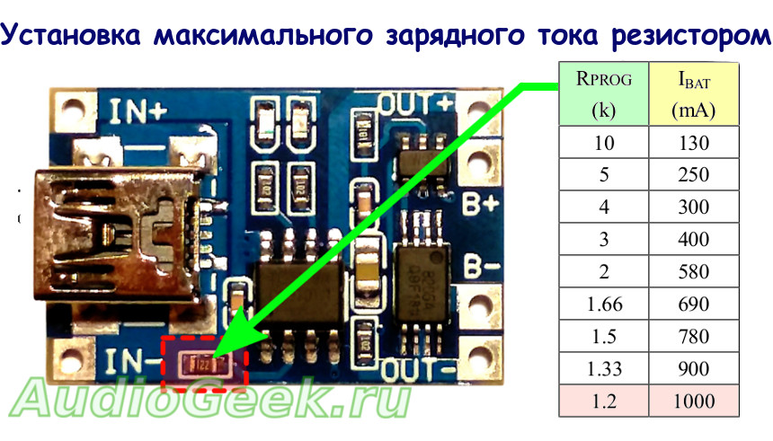
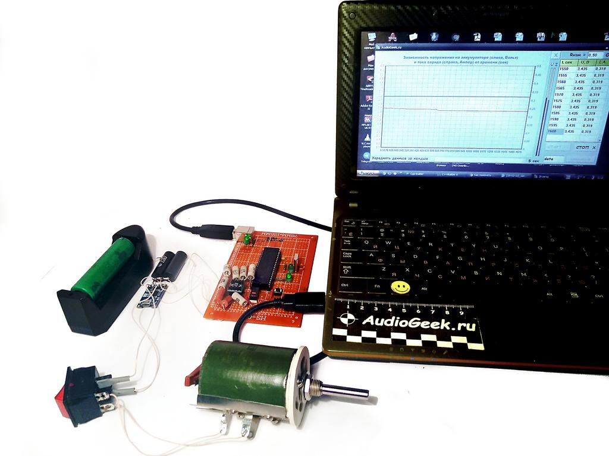
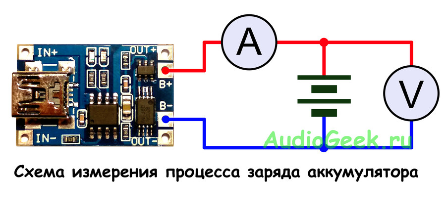
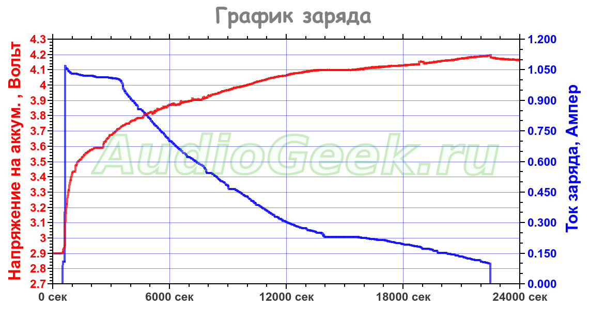
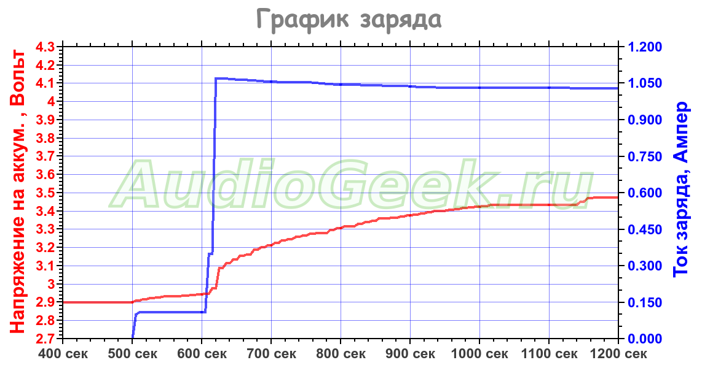
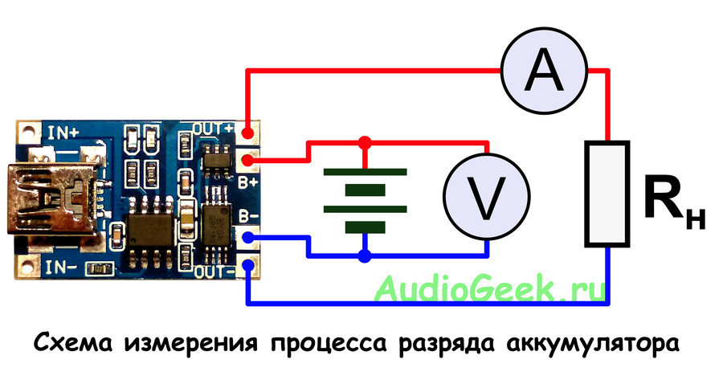
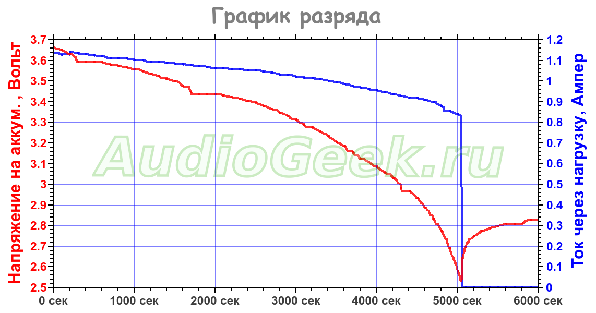
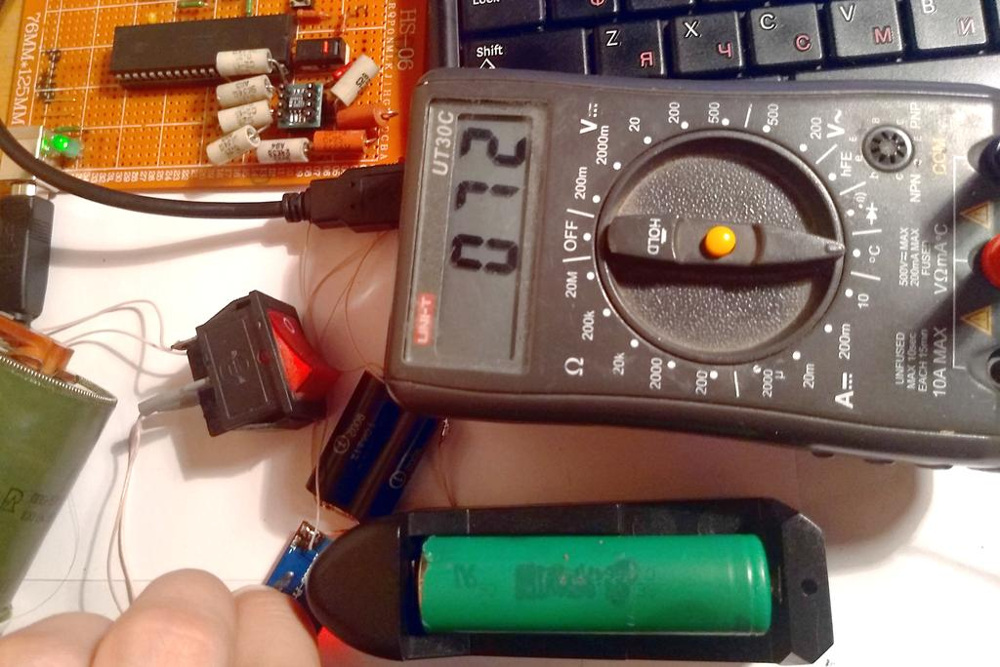

[Русский](./README.ru.md) | **English**

# A smart Li-ion charge controller: the TP4056 module

**Published:** 2019-07-08  
**Category:** Electronics  
**Tags:** AliExpress, ready-made module, power supply  
**Original:** https://audiogeek.ru/kontroller-zaryada-li-ion-modul/

---

For a lithium battery to live a long and happy life, it is very important to charge it correctly. Controlling the discharge is just as important. Luckily, a Li-ion charge controller was invented long ago and comes as a ready-made module. But can it be trusted? Let us find out.

> **Before reading, I recommend watching my video about lithium battery charging modules.**
>
> ▶ **[Watch the video on YouTube](https://www.youtube.com/watch?v=Ow8v4vfCHpQ)**

## How to charge lithium batteries

The whole point of charging lithium batteries is that neither the charge current nor the voltage should be constant. The charge has to go through certain phases:

1. ***When the battery is fully discharged (< 3 volts), the charge current should be at its maximum. It should normally not exceed the battery capacity value (C).***
2. ***As the charge builds up, that is, as the battery voltage rises, the charge current should decrease.***
3. ***At 90% of full charge the current should drop to about 0.1C. As soon as the battery voltage reaches 4.1–4.15 V, charging should stop.***

> Following these rules gives the battery a long service life. Discharging a lithium battery below 3 volts, or regularly overcharging it even by 0.1 volt, significantly reduces its capacity.

## Li-ion charge controller chips

Today there are chips that are complete lithium battery charge controllers. One of them is the ***TP4056*** (***[download the datasheet](./TP4056_-AudioGeek-ru.pdf)***). A charger circuit based on the TP4056 looks like this:

If you are thinking of building it yourself, I have to disappoint you. The effort, time and money you spend will exceed many times over the price of a ready-made module built to exactly the same circuit, and even improved with more powerful output transistors.

## The Li-ion charge control module

A ready-made lithium battery charge module can be **bought for just 30 cents**.

> **Note that such modules come not only with a charge controller. There are also versions with discharge protection.**

The picture shows all four variants of these modules. The two on the left are completely identical to the two on the right, the only difference being the connector. Between themselves, the two on the left, like the two on the right, differ in whether they can control the battery discharge.

> If, in addition to the battery pads **B+** and **B−**, the module also has **OUT+** and **OUT−** pads, the module can control discharge, and the load is connected to the battery through the module.

Do not worry that the version with discharge protection will drain your battery. Measurements showed that the module itself draws only about 5 microamps, which even surprised me a little.

## How to set the charge current

> **As delivered, the module can supply a maximum charge current of up to 1 A. If you need more, see my video at the beginning of the article.**

If the battery capacity is below 1000 mAh, it is better to reduce the maximum charge current to a value equal to the capacity or lower, especially if the battery is not very new. To do that, replace resistor ***RPROG*** with a suitable value.

## Measuring the module

**We will measure the following:**

1. **The charging process**: how the charge current changes with battery voltage.
2. **Discharging**, or more precisely the module's ability to deliver current to a load for a long time, and to disconnect the battery when the discharge threshold is reached.

For this we need a voltmeter and an ammeter. But I am lazy, and measuring by hand in this day and age is a waste of time. So a PIC18F4550 microcontroller came to help. It can talk to a computer over USB and has a 10-bit ADC on board.

The ammeter and voltmeter are shown schematically below. Both are built on [***differential amplifiers***](../diff-amp/). To measure current, a low-value resistor is used, and the voltage across it is picked up by a differential amplifier. This current measurement method was recently covered in a [***separate article***](../kak-izmerit-tok/).

The outputs of the differential amplifiers go to the microcontroller's ADC. The ADC step is about 5 mV, which is more than enough for these measurements. To minimize the error, the data arriving over 10 seconds was averaged (200 values at a time).

> ***All tests were done with a Sony VTC6 18650 battery. It has a capacity of 3000 mAh and can deliver up to 30 A.***

## Measuring the charge

To study the charging process I used the following measurement circuit:

The graph obtained with it is shown below. For convenience, the current is **blue** and the voltage is **red**, and time is in seconds.

6000 seconds is 100 minutes, or 1 hour 40 minutes. A full charge took about 6 hours, so with a 3000 mAh battery the average charge current can be taken as 500 mA.

All three charging phases described above are clearly visible on the graph. The circuit does everything as it should. There is a small spread in final voltage between individual modules, but it is not critical.

***Note that any measurement of a physical quantity is only an attempt to approach the true value. Do not pay attention to the small teeth on the curve, they may come from ADC nonuniformity or from nonlinearity of the module. This is not critical at all.***

> **In any case, the resulting curve satisfies all the rules of battery charging.**

## The smart module protects the battery

I did not call this module smart for nothing. If you look closely at the moment power is applied to the module, you can see a small step in the current curve. Here it is close up:

This is the step between 500 and 600 seconds at the 100 mA level. It is present if the battery was discharged below 3 volts.

The module treats the battery gently. First it brings the battery voltage up to about 3 volts with 100 mA. Only then does it start pushing 1 A through the battery, or whatever current was set by resistor ***RPROG***.

## Discharge control

To study the module's output characteristics the circuit was changed slightly. A variable resistor was used as the load, connected in series with the ammeter to the module's output pads.

The load resistance was set so that the initial discharge current was about 1.15 A. Since the load was constant, the current in the output circuit fell as the battery voltage dropped.

As the graph shows, the module successfully disconnected the load from the battery at around 5000 seconds. That means it delivered about 1 A for an hour and a half and did not die. **An excellent result.**

The rise in battery voltage after the load is disconnected comes from the battery's chemical recovery after such a long period of decent current.

If the battery was fully discharged and the module cut it off, it switches back on when a charger is connected, as soon as the battery voltage reaches 2.9–3 volts.

## How hot the module gets

During charging, when the current is 1 A, the module gets quite hot. Keep this in mind if you use it in an enclosed device. In open air the module temperature exceeded 70 degrees *(measured with a thermocouple)*.

If you install the module in a closed case, it is better to reduce the maximum charge current to 500–700 mA. And still do not attach it with hot glue.

The module itself has overheating protection: when it overheats it starts limiting the output current. So it will most likely not die from overheating. But do not rely on the protection completely.

## Where to buy

I cannot vouch for all such modules. Every self-respecting manufacturer in China makes them. The modules shown here were ordered more than once from one particular seller.

Buying them one at a time is not worthwhile, since sellers inflate the price of both the module and the delivery. It is more convenient and cheaper to order 5 or 10 at once even if you need only 1–2. It is very handy to have a pile of these modules in a drawer and be able to put together a charger from them quickly. When I wrote this, 5 modules cost about $1.57 and 10 modules about $2.61 (prices of 16 September 2020), which is pennies. Many electronics shops will ask a similar sum for each single module. They come with either micro-USB or mini-USB connectors.

## Conclusion

To be honest, I did not expect such results myself, but the lithium battery charging modules performed very well, and I definitely recommend buying such a controller. You can build many interesting things with them. Soon I will show how to use them to build an uninterruptible power supply for Canon cameras.

*Originally written for [AudioGeek.ru](https://audiogeek.ru). Translated from Russian.*
