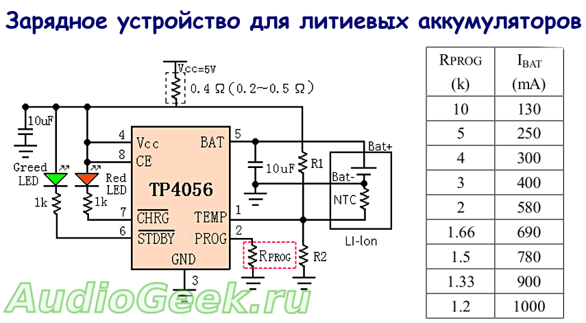
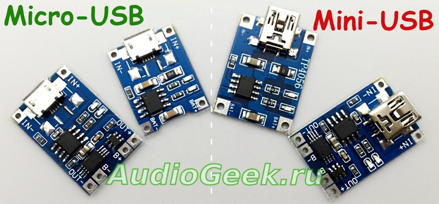
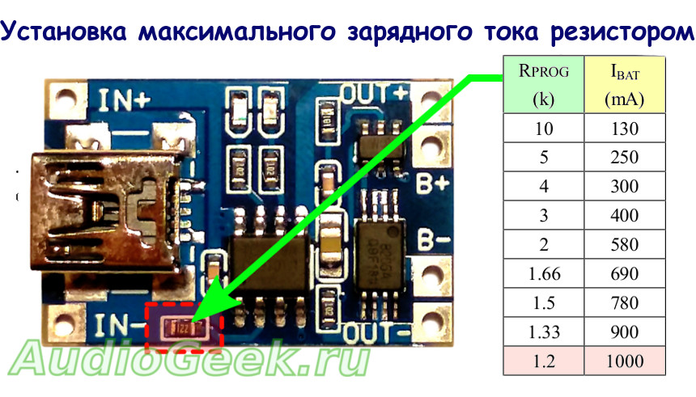
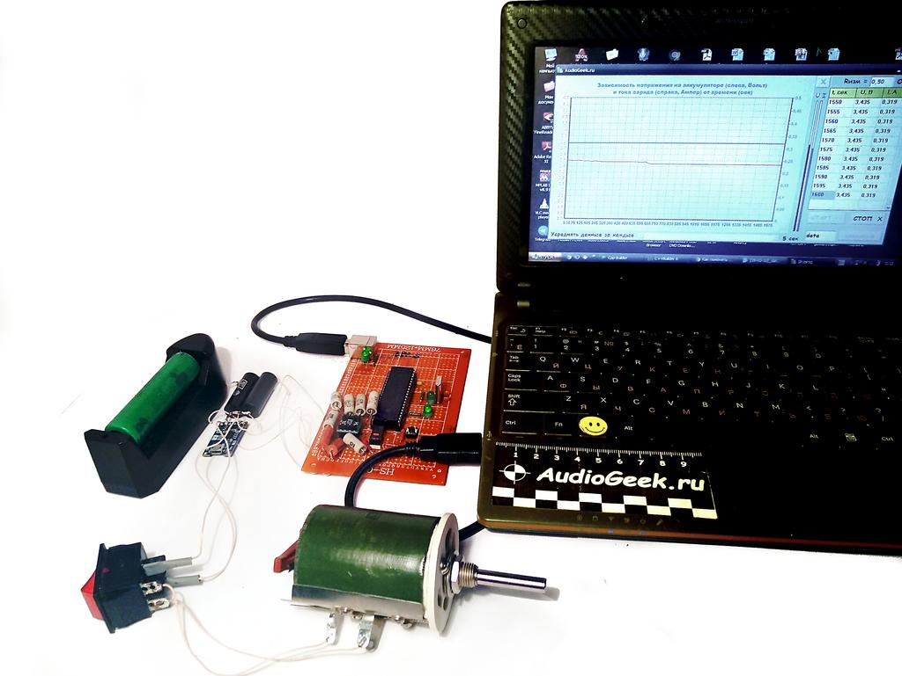
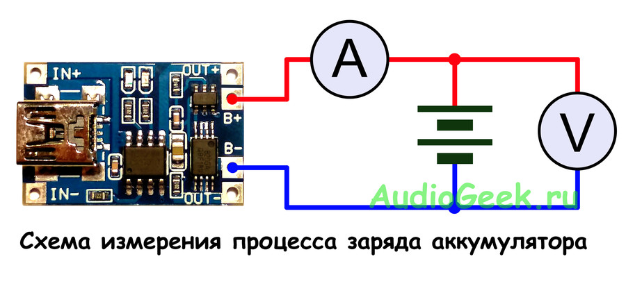
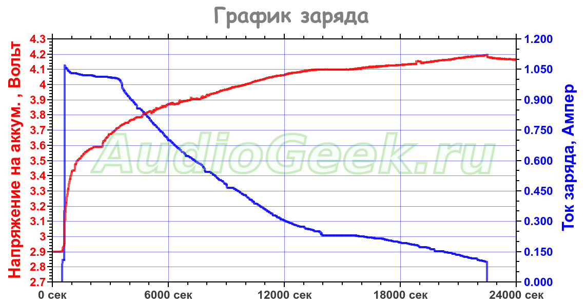
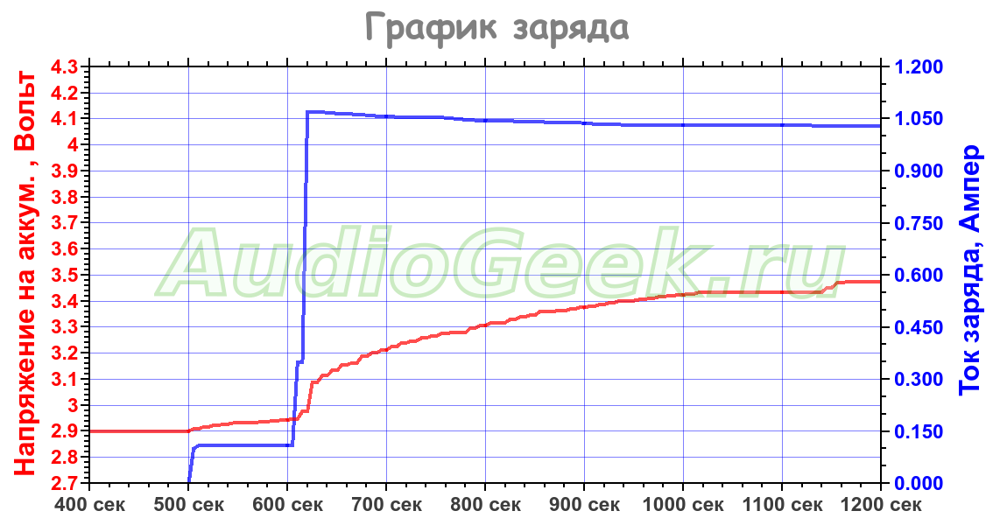
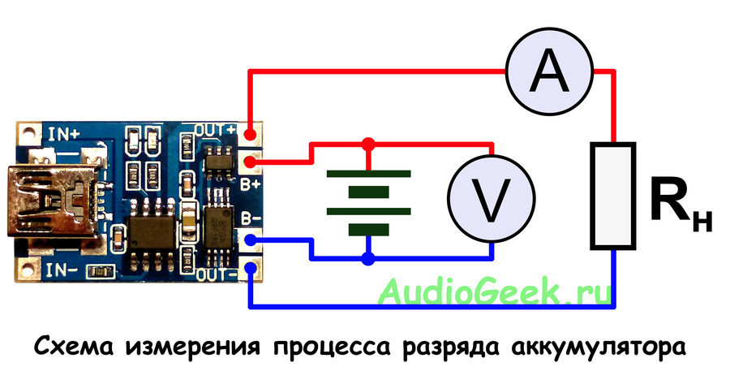
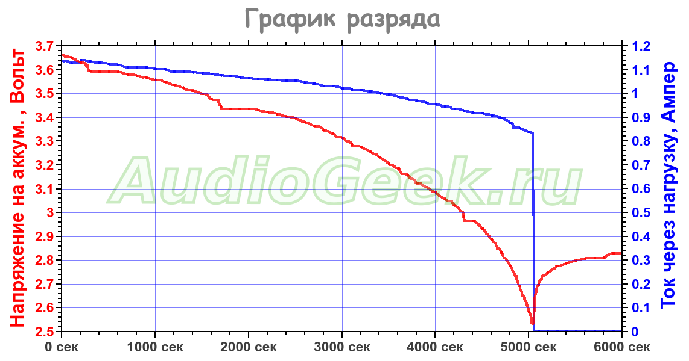
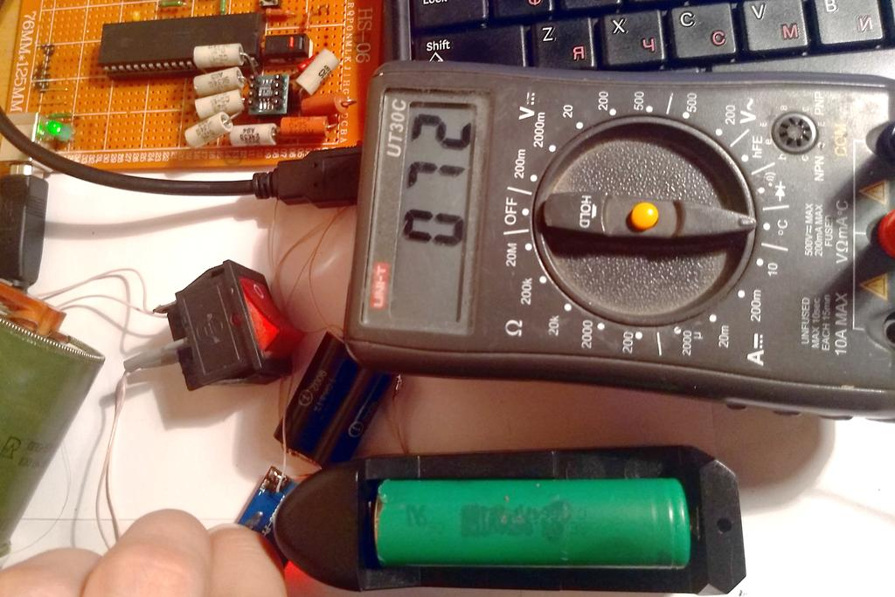

[English](./README.md) | **Русский**

# Умный контроллер заряда литиевых аккумуляторов - модуль на tp4056

**Рубрики:** Разная электроника  
**Метки:** AliExpress, готовый модуль, источник питания  
**Оригинал:** https://audiogeek.ru/kontroller-zaryada-li-ion-modul/

---

Для долгой и счастливой жизни литиевого аккумулятора очень важно правильно его заряжать. Не менее важно контролировать так же и разряд. На наше спасение, уже давно придумали контроллер заряда литиевых аккумуляторов в виде готового модуля. Но можно ли ему доверять, сейчас мы это и проверим.

> **Перед прочтением рекомендую посмотреть мой ролик про модули заряда литиевых аккумуляторов.**

> ▶ **[Смотреть видео на YouTube](https://www.youtube.com/watch?v=Ow8v4vfCHpQ)**

## **Как заряжать литиевые аккумуляторы**

Вся фишка зарядки литиевых аккумуляторов кроется в том, что ни ток заряда ни напряжение не должен быть постоянными. Процесс заряда должен проходить по определенным фазам:

1. ***При полной разрядке аккумулятора ( < 3 вольт) ток заряда должен быть максимальным. Обычно он не должен превышать значения емкости аккумулятора (С).***
2. ***По мере накопления заряда, т.е. повышении напряжения аккумулятора, ток заряда должен уменьшаться.***
3. ***При достижении 90% от полного заряда, ток заряда должен снизиться до уровня порядка 0,1С. Как только напряжение на аккумуляторе достигнет 4.1-4.15 В, процесс заряда должен прекратиться.***

> Соблюдение этих правил заряда литиевого аккумулятора обеспечит ему продолжительный срок службы. Разрядка литиевого аккумулятора ниже 3 вольт, а так же его регулярная перезарядка даже на 0.1 вольта значительно сокращает емкость аккумулятора.

## **Микросхемы контроля заряда литиевых аккумуляторов**

Сегодня существуют  микросхемы, представляющие собой готовый контроллер заряда литиевых аккумуляторов. Одной из таких микросхем является ***TP4056*** (***[скачать даташит](./TP4056_-AudioGeek-ru.pdf)***). Схема контроллера заряда литиевых аккумуляторов на TP4056 выглядит следующим образом:

Однако, если вам вздумалось ее реализовать, то спешу вас огорчить. Потраченные усилия, время и деньги во много много раз превысят стоимость готового модуля, построенного по точно такой же схеме и даже усиленного более мощными транзисторами на выходе.

## **Модуль контроля заряда Li-ion аккумулятора**

Готовый модуль контроля заряда литиевого аккумулятора можно **купить всего за 30 центов**.

> **Обращаю ваше внимание, что такие модули бывать не только с контроллером заряда аккумулятора. Есть так же версии с контролем разряда аккумулятора.**

Картинка демонстрирует все четыре варианта подобных модулей. Два левых модуля полностью аналогичны двум правым модулям, разница заключается только в установленном разъеме. А вот между собой, два левых модуля, как и два правых отличаются возможностью контроля разряда аккумулятора.
> Если на модуле помимо контактов для аккумулятора **В+** и **В-** также присутствуют контакты **OUT+**и **OUT-** то это значит, что модуль умеет контролировать разряд аккумулятора, а подключение нагрузки к аккумулятору происходит через модуль.

Не стоит бояться что версия с контроллером разряда посадит вам аккумулятор. Измерения показали, что потребление тока самим модулем составляет всего около 5 микро Ампер. Что меня даже немного удивило.

## Как регулировать ток заряда

> **В исходном состоянии модуль может выдать максимальный ток заряда до 1 Ампера. Если нужно больше, то смотрите мой видосик в начале статьи.**

Если же емкость аккумулятора меньше 1000мА\*ч, то максимальный ток заряда лучше снизить до значения, равного емкости аккумулятора или еще ниже, особенно если аккумулятор не очень новый. Для этого стоит заменить резистор ***RPROG*** на подходящий номинал.

## **Измерение характеристик модуля**

**Мерить мы будем следующее:**

1. **Процесс зарядки** - посмотрим, как меняется ток заряда от напряжения на аккумуляторе.
2. **Разрядку**, а точнее умение модуля продолжительно отдавать ток в нагрузку, а так же умение отрубать аккумулятор по достижении порога разряда.

Для этих целей нам понадобится вольтметр и амперметр. Но я рожа ленивая, да и мерить вручную в наш век - мартышкин труд. Поэтому на помощь был позван микроконтроллер PIC18F4550. Он умеет общаться с компом по USB и обладает 10-битным АЦП на борту.

Амперметр и вольтметр далее изображены условно. И вольтметр и амперметр реализованы на [***дифференциальных усилителях***](../diff-amp/). Для измерения тока использован низкоомный резистор, разность напряжений с выводов которого и снимается дифференциальным усилителем. Такому методу измерения тока недавно была посвящена [***отдельная статья***](../kak-izmerit-tok/).

С выходов диф. усилителей сигнал поступает на АЦП микроконтроллера. Шаг АЦП по напряжению составляет около 5 мВ, чего для таких измерений более чем достаточно. Чтобы максимально снизить погрешность, данные приходящие за 10 секунд усреднялись ( по 200 приходящих значений).

> ***Все пытки проводились с участием аккумулятора Sony VTC6 формата 18650. Этот аккумулятор обладает емкостью 3000 мА\*ч. Максимальный выходной ток аккумулятора может достигать 30 А.***

## **Измерения заряда аккумулятора**

Для изучения процесса заряда аккумулятора была реализована следующая измерительная схема:

Полученный с ее помощью график, представлен на следующей картинке. Для удобства **синим** обозначена зависимость тока, а **красным** - зависимость напряжения от времени. При этом время указанно в секундах.

6000 секунд соответствуют 100 минутам или же в более привычном виде это 1 час 40 минут. Соответственно полная зарядка аккумулятора заняла около 6 часов. При емкости аккумулятора в 3000 мАч, средний ток заряда можно считать равным 500мА.

На графике отлично видны все три описанные выше фазы зарядки. Схемка отрабатывает все как и положено. Между разными экземплярами модулей присутствует небольшой разброс конечного напряжения, но он не критичен.

***Стоит отметить, что любое измерение физической величины это лишь попытка приближения к истинному значению. Не стоит обращать внимание на мелкие зубчики, их природа может быть вызвана как неравномерностью АЦП так и нелинейностью модуля. Что совсем не критично.***

> **В любом случае получившаяся зависимость отлично удовлетворяет всем правилам заряда аккумулятора.**

## **Умный модуль бережет аккумулятор**

Я не зря назвал этот модуль умным. Если внимательно присмотреться к моменту подачи питания на модуль, то можно увидеть небольшую ступеньку на зависимости тока. Вот так она выглядит крупным планом:

Речь идет о ступеньке между 500 и 600 секундами на уровне 100 мА. Эта ступенька присутствует если аккумулятор разряжен ниже 3 вольт.

Модуль бережно относится к аккумулятору. Сначала он доводит напряжение на аккумуляторе примерное до 3 вольт током в 100 мА. А уже затем начинает кочегарить через аккумулятор 1 ампер. Ну или ток, который был установлен резистором ***RPROG***.

## **Контроль разряда аккумулятора**

Для изучения выходных характеристик модуля схема была несколько изменена. В качестве нагрузки был установлен переменный резистор, включенный последовательно с амперметром к выходным контактам модуля.

Сопротивление нагрузочного резистора было установлено так, что начальный ток разряда составлял около 1.15 А. Т.к. нагрузка была постоянной, соответственно ток в выходной цепи падал с падением напряжения на аккумуляторе.

Как видно из графика, модуль благополучно отрубил нагрузку от аккумулятора в районе 5000 сек. А это значит, что модуль отдавал ток порядка 1 ампера в течении полутора часов и не загнулся. **Отличный результат)**

Рост напряжения на аккумуляторе, после отключения нагрузки, вызван химическим восстановлением аккумулятора после столь длительной отдачи приличного тока.

Если аккумулятор был полностью разряжен и модуль его отключил, то включение произойдет, при подключении зарядного устройства, как только напряжение на аккумуляторе достигнет уровня в 2.9 - 3 вольта.

## **Как греется модуль**

В процессе зарядки, когда ток составляет 1 ампер, модуль прилично греется. Стоит учитывать этот факт при использовании модуля в закрытом устройстве. Так, на открытом воздухе температура модуля достигала значений более 70 градусов *(**по термопаре**)*.

В случае установки модуля в закрытый корпус желательно снизить максимальный ток заряда до 500-700 мА. Но на терма-клей все же не стоит крепить.

У самого же модуля предусмотрена защита от перегрева. Так при перегреве модуль начинает ограничивать выходной ток. Так что от перегрева он скорее всего не сдохнет. Но не стоит полностью полагаться на защиту))

## **Где купить модуль заряда Li акумулятора?**

Я не могу ручаться за все подобные модул. Их производством не брезгует каждый уважающий себя житель поднебесной. Показанные модули заказывались уже не первый раз у конкретного продавца. Которого советую и вам.

Покупать такие модули поштучно не выгодно - продавцы начинают накручивать цену и за модуль и за доставку. Удобнее и дешевле закупать сразу по 5 или 10 штук даже если требуется 1-2. Очень удобно, когда где-то в шкафу лежит кучка таких модулей и при необходимости можно быстро сообразить из них зарядку. Вот ссылки на разные лоты проверенного магазина:

- ***5 шт. micro-USB*** **– 1.57$**
- ***5 шт. mini-USB*** **– 1.57$**
- ***10 шт. micro-USB*****– 2.61$**
- ***10 шт. mini-USB*** – **2.61$**

**1.57$ за 5 штук, и тем более 2.61$ за 10 штук - это копейки. Во многих магазинах радиодеталей с вас попросят аналогичную сумму за каждый такой модуль.**

***цены от 16 сентября 2020***
> ***Да, ссылки реферальные, но покупая по ним Вы абсолютно ничего не теряете (а теперь даже кэшбэк с них не дают). Зато этим Вы говорите мне спасибо за проделанную работу и помогаете копеечкой моему проекту. За это спасибо и Вам.***

## **Заключение**

Честно говоря я и сам не ожидал таких результатов, но модули зарядки литиевых аккумуляторов отлично себя показали. И я однозначно рекомендую к покупке такой контроллер заряда. На таких модулях можно мастерить много интересных штук. В скором времени я покажу как с их помощью соорудить блок бесперебойного питания для камер Canon.

*Материал подготовлен исключительно для сайта [AudioGeek.ru](https://github.com/SkyTrip-13/AudioGeek)*
