[Русский](./README.ru.md) | **English**

# A DIY tube headphone amplifier with a transformerless output

**Category:** Audio circuit design  
**Original:** https://audiogeek.ru/lamp-headphone-amp/

---

Today let us look at a fairly simple but very high-quality tube headphone amplifier. The amplifier surprised me very pleasantly, and I rediscovered the sound of my headphones. If you want a taste of tube sound, this tube headphone amplifier is the perfect solution.

## The tube headphone amplifier

I had been planning to build myself a tube headphone amplifier for a very long time, but each time I was put off by the thought of having to wind output transformers. Not that it is a big problem, and I have the experience, but you have to find the iron, the wire, calculate, wind... In short, laziness won.

Fortunately I recently came across a very ***[fascinating article](http://r-lab.narod.ru/Rlamp01.htm)*** (in Russian) by Oleg Ivanov. The article is fairly long and deep, but I would recommend reading it. The point is that the author got fired up by the idea of building a tube amplifier for low-impedance headphones with a transformerless output.

To be honest, I had always been rather skeptical about tube amplifiers with transformerless outputs. But the author's approach looked very convincing and I wanted to try it. As it turned out, with good reason!

***Watch my video on this article:***

> ▶ **[Watch the video on YouTube](https://www.youtube.com/watch?v=8958EapgVng)**

## The tube headphone amplifier circuit

I make no claim whatsoever to authorship of the circuit or any involvement with it. I am simply acting as a propagandist of ~~healthy living~~ DIY and electronics.

**Here is the author's original circuit:**

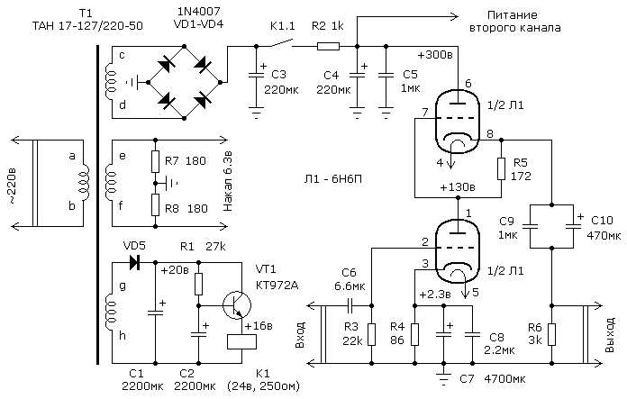

The idea of the circuit is that it is an SRPP stage, with two tubes per channel driving the headphones. The tube is the fairly common 6N6P (6Н6П), a dual triode, so everything is as you like it :)

The circuit was calculated for a gain of two. However into a 32 Ω load it is only slightly over one, about 1.2 as the author states. If your headphones are higher impedance, the gain tends toward two.

Still, despite a gain only a little over one, this is the voltage gain. That is, the amplifier hardly amplifies the volume, but it does amplify the signal in current. And that is very important, because if a headphone amplifier (like any amplifier) cannot supply enough current into the load, the output voltage sags, which distorts the signal shape and is death for sound.

On the other hand, it is more logical to use such an amplifier with headphones of the "professional" category, whose impedance is not often below 50–60 Ω.

If your source's signal level is insufficient, the author offers a solution in the form of an additional input stage on a 6N1P tube with a gain of 10:

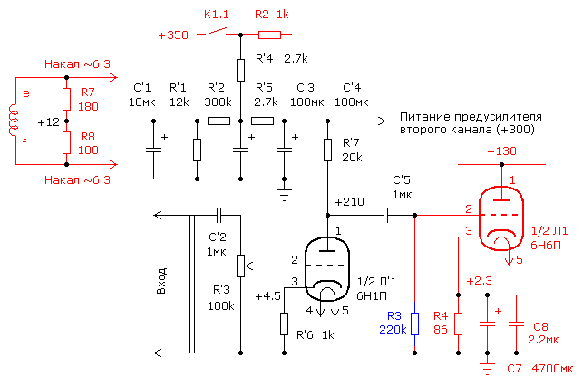

With my sources and headphones I felt no need for this stage.

As for the 6N6P tube, note that it requires quite a large heater current, about 750 mA. If the transformer cannot supply enough current, the heater voltage will sag.

That is bad not only because the sound will be more constricted, but also because it causes "cold tearing out" of electrons from the tube cathodes. That shortens the life of the tubes.

## Prototyping

Of course, before cutting a chassis and bothering with a case for the tube headphone amplifier, I first decided to check everything on a prototype, to make sure I needed it at all.

For the prototype I bombed some tube unit from a Soviet chart recorder. It is very convenient to use ready-made pieces. Plus it has a good transformer, even with screens between the windings.

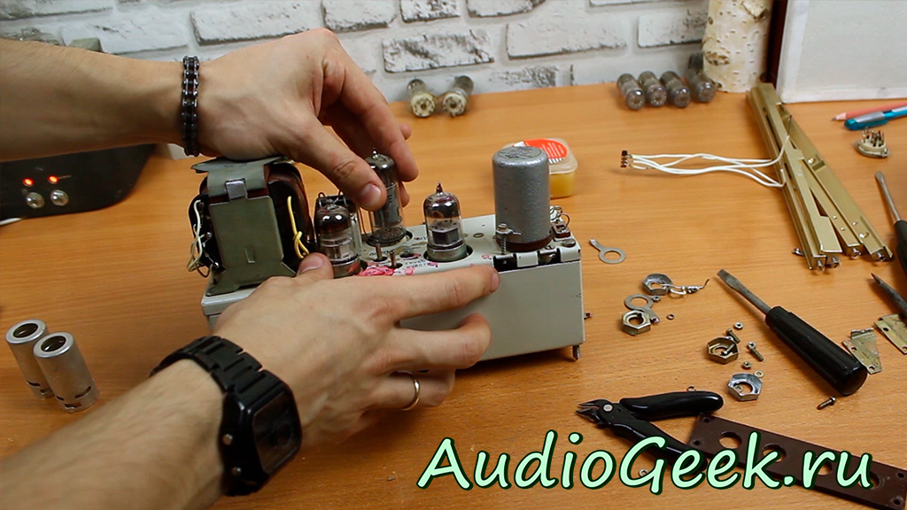

Prototyping is also useful for selecting parts and estimating the necessary dimensions of the future device.

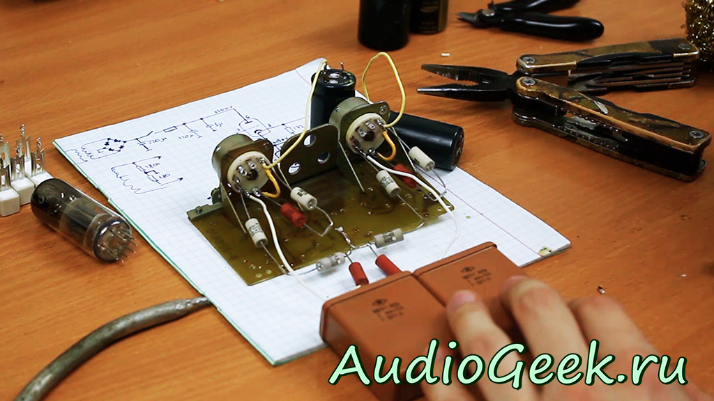

What pleasantly surprised me about this circuit is the complete absence of noise. The author himself says that spectrum measurements show a small peak from mains pickup, but it is completely inaudible.

## Building the amplifier

When building this amplifier I wanted to move away from the classic metal chassis in favor of "good-sounding" wood. Although instead of wood I used plywood, which in its past life was proudly a kitchen cutting board.

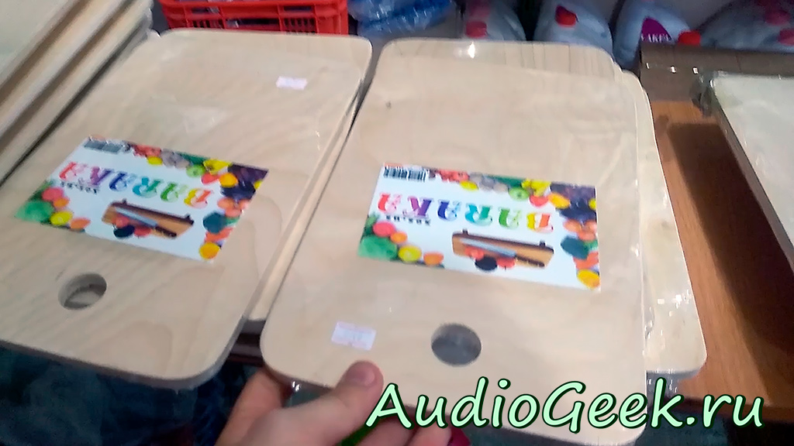

But I still preferred a metal case, to shield the guts of the amplifier. The lid came from a piece of some military instrument for testing radio tubes in the field. I got this treasure from a neighbor after his garage was demolished.

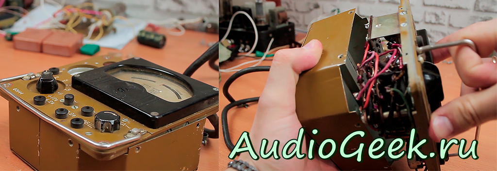

After deciding on the layout of the parts on the plywood top, all the necessary holes were drilled. The only thing worth highlighting is drilling the holes for the tube sockets. Since the sockets were to be mounted on the top side, I drilled larger holes from the inside for free access to the contacts, leaving 4 layers of plywood to hold the sockets themselves.

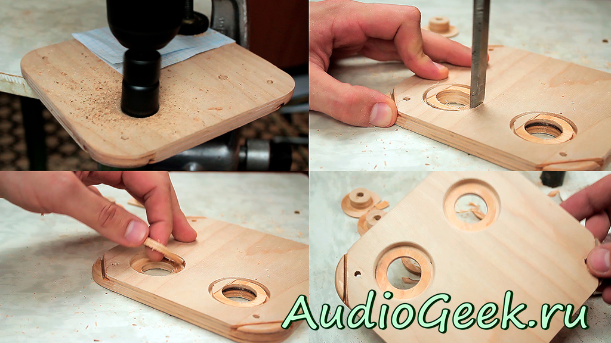

Be careful and attentive here, because plywood likes to delaminate. So whenever a hint of a crack appeared I glued it with superglue.

## Staining the wood

I wanted a design between hi-tech and retro, so I thought about staining the plywood. The list of stains in nearby hardware stores did not satisfy me, so I decided to use a wood aging technique I found on the internet.

The method comes down to soaking metal shavings or nails in acetic acid essence and letting it stand for a week or two. Then dilute it with water, apply the solution to the wood and wait for it to dry.

If you do not want to wait a week, you can prepare an express solution. A cast-iron frying pan is good for that. Sand it with coarse sandpaper and pour the same acetic essence over the dust. Then you can immediately dilute the solution 1:1 or more with water and apply it to the wood right away.

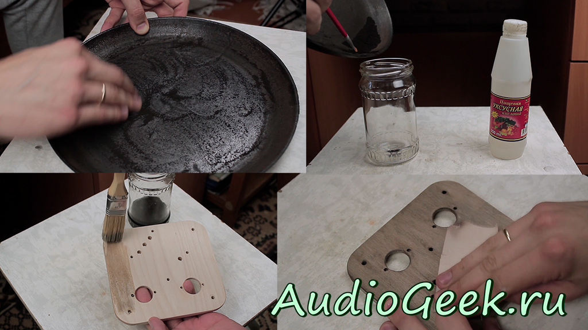

In fact such a solution is not quite a stain. It artificially ages the wood. Such a stain does not work very well on pine, which most plywood is made from, but there is still an effect. Plus black particles of the frying pan remain between the fibers, which also looks quite interesting, bringing out the wood grain.

After the wood dries you can repeat the application. However it will not give a significant change. So sand the plywood with fine sandpaper to remove the raised nap and cover it with a layer of varnish. In my case it is matte parquet varnish.

## The case of the tube headphone amplifier

First the necessary holes were made. For the input/output jacks and a hole for the volume control. On the back wall a hole was made for the mains power inlet.

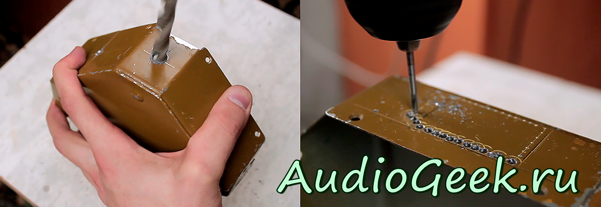

This is a ready-made little block that combines a mains cord connector, a switch and a fuse. An amazing thing, I ordered it for just 95 cents each:

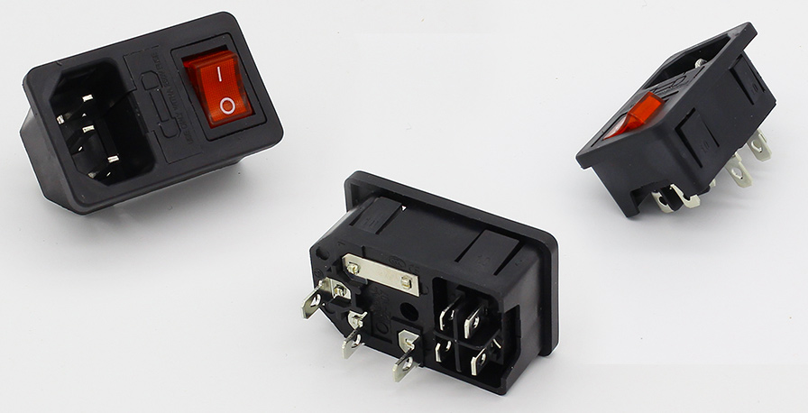

When all the holes are ready and no new ones are expected, it is time for finishing work. To give the case a solid look it was sanded to bare metal, then filled with car body filler. And, after careful sanding, I covered it with three coats of black paint with sanding between coats.

Originally, in the classic style, the case was meant to be matte black. But, alas, I could only get normal paint in gloss. I used acrylic nitro paint. However I happened to apply the last coat at about 17 degrees, below the application conditions specified. As a result the layer did come out matte.

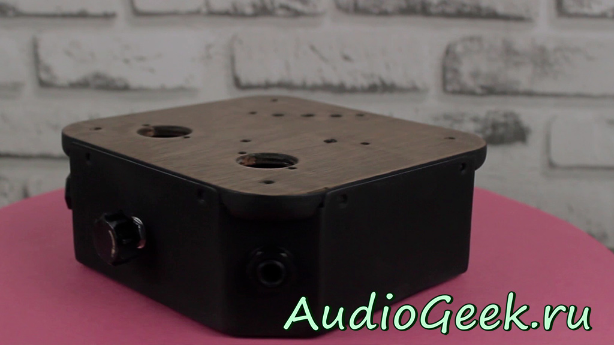

The transformer cover was painted together with the case.

## The guts of the headphone amplifier

When the case is ready, all that remains is to assemble everything and make it work.

First I ran the wires for the tube heaters. I did not rectify the heater supply, so the wires going to the tubes should be as short as possible. The heater winding of my transformer has a center tap, which I immediately connected to the leads of the screens between the transformer windings and connected all of it to ground.

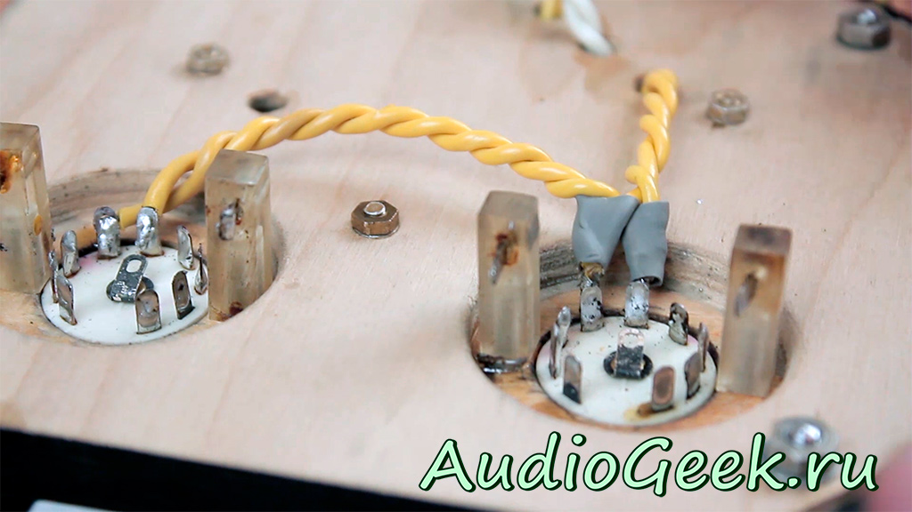

I soldered the parts directly to the tube socket pins, but I also used acrylic standoffs with a contact, unscrewed from some tube instrument.

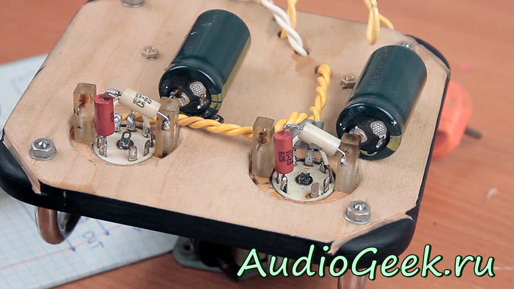

For the amplifier I specially ordered good capacitors, but at the time of assembly they had not arrived, so I did not bother with mounting the ones I had and put everything on hot glue. It does not look the best, but everything works perfectly.

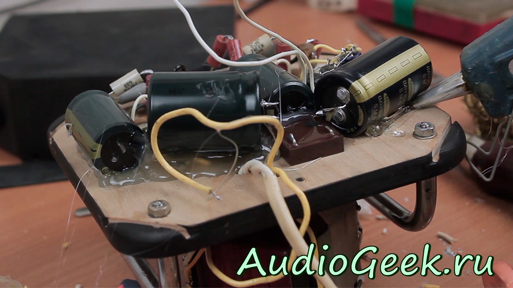

After assembly the amplifier worked right away, but just in case I went over the circuit once more and checked everything.

To verify the circuit works correctly, check the voltages at the points indicated on the schematic. If the circuit is assembled correctly but the voltages differ from those shown by more than a factor of 10, the tubes belong in the trash.

## Conclusion

The result is this amazing amplifier:

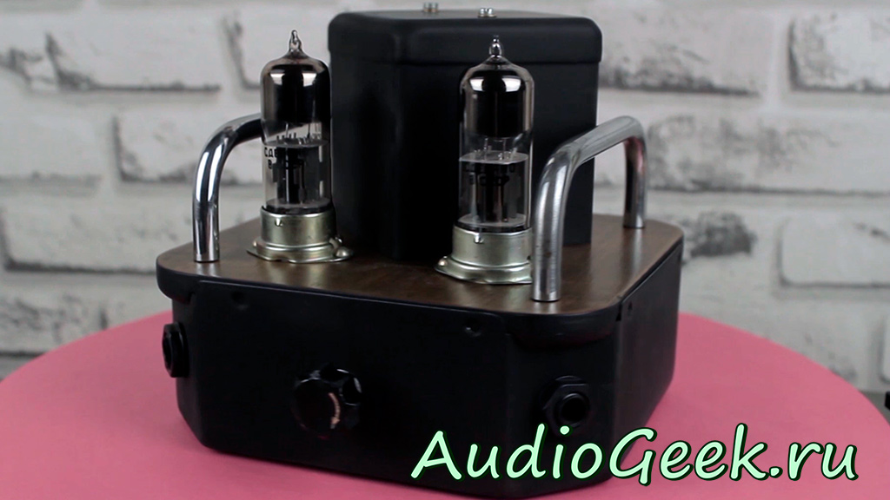

With this amplifier I rediscovered my headphones. The circuit is so simple that even a beginner tube builder can repeat it. The main thing is not to forget the simple safety rules: always switch off the power and discharge the capacitors. That is all from me. For a more detailed look at the build process, see my video at the beginning of the article.

**Good luck and good sound to everyone!**

*Originally written for [AudioGeek.ru](https://github.com/SkyTrip-13/AudioGeek). Translated from Russian.*
