[English](./README.md) | **Русский**

# Ламповый усилителя для наушников с бестрансформаторным выходом своими руками

**Дата:** 2020-07-27  
**Рубрики:** Схемотехника аудиотракта  
**Оригинал:** https://audiogeek.ru/lamp-headphone-amp/

---

Рассмотрим сегодня довольно простой, но весьма качественный ламповый усилитель для наушников. Усилитель меня очень приятно удивил и я по новой открыл для себя звучание своих наушников. Если вы хотите вкусить лампового звука то этот ламповый усилитель для наушников идеальное решение.

## **Ламповый усилитель для наушников**

Я уже очень давно планировал собрать себе ламповый усилитель для наушников, но каждый раз напрягала мысль о необходимости намотки выходных трансформаторов. Не то чтобы это большая проблема, да и опыт имеется, но нужно искать железо, проволоку, рассчитывать, мотать….. Вобщем лень брала вверх.
К счастью недавно наткнулся на очень ***[увлекательную статью](http://r-lab.narod.ru/Rlamp01.htm)*** от Олега Иванова. Статья достаточно большая и глубокая, но я бы рекомендовал с ней ознакомиться. Суть в том, что автор загорелся идеей соорудить ламповый усилитель для низкоомных наушников с бестрансформаторный выходом.
Честно говоря, я всегда довольно скептически относился к ламповым усилителям с бестрансформаторным выходом. Но подход автора выглядел очень убедительным и я загорелся попробовать. Как оказалось – не зря!
***Смотрите мое видео по этой статье:***

> ▶ **[Смотреть видео на YouTube](https://www.youtube.com/watch?v=8958EapgVng)**

## **Схема лампового усилителя для наушников**

Я никоим образом не претендую на авторство схемы и на какое-то к ней отношение. Я просто выступаю в роли пропагандиста *~~здорового образа жизни~~* рукодельничества и электроники.
**Вот так выглядит оригинальная схема автора:**
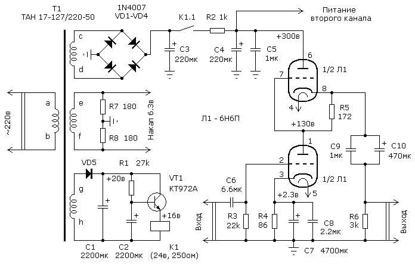
Идея схемы состоит в том, что это SRPP каскад и раскачкой наушников занимается по две лампы в каждом канале. Лампой служит довольно распространенная 6Н6П, являющаяся сдвоенным триодом - всё, как вы любите).
Схема рассчитывалась на коэффициент усиления равный двум. Однако на нагрузку в 32 Ома он составляет чуть более единицы, около 1,2 как заявляет сам автор. Если же ваши наушники более высокоомные, то коэффициент усиления будет стремиться к двум.
Тем не менее несмотря на коэффициент усиления немногим больше единицы – это коэффициент усиления по напряжению. Т.е. усилитель практически не усиливает по громкости, зато он усиливает сигнал по току. А это очень важно, т.к. если усилитель для наушников (так же как и любой другой усилитель) не может обеспечить достаточный ток в нагрузку, то это приводит к проседанию выходного напряжения – а это искажения формы сигнала и смерть для звука.
С другой стороны использовать такой усилитель логичнее с наушниками скорее относящимися к категории «профессиональные», а их сопротивление не часто бывает ниже 50-60 Ом.
Если уровень сигнала вашего источника недостаточный, то автор предлагает решение в виде дополнительного входного каскада на лампе 6Н1П, с коэффициентом усиления равным 10:
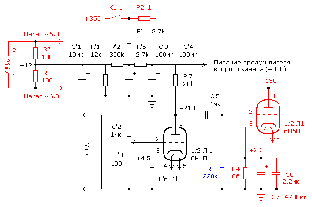
С моими источниками сигнала и наушниками я не испытал необходимости в этом каскаде.
Что касается лампы 6Н6П то стоит обратить внимание, что она требует достаточно большого накального тока, порядка 750 мА. Если трансформатор не может обеспечить достаточный ток, то напряжение накала будет проседать.
Плохо это не только тем, что звук будет более зажатым, но и тем что при этом будет происходить «холодный вырыв» электронов из катодов ламп. Это приводит к уменьшению срока службы ламп.

## **Макетирование**

Разумеется перед тем, как пилить шасси и заморачиваться с корпусом для лампового усилителя для наушников я в первую очередь решил проверить всё на макете, чтобы вообще убедиться надо ли оно мне.
Для макетирования я разбомбил какой-то ламповый блок от советского самописца. Очень удобно пользоваться готовыми кусками. Плюс тут и трансформатор хороший, даже с экранами между обмотками.
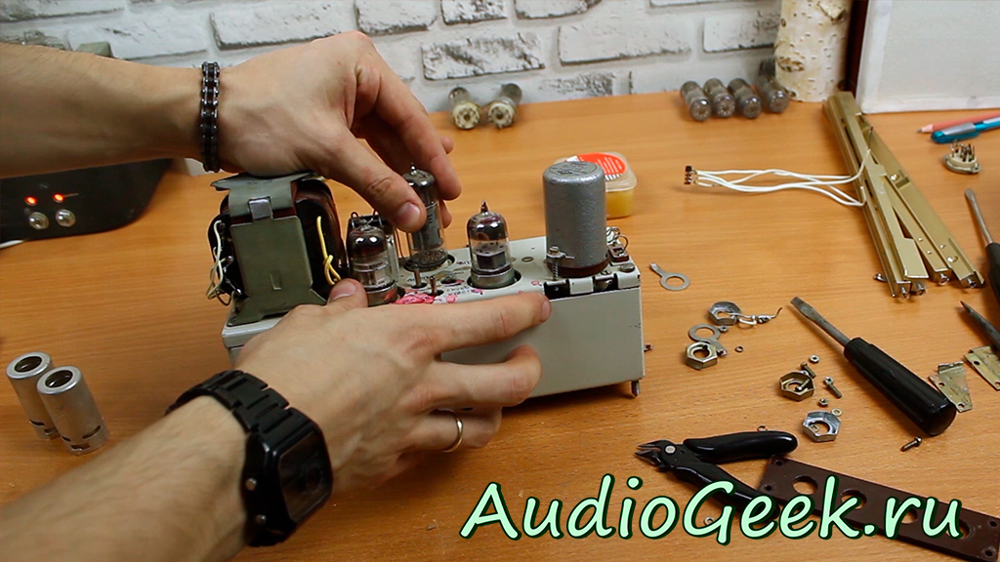
Макетирование так же удобно для того чтобы подобрать детали, и прикинуть необходимые размеры будущего девайса.
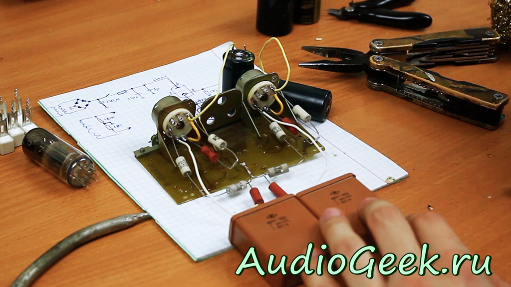
Что меня очень приятно удивило в этой схеме – так это полное отсутствие шумов. Сам автор говорит, что на измерениях спектра есть небольшой пик от сетевой наводки, но он абсолютно отсутствует на слух.

## Сборка усилителя

Собирая этот усилитель мне захотелось отойти от классического металлического шасси в пользу «хорошо звучащего» дерева. Правда вместо дерева я воспользовался фанерой, которая в прошлой жизни гордо называлась кухонной доской.
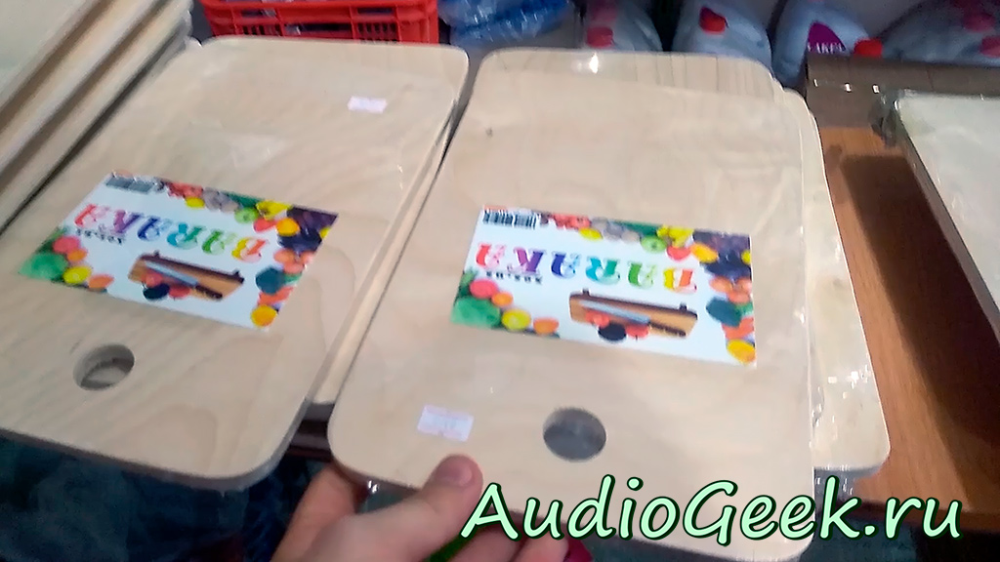
Но вот корпус я все равно предпочел сделать из метала для экранировки потрохов усилителя. На роль крышки пошла крышка от куска какого-то военного прибора для проверки радиоламп в полевых условиях. Это счастье досталось мне от соседа, после сноса его гаража.
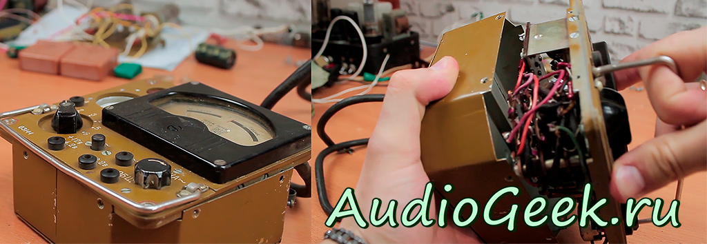
После того как я определился с расположением элементов на фанерной крышке корпуса, были просверлены все необходимые отверстия. Тут стоит заострить внимание, пожалуй, только на сверление отверстий под панельки для ламп. Т.к. панельки было решено устанавливать с верхней стороны, то для свободного доступа к контактам, с внутренней стороны я высверливал отверстия бОльшего диаметра, оставляя 4 слоя фанеры, для крепления самих ламп.
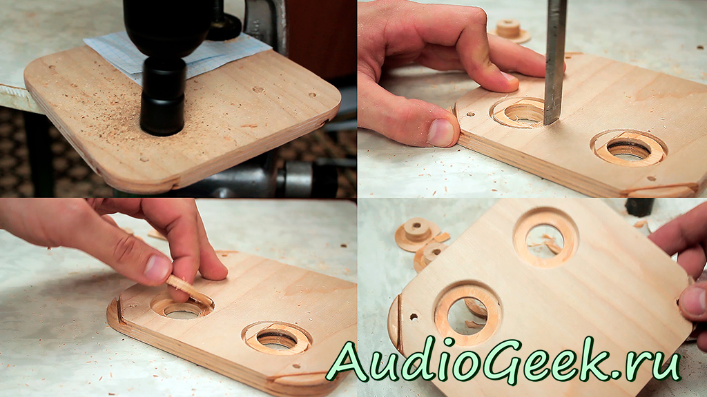
Тут стоит быть осторожным и внимательным т.к. фанера любит расслаиваться. Поэтому как только появлялся намек на трещину я подклеивал его суперклеем.

## **Тонировка дерева**

Хотелось замутить дизайн между хайтеком и ретро, поэтому я озадачился идей тонировки фанеры. Перечень морилок в ближайших строительных магазинах меня не удовлетворил и было решено воспользоваться технологией состаривания дерева, найденной в интернетах.
Суть метода сводится к тому, что необходимо замочить в уксусной эссенции металлическую стружку или гвозди, настоять это дело недельку – другую. Затем разбавить водой, нанести полученный раствор на дерево и дождаться его высыхания.
Если лень ждать неделю, то можно приготовить эксперсс-раствор. Для этого подойдет чугунная сковорода. Шкурим ее крупной наждачкой и полученную пыль заливаем все той же уксусной эссенцией. После чего можно сразу разбавить раствор 1:1 или более водой и сразу наносить на дерево.
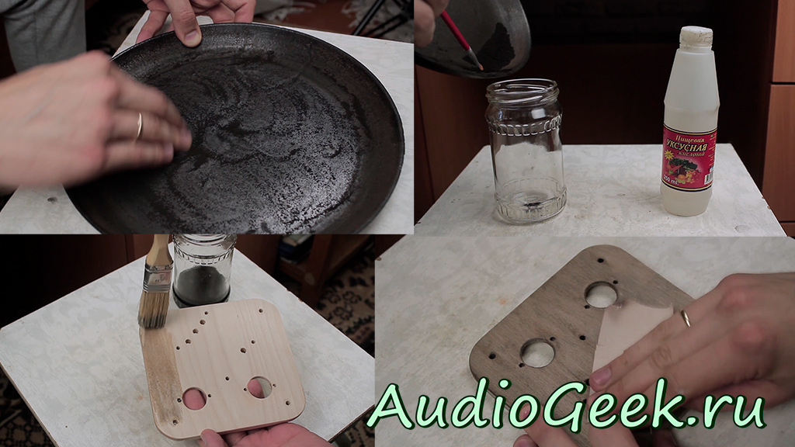
На самом деле такой раствор это не совсем морилка. Раствор искусственно состаривает дерево. Вообще такая морилка не очень эффективно справляется с сосной, из которой изготавливается большинство фанер, но эффект все же есть. Плюс между волокон остаются черные частички сковородки что тоже выглядить достаточно интересно, проявляя волокна дерева.
После того как деревяшка просохнет можно повторить нанесение. Однако это не даст значительного изменения. Поэтому прошкуриваем фанерку мелкой наждачкой чтобы убрать вылезший ворс и покрываем её слоем лака. В моем случае это матовый паркетный лак.

## **Корпус лампового усилителя для наушников**

Первым делом было сделаны все необходимые отверстия. А под разъёмы для входа/выхода и отверстие для регулятора громкости. На задней стенке был сделано отверстие под интерфейс для сетевого питания.
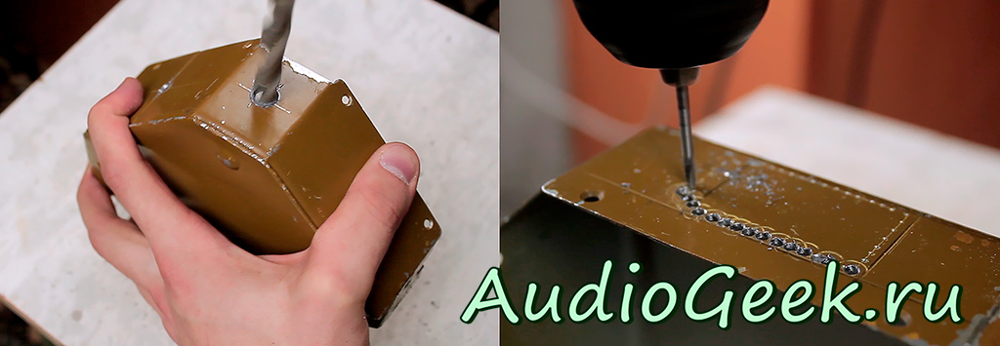
Это готовый блочек, в котором уже совмещены разъем для сетевого провода, выключатель и предохранитель. Потрясающая штука, заказывал в ***этом магазине*** всего по 95 центов:
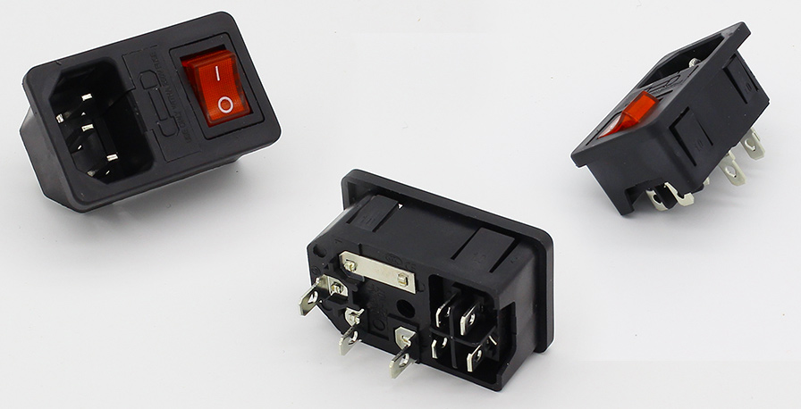
Когда все отверстия готовы, а новых не предвидится – пора переходить к отделочным работам. Для придания корпусу солидного вида – он был отшкурен до металла, затем отшпаклеван автомобильной шпатлевкой. И, после тщательного прошкуривания, я покрыл его тремя слоями черной краски с промежуточными прошкуриваниями.
Исходно, по классике жанра, корпус предполагался черным матовым. Но, увы, нормальную краску удалось достать только глянцевую. Я использовал акриловую нитрокраску. Однако последний слой, так получилось, я наносил при температуре около 17 градусов, что ниже указанной в условиях нанесения. В результате слой таки получился матовым.
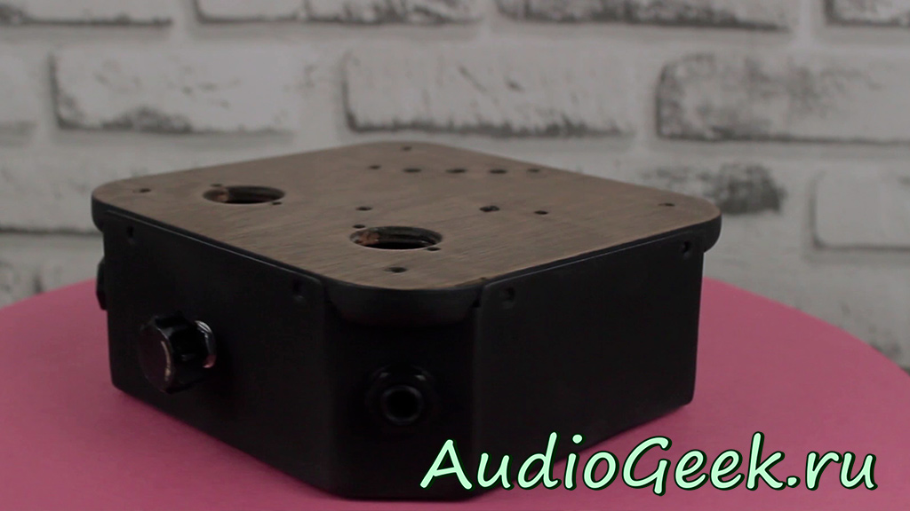
Кожух трансформатора красился вместе с корпусом.

## **Потроха усилителя для наушников**

Когда корпус готов остается только собрать все воедино и заставить работать.
Первым делом я провел провода для накала ламп. Я не стал выпрямлять накал, поэтому провода идущие к лампам желательно делать как можно короче. Накальная обмотка моего трансформатора имеет центральный отвод, который я сразу соединил с выводами экранов между обмотками трансформатора и подключил все это дело к земле.
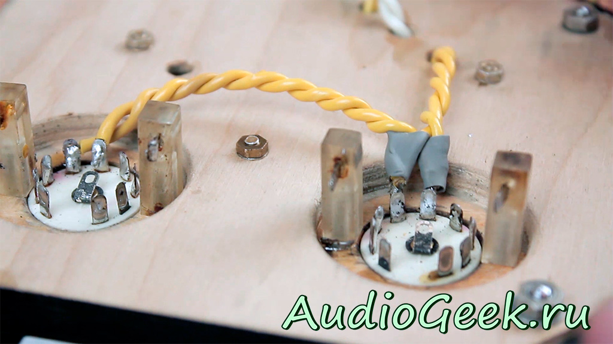
Детали я напаивал непосредственно на выводы панелек ламп, но так же воспользовался столбиками из оргстекла с контактом, выкрученными из какого-то лампового прибора.
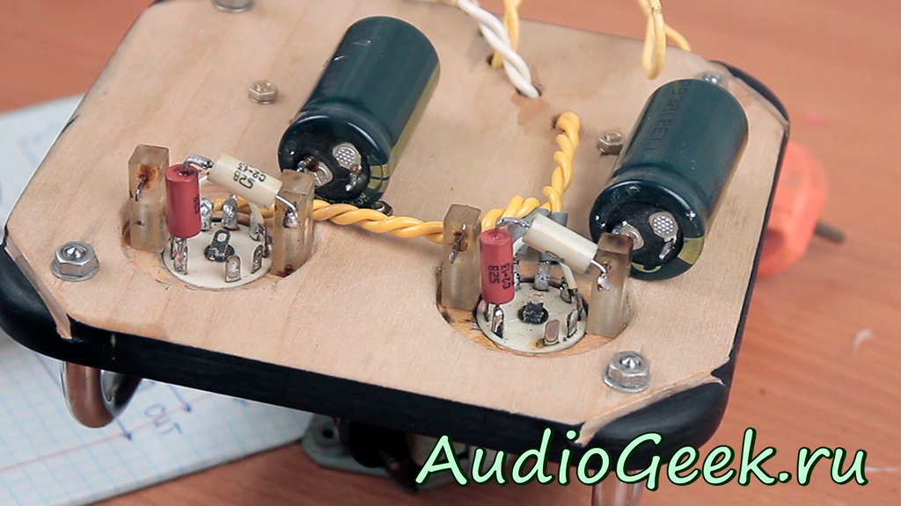
Для усилителя я специально заказал хорошие конденсаторы, однако на момент сборки они не успели придти, поэтому не стал заморачиваться с крепежом имеющихся и посадил все на термоклей. Выглядит не самым лучшим образом, зато все прекрасно работает
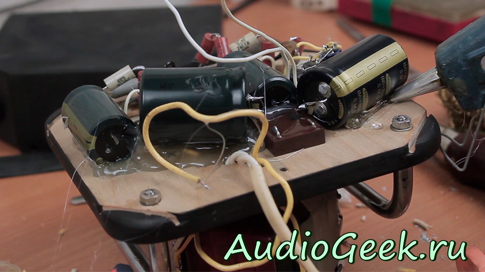
После сборки усилитель заработал сходу, но на всякий случай еще раз пробежался по схеме и все проверил.
В качестве проверки правильности работы схемы стоит проверить напряжения в указанных на схеме точках. Если схема собранна правильно, но при этом напряжения отличаются от указанных более чем в 10 раз, то это значит лампам пора на мусорку.

## **Заключение**

В итоге получился вот такой потрясающий усилитель:
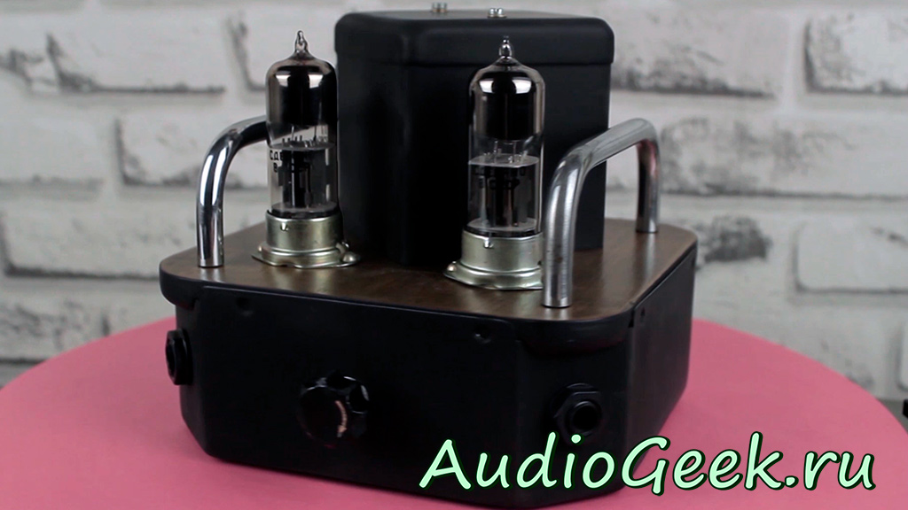
С этим усилителем я заново открыл для себя свои наушники. Схема усилителя настолько просто, что ее действительно сможет повторить даже начинающий лампостоитель. Главное не забывать о простых правилах безопасности, а именно не забывать отключать питание и разряжать конденсаторы. На этом у меня всё, более подробно процесс сборки смотрите в моем видео в начале статьи.
**Всем удачи и хорошего звука!**

**Статья написана исключительно для сайта [AudioGeek.ru](https://audiogeek.ru/)**
