[Русский](./README.ru.md) | **English**

# An electret microphone preamp (with PCB)

**Category:** Audio circuit design  
**Original:** https://audiogeek.ru/mic-preamp/

---

Buying a good microphone is expensive. It is far cheaper, and more fun, to build your own microphone preamp that gets the most out of a lavalier mic. I tried several circuits and in the end built a preamp of my own. I even laid out a printed circuit board for it. But let us take it step by step...

## A microphone preamp

For over a year now I have been active not only on this site but also on YouTube. If you have not been there yet, I recommend dropping by. These days I am there more often than here.

As the quality of my videos improved, I came to need better sound recording. Originally I recorded on a Maono AU101 lavalier mic. It is a perfectly convenient mic, but it gave me a number of practical annoyances.

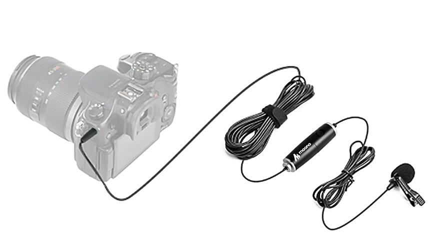

That is how I came to the idea of building a microphone preamp. Before building I wanted roughly the following from it:

- power from a Li-ion battery
- an op-amp-based circuit
- a printed circuit board

Describing the resulting sound in words is a strange exercise, and I see no point in duplicating the video in the article. So I suggest you watch the video first and then continue reading. They complement each other. It will also be clearer whether you need this.

> ▶ **[Watch the video on YouTube](https://www.youtube.com/watch?v=usmkx5rgFNY)**

## Powering an electret microphone

For some reason there is very little information on the internet about how to wire up electret microphones correctly. The standard arrangement applies the voltage through a current-limiting resistor and then uses a capacitor to block the DC.

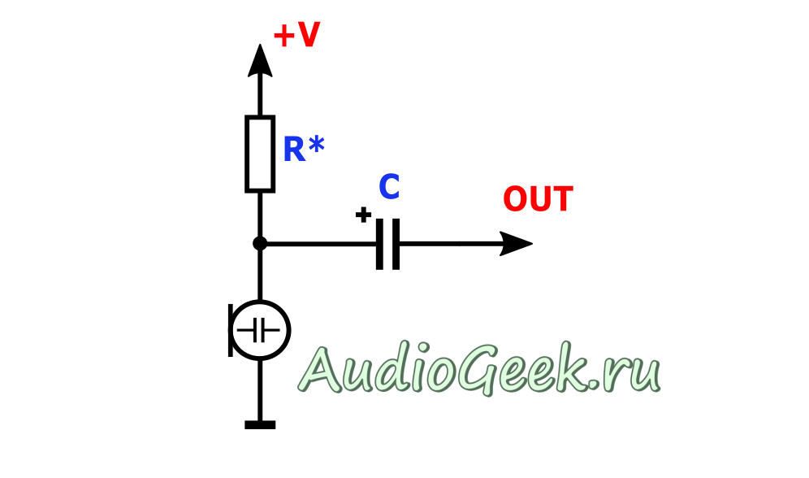

Most circuits say nothing about how to choose this resistor and just give a specific value. That is not quite right. The value of this resistor should not be picked out of thin air, but selected for each specific microphone capsule.

***But how do you select it?***

Fortunately I found a very ***[interesting article](http://forum.cxem.net/index.php?/blogs/entry/429-танцы-с-бубном-вокруг-электретного-микрофона/)*** (in Russian) in which the author made a series of measurements and drew a very useful practical conclusion.

> So, **when selecting the current-limiting resistor, the voltage at the junction of the resistor and the microphone must be exactly half the supply voltage.**

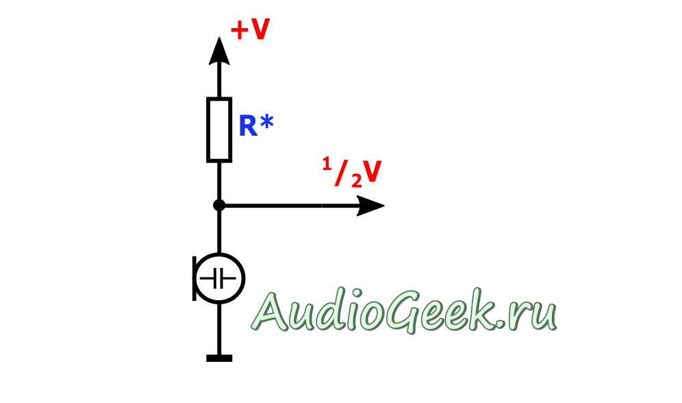

Besides giving the microphone its optimal operating point, this trick has a bonus: we get the bias for an op-amp on a single supply. That means we can drop an extra capacitor and two resistors from the circuit.

## Amplifier circuit options

In another ***[article](https://cxem.net/sound/soundpred/soundpred37.php)***, the same author proposed a ready-made microphone preamp. It is a circuit with **AGC** (***A**utomatic **G**ain **C**ontrol*). This is how it looks in the original (*without the frequency-shaping network*):

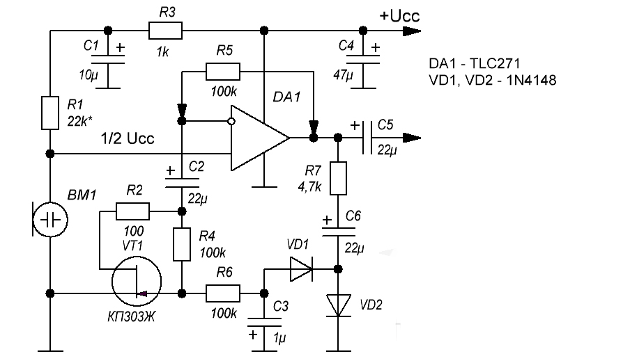

Thanks to a field-effect transistor (KP303Zh) in the feedback path, the circuit works like a compressor and evens out the volume of the voice by varying the gain within certain limits.

The circuit is fully functional. I tested it personally on a breadboard and had no problems. It is very handy, for example, for microphones in conference rooms. It can also be used as a microphone preamp when connecting to a computer.

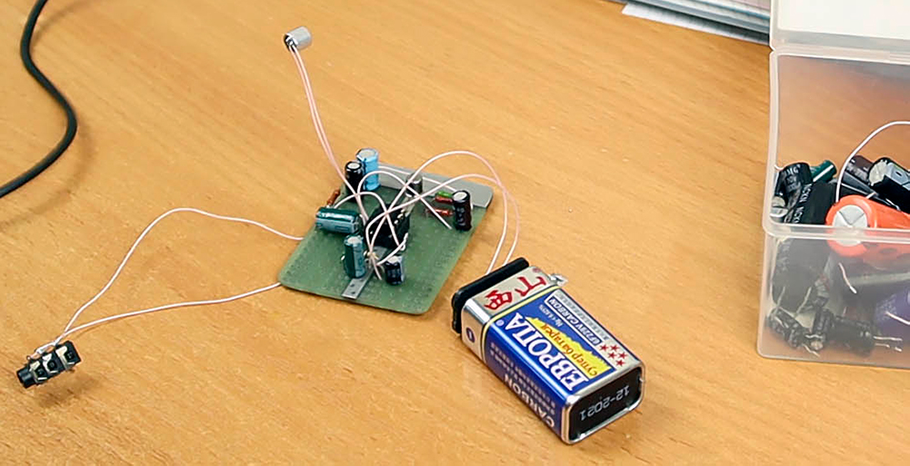

It did not suit me personally because when the gain changes, not only the voice gets louder and quieter but also all the extraneous sounds and noise. That means you cannot remove the noise with an ordinary noise reducer when processing the voice recording. You can read about voice processing in [***this article***](../kak-obrabotat-golos-audacity/).

So I gave up on AGC and cut the circuit down to a plain non-inverting amplifier with constant gain. That circuit does its job very well too.

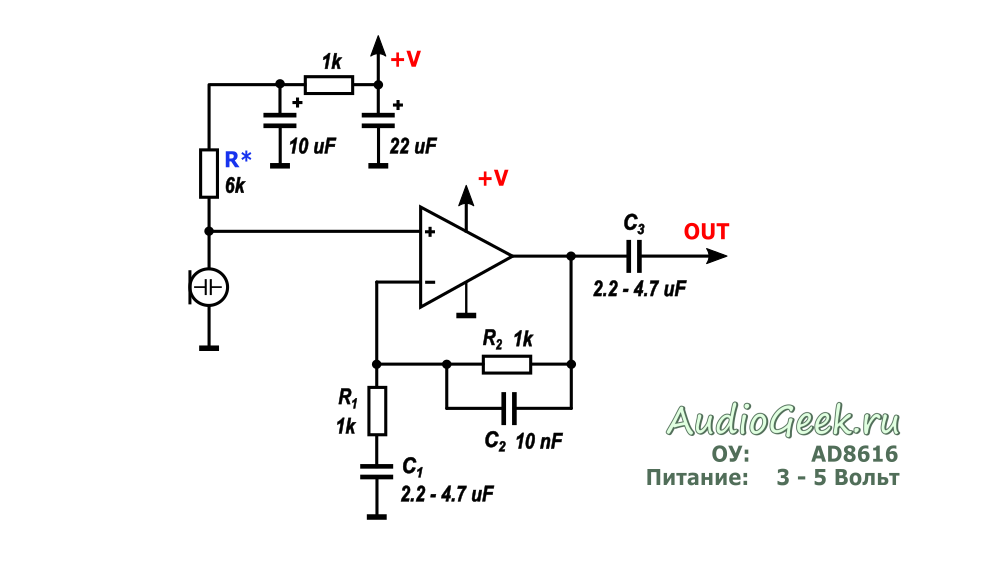

## Gain

In this case the gain is set by resistors R2 and R1, or more precisely it is:

> ***K = 1 + (R2 / R1)***

You can set any gain you like on this amplifier. Just remember that electret microphones usually give a signal of up to 50 mV amplitude. In practice it is most often limited to 25–30 mV.

So if you plan to connect the microphone to a computer line input designed for a 1 V signal, the preamp should be designed for a gain of about 20–30.

As for specific resistor values, it is better to choose values in the range of 1–10 kΩ. You can of course use larger values, but do not forget that any resistor adds noise by itself, and the larger the resistance, the more noise.

When I connected the preamp to a camera (***Canon M50***), I ran into some trouble with the gain. I originally planned to set it to around 10. Then I could set the camera's audio gain to the minimum and all the noise should vanish... **Buuut**...

It later turned out that even at the minimum gain of two (***R1*** = ***R2***) the signal was recorded overloaded.

The cause was overload of the camera's input stages. So I had to double the value of resistor ***R1***. That gave a gain of about **1.5**. But all the distortion disappeared as if by magic.

Do not think that at such a low gain the microphone preamp is useless. The preamp's role is not only to raise the signal amplitude.

Matching the impedance of the microphone to the camera input plays a very big role. It not only makes life easier for the camera, but also improves the signal-to-noise ratio and evens out the microphone's frequency response.

## Single-supply operation

An important point of these circuits is that some extra steps are needed because of the single supply.

The bias voltage (half the supply) is already created at the circuit input, so we have already saved two resistors. But to keep this DC voltage from reaching the output, a capacitor is needed there. That is ***C3***.

Also remember that any op-amp amplifies AC and DC equally well. So the amplifier must be turned into an AC amplifier.

Capacitor ***C1*** does that. Thanks to it the DC gain becomes unity, while the AC voltage is amplified according to the gain set by the resistors.

## Frequency shaping

Capacitor ***C1*** has one more function. Together with resistor ***R1*** it forms an RC network that cuts low frequencies, that is, it works as a high-pass filter.

This is very convenient. By setting the cutoff at about 30–80 Hz we get rid of unwanted low-frequency content in the recording.

Calculation of such filters with simplified formulas was described in the article ***[RC circuits: the 5 most common filter circuits and how to calculate them](../rc-circuit/)***.

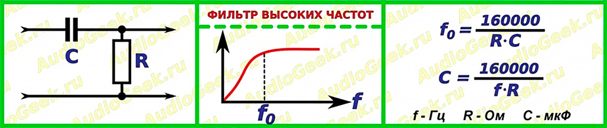

Practically every decent microphone has such a filter built in. On more expensive models you can even choose the cutoff at 75 or 150 Hz.

In any case, first decide on the resistor value, then calculate the capacitor for the desired frequency.

Capacitor ***C2*** prevents the op-amp from oscillating and limits the audio band at the top.

Human speech is generally considered to lie in the range of 100 Hz to 10 kHz. But when editing recordings I have repeatedly noticed that although there is no voice above 10 kHz, those frequencies still affect how the voice is perceived. **So in my opinion the cutoff is best set at about 15 kHz.**

The calculation is similar. First choose the resistor that sets the gain (***R2***), then calculate ***C2*** using the same formula as for ***C1***.

## The finished microphone preamp circuit

But it nagged at me that nearly all the op-amps I have are dual, and I do not like leaving half an op-amp hanging in the air. It somehow feels wrong...

So without much thought I switched to my favorite circuit, the ***[headphone amplifier circuit](../headphone-amp-dual-current/)***. It is in essence the same non-inverting amplifier, but supplemented with a cleverly connected follower.

The reason for the switch is not only the wish to use both op-amps in the package.

- **First,** I had long wanted to try this circuit on a single supply.
- **Second,** this circuit can deliver twice the current at the same output voltage. That guarantees no sag or signal distortion on the way from the preamp to the recording device. The cable may well be 5 or 10 meters long.

So all that remained was to add the input circuit with the microphone and change the capacitor values for our task.

Here is the final circuit.

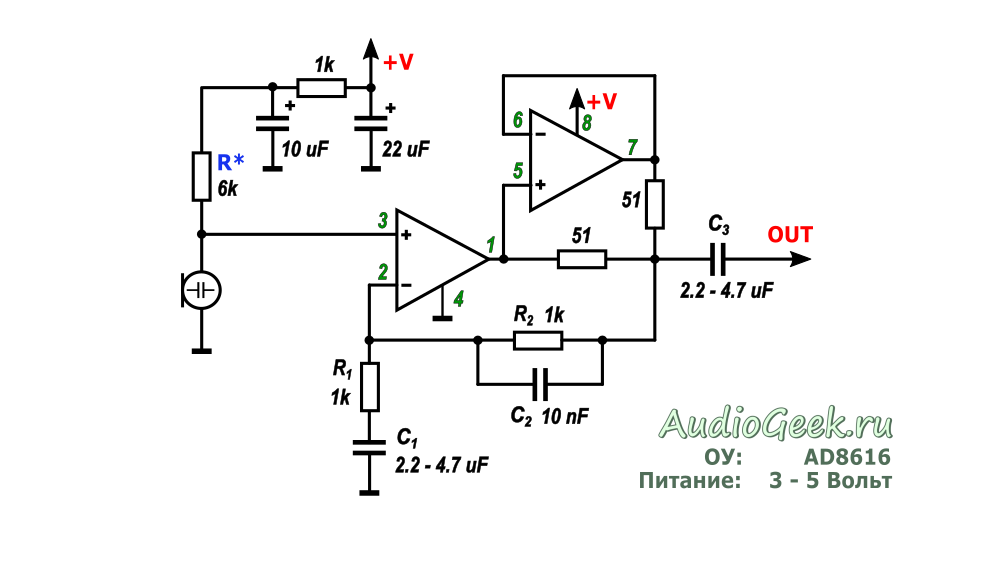

## Choosing the op-amp

The choice of op-amp for a microphone preamp depends strongly on the power source. If you plan to power it from a 9 V battery, most common op-amps will do. But from the start I wanted to use an 18650 lithium battery. First, they have good capacity, and second, they are easy to charge with ***[ready-made modules](../kontroller-zaryada-li-ion-modul/)***.

So I chose the AD8616 as the op-amp. Excellent, inexpensive and readily available dual op-amps. But the main thing is that they work with supply voltages from 2.5 to 5 volts, which is just perfect for a lithium battery and portable gear in general.

The only drawback may be that they are not made in a DIP package. But here the ***[SO-8 to DIP8 adapters](../so8-to-dip8/)*** I had once ordered from AliExpress came to the rescue.

## The printed circuit board

After settling on the circuit and trying it on a breadboard, it was time to make a PCB. I had not made boards for several years, but surprisingly it turned out easier than I thought. I lay out boards in P-CAD, so I drew the schematic quickly, and after a few hours at the computer I had a finished board.

The board fits in 20×45 mm. These dimensions came from the case I chose, but they seem convenient for practically any case. The dimensions correspond to the strip drawn around the perimeter.

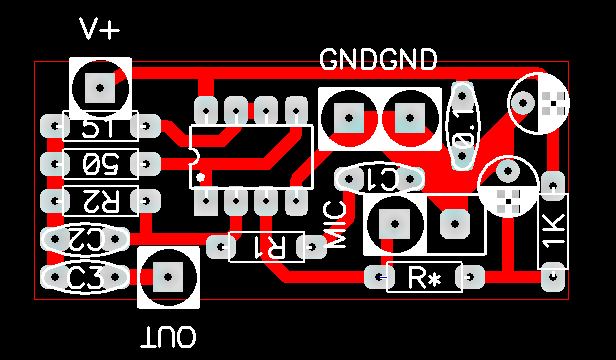

You can download the microphone preamp PCB through one of the links below. The board is saved as a PDF and is ready to print.

- [***Download the PCB***](./Mic_amp_PCB.pdf)
- [***Download the PCB (mirrored)***](./Mic_amp_PCB_MIRROR.pdf)

I made two versions of the board. The first is as in the picture above and the second is mirrored. If you use the mirrored board, it will become the normal orientation after transfer, and the parts should be placed on the track side.

## Making the board by toner transfer

They say boards turn out best when printed on pages from Playboy. I used to do that, but lately I have switched to paper that is glossy on one side. It is a pity to waste interesting articles on who knows what...

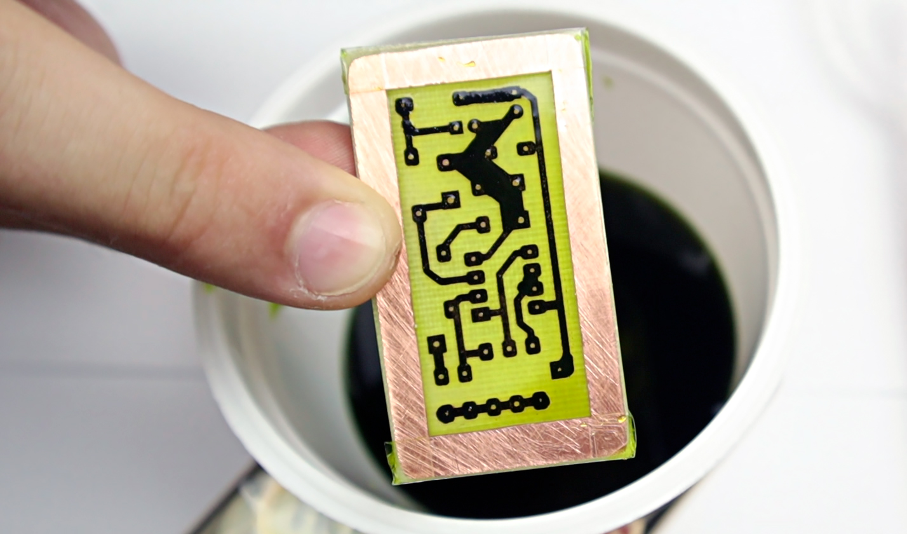

The toner transfer technique is well known to everyone anyway and is shown in the video, so I will only dwell on two points.

- I heat with the iron for about a minute, then throw the board into the nearest book and stand on the book with my full weight for 1–2 minutes.
- I always touch up wide areas and transfer or print defects with a permanent marker. This time, instead of a permanent marker, I used an acrylic one. I waited 10–15 minutes for it to dry. It worked great all the same and nothing etched under it.

## Selecting resistor *R\**

The value of resistor ***R\**** depends strongly on the capsule. To select it, I first soldered in a multi-turn variable resistor.

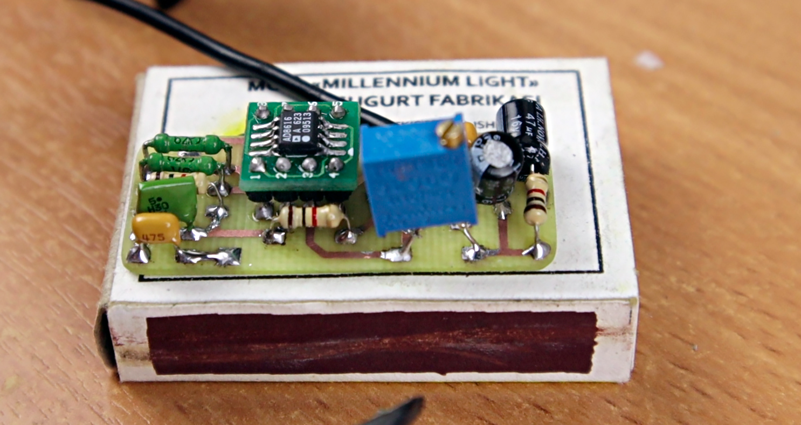

I turned it to the required voltage and desoldered it. The resistance was exactly *6 kΩ*. I did not have one, so I made it from two.

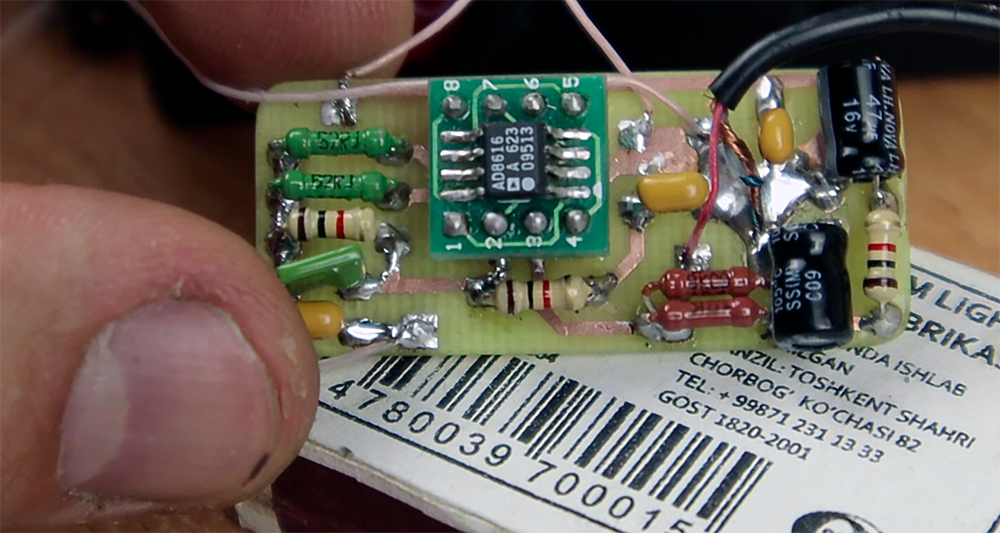

> **With other capsules, however, the resistance may be *2 kΩ* or *8 kΩ*. So this is very individual.**

## The microphone preamp case

A few words about the case. I used a vape case. It had been lying in my cupboard for a long time waiting for its fate. It turned out to be a perfect choice, since it has a battery compartment and has holes that are enough for my needs.

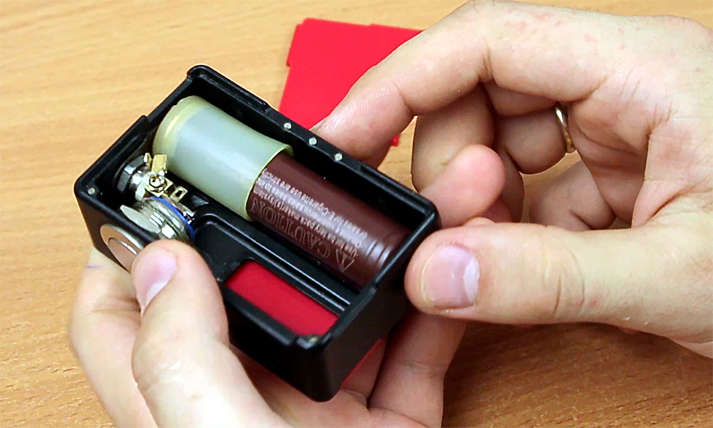

First I threw out everything that reminded me of its origin and also took out and cleaned the battery contacts. Then a desk lamp switch was installed in place of the button. It fit perfectly in size, I only had to cut a slot for the latch.

To minimize the noise from the preamp I decided to shield the case. For that I cut pieces of copper foil for the removable walls of the case and stuck them on with double-sided tape. Later I will connect them to the battery negative.

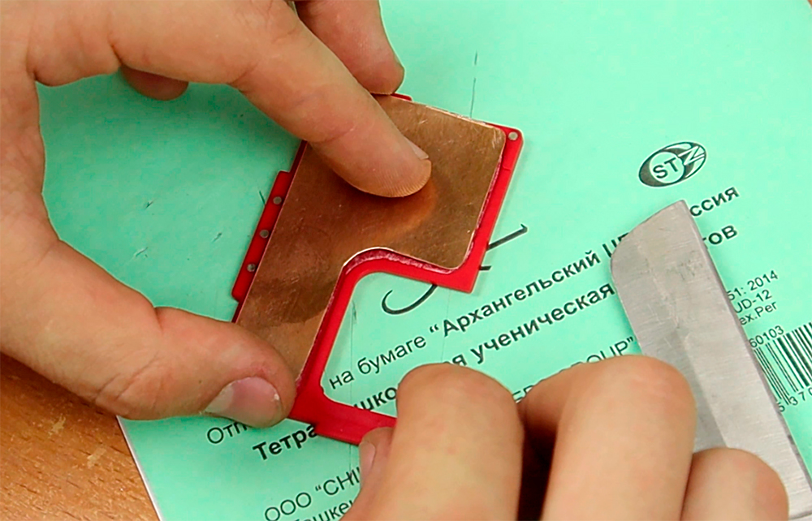

The only thing that bothered me in this case was the hole in the front panel. But it actually worked in my favor.

I cut an insert from acrylic glass and glued it to the cover. It not only covered the hole but was also meant to show a blue LED indicating that the device is on.

To make the insert more interesting, and also to increase the glow, I engraved a symbolic microphone image on it. Now, even from afar and in bright light, I can always see whether my microphone is on.

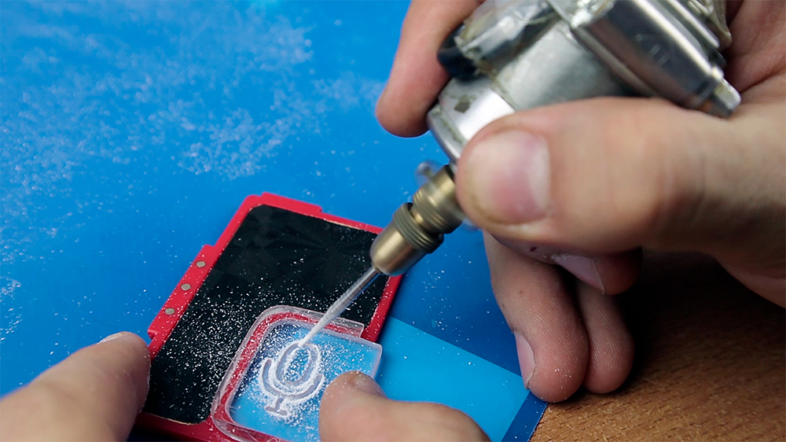

Now all that is left is to pass the wires through the hole and solder them to the board.

## Conclusion

That is the microphone preamp I ended up with. I am very happy with the result. Using it reduced the processing of the audio track to a minimum. In the video on this topic I did not process the sound at all. It sounds very good as it is. So if you have not watched the video yet but are interested in such a preamp, I recommend doing so. Otherwise, what was all my effort for? :)

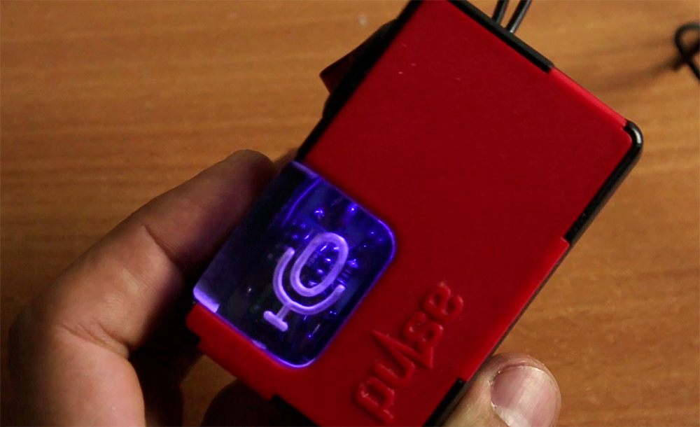

The only thing I would do to the voice in post is add compression for the listener's comfort. Otherwise the voice sounds very even and natural, even though I used a rather cheap lavalier mic with who knows what capsule.

I plan to buy a decent original capsule, such as a Philips 61A, and enjoy life.

***Thanks for reading, and good sound to everyone!***

*Originally written for [AudioGeek.ru](https://audiogeek.ru). Translated from Russian.*
