[English](./README.md) | **Русский**

# Усилитель для электретного микрофона (+печатка)

**Дата:** 2020-09-03  
**Рубрики:** Схемотехника аудиотракта  
**Оригинал:** https://audiogeek.ru/mic-preamp/

---

Покупать качественный микрофон - весьма затратная мысль. Куда дешевле и интереснее соорудить своими руками предусилитель для микрофона, который  вытянет максимум из петлички. Были опробованы несколько схем, в итоге я соорудил свой усилитель для микрофона. Для него даже была разведена печатная плата. Но обо всем по порядку...

## Предусилитель для микрофона

Уже больше года я веду свою деятельность не только на этом сайте, но и на YouTube. Если вы там еще не были – советую заглянуть, сейчас я чаще бываю там, чем тут.
По мере улучшения качества своих роликов я пришел к необходимости улучшения качества записи звука. Исходно я записывал звук на петличку Maono AU101(покупал в этом магазине ). Вполне удобная петля, но для меня возник ряд пользовательских неудобств.
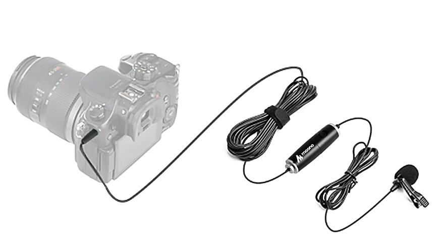
Так я и пришел к мысли собрать предусилитель для микрофона.Перед сборкой от предусилителя хотелось примерное следующего

- питание от литий ионного аккумулятора
- использование схемы на операционном усилителе.
- создание печатной платы.

Описывать получившийся звук словами – странное занятие, да и дублировать содержимое ролика в статье не вижу смысла. Поэтому советую для начала посмотреть мой ролик, а уже потом продолжить чтение статьи. Они дополняют друг друга. Да и так будет понятнее надо ли оно вам.

> ▶ **[Смотреть видео на YouTube](https://www.youtube.com/watch?v=usmkx5rgFNY)**

## Питание электретного микрофона

Почему-то в интернетах очень мало информации о том, как правильно включать электретные микрофоны. Обычно используется стандартный вариант, при котором напряжение подается через токоограничивающий резистор, а далее для отсечения постоянного напряжения устанавливается конденсатор.
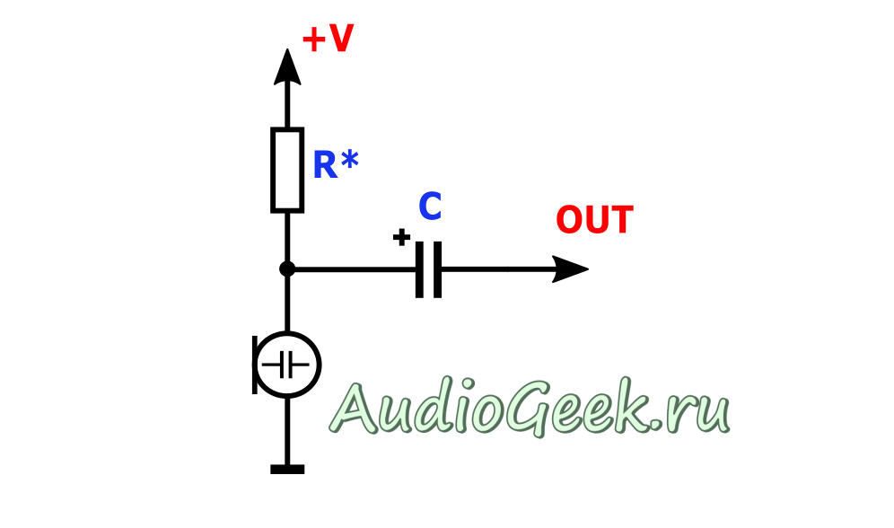
При этом в большинстве схем ни слова не говорится о подборе этого резистора и просто указывается конкретное значение. Хотя в целом это не совсем верно. Величину этого резистора следует выбирать не с потолка, а подбирать для каждого конкретного микрофонного капсуля.
***Но как же его подобрать?*** 
К счастью была найдена очень ***[интересная статья](http://forum.cxem.net/index.php?/blogs/entry/429-танцы-с-бубном-вокруг-электретного-микрофона/)***, в которой автор провел ряд измерений и сделал очень полезное, с практической точки зрения, заключение.
> Итак, **при подборе токоограничивающего резистора необходимо, чтобы в точке соединения резистора и микрофоном получалась ровно половина питающего напряжения.**

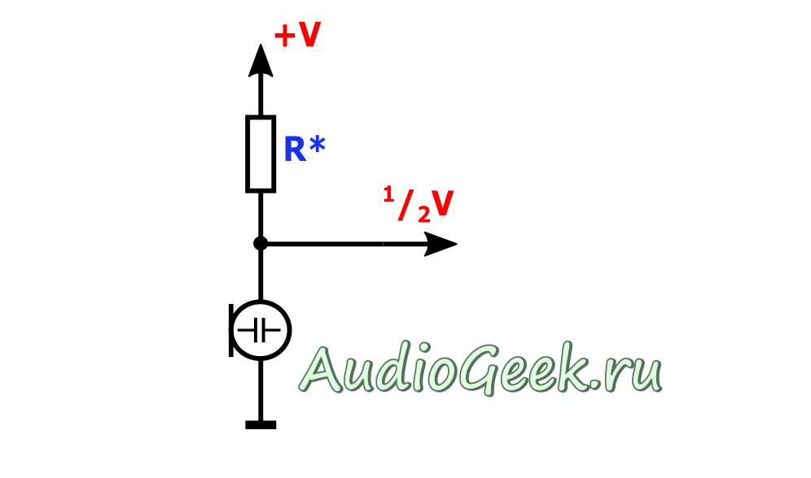
Помимо оптимального режима работы микрофона эта фишка удобна еще и тем, что бонусом мы получаем смещение для операционного усилителя при питании от однополярного источника. Это означает, что можно выкинуть из схемы лишний конденсатор и два резистора.

## **Варианты схем усилителя**

В другой своей ***[статье](https://cxem.net/sound/soundpred/soundpred37.php)***, тот же автор предложил готовый предусилитель для микрофона. Это схема с **АРУ** (***А**втоматической **Р**егулировкой **У**силения*). Вот так выглядит эта схема в оригинале (*без цепи частотной коррекции*):
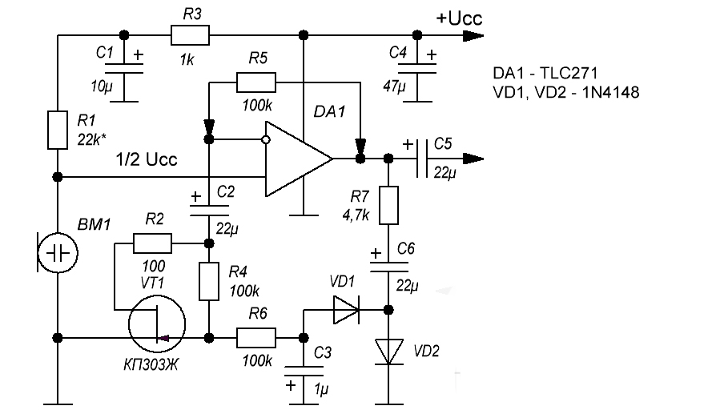
Благодаря применению полевого транзистора (КП303Ж) в обратной связи, такая схема работает как компрессор и выравнивает громкость голоса, изменяя коэффициент усиления в некоторых пределах.
Схема полностью рабочая, была проверена мной лично на макете и никаких проблем не вызвала. Такая схема очень удобна, например, для микрофонов в конферент-залах и переговорных. Но может быть использована и как предусилитель для микрофона при подключении к компьютеру.
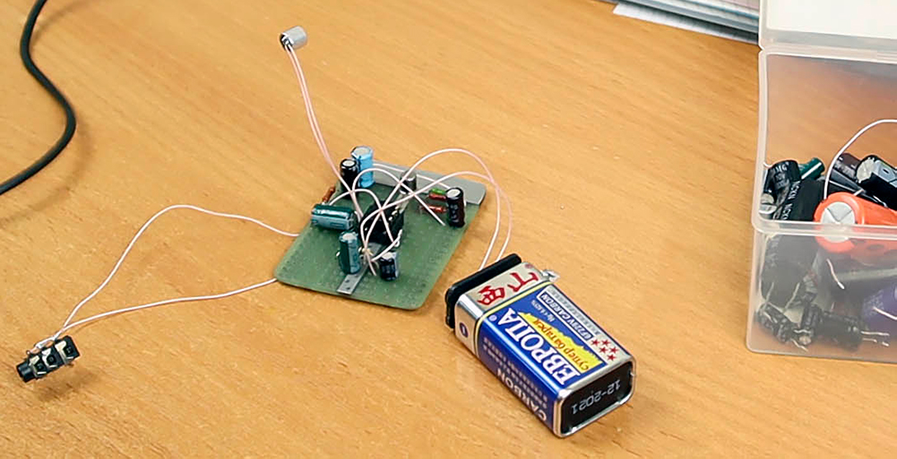
Лично для меня она не подошла по той причине, что при изменении усиления, громче и тише становится не только голос, а так же и все посторонние звуки и шумы. А значит при обработке записи голоса не получится избавиться от шумов обычным шумодавом. Про обработку голоса читайте в [***этой статье***](../kak-obrabotat-golos-audacity/).
Поэтому от АРУ пришлось отказаться и схема была урезана до обычного неинвертирующего усилителя с постоянным коэффициентом усиления. Такая схема тоже отлично справляется со своими обязанностями.
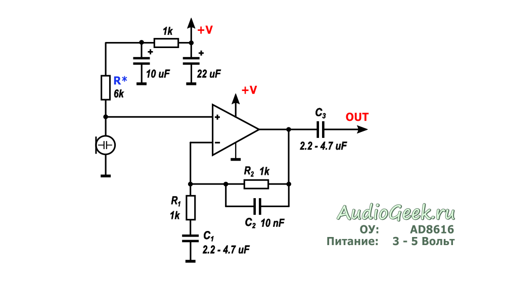

## **Коэффициент усиления**

В таком случае коэффициент усиления задается резисторами R2 и R1, а если быть точнее, то он равен:
> ***К = 1 + ( R2 / R1 )***

На таком усилителе можно задавать любой коэффициент усиления. Стоит лишь помнить, что обычно электретные микрофоны дают сигнал амплитудой до 50 мВ. На практике чаще всего это значение ограничивается 25-30 мВ.
Поэтому, если предполагается подключать микрофон в линейный вход компьютера, рассчитанный на сигнал 1 Вольт, то предусилитель для микрофона лучше рассчитать на коэффициент усиления порядка 20 ÷ 30.
Что касается конкретных значений сопротивлений, то лучше выбирать величины в диапазоне от 1 ÷10 кОм. Можно конечно использовать и бО'льшие значения сопротивлений, но не стоит забывать, что любой резистор сам по себе вносит шумы. Эти шумы тем больше, чем больше сопротивление резистора.
Когда я подключил предусилитель для микрофона к камере (***Canon M50***), у меня возникли некоторые трудности с коэффициентом усиления. Изначально я планировал установить его около 10. Тогда можно было бы установить на камере минимальное значение предусиления звука и все шумы должны были уйти в небытие…. **Нооо**….
Позже выяснилось, что даже при минимальном коэффициенте усиления, равном двум (***R1***=***R2***) сигнал записывается с перегрузкой.
И виной тому была перегрузка входных каскадов камеры. Поэтому я был вынужден увеличить значение резистора ***R1*** вдвое. Это дало коэффициент усиления около **1,5**. Зато все искажения как рукой сняло.
Не стоит думать, что при такой низком коэффициенте усиления предусилитель для микрофона бесполезен. На самом деле роль предусилителя состоит не только в увеличении амплитуды сигнала.
Очень большую роль играет согласование сопротивлений микрофона и входа камеры. Это не только облегчает жизнь камере, но и так же улучшает соотношение сигнал/шум и выравнивает АЧХ микрофона.

## **Однополярное питание усилителя**

Важным моментом этих схем является необходимость в некоторых дополнительных манипуляциях, связанных с однополярностью питания.
Напряжение смещения (1/2 питания) у нас уже создается на входе схемы и два резистора мы уже сэкономили. Но для того, чтобы это постоянное напряжение не пошло на выход там требуется конденсатор. Для этого нужен ***С3***.
Так же стоит помнить - любой ОУ одинаково хорошо усиливает и переменное и постоянное напряжение. Поэтому необходимо превратить усилитель в усилитель переменного напряжения.
Для этой цели служит конденсатор ***С1***. Благодаря нему коэффициент усиления по постоянному напряжению становится равным единице. А вот переменное напряжение усиливается в соответствии с заданным резисторами коэффициентом.

## **Частотная коррекция**

Конденсатор ***С1*** выполняет еще одну функцию. Вместе с резистором ***R1*** они образуют RC-цепь, которая срезает низкие частоты. Т.е. работает как фильтр высоких частот.
Это очень удобный момент. Задав частоту среза порядка 30-80 Гц, мы избавимся от лишней низкочастотной составляющей на записи.
Расчет таких фильтров с упрощенными формулами был описан в статье ***[RC-цепи, 5 самых ходовых схем фильтров и их простой рассчет](../rc-circuit/)***.
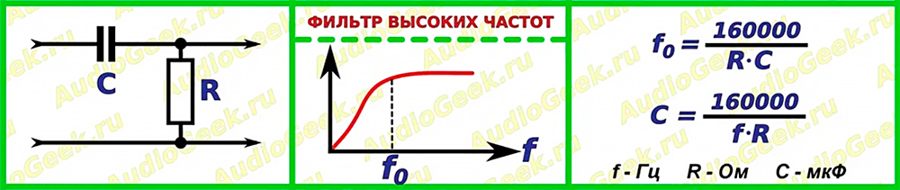
Практически все нормальные микрофоны имеют в своем составе такие фильтры. На более дорогих моделях даже можно выбрать срезать на частоте 75 либо же 150 Гц.
В любом случае стоит сначала определиться с величиной резистора, а затем рассчитать под него конденсатор на желаемую частоту.
Для исключения самовозбуждения ОУ и ограничения звуковой полосы с верхней стороны используется конденсатор ***С2***.
Принято считать, что человеческая речь лежит в диапазоне частот от 100Гц до 10кГц. Однако при редактировании записей, я неоднократно замечал, что хоть выше 10 кГц голоса и нет, но эти частоты все равно влияют на восприятие голоса. **Поэтому частоту среза, на мой взгляд, лучше задать порядка 15кГц**.
С его расчетом ситуация аналогичная. Сначала выбирается резистор, задающий коэффициент усиления (***R2***), а затем, по той же формуле, что ***С1*** рассчитывается величина конденсатора ***С2***.

## Усилитель для микрофона готовая схема

Но меня все подмывал тот факт, что практически все ОУ которые есть у меня в наличии – сдвоенные, а я не люблю, когда половина операционника висит в воздухе. Как-то это не кошерно…
Поэтому недолго думая я перешел к своей любимой схеме - ***[схеме усилителя для наушников](../headphone-amp-dual-current/)***. Она по сути такой же неинвертирующий усилитель, однако дополненная хитро включенным повторителем.
Причина перехода не только в желании задействовать оба операционных усилителя в корпусе микросхемы.

- **Во-первых** мне давно хотелось попробовать эту схему при однополярном питании.
- **Во-вторых** эта схема способна выдавать вдвое больший ток, при том же выходном напряжении. Это гарантирует отсутствие просадок и искажений сигнала на пути от предусилителя до записывающего устройства. Кабель то может быть и 5 и 10 метров.

Поэтому оставалось просто добавить в нее входную цепь с микрофоном и изменить номиналы конденсаторов под нашу задачу.
Вот так в итоге выглядит конечная схема.
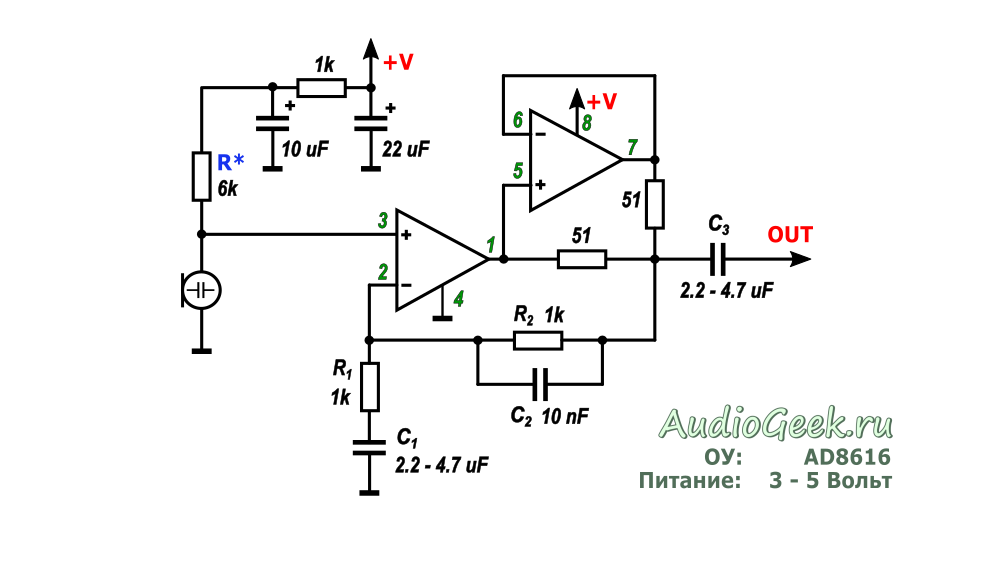

## **Выбор ОУ**

Выбор ОУ в предусилитель для микрофона сильно зависит от источника питания. Если предполагается питание от 9 вольтовой кроны, то в таком случае подойдет большинство распространенных ОУ. Но мне с самого начала хотелось использовать литиевый аккумулятор формата 18650. Во-первых у них хорошая емкость, во вторых их легко заряжать при помощи ***[готовых модулей](../kontroller-zaryada-li-ion-modul/)***.
Поэтому на роль ОУ в предусилителе был выбран AD8616. Отличные, недорогие и доступные сдвоенные ОУ. Но главное это то, что работают они в диапазоне напряжений питания от 2.5 до 5 Вольт, что просто идеально для литиевого аккумулятора и портатива в целом.
Единственным минусом может стать то, что они не выпускаются в dip корпусе. Но тут мне на помощь пришли ***[переходники SO-8 в DIP8](../so8-to-dip8/)***, которые я когда-то заказывал с АлиЭксперсс. Заказывал в ***этом магазине***.

## **Печатная плата**

После того, как я определился со схемой и опробовал ее на макете, пришла пора запилить печатную плату. Я уже несколько лет не делал печаток, но на удивление все получилось проще, чем я думал. Платы я развожу в P-CAD, поэтому нарисовал по быстрому схему и спустя несколько часов залипания в комп получил готовую печатку.
Плата была упакована в размеры 20х45мм. Такие размеры получились из-за выбранного корпуса, но они видятся мне удобными практически для любого корпуса. Указанные размеры соответствуют нарисованной по периметру полоске.
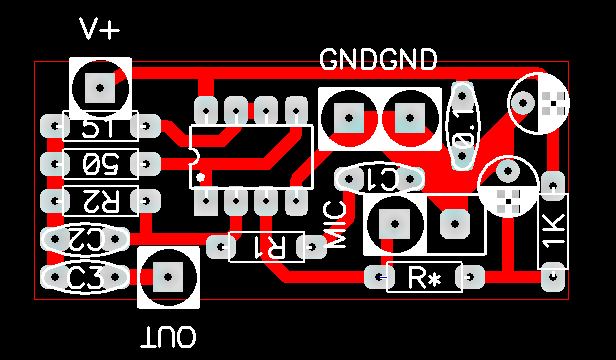
Скачать печатную плату предусилителя для микрофона вы можете по одно из ссылок ниже. Плата сохранена в формате ПДФ и готова к печати.

- [***Скачать печатную плату***](./Mic_amp_PCB.pdf)
- [***Скачать печатную плату (зеркальную)***](./Mic_amp_PCB_MIRROR.pdf)

Я сделал два варианты платы, разница лишь в том, что первая как на рисунке выше, а вторая зеркальная. В случае использования зеркальной платы, после переноса она станет нормальной и детали следует располагать со стороны дорожек.

## **Изготовления платы ЛУТом.**

Говоря, что лучше всего платы получаются при печати на страницах плейбоя. Раньше я так и делал, но в последнее время перешел на глянцевую с одной стороны бумагу. Жалко переводить интересные статьи на непонятно что….
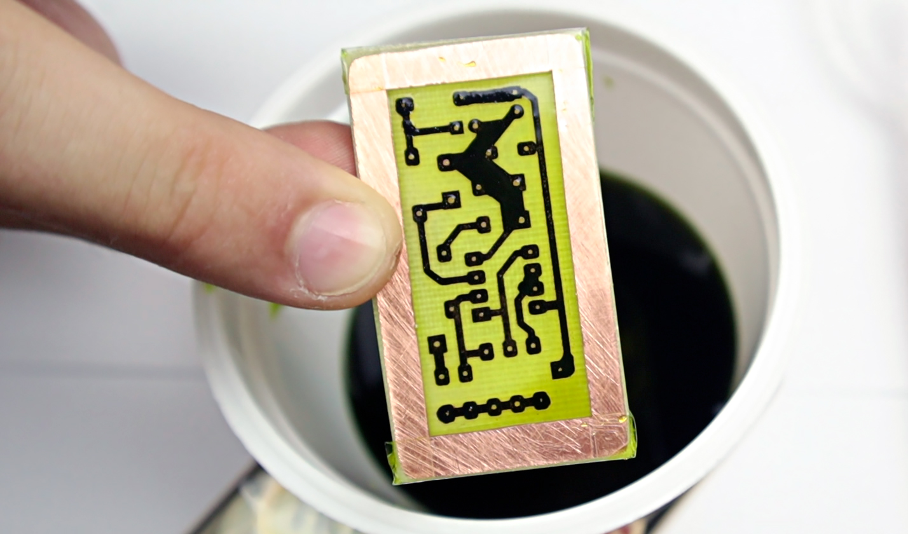
В целом технология ЛУТ итак всем известна, и в ролике она показана, поэтому остановлюсь только на двух моментах.

- Прожарку утюгом я делаю в течении минуты, а после закидываю плату в ближайшую книжку и встаю на книжку всем весом на 1-2 минуты.
- Широкие места и дефекты переноса или печати я всегда промазывал перманентным маркером. В этот раз вместо перманентного маркера я воспользовался акриловым. При этом я ждал высыхания минут 10-15. Тем не менее он отлично справился и под ним ничего не травилось.

## Подбор резистора *R\**

Сопротивление резистора ***R\**** сильно зависит от капсюлей. Для того чтобы подобрать резистор я сначала впаял многооборотный переменный резистор.
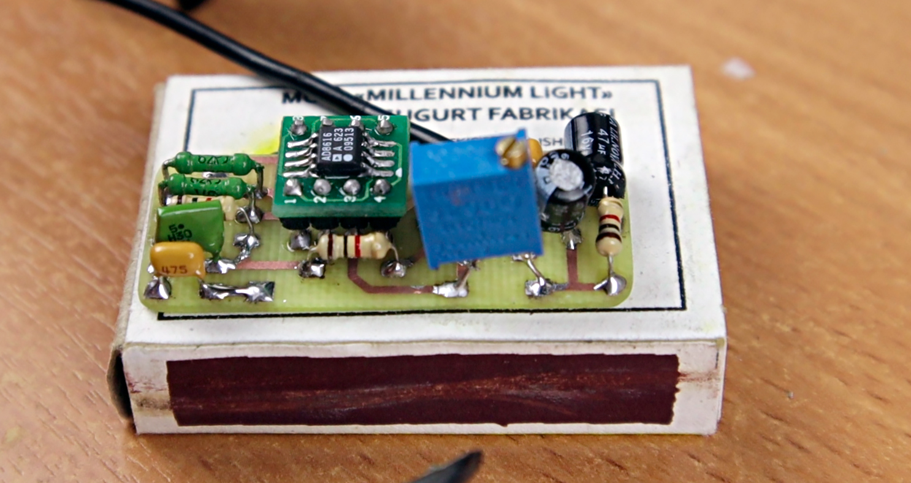
Покрутил его до нужного напряжения и отпаял. Сопротивление резистора составило ровно *6 кОм*. Которого у меня не оказалось и пришлось собирать его из двух.
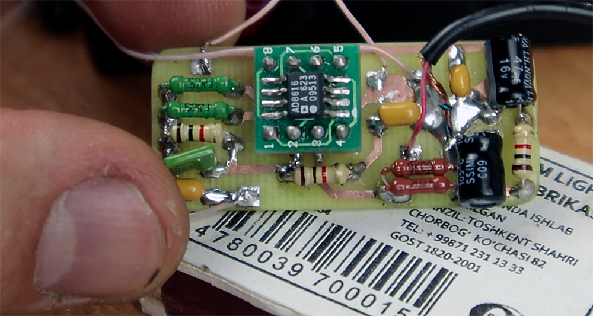
> **Однако, в случае с другими капсюлями, сопротивление может быть и *2 кОм* и *8 кОм*. Поэтому тут все очень индивидуально.**

## **Корпус усилителя для микрофона**

Теперь пару слов о корпусе. Для этих целей я использовал корпус от вэйпа. Он уже давно валялся у меня в шкафу и ждал своей участи. Он оказался просто идеальным вариантом, т.к. располагает отсеком для аккумулятора и имеет отверстия, которых мне будет достаточно для счастья.
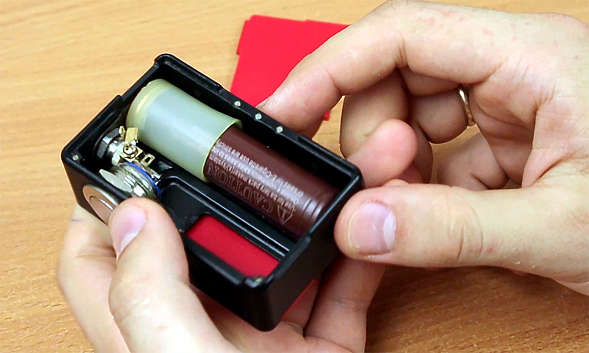
Для начала я выкинул из него все что напоминает о его происхождении, а так же достал и прочистил контакты для аккумулятора. После этого на место кнопки был установлен выключатель от настольной лампы. Он идеально подошел по размеру, потребовалось только сделать пропил под фиксатор.
Для того чтобы минимизировать уровень шумов от предусилителя я решил экранировать корпус. Для этого в съемные стенки корпуса я вырезал кусочки медной фольги которые приклеил на двусторонний скотч. Впоследствии их я соединю с минусом аккумулятора.
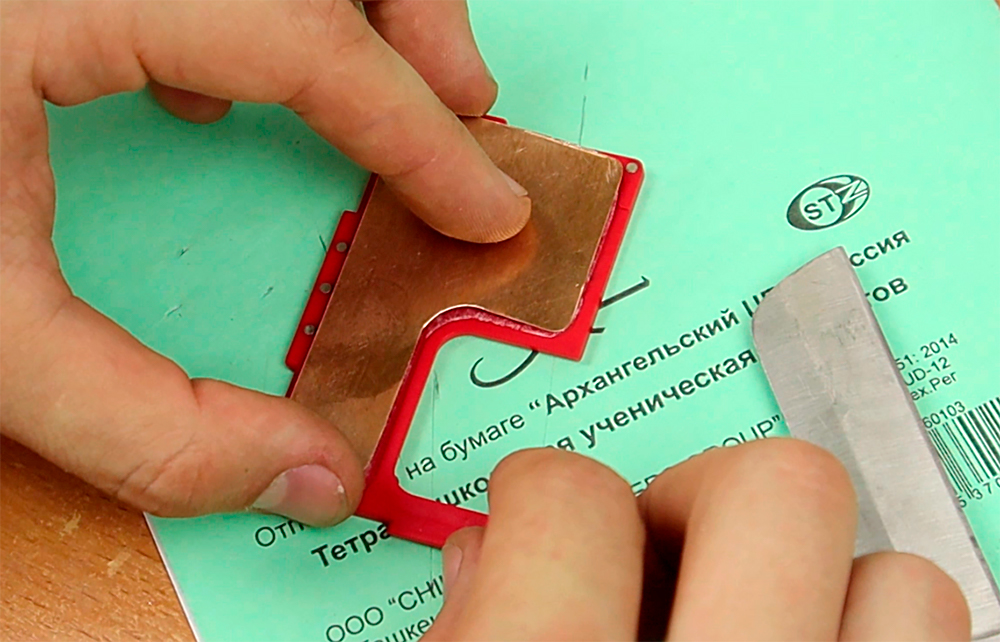
Единственное, что меня смущало в этом корпусе, так это отверстие на передней панели. Но оно сыграло мне даже на руку.
Из оргстекла я вырезал вставку, которую приклеил к крышке. Она не только закрывала имеющуюся дырка но так же была призвана демонстрировать синий светодиод намекающий на включенность устройства.
Чтобы как-то разнообразить вставку, а заодно усилить свечение я выгравировал на ней символичное изображение микрофона. Теперь, даже издалека и при ярком свете, я всегда смогу увидеть включен ли мой микрофон.
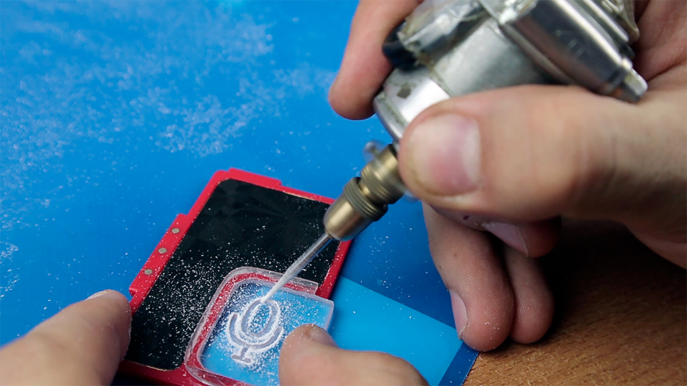
Ну а теперь остается продеть провода через отверстие и подпаять их к плате.

## **Заключение**

Вот такой вот получился предусилитель для микрофона. Я очень доволен получившимся результатом. Использование такого усилителя позволило свести к минимуму обработку звуковой дорожки. В видео по теме я вообще не обрабатывал звук. Он итак звучит очень хорошо. Поэтому если вы еще не смотрели ролик, но заинтересованы в таком предусилителе – советую вам это сделать. Иначе что, зря я старался?))
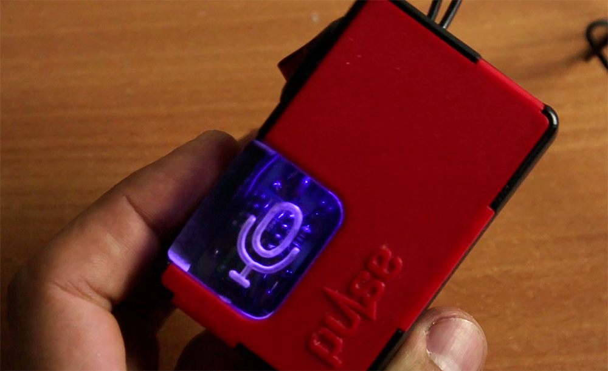
Единственное, что я бы сделал с голосом на пост обработке – наложил бы компрессию для большего удобства слушателя. В остальном голос звучит очень ровно и натурально. Даже несмотря на использование довольно дешевой петлички с непонятно каким капсюлем.
В планах прикупить нормальный оригинальный капсюль, например Phuillips 61A и радоваться жизни.
***Спасибо за внимание, всем хорошего звука!***

**Статья подготовлена исключительно для сайта [AudioGeek.ru](https://audiogeek.ru/)**
