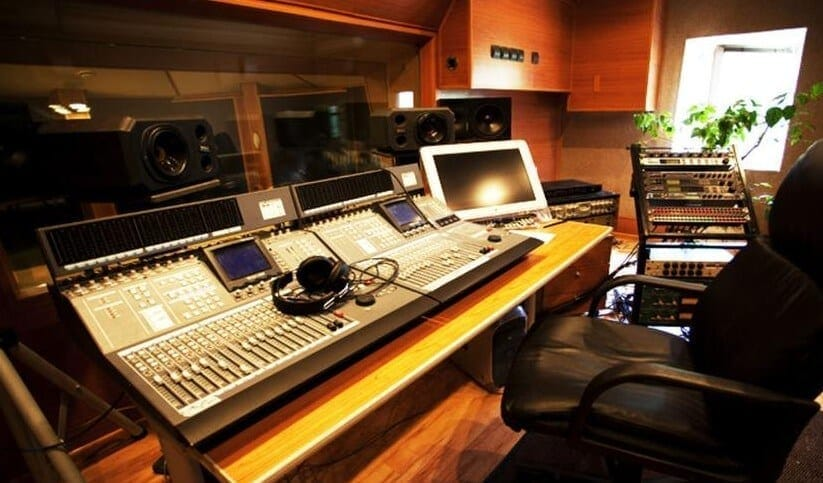
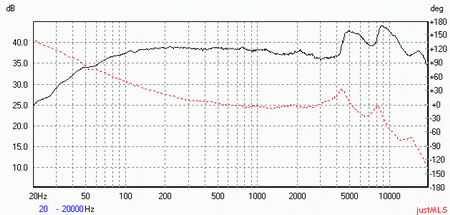
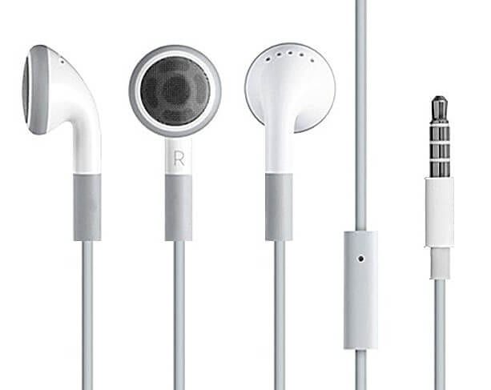
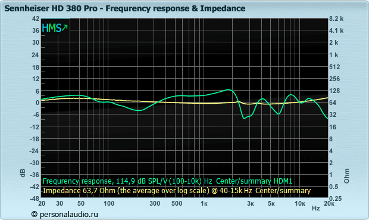
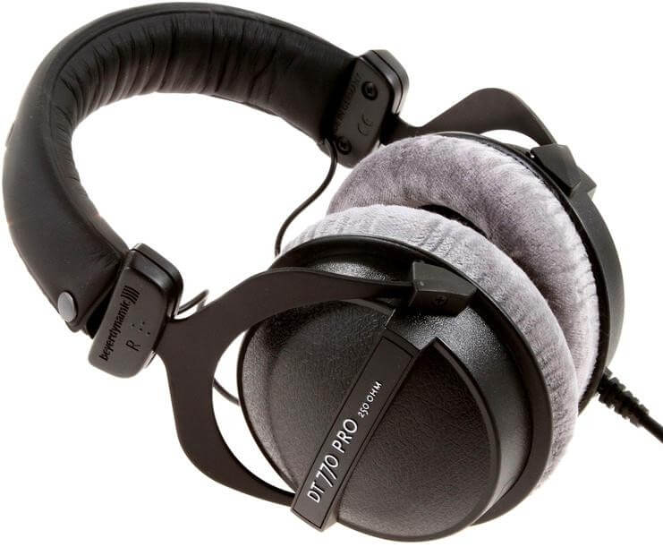
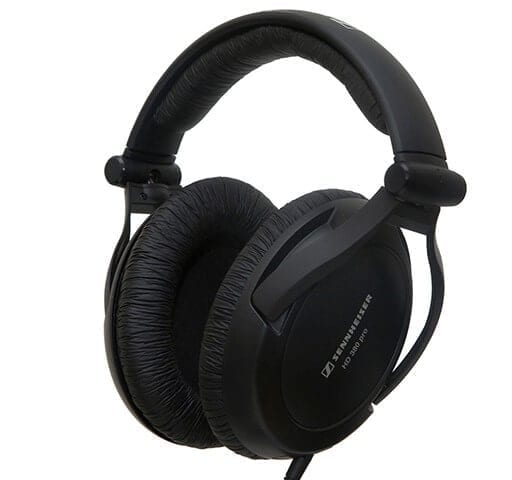
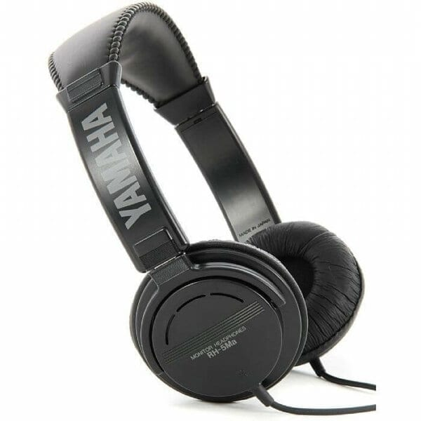
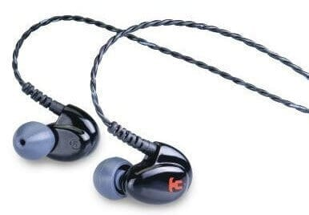
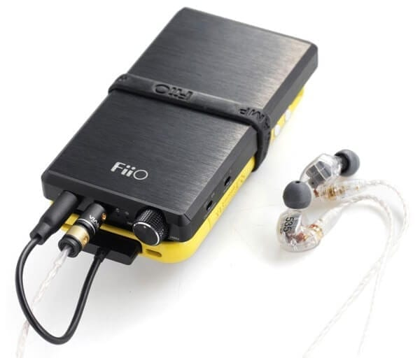

[Русский](./README.ru.md) | **English**

# Studio monitor headphones: what makes them special

**Category:** Headphone types, Misc  
**Original:** https://audiogeek.ru/monitoring-headphones/

---

We are used to thinking that if something is professional, it is definitely better than other similar things. But is that always so? Quite often in headphone descriptions you come across the phrase "monitor headphones". The model names may also contain the words "Pro" or "Professional", which many take as a sign of quality. Is that really so, and what does the label ***professional*** or ***monitor headphones*** on the box mean?
> **Too lazy to read? Watch my video:**

> ▶ **[Watch the video on YouTube](https://www.youtube.com/watch?v=vNdL0janAxM)**

## **What are monitors?**

Before talking about monitor headphones, a couple of words are needed on what monitors are.

Monitors are speakers placed in front of musicians, pointed at them. They are used so that musicians can hear themselves during a performance. These are the very speakers at the front of the stage that rock musicians like to put their feet on for added gravitas.

## **Who are monitor headphones for?**

> The term ***monitor headphones*** comes from "to monitor", or monitoring, i.e. control. For headphones, monitoring means checking the sound while recording, processing and mixing.

That is, such headphones are intended for sound engineers, sound operators and other professions whose work is inseparably tied to recording and processing music and sound. That is what the label "professional headphones" indicates.

And since such headphones are most often used in studios, they also got another name: studio headphones.

> Speakers used in studios are called studio monitors. They are used for the same tasks as monitor headphones.

But for headphones to proudly call themselves professional, a label on the box is not enough. They must have certain qualities that distinguish them from headphones for music or ***gaming headphones***.

## Flat frequency response

First of all, monitor headphones must have a flat frequency response. This is a very important fact in sound processing. Headphones must not "color" the sound.

***Frequency response of the Beyerdynamic DT880 (black line) (taken from [www.ferra.ru](https://www.ferra.ru/ru/multimedia/s25739/page-3/))***
***Not the best frequency response for monitor headphones. A rolloff below 100 Hz, two humps in the highs...***

Imagine headphones with slightly lowered bass were used during recording. As a result the sound engineer will add bass while processing the recording.

But not all listeners use exactly the same headphones. As a result, those whose headphones already have raised bass will get an excess of bass, and it will probably even drone.

In general, decent audio equipment makers always try to give their audio devices a flat frequency response. With headphones, though, the sound is often colored, raising the lows and highs. This is done to please the average user.

Also, most phones alter the sound quite strongly with various "enhancers". A familiar example of bright sound is the headphones from the fruit company.

For this reason, if you use monitor headphones to listen to music, many people will find it more boring, bland and, as is often said, "sterile". Do not expect pounding bass or highs. There will be exactly as much of them as the sound engineer planned.

By ear it may even seem that the midrange is emphasized, because that is the most audible part of the human hearing range. And many monitor headphones (for example the Sennheiser HD380 Pro) often have specially raised mids for convenience when working with vocals, so vocals, guitar and many acoustic instruments will be slightly emphasized. Which I personally like very much.

***Frequency response of the Sennheiser HD 380 Pro (green line) (taken from [personalaudio.ru](http://personalaudio.ru/raa/otchety/naushniki/sennheiser-hd-380-pro/)). These headphones are considered one of the reference models among monitors. The 500–2000 Hz hump is convenient for working with vocals, and with a full frequency range of 8 Hz–27 kHz the response is practically flat.***

---

## High detail

Studio headphones must have a high level of detail. The sound engineer must hear everything, even the smallest flaws in the recording. For music of any complexity, especially with many instruments, each one must be clearly distinguishable and localized.

So with plain listening to music, this leads to many monitor headphones exposing the flaws of audio formats, especially compressed ones such as the universally loved MP3.

---

## Sensitivity, impedance, sound source

Studios use stationary equipment powered from the mains with enough power in reserve. So the designers of monitor headphones are not faced with the task of providing high sensitivity.

To fully "drive" monitor headphones you usually need a solid amplifier able to provide sufficient power. This applies especially to low frequencies. In any case an ordinary phone cannot drive monitor headphones such as the Beyerdynamic DT 770 Pro or Sennheiser HD 380 Pro.

***Beyerdynamic DT 770 Pro (~$180): full-size closed studio headphones.***

The headphones shown above have an impedance of 250 Ω, almost ten times the standard 32 Ω. And that is common for professional headphones. A higher impedance can give better sound. It is also a lighter current load for the amplifier.

> Some manufacturers have two or even three versions of one headphone model that differ only in impedance. The Beyerdynamic headphones shown above exist in 3 variants, with impedances of 32, 80 and 250 Ω.

The higher the headphone impedance, the more voltage the headphone amplifier must be able to deliver to drive them. Most portable devices are powered by batteries at 3.6 volts, and cannot provide a voltage higher than the supply.

For example, to drive TDS-5 isodynamic headphones (Soviet-made), whose impedance is about 90 Ω, a voltage above 5–6 volts peak-to-peak is needed. So for portable use you should definitely look toward lower-impedance headphones.

## Studio headphone designs

As a rule, monitor headphones are made full-size, i.e. they fully surround the outer ear. In such headphones you can easily sit for several hours without any discomfort at all. Read more about headphone types in ***[this article](../headphones-types/)***.

***Sennheiser HD 380 Pro (~$150): full-size headphones surrounding the whole outer ear.***

But the term "monitor" does not oblige headphones to be full-size. The on-ear Yamaha RH-5MA are also monitor headphones. A proud label on the box and on the cups of the headphones themselves even says so. These headphones were originally developed by the company for use with a synthesizer.

***Yamaha RH-5MA (~$50): on-ear monitor headphones with a semi-open design***

Professional headphones can have either a closed or an open design. If headphones are used by a singer when recording vocals, they definitely must be closed-back. Otherwise the microphone will pick up their sound.
Sound engineers in a studio, however, may prefer an open design, since it conveys the depth and width of the soundstage better. There are also intermediate models, such as the Yamahas shown above.
Read more about this in the article: ***[Open-back and closed-back headphones: which is better for what](../open-close-headphones/)***

### IEM headphones

But even that is not all. IEM headphones are gaining popularity now. The abbreviation stands for In-Ear Monitors.

These are in-ear buds that match full-size headphones in sound quality and are made for professional purposes. This is already an independent and interesting kind of headphones, which will be covered separately.

## Price

As a rule, prices for studio headphones are quite steep. That is understandable: manufacturers often have to spend a huge amount of time on research and go for complex, expensive technical solutions to reach the desired characteristics.
An example of such a solution is platinum sputtered on the inner surface of the dome (the central part) of the driver diaphragm to give it greater stiffness and strength.
Another example is the Sennheiser HD 380 Pro mentioned earlier, which has a rather complex system of sound tubes, pedantically calculated by German engineers, thanks to which such a flat frequency response is obtained. You can see their insides in the article: **[Taking apart and lightly damping the Sennheiser HD 380 Pro](../dempf-senhi-hd380pro/)**
Of course the price of these headphones is justified. Though the complication and rising cost of technology do not always lead to a significant gain in sound. And the brand and marketing costs strongly influence the price tag too.
Here an alternative can be suggested: the little-known Chinese company ***Superlux***, whose popularity is growing every day. The company specializes in high-quality audio equipment.
The engineers take studio headphones of world brands as a basis and, with minimal changes, create their own models as close in characteristics to the originals as possible. The price tag drops 3–5 times. Excellent budget monitor headphones are the ***HD668b***.

## CONCLUSION

Monitor or professional headphones can easily be used by mere mortals too, if they are ready to pay the required sum. One way or another, such headphones, like any other quality headphones, also need a quality signal source. Its cost will be comparable to the cost of the headphones themselves or even exceed it.

For portable use you can use players with a built-in amplifier. True, the price tag of many such players can run to three digits. But many manufacturers have more budget solutions in their lines, such as the HiFiMan HM-601 ($250) or Fiio X3 ($230).

***HiFiMan HM-601***

Buying a player and a separate external amplifier will cost less. But then you pay by carrying a "sandwich" in your pocket and charging two devices.

In any case the choice is always yours. If you decide to buy monitor headphones, it is better to find a way to listen to them first. And listen on the device you will listen on later. When searching for "your sound", it is better to operate not with the price tag and forum comments but with your own impressions of what you hear.

**Good sound to everyone!**

*Originally written for [AudioGeek.ru](https://audiogeek.ru). Translated from Russian.*
