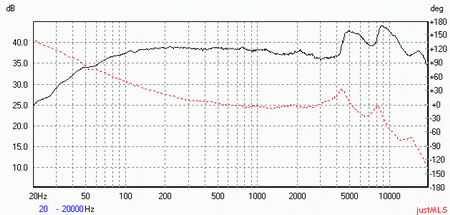
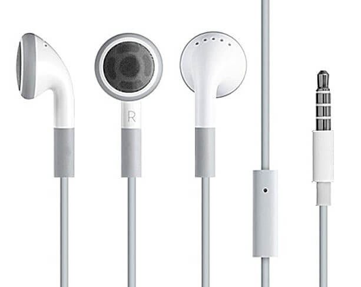
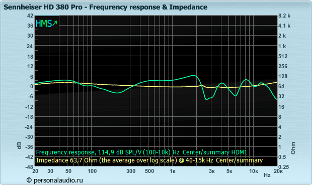
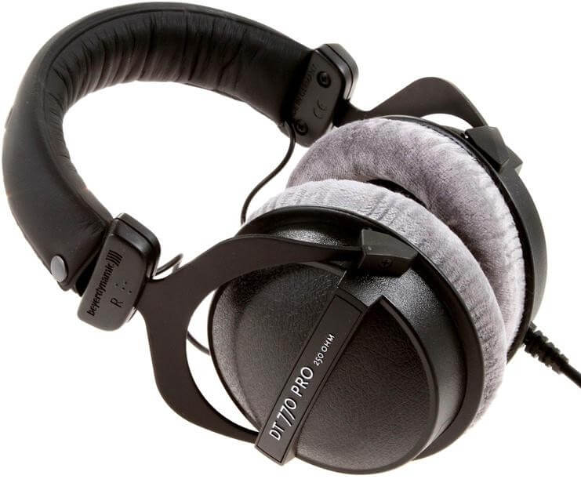
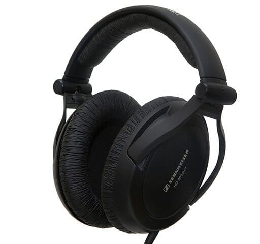
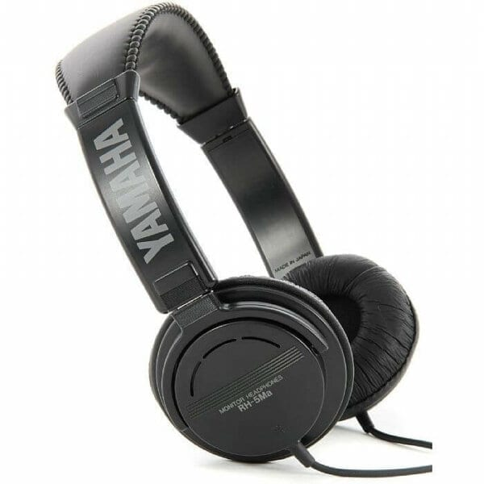
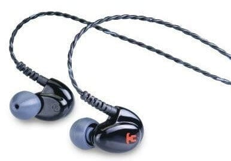
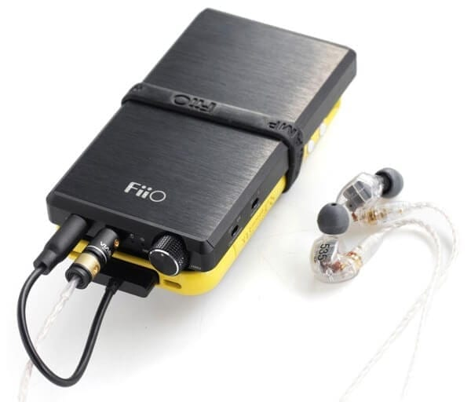

[English](./README.md) | **Русский**

# Мониторные наушники, в чем их особенность и отличия

**Дата:** 2017-10-04  
**Рубрики:** Виды и типы наушников, Разное  
**Оригинал:** https://audiogeek.ru/monitoring-headphones/

---

Мы привыкли, что если вещь профессиональная, то значит она определенно лучше других таких же. Но всегда ли это так? Достаточно часто в описаниях наушников можно наткнуться на такое словосочетание, как мониторные наушники. При этом в названии моделей могут присутствовать слова "Pro" или "Professional", которые многими воспринимаются как знак качества этих наушников. Так ли это на самом деле и что обозначает надпись ***профессиональные*** или ***мониторные наушники*** на коробке?
> **Лень читать? Смотри мое видео:**

> ▶ **[Смотреть видео на YouTube](https://www.youtube.com/watch?v=vNdL0janAxM)**

## **Что такое мониторы?**

Прежде чем говорить о мониторных наушниках стоит сказать пару слов о том что такое мониторы.

Мониторы - это колонки, которые устанавливаются перед музыкантами, направленные на них же. Используются для того, чтобы музыканты могли слышать самих себя при выступлении. Это те самые колонки, впереди сцены, на которые так любят вставать ногами рок-музыканты для большей солидности.

## **Для кого предназначены мониторные наушники?**

> Понятие ***мониторные наушники*** происходит от "*мониторить*" или мониторинг, т.е. контроль. В случае же наушников под мониторингом понимается контроль звука при записи, обработке, сведении.

Т.е. такие наушники предназначаются для звукорежиссеров, звукооператоров и других профессий, чья деятельность неразрывно связанна с записью и обработкой музыки и звука. Об этом и свидетельствует надпись профессиональные наушники.

Ну и т.к. такие наушники чаще всего используются в студиях, то за ними закрепилось еще одно название - студийные наушники.

> Колонки, используемые на студиях называются студийными мониторами. Их используют для тех же задач, что и мониторные наушники.

Но для того чтобы наушникам гордо называться профессиональными не достаточно просто надписи на коробке. Они должны обладать определенными качествами, которые и отличают их от наушников для музыки или ***игровых наушников***.

## Линейная АЧХ

В первую очередь мониторные наушники должны обладать линейной АЧХ. Это очень важный факт при обработке звука. Наушники не должны "красить" звук.

***АЧХ наушников Beyerdynamic DT880(черная линия) (взята с сайта [www.ferra.ru](https://www.ferra.ru/ru/multimedia/s25739/page-3/))*** 
***Не самая лучшая АЧХ для мониторных наушников. Завал ниже 100 Гц, два горба на высоких...***

Представим, что при записи использовались наушники, у которых слегка приспущены низкие частоты. Как результат,  звукорежиссер при обработке записи их(басы) добавит.

Но ведь не все слушатели пользуются точно такими же наушниками. Как результат - у тех, в чьих наушниках низкие частоты и без того приподняты, басы буду с избытком и вероятно будут даже гудеть.

Вообще, нормальные производители аудиотехники всегда стараются, чтобы их аудиоустройства имели линейную АЧХ. Однако в случае наушников, часто их звук делают окрашенным, поднимая низкие и высокие частоты. Делается это чтобы угодить среднестатистическому пользователю.

Так же большинство телефонов достаточно сильно изменяют звук различными улучшайзерами. В качестве знакомого всем примера яркого звука можно привести наушники от яблочной компании.

По этой причине, если использовать мониторные наушники для прослушивания музыки, то многим она покажется более скучной, пресной и, как часто говорят, "стерильной". Тут не стоит ждать долбящих басов или верхов. Их будет ровно столько, сколько запланировал звукорежиссер.

На слух скорее даже покажется, что выделена середина. Т.к. именно она самая слышимая часть диапазона человеческого слуха. Да и у многих мониторных наушников(например у Sennheiser HD380 Pro), зачастую, средние частоты специально приподнимают для удобства работы с вокалом, поэтому вокал, гитара и многие акустические инструменты будут слегка выделены. Что лично мне очень по вкусу.

***АЧХ Sennheiser HD 380 Pro (зеленая линия) (взята с сайта [personalaudio.ru](http://personalaudio.ru/raa/otchety/naushniki/sennheiser-hd-380-pro/))  Эти наушники считаются одними из эталонных среди мониторных. Горбик 500-2000Гц удобен для работы с вокалом, а полный частотный диапазон 8 Гц-27кГц, АЧХ практически линейна.***

---

## Высокая детализация

Студийные наушники должны обладать высоким уровнем детализации. Звукорежиссер должен слышать все, даже самые мельчайшие огрехи в записи. Так же для музыки любой сложности, особенно с большим количеством инструментов, каждый из них должен быть отчетливо различим и локализован.

Поэтому при простом слушании музыки это приводит к тому, что многие мониторные наушники выделяют огрехи звуковых форматов, особенно сжатых, вроде всеми любимого MP3.

---

## Чувствительность, сопротивление, источник звука

В студиях используются стационарная аппаратура, питающаяся от сети и имеющая достаточный запас по мощности. Поэтому перед разработчиками мониторных наушник не стоит задача обеспечения высокой чувствительности.

Для полноценной "раскачки" мониторных наушников, как правило, нужен добротный усилитель, способный обеспечить достаточную мощность. Особенно это касается низких частот. В любом случае обычный телефон не сможет раскачать мониторные наушники, такие как Beyerdynamic dt 770 Pro или Sennheiser HD 380 Pro. 

***B**eyerdynamic dt 770 Pro (~180$) - полноразмерные закрытые студийные наушники.***

Показанные выше наушники обладают сопротивлением в 250 Ом, что почти в десять раз больше стандартного сопротивления в 32 Ома. И это частое явление для профессиональных наушников.На более высоком сопротивление можно получить лучший звук. К тому же это меньшая нагрузка для усилителя по току.

> У некоторых производителей встречаются по две, а то и три версии одной модели наушников, отличающихся только сопротивлением. Показанные выше наушники от Beyerdynamic существуют в 3 вариантах, с сопротивлением 32, 80 и 250 Ом.

Чем больше сопротивление наушников, тем большее напряжение должен уметь выдать усилитель для наушников, чтобы их раскачать. Большинство портативных устройств питаются от аккумуляторов, напряжением в 3.6 Вольта, а обеспечить напряжение выше напряжения питания они не могут.

Для примера, для раскачки изодинамических наушников ТДС-5, сопротивление которых около 90 Ом требуется напряжение выше 5-6 вольт в размахе. Поэтому для портатива определенно стоит смотреть в сторону более низкоомных наушников.

## Конструкции студийных наушников.

Как правило, мониторные наушники делают полноразмерными, т.е они целиком обхватывают ушную раковину. В таких наушниках можно легко просидеть несколько часов, абсолютно не испытывая никакого дискомфорта. Подробнее о типах наушников читайте в ***[этой статье](../headphones-types/)***.

***Sennheiser HD 380 Pro(~150$) - полноразмерные наушники, охватывающие всю ушную раковину.***

Но понятие мониторные не обязует наушники быть полноразмерными. Накладные наушники Yamaha RH-5MA так же являются мониторными. Об этом даже свидетельствует гордая надпись на коробке и чашах самих наушников. Исходно эти наушники разрабатывались компанией для применения с синтезатором.

***Yamaha RH-5MA(~50$) - накладные мониторные наушники с полуоткрытой конструкцией***

При этом профессиональные наушники могут иметь как закрытую так и открытую конструкцию. Если наушники используются певцом при записи вокала, то они определенно должны обладать закрытой конструкцией. Иначе микрофон будет улавливать их звук.
А вот звукорежиссеры в студии могут предпочитать открытую конструкцию, т.к. она лучше передает глубину и ширину сцены. Существуют так же и промежуточные модели, например показанные выше Ямахи. 
Подробнее об этом читайте в статье: ***[Открытые наушники и закрытые наушники, какие и для чего лучше](../open-close-headphones/)***

### IEM - наушники

Но даже это еще не всё. Сейчас всё большую популярность набирают IEM-наушники. Эта аббревиатура расшифровывается как In-Ear-Monitors, что дословно можно перевести как - внутриушные мониторы.

Это затычки, которые по качеству звука не уступают полноразмерным и создаются для профессиональных целей. Это уже самостоятельная интересная разновидность наушников, которая будет рассмотрена отдельно.

## Стоимость

Как правило, цены на студийные наушники довольно кусачие. Оно и понятно, зачастую производителям приходится тратить уйму времени на исследования и идти на сложные дорогостоящие технические решения для достижения желаемых характеристик.
Примером такого решения может быть напыление платины на внутреннюю поверхность купола(центральная часть) диффузора динамика для придания ей большей упругости и прочности.
Другой пример - упомянутые Sennheiser HD 380 Pro, которые имеют довольную сложную систему звуководов, педантично рассчитанную немецкими инженерами, благодаря которой и получается такая линейная АЧХ. Их внутренности можно посмотреть в статье: **Разбор и легкое демпфирование Sennheiser HD 380 Pro**
Конечно стоимости этих наушников оправдывают себя. Хотя и не всегда усложнение и и удорожание технологии приводит к значительному приросту в звуке. Да и бренд с маркетинговыми расходами оказывают сильное влияние на ценник.
Тут можно предложить альтернативу - малоизвестная китайская компания ***Superlux*,** популярность которой растет с каждым днем. Компания специализируется на выпуске высококачественной аудио аппаратуры. 
Инженеры берут за основу студийные наушники мировых брендов, и с минимумом изменений, создают собственные модели, максимально приближенные по характеристикам к оригиналам. Ценник при этом уменьшается в 3-5 раз. Отличные бюджетные мониторные наушники ***HD668b***.

## ЗАКЛЮЧЕНИЕ

Мониторными или профессиональными наушниками легко могут пользоваться и простые смертные, готовые выложить требуемую сумму. Так или иначе, для подобных наушников, как и для любых других качественных наушников требуется и качественный источник сигнала. Стоимость которого будет сопоставима со стоимостью самих наушников или даже превосходить ее.  

Для портативного использования можно использовать плееры со встроенным усилителем. Правда ценник многих подобных плееров может переваливать трехзначное число. Но у многих производителей есть более бюджетные решения в линейках, например такие как HiFiMan HM-601(250$) или Fiio X3 (230$).

***HiFiMan HM-601***

Дешевле обойдется покупка плеера и отдельного внешнего усилителя. Но в таком случае придется расплачиваться тасканием бутерброда в кармане и зарядкой уже двух устройств.

В любом случае выбор всегда за вами. Если вы решили прикупить мониторные наушники, то лучше найти способ их послушать. И послушать с того устройства, с которого будите слушать в дальнейшем. При поисках “своего звука”, лучше оперировать не надписью на ценнике и комментариями на форумах, а собственными впечатлениями от услышанного.

**Всем хорошего звука!**

**Материал подготовлен исключительно для сайта [AudioGeek.ru](https://audiogeek.ru)**
