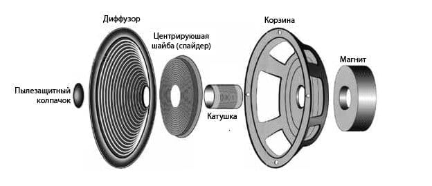

[Русский](./README.ru.md) | **English**

# Can low speaker efficiency be a good thing?

**Published:** 2017-04-24  
**Category:** Misc, Speaker components  
**Tags:** sound quality  
**Original:** https://audiogeek.ru/nizkiy-kpd-dinamika/

---

As industry and technology developed, driver manufacturers competed fiercely to raise the efficiency of the drivers they made. They resorted to all kinds of technical tricks for it. That competition continues now and has its reasons, for example in portable devices. However, as early as the 1970s, large driver manufacturers began making drivers whose efficiency was deliberately lowered by up to 10 times. Why make such drivers?...

## Modern drivers

Many have surely noticed that modern loudspeakers sound unnatural. This is mostly caused by the attempt to squeeze decent sound out of a tiny driver. Modern composite materials are used for this. However, low efficiency, which used to be considered a big drawback, has gradually turned into a means of achieving high fidelity. Of course, deliberately lowering driver efficiency is not a goal in itself but a consequence of manufacturers' pursuit of high-quality reproduction. This is what is now fashionably called Hi-End.

## Why deliberately lower driver efficiency:

**-1-** In pursuit of high fidelity, in recent years bass reflex enclosures and acoustic labyrinths are being abandoned more and more often. The drivers are placed only on the front of the speaker, and the back is made airtight, that is, a "closed box" design is used. This definitely lowers efficiency, but gives a much more natural and realistic bass, especially around the driver's own resonance.

**-2-** To reduce distortion at low frequencies, where the driver's operation turns into piston mode, the voice coil is made longer so that both of its ends extend beyond the magnetic gap. In this case the coil winding moves through a uniform magnetic field, but the electrical power actually used in it goes down.

**-3-** To reduce distortion and parasitic resonances caused by local deformations, the cone of woofers is made less stiff and thicker. This increases its mass and requires more electrical power to set it in motion.

**-4-** Designers often deliberately reduce the magnetic flux density in the gap to some optimal value. Although the usual aim is the opposite, strangely enough, lowering the flux density benefits the sound and helps unwanted high-frequency oscillations die out faster.

The examples listed do not exhaust all the techniques and considerations behind reducing driver efficiency. But they clearly show what compromises can be made for the sake of high fidelity.

*Originally written for [AudioGeek.ru](https://audiogeek.ru). Translated from Russian.*
