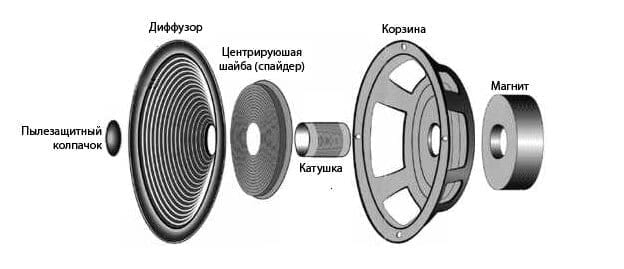

[English](./README.md) | **Русский**

# Низкий КПД динамиков может быть полезен?

**Дата:** 2017-04-24  
**Рубрики:** Разное, Элементы АС  
**Метки:** качество звука  
**Оригинал:** https://audiogeek.ru/nizkiy-kpd-dinamika/

---

По мере развития промышленности и совершенствования технологий, между производителями динамических головок шла серьезная конкуренция за повышение показателя КПД динамиков, производимых ими. К каким только техническим уловкам не прибегают ради этого. Эта конкуренция продолжается и сейчас и имеет свои основания, например при использовании в портативной технике. Однако еще в 70-е годы крупные фирмы, производящие динамики, начали выпускать динамики с КПД специально заниженным до 10 раз.  Для чего же делать такие динамики?...

## Современные динамики

Наверняка многие замечали что современные громкоговорители звучат ненатурально. Вызвано это по большей части стремлением выжать из малюсенького динамика сносный звук. Для этого используют современные композитные материалы. Однако, низкий КПД, который раньше считался большим недостатком, постепенно превратилось в средство достижения высокой верности воспроизведения. Конечно искусственное снижение КПД динамиков это не самоцель, а следствие стремления производителей к высокому качеству воспроизведения. Это, как сейчас модно говорить Hi-End.

## Зачем искусственно снижать КПД динамиков:

**-1-** Стремясь к высокой верности воспроизведения в последние годы все чаще и чаще отказываются от использования корпусов для акустических систем типа “фазоинвертор” а также с акустическими лабиринтами. Громкоговорители располагают только на лицевой стороне акустической системы, а заднюю часть делают герметичной, т.е. Используется конструкция типа “закрытый ящик”. Это определенно снижает КПД, но обеспечивает гораздо более натуральное и естественное звучание низкочастотной составляющей, особенно в области собственного резонанса.

**-2-** Для уменьшения искажений на низких частотах, там где работа динамика переходит в поршневой режим, практикуется увеличение длины подвижной катушки так, чтобы оба ее конца выходили за пределы магнитного зазора. В этом случае намотка катушки пересекает равномерное магнитное поле, однако при этом уменьшается используемая в ней электрическая мощность

**-3-** Для уменьшения искажений и паразитных резонансов вызванных местными деформациями, диффузор НЧ громкоговорителей делается менее упругим и более толстым. Это увеличивает его массу и требует большей электрической мощности для приведения его в движение.

**-4-** Часто конструкторы практикуют искусственное снижение индукции магнитного поля в зазоре до некоторого оптимального значения. Хоть обычно и стремятся сделать обратное, как ни странно снижение индукции благоприятно сказывается на звучании и способствует более быстрому затуханию нежелательных колебаний на высоких частотах.

Перечисленные примеры не исчерпывают всех приемов и соображений связанных с уменьшением КПД динамиков. Однако они отчетливо демонстрируют к каким компромиссам можно прибегать ради высокой верности воспроизведения.
