[Русский](./README.ru.md) | **English**

# How to digitize vinyl records

**Category:** Vinyl  
**Tags:** Audacity, audio processing  
**Original:** https://audiogeek.ru/ocifrovat-vinil/

---

Digitizing vinyl, like digitizing an audio cassette, is not difficult. Here is the whole process, plus some light processing of the resulting recording.

> The screenshots show the Russian-language interface of Audacity. The English menu names are given in the text.

## Connecting the turntable to the computer

If your turntable was made in the USSR, there is a 99% chance its output is a 5-pin DIN connector. If so, you will need to make or buy an adapter from the Soviet DIN plug to the standard 3.5 mm jack.

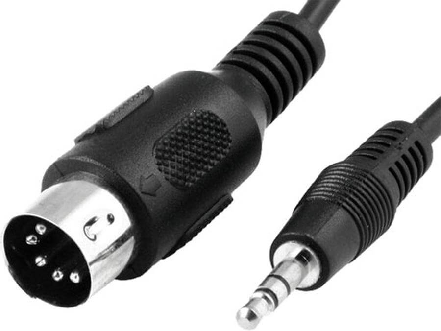

Let us assume you already have one. Great: now connect the turntable to the line input of your computer. If you have a laptop or netbook, use the microphone input.

*We will not go deep into conversion quality. That is a big topic of its own. One of the main factors in digitizing is the quality of your sound card, so if you are not satisfied with the sound, think about a better one.*

If your turntable has any tone controls, set them to the middle position to remove their influence. If there is a volume control, it is best set to maximum.

If the turntable has not been used for a long time, it is worth turning all the controls back and forth a few times to get rid of possible bad contacts and the crackling that comes with them. Also check with the stroboscope that the rotation speed is correct.

***The stroboscope*** is a small illuminated triangle plus special marks on the edge of the platter. If the speed is right, the marks on the platter under the record will appear to "stand still". If not, they will drift. In that case adjust the speed with the speed control.

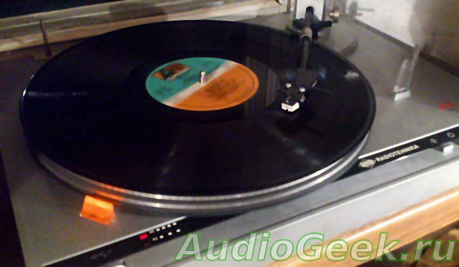

If you use the microphone input, do not set the volume above 100%, or it will be terribly noisy. It is better to try a recording and judge the result.

If the level is too high you will get clipping, that is, the recording is cut off at the top and bottom. In that case lower the volume until the clipping stops. Keep in mind that vinyl, especially old vinyl, has a very large dynamic range, that is, a big spread between the quietest and loudest sounds.

Before digitizing it is advisable to clean the record of dust and other dirt. How to do that is described in the article ***[How to store and wash vinyl records properly](../kak-hranit-vinil/)***.

Now you need a program for recording and some light processing afterwards. In my case that is Audacity, which is free and has all the functions of a full audio editor.

## Recording

To digitize a record, put it on the turntable. Start the turntable and start recording on the computer by clicking the red circle. A new track is created for the recording and, if all is well, you will see the waveform of the sound being recorded.

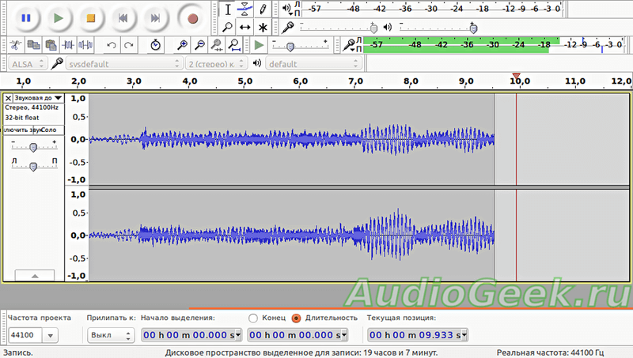

### Recording did not start?

If nothing appears, the microphone input may be disabled in the system sound settings, or its volume may be muted. Another possibility is the wrong input device selected in Audacity's settings. The cause may also be sound card driver problems.

So, the signal is being recorded. Adjust the volume so that it does not go beyond the limits of the track. Do not worry if it looks too small, we will amplify it after recording.

Start the recording on the computer, start the turntable. To stop recording, click the square (Stop). Excellent, we have digitized the vinyl. Now let us even out the volume and clean it up a little.

## Post-processing

Select the whole recording and choose ***Effect → Normalize***. Leave the effect settings at their defaults.

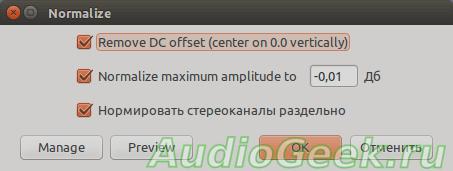

You could export the recording to a convenient format at this point and listen to it. But we will go a little further. As you can see in the picture, my recording has sharp spikes that are louder than the main signal, and one channel is somewhat fatter than the other.

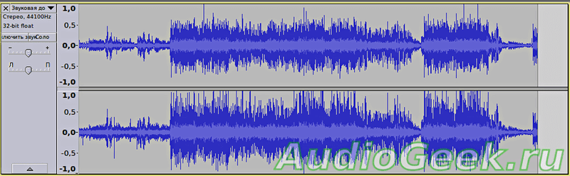

### Removing noise

The recording will almost certainly contain some constant noise, so start by removing it. Select a section containing only noise and go to ***Effect → Noise Reduction***:

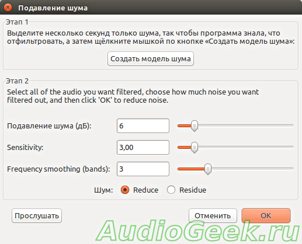

and click "***Get Noise Profile***". Then select the whole recording, open the same effect again and click **OK**. After that it is better to normalize again.

### Click removal

Dust specks have surely landed on the record, or some other supernatural forces have produced clicks that should not be in the recording. So go to ***Effect → Click Removal***:

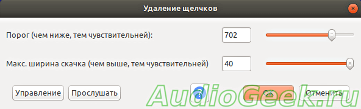

Choose settings that remove as many clicks as possible without harming the recording. Here is how the recording looks after click removal.

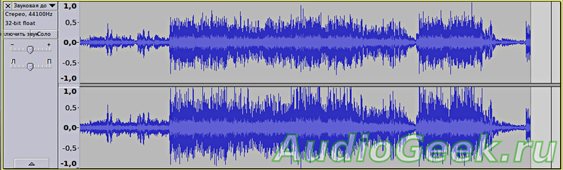

There are fewer spikes, but unfortunately not all of them are gone. Particularly bad cases can be fixed by hand.

To do that, zoom in on the area around the peak and select it. The program may simply not have recognized it as a click, as in this case:

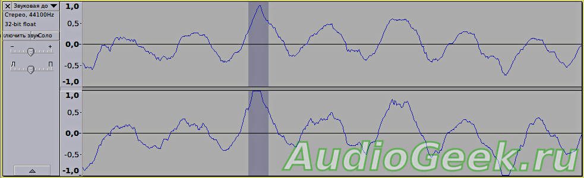

There are two ways to deal with it. The first is to go to ***Effect → Amplify*** and set, say, −6 dB. If that seems too little, you can set −12 dB.

The second is to flatten the peak to zero. The peak lasts a negligible time, and you simply will not hear a difference with or without it, so just silence it.

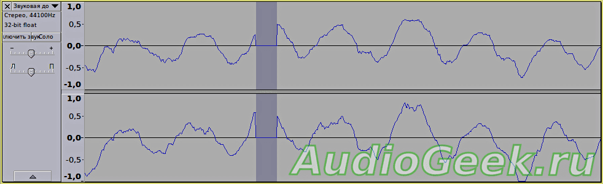

There is a special button for this on the toolbar:

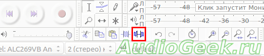

Also, Ctrl+R makes Audacity apply the last used effect again with the same settings.

### Compression

As already noted, recordings from vinyl have a very wide dynamic range, meaning a large difference between the loudest and the quietest sounds. But you can make the recording more "dense", which is more convenient for listening on modern digital players.

First, compression. Compression boosts quiet sounds and attenuates loud ones. Select the recording and go to ***Effect → Compressor***:

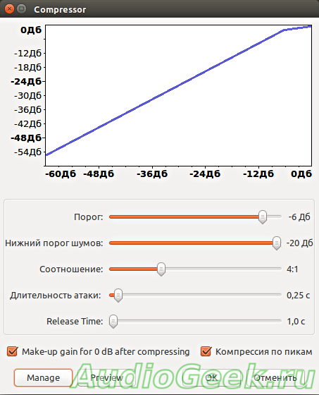

It is better to use the settings from the screenshot. This is fairly light compression. If you want a denser sound, set the threshold to −6 or −9 dB rather than −3 dB, and the ratio to 4:1 or 6:1. All these recommendations are approximate, and you should go by ear first of all.

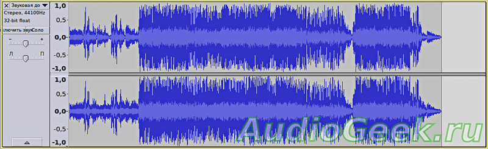

After compression the average volume has gone up, but sharp peaks remain. These peaks are the drums. For those I have one more effect in reserve: the limiter.

A limiter simply cuts everything above a set level. ***Effect → Limiter***

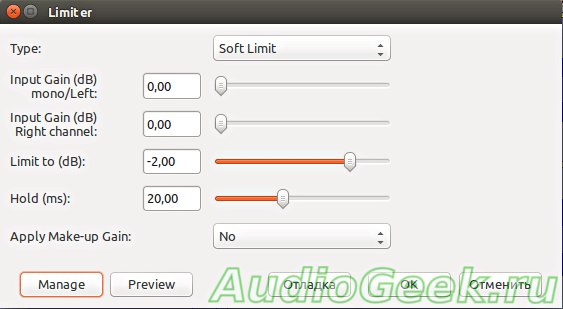

A limiter can cut hard (Hard Limit), but that may cause distortion. A soft limiter rounds the peaks off gently, which is just what we want :). The main thing is that there is no crunchy sound after the limiter, which appears when too much is cut.

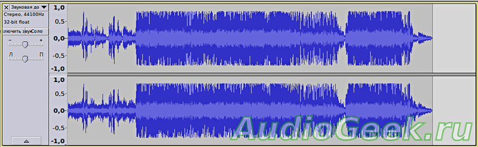

I usually set the level to −3 dB. That means the limiter cuts 3 dB from the top. If you then notice distortion on the former peaks, set −2 or −1 dB. In some cases you can painlessly cut 4–5 dB. The main thing is not to be afraid to experiment!

After the limiter, normalize the recording again to stretch it over the whole range, and export the finished recording to a file.

*Originally written for [AudioGeek.ru](https://github.com/SkyTrip-13/AudioGeek). Translated from Russian.*
