[English](./README.md) | **Русский**

# Как оцифровать винил

**Дата:** 2018-10-08  
**Рубрики:** ВИНИЛ  
**Метки:** Audacity, обработка звука  
**Оригинал:** https://audiogeek.ru/ocifrovat-vinil/

---

Оцифровать винил, как и аудио кассету совсем несложно. Рассмотрим весь процесс оцифровки винила и небольшую обработку полученной записи.

## **Стыкуем проигрыватель с компьютером**

Если ваш проигрыватель произведен еще в ссср, то с вероятностью в 99% в качестве разъема там стоит 5-ти штырьковой тюльпан. Если это так, то потребуется изготовить/купить переходник с советского тюльпана на стандартный сегодня jack 3.5.

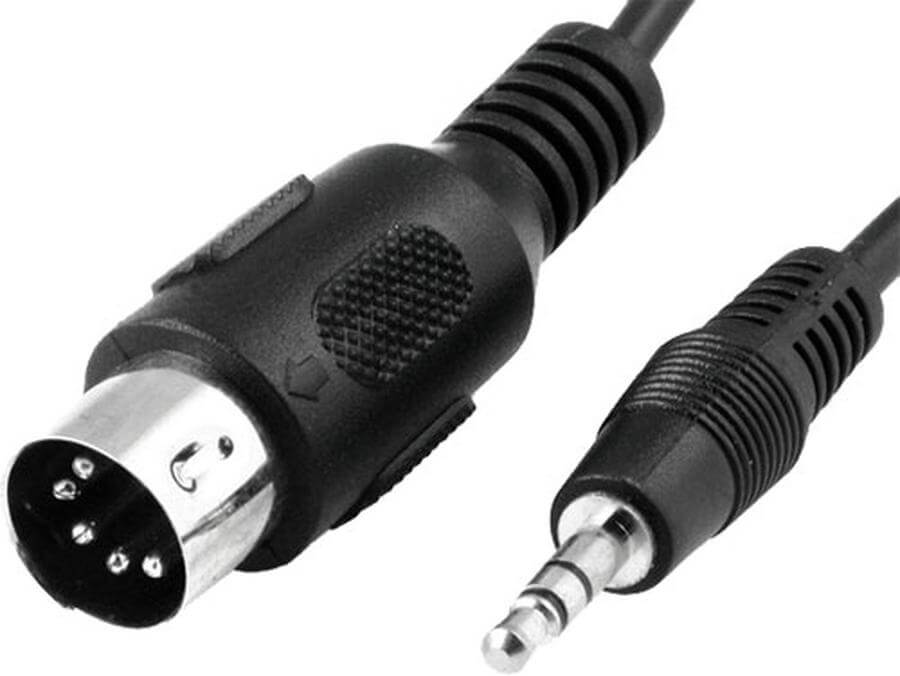

Предположим, что таковым вы уже обзавелись. Замечательно, теперь соединяем виниловый проигрыватель с линейным входом вашего компьютера. Если у вас ноутбук или нетбук, то втыкаемся в микрофонным вход.

*Не будем сильно грузиться качеством преобразования. Это отдельная большая тема. Одним из основных аспектов оцифровки является качество вашей звуковой карты. Поэтому если качество звука вас не удовлетворит стоит задуматься о более солидной звуковухе.*

Если на вашем проигрывателе присутствуют какие либо регуляторы тембра, то необходимо выставить их в среднее положение, дабы исключить их влияние. Регулятор громкости, при его наличии лучше выставить на максимум.

Если проигрывателем давно никто не пользовался то не лишним будет покрутить туда сюда несколько раз все регуляторы, дабы избавиться от возможного плохого контакта и сопутствующего ему хруста. Так же по стробоскопу стоит убедиться что правильно выставлена скорость вращения.

***Стробоскоп*** - это светащийся треугольничек и специальные отметки на торце диска. Если скорость установлена правильно, то отметки, нанесенные на диск под пластинкой будут “стоять” на месте, если нет - будут ехать. В таком случае необходимо отрегулировать скорость вращением регулятором.

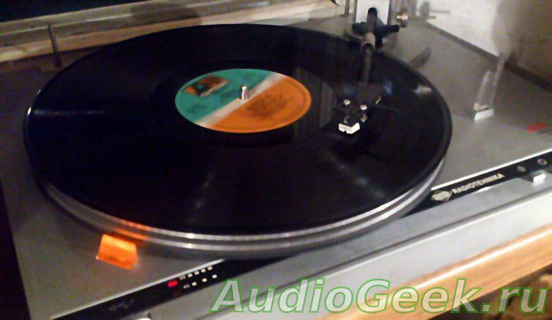

Если вы используете микрофонный вход, то не стоит устанавливать громкость выше 100% - шуметь будет ужасно. Лучше попробовать произвести запись и оценить результат.

Если громкость будет слишком задранной, то будет возникать клиппинг, т.е. подрезание записи сверху и снизу. В таком случае громкость следует опустить до уровня пока клиппинг не прекратится. Имейте ввиду, у винила, особенного у старого очень большой динамический диапазон, т.е. размах громкости между самым тихим и громким звуками.

Перед оцифровкой пластинку желательно очистить от пыли и прочих загрязнений. О том как это сделать описано в статье: ***[Как следует правильно хранить и мыть виниловые пластинки](../kak-hranit-vinil/)***

Теперь нужна программа для записи и последующей небольшой обработки записи. В моем случае в этой роли выступит Audacity, которая бесплатна и имеет все функции полноценного аудиоредактора.

## **Оцифровка винила**

Чтобы оцифровать винил ставим пластинку на положенное ей место. Запускаем проигрыватель и включаем на компьютере запись, нажав на красный круг. Для записи будет создана новая дорожка и, если все хорошо, то вы увидите спектр записываемых звуков.

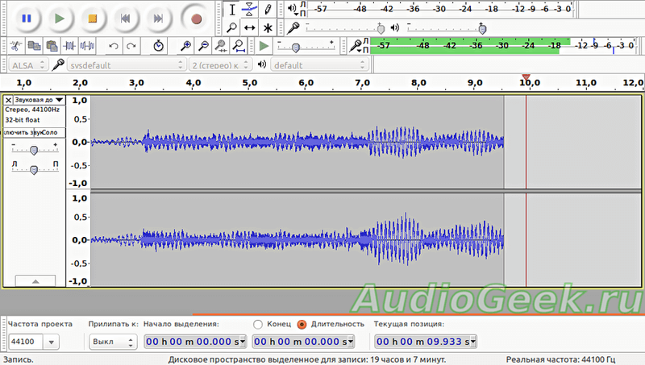

### **Запись не пошла?**

Если же этого не произошло, то вероятно проблема заключается в том, что в системных настройках звука выключен микрофонный вход либо убрана его громкость.Другой может быть неправильно выбранное аудиоустройство входа в настройках Audacity. Так же причина может крыться в проблемах с драйверами на звуковую карту.

Итак, сигнал записывается. Отрегулируйте громкость так, чтобы она не выходила за пределы дорожки. Не бойтесь, если он кажется вам слишком маленькой - доусилим после записи.

Запускаем запись на компьютере, включаем вертушку. Для того, чтобы остановить запись нажимаем на прямоугольник (стоп). Отлично, мы оцифровали винил. Теперь давайте выровняем громкость и слегка почистим ее от лишнего.

## Постобработка

Выделаем всю запись, выбираем ***Эффекты→Нормировка***. Настройки эффекта оставляем как есть по умолчанию.

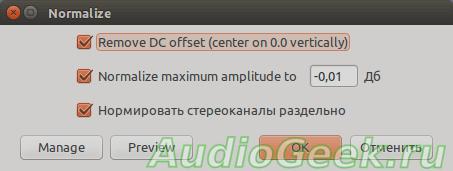

В принципе после этого можно экспортировать запись в удобный формат и слушать ее. Но мы пойдем немного дальше. Как видно из картинки, у моей записи присутствуют резкие выбросы, которые громче основного сигнала да и один канал немного жирнее другого.

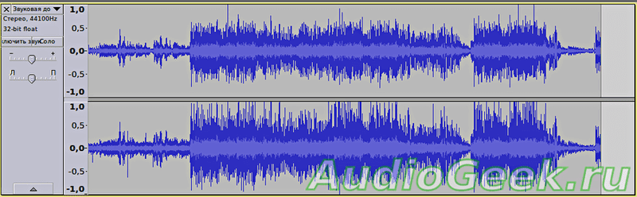

### Удаляем шум

На записи наверняка будет присутствовать некоторый постоянный шум. Поэтому начать обработку записи стоит с небольшой очистки от шума. Для этого выделяем участок шума,  заходим ***Эффекты→Подавление шума:***

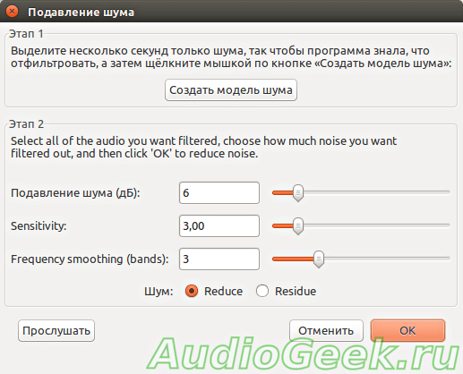

и нажимаем '***создать модель шума***'. После выделяем всю запись заходим в тот же эффект и жмем **ОК**. После чего лучше повторить нормировку.

### **Удаление щелчков**

Так или иначе на пластинку наверняка попали различные пылинки, либо по воле какихто других потусторонних сил на ней появились различные щелчки, которых в записи быть не должно. Поэтому заходим в ***Эффекты→****Удаление щелчков***

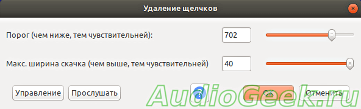

Настройки желательно подобрать так, чтобы щелчки удалялись максимально, но без ущерба записи. Вот так выглядит запись после удаления щелчков.

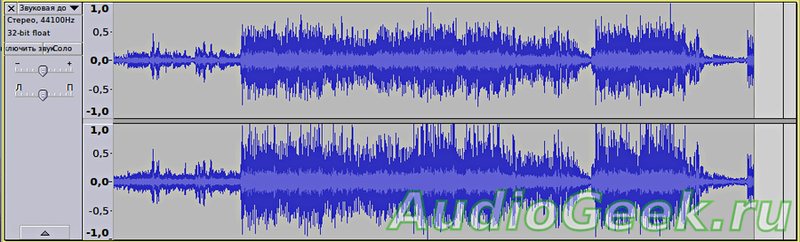

Конечно пичков стало поменьше, но к сожалению ушли не все. Особо тяжелые случае можно вылечить вручную.

Для этого приближаем запись в районе пика, и выделяем его. Программа могла просто не понять что это щелчок, как например в данном случае:

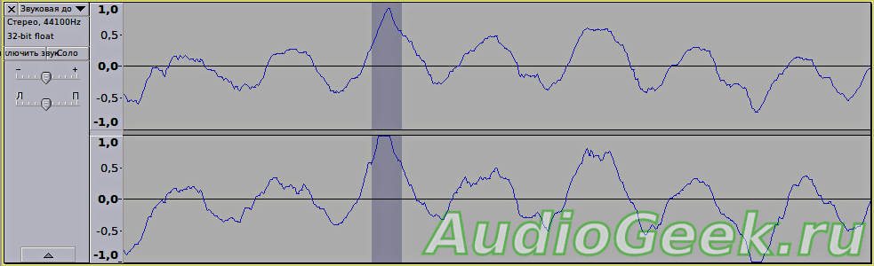

С ним можно поступить двумя путями. Первый вариант: зайти в ***Эффекты→****Усиление сигнала*** и установить там например -6 дБ. Если этого вам покажется мало, то можно и -12дБ поставить.

Вариант второй - сровнять пик с землей. Длительность пика ничтожна и никакой разницы с ним и без него вы просто не расслышите. Поэтому просто заглушаем его в ноль.

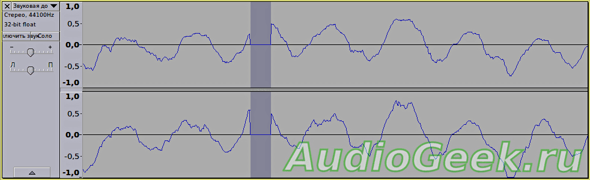

Для этого в панели инструментов есть специальная кнопочка:

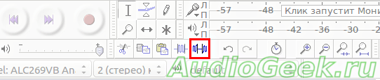
Так же комбинацией Ctrl+R аудасити применит последний использованный эффект с выбранными настройками.

### **Компрессия**

Как уже было отмечено, записи с винила обладают очень широким динамическим диапазоном, это значит что очень велика разница между самым громким и самым тихим звуками. Но можно сделать запись более 'плотной'. Так ее будет удобнее слушать с современных цифровых носителей.

Для начала произведем компрессию. Компрессия - это усиление тихих звуков и ослабление громких. Выделяем запись и переходим: ***Эффекты→Компрессор динамического диапазона***

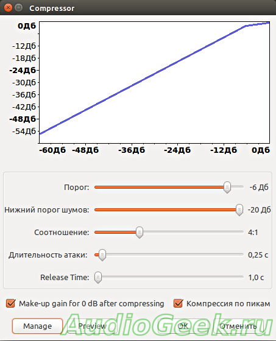

Настройки лучше поставить, как на скриншоте - это довольная слабая компрессия, Если хотите еще более плотный звук, то можно установить порог не -3 дБ , а -6 или -9дБ, а отношение 4:1 или 6:1. Все рекомендации условны, ориентироваться следует в первую очередь на звук.

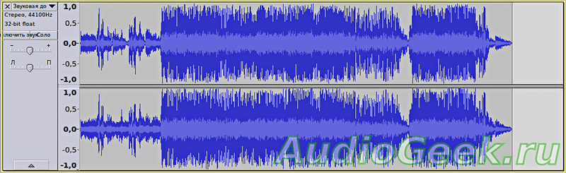

После компрессии средний уровень громкости подрос, но резкие пики всеравно остались. Эти пики - это барабанная партия. Для нее в закромах припасен еще один эффект - лимиттер.

Лимиттер просто срезает всё, что лежит выше установленного уровня громкости. ***Эффекты→****Лимиттер***

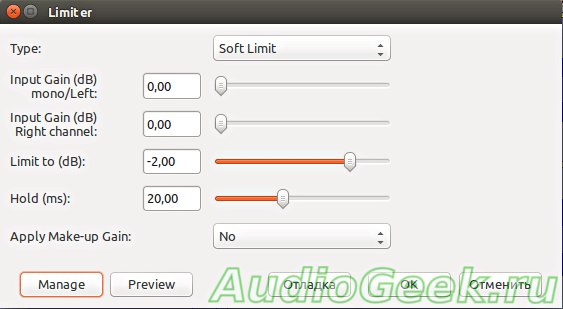

Лимиттер может срезать жестко (Hard Limitter), но это может привести к искажениям. Софт лимиттер же будет плавно их скруглять - то что надо). Главное чтобы после лимиттера не было хруста который появляется при слишком сильном срезании.

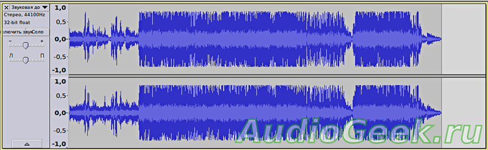

Обычно я устанавливаю значение уровня в -3дБ. Это означает, что лимиттер срежет эти 3 дБ сверху. Если после этого вы заметите искажения на бывших пиках, то следует установить величину -2 или -1 дБ. В некоторых случаях безболезненно можно срезать и 4-5дБ. Главное  - не бояться пробовать!

После лимиттера вновь нормируем запись, чтобы растянуть на весь диапазон и экспортируем готовую запись в файл.

***Материал подготовлен исключительно для сайта [AudioGeek.ru](https://audiogeek.ru)***
