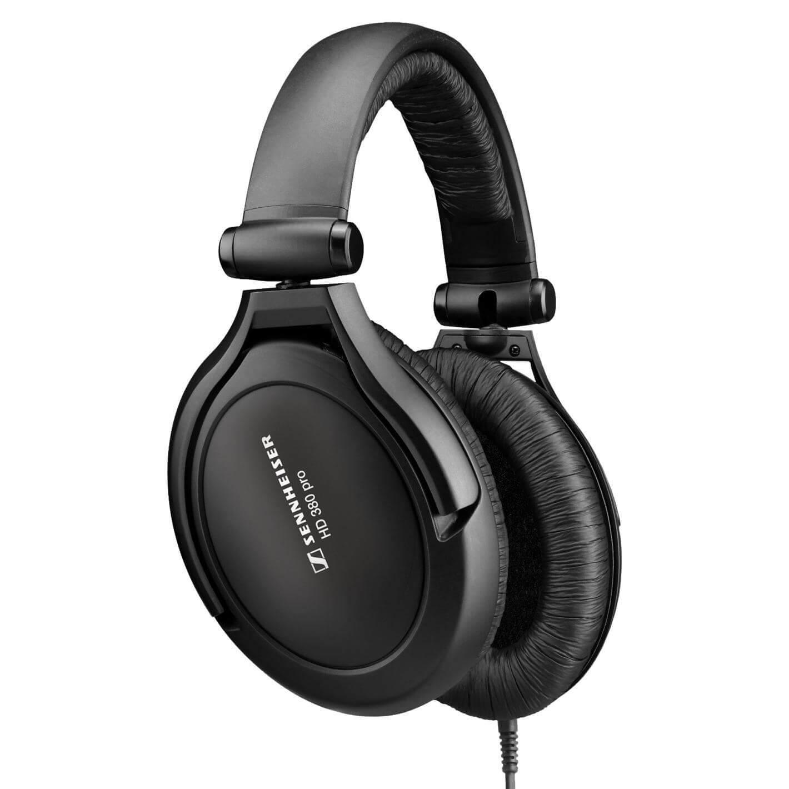
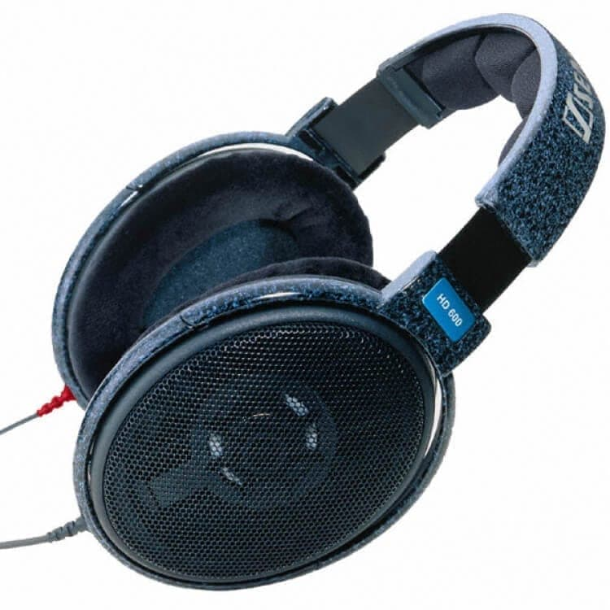
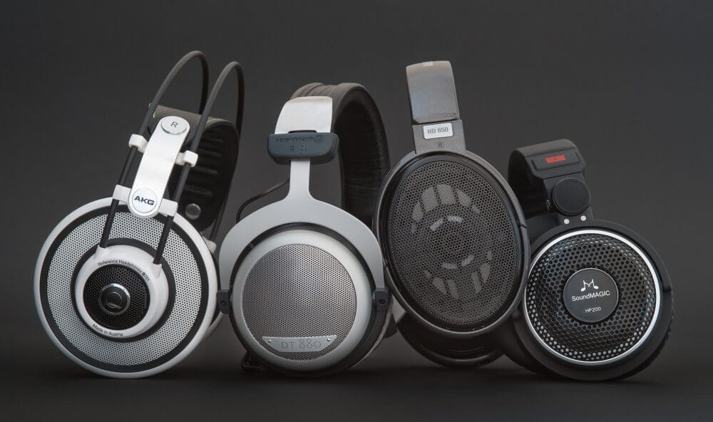
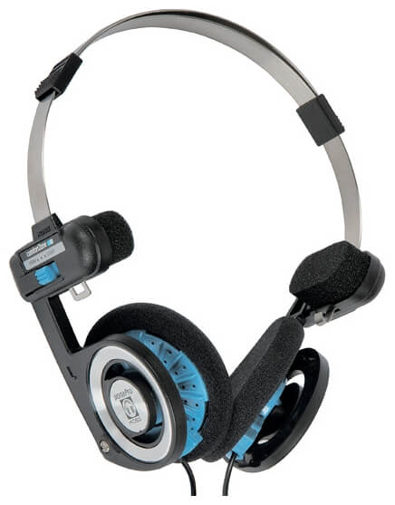
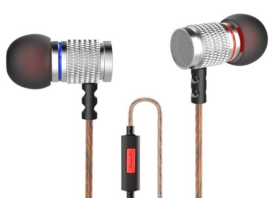
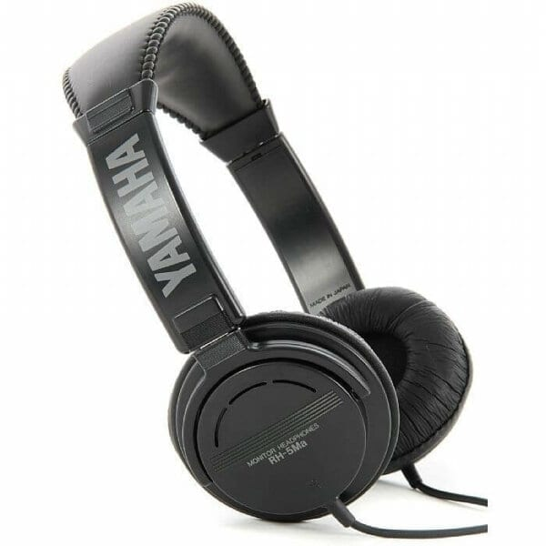

[Русский](./README.ru.md) | **English**

# Open-back and closed-back headphones: which is better for what

**Category:** Headphone types  
**Original:** https://audiogeek.ru/open-close-headphones/

---

There are a great many headphones today. All of them can be divided into open-back and closed-back headphones. There is also an intermediate option: semi-closed or, which is the same thing, semi-open headphones. Let us look at all three options in turn and their characteristics.

> **If you are too lazy to read a lot of text, watch my video on the subject:**

> ▶ **[Watch the video on YouTube](https://www.youtube.com/watch?v=i0bUqNqRsQ8)**

The concepts of closed and open themselves refer to the construction of the back wall of the earcup. The back wall means the wall behind the driver, i.e. the earcup shell.

## **Closed-back headphones**

If the headphone design is closed, the earcup seals the driver from the rear. The volume of air inside the cup acts as a load for the driver.

Headphones of this type often have a rolloff in the low-frequency region, caused by the cups' internal volume being too small for those frequencies. So designers have to resort to various tricks to raise the bass range. In the Sennheiser HD380 Pro, for example, something like a bass reflex port was implemented for this purpose, thanks to which the lowest reproducible frequency is as low as 8 Hz.

To increase the effective internal volume, damping is also often used. Yet for some reason the manufacturers themselves usually do not bother with damping and simply do not do it. [I have already written about damping the Sennheiser HD 380 Pro.](../dempf-senhi-hd380pro/)

A closed design usually has a not very wide stereo image and depth of the soundstage. Both of these improve with properly chosen damping. But they usually still do not reach the level of an open design.

On the other hand, not all styles of music need a large stereo image and depth. For heavy styles of music, for a denser and "pumping" sound, a closed design in my opinion suits better. For atmospheric music, an open design is preferable.

## **Open-back headphones:**

In this design the rear wall of the cup has openings comparable in area to, or larger than, the size of the driver. That is, the back of the driver plays directly into the open air.

As you can see, in the Sennheiser HD600 the driver is freely visible from outside through the mesh.

Because of this design, the headphones are unsuitable for use in transport and poorly suited for use outdoors, since besides the people around you listening to the same thing as you, all outside sounds will also be mixed into your music.

But open-back headphones have an excellent stereo image and soundstage depth when listened to at home in quiet. Such headphones are also great for games, adding to the sense of presence.

It is not only full-size headphones that are made open. The on-ear Koss Porta Pro, loved by many, are also often positioned as open-back headphones. To see this, look closely at the many little holes in the blue plastic. Though in principle they can also be considered semi-closed.

As for earbuds, there are representatives of the open type here too. For example the open earbuds of the fairly young but actively developing company KZ, model EDR2. If you look at them closely, you can see a fine mesh on the back of the earbud.

## **Semi-closed and semi-open headphones**

As the name suggests, this type includes headphones of an intermediate kind. They have openings, but not large ones. A very well-known representative of this type is the Yamaha RH-5MA studio headphones. Each earcup has three slots running in a semicircle.

Semi-closed headphones are meant to take over the best qualities of both types. But not everything is so smooth. Yes, the soundstage is somewhat wider and deeper than closed ones, but noise isolation suffers because of the slots.

Both open and semi-open headphones, even those that are *[studio monitors](../monitoring-headphones/)* designed for working with sound, cannot be used by musicians when recording instruments or vocals, because the sound leaking from them will be picked up by the microphone and heard in the recording. Only closed-back headphones with good sound isolation are suitable for that.

## **Conclusion**

When choosing a type of headphones, first of all be guided by the conditions in which they will be used. If you use headphones in transport most of the time, the choice should obviously go to closed-back headphones.

If you want to savor your favorite tracks at home without harming relations with your neighbors, take a look at open-back headphones.

For the street, semi-closed are probably preferable. True, you will not immerse yourself in the music completely, but the chance of not noticing an approaching car is much smaller.

**Good sound to all!**

*Originally written for [AudioGeek.ru](https://github.com/SkyTrip-13/AudioGeek). Translated from Russian.*
