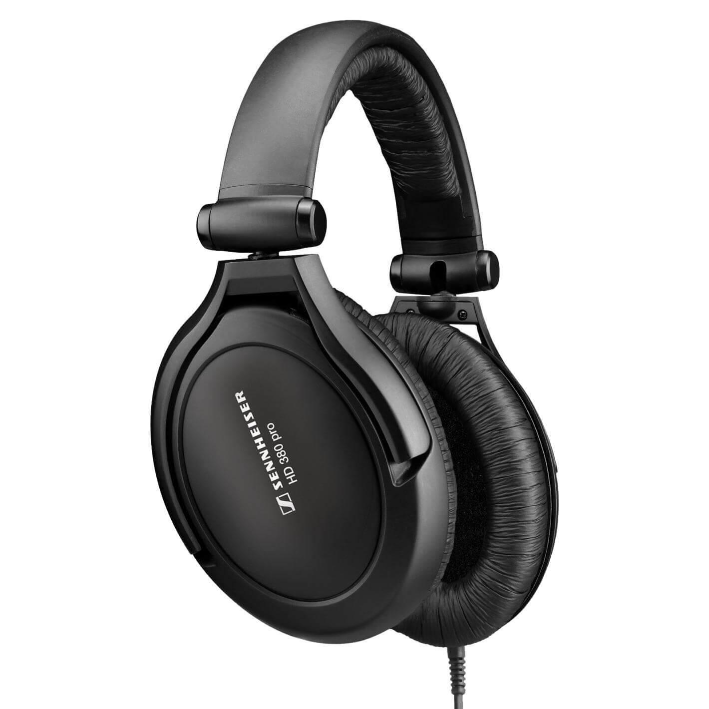
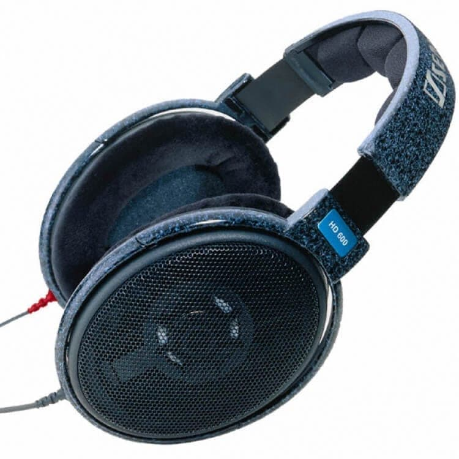
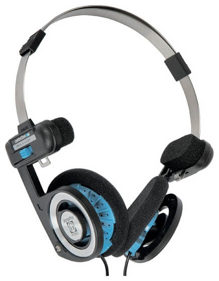
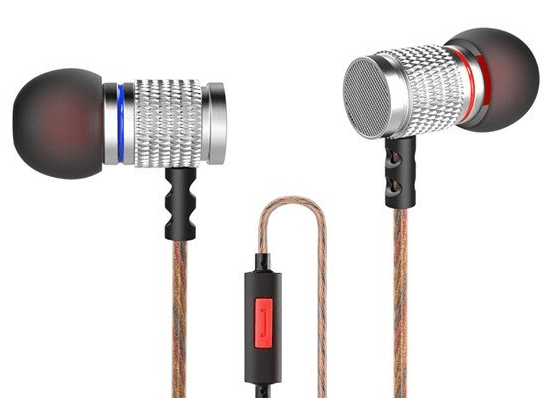
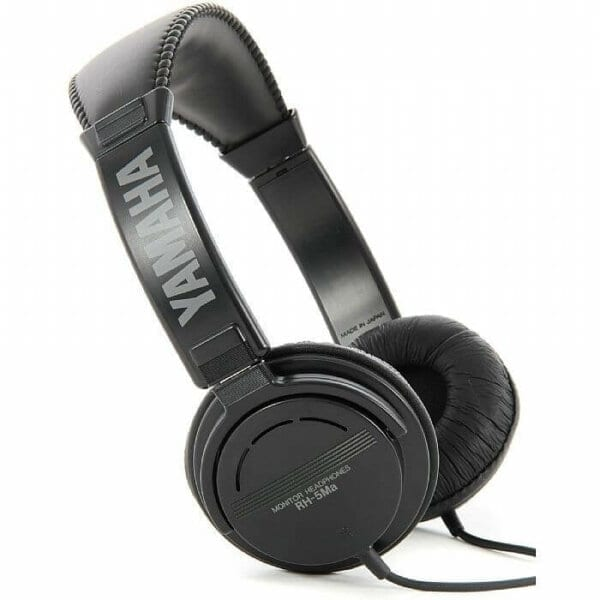

[English](./README.md) | **Русский**

# Открытые наушники и закрытые наушники, какие и для чего лучше

**Рубрики:** Виды и типы наушников  
**Оригинал:** https://audiogeek.ru/open-close-headphones/

---

Наушников сегодня великое множество. При этом их всех можно разделить на открытые наушники и закрытые наушники. Существует так же и промежуточный вариант - полузакрытые или, что тоже самое, полуоткрытые наушники. Рассмотрим по порядку все три варианта и их особенности.

> **Если вам лень читать много буковок, то смотрите мое видео по теме:**

> ▶ **[Смотреть видео на YouTube](https://www.youtube.com/watch?v=i0bUqNqRsQ8)**

Сами по себе понятия закрытости/открытости относятся к строению задней стенки наушника. Под задней понимается стенка располагающаяся позади динамика, т.е. чаша наушника.

## **Закрытые наушники**

Если конструкция наушников закрытая, то чаша наушников герметично закрывает динамик с задней стороны. При этом объем воздуха внутри чаши выступает как нагрузка для динамика.

Зачастую у наушников такого типа ощущается спад в низкочастотной области, вызванный нехваткой внутреннего объема чаш для этих частот. Поэтому конструкторы вынуждены идти на различные приемы для подъема НЧ диапазона. Например в наушниках Sennheiser HD380 Pro для этих целей реализовано подобие фазоинвертора, благодаря чему нижняя воспроизводимая частота составляет всего 8Гц.

Так же для увеличения внутреннего объема часто прибегают к демпфированию. При этом почему-то сами производители с демпфированием обычно не заморачиваются и попросту не делают его. [О демпфирование Sennheiser HD 380 Pro я уже рассказывал ранее.](../dempf-senhi-hd380pro/)

Для закрытой конструкции, зачастую, свойственны не очень широкая стереобаза и глубина сцены. Оба этих показателя улучшаются при наличии правильно подобранного демпфирования. Однако до величин открытой конструкции обычно все же не дотягивают.

С другой стороны далеко не для всех стилей музыки нужны больша’я стереобаза и глубина. Например, для тяжелых стилей музыки, для более плотного и 'качающего' звука, на мой взгляд, лучше подходит именно закрытая конструкция. А вот для атмосферной музыки предпочтительнее открытая конструкция.

## **Открытые наушники:**

В такой конструкции задняя стенка чаши имеет отверстия, по площади сопоставимые или большие размеров динамика. Т.е. динамик задней стороной играет непосредственно на улицу.

Как видно, у наушников Sennheiser HD600 динамик свободно просматривается с наружней стороны через сеточку.

Из-за такой конструкции наушники непригодны для использовании в транспорте и малопригодны для использования на улице. т.к. помимо того, что окружающие будут слушать то же, что и вы, так еще и к вашей музыке будут подмешиваться все внешние звуки.

Зато открытые наушники обладают отличной стереобазой и глубиной сцены если слушать их дома и в тишине. Такие наушники так же отлично подходят для использования в играх, способствуя эффекту присутствия.

Не только полноразмерные наушники делают открытыми. Любимые многими накладные Koss Porta Pro, также часто позиционируются как открытые наушники. Чтобы убедиться в этом стоит присмотреться к множеству дырочек на синем пластике. Хотя в принципе их можно признать и полузакрытыми.

Что же касается затычек, то и тут есть свои представители открытого типа. Например открытые наушники довольно молодой, но активно развивающейся фирмы KZ модель Edr2. Если присмотреться к ним внимательно, то можно увидеть мелкую сеточку с задней стороны наушника.

## **Полузакрытые и полуоткрытые наушники**

Как и следует из названия, к такому типа относятся наушники промежуточного типа. Отверстия в них есть, но они не большие. Весьма известным представителем этого типа являются мониторные наушники Yamaha RH-5MA. У каждого наушника имеется по три прорези идущих полукругом.

Полузакрытые наушники призваны перенять все лучшие качества обоих типов. Однако не все так гладко. Да сцена несколько шире и глубже закрытых, но из-за прорезей страдает шумоизоляция.

И открытые и полуоткрытые наушники, даже те, которые являются *[мониторными](../monitoring-headphones/)* и спроектированы для работы со звуком, не получится использовать музыкантами при записи музыкальных инструментов или вокала т.к. исходящий от них звук будет улавливаться микрофоном и слышен на записи. Для этого подходят только закрытые наушники с хорошей звукоизоляцией.

## **Заключение**

При выборе типа наушников прежде всего стоит руководствоваться условиями, в которых они будут использоваться. Если основную часть времени вы используете наушники в транспорте, то очевидно выбор стоит сделать в пользу закрытых наушников.

Если же вам хочется посмаковать любимыми композициями дома, без вреда для отношений с соседями, то стоит обратить внимание на открытые наушники.

Для улицы же, наверное, предпочтительнее полузакрытые. Да целиком в музыку не погрузишься, зато и вероятность не заметить надвигающуюся машину гораздо меньше.

**Всем хорошего звука!**
