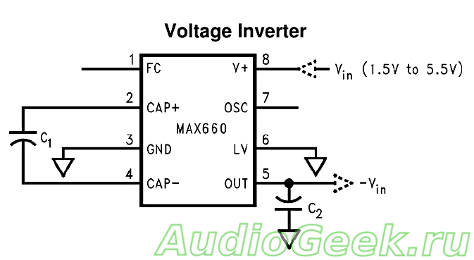
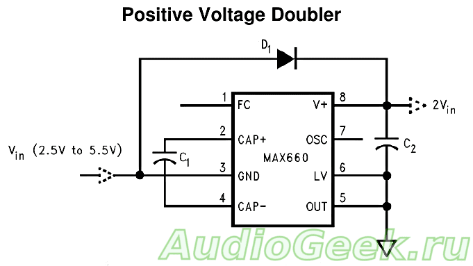
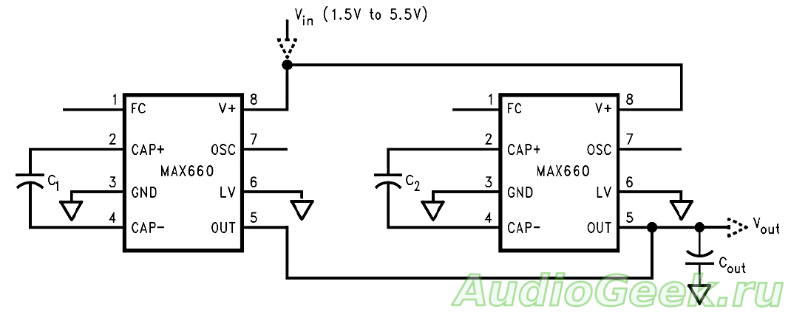
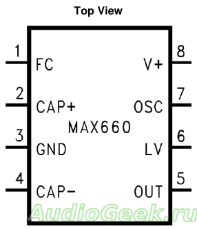
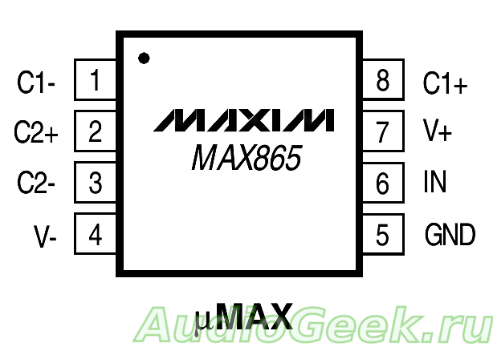
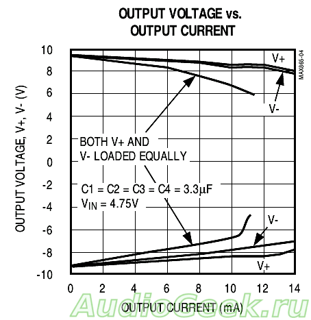
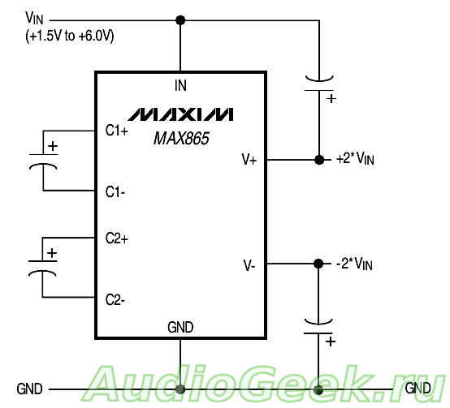
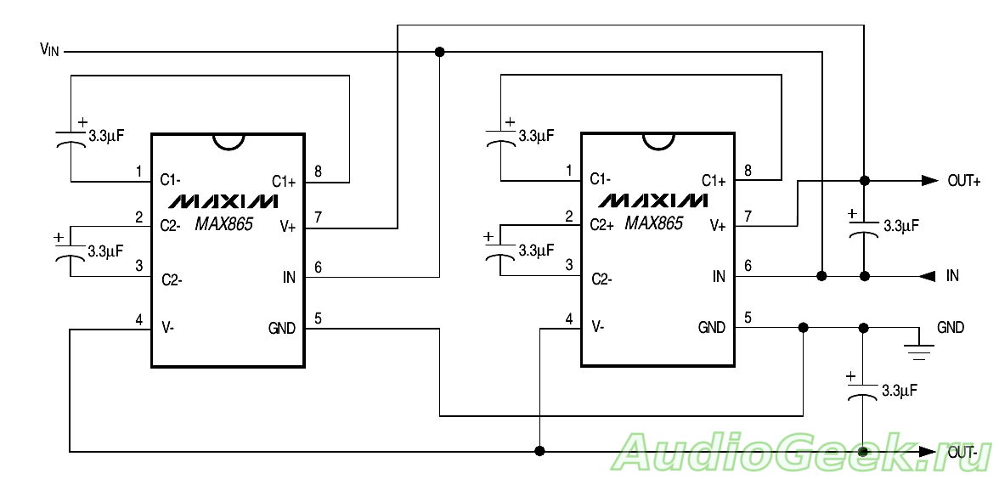

[Русский](./README.ru.md) | **English**

# Negative voltage from a positive supply with the MAX660 or MAX865

**Category:** Useful circuits  
**Tags:** DC-DC converter, power supply  
**Original:** https://audiogeek.ru/otricatelnoe-napryajenie-iz-polojitelnogo/

---

For powering portable electronics, DC-DC voltage converters are very convenient today. Of particular interest are chips that can create a negative voltage from a positive one with a minimum of external components. Let us look in more detail at two well-proven chips from the famous company Maxim: the MAX660 and the MAX865.

## **The MAX660 chip**

This is an improved and refined descendant of the 7660 chip (ICL7660), which is made by many manufacturers, not only Maxim. The characteristics of the chip may differ between manufacturers...

***But let us return to the MAX660.***

## **MAX660 application circuits**

There are 2 application circuits for the MAX660, pursuing different goals:

**•** **Input voltage inverter Uout = −Uin**

**• Input voltage doubler Uout = 2·Uin**

The chip comes in DIP8 and SO-8 packages. As the circuits show, the input voltage range of the MAX660 in the inverter circuit is from 1.5 to 5.5 volts, and in the voltage doubler circuit 2.5–5.5 volts.

The conversion principle here is capacitive. For normal operation the chip needs capacitors of 100 µF or more on the CAP+ and CAP− pins (pins 2 and 4) and also at the output. The datasheet specifies capacitance from 47 µF, but its own graphs show that it is better to use capacitors of at least 100 µF. It is best to use 150–200 µF tantalum capacitors. There is little point in using larger capacitance. The capacitors do not have to be tantalum, but they must have low ESR to be able to deliver the required current very quickly.

The chip can deliver 100 mA into the load, which is quite good. But the output voltage sag at that current will be 0.65 V, which is not so good. If you need more current, two chips can be connected "in parallel". Each chip must then have its own conversion capacitors, i.e. 100–200 µF each, while the output capacitance is common and equal to the sum of the output capacitances of the individual converters, which is quite logical.

## **The MAX660 in audio circuit power supplies**

The MAX660 DC-DC converter can operate at two frequencies: 10 and 80 kHz. The first option is not interesting, as it lies in the audible range.

The good news is that you can make the chip run at a conversion frequency of 80 kHz by applying a high level to the FC pin (pin 1). In that case the datasheet guarantees a conversion frequency of no less than 40 kHz, which is quite enough for us.

Clock pulses can also be fed to the OSC pin (pin 7) from an external generator. A built-in 15 pF capacitor is connected to this pin. By connecting an external capacitor you can lower the frequency to the required value.

The beauty is that the chip does not produce a pile of extra noise on the supply rails, as the universally loved MC34063 does.

A converter based on this chip works great with a headphone amplifier on the NE5532, built to the circuit from the article **[A high-quality headphone amplifier on op-amps at a reasonable price](../headphone-amp-dual-current/)**, even though the NE5532 has a minimum supply voltage of ±5 V.

With the MAX660 it is very convenient to make a dual supply from a single one. The drawback is that if the power source is a battery, then as it discharges both the positive and the negative supply voltage drop. With a lithium battery the supply will be ±4.2 V when fully charged and ±3.2 V when discharged.

Want a larger voltage swing? ***Here you go: the MAX865.***

## **The MAX865 chip**

Unlike the 660, the DC-DC converter on the MAX865 is actually two converters. Essentially it is a step-up and an inverting converter in one package. The output of the chip will have a doubled positive and a doubled negative voltage. A very convenient solution for powering portable gear from a dual supply.

The chip comes in a µMAX package, a surface-mount package measuring 3x3 mm, not counting the leads. That again confirms that the chip was made for portable devices.

The input voltage range here is slightly wider, between 1.5 and 6 volts. Accordingly, from a single supply you can get a dual supply from ±3 to ±12 V at the output.

The output current of the chip, however, is not as pleasing. The datasheet claims that the chip copes well with loads up to 20 mA, although the output voltages begin to sag even before that current is reached, as can be seen clearly in the graph of output voltage versus current shown below. The maximum output current is stated as 100 mA, but that is the short-circuit current.

There is no choice of conversion frequency here, but the manufacturers took care to put the frequency outside the audible range. The chip works at frequencies from 20 to 38 kHz. Apparently the frequency sags under load.

## **The MAX865 application circuit is simple to the point of absurdity**

All the capacitors shown are 3.3 µF. Again it is better to use tantalum capacitors, but any others with low ESR will do. The output capacitor, in my opinion, is somewhat small. It is better to add extra 10–20 µF directly at the supply pins of the powered chips.

As before, if the output current is insufficient, two chips can be paralleled.

According to the datasheet the output capacitance stays the same. But again it is better to increase it, and of course it does not hurt to place electrolytics directly at the supply pins of the powered chips. That ensures maximum efficiency under peak loads.

These chips are undoubtedly very interesting candidates for building DC-DC converters that create a negative voltage from a positive one, and can find use in various cases.

If you want tastier characteristics, in particular a conversion frequency above 1.5 MHz, an output current above 400 mA and a stable dual output voltage of ±5 volts, it is worth taking a closer look at the ***[converter on the TPS65130](../unipolar-to-bipolar-voltage-converter/)***.

*Originally written for [AudioGeek.ru](https://audiogeek.ru). Translated from Russian.*
