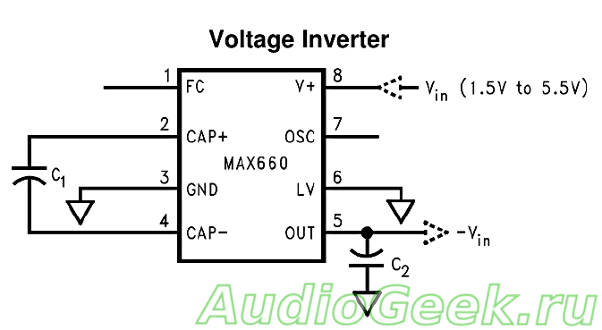
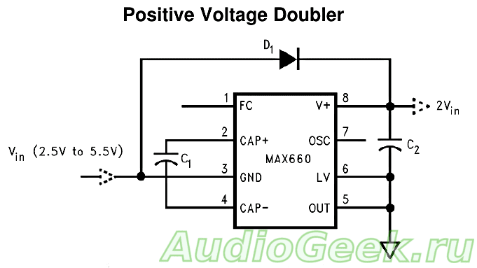
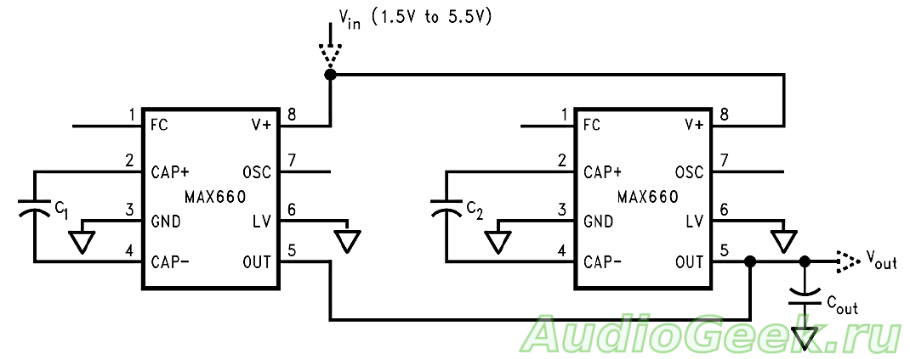
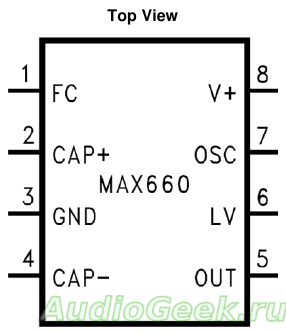
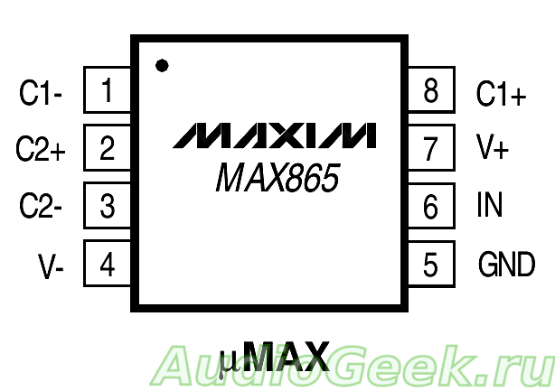
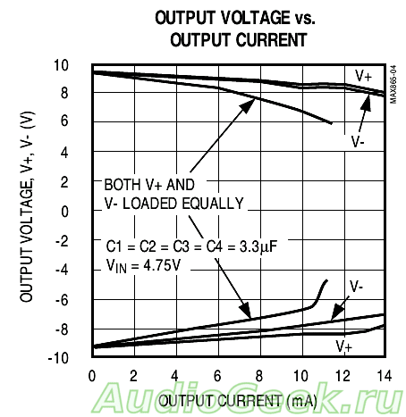
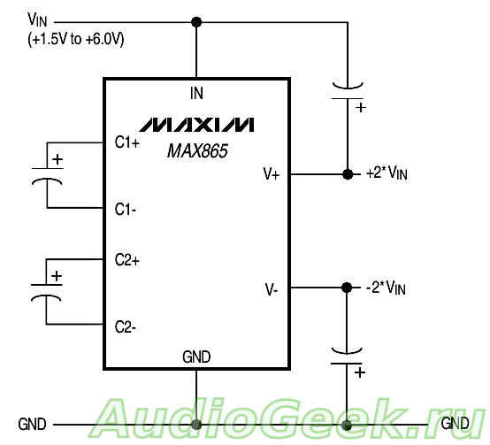
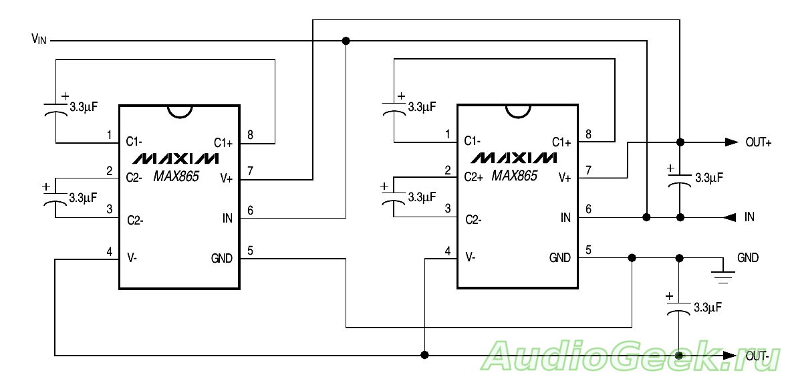

[English](./README.md) | **Русский**

# Отрицательное напряжение из положительного на max660 или max865

**Дата:** 2018-06-09  
**Рубрики:** Полезные схемы  
**Метки:** DC-DC преобразователь, источник питания  
**Оригинал:** https://audiogeek.ru/otricatelnoe-napryajenie-iz-polojitelnogo/

---

Для питания портативной электроники сегодня очень удобно применять dc-dc преобразователи напряжения. Особый интерес представляют микросхемы, способные создать отрицательное напряжение из положительного с минимумом внешних компонентов. Рассмотрим подробнее две хорошо зарекомендовавшие себя микросхемы от прославленной компании Maxim - MAX660 и MAX865. 

## **Микросхема MAX660**

Это улучшенный и доработанный потомок микросхемы max7660. Которая выпускается далеко не только фирмой maxim. При этом характеристики микросхемы у разных производителей могут отличаться...

***Но вернемся к max660.***

## **Схема включения MAX660**

Существует 2 схемы включения max660, преследующие разные цели:

. 
**•** **Инвертор входного напряжения Uвых= -Uвх**

**• Удвоитель входного напряжения Uвых=2\*Uвх**

Микросхема выпускается в корпусах DIP8 и SO-8. Как видно из представленных схем диапазон входных напряжений по схеме инвертора на Max660 лежит в пределах от 1.5 до 5.5 вольт, а по схеме удвоителя напряжения 2.5-5.5 Вольт.

Принцип преобразования тут емкостной. И для нормальной работы микросхема требует наличия на выводах CAP+ и CAP- (выводы 2 и 4), а так же на выходе конденсаторов емкостью от 100uF. В даташите указывается емкость от 47мкФ, но из их же графиков следует, что лучше ставить конденсаторы емкостью не меньше 100мкф. Лучше поставить 150-200 мкФ танталовых конденсаторов. Использовать бОльшую емкость особого смысла не имеет. Конденсаторы могут быть и не танталовыми, но они должны обладать низким ESR, чтобы иметь возможность очень шустро отдать требуемый ток.

Микросхема может отдать в нагрузку ток в 100mA, что очень даже хорошо. Но проседание выходного напряжения при этом составит 0.65В, что уже не так хорошо. Если требуется ток больше указанного, можно включить две микросхемы "в параллель". При этом емкость используемая для преобразования у каждой микросхемы должна быть своя, т.е по 100-200 мкФ, а выходная емкость общая и равная сумме выходных емкостей отдельных преобразователей, что вполне логично.

Если вам было лень читать много буковок, то можно послушать умного дядю, посмотрев короткое видео:

## **MAX660 в питании звуковых цепей.**

Работа dc-dc преобразователя на MAX660 возможна на двух частотах - 10 и 80 кГц. Первый вариант не интересен, так как лежит в слышимом диапазоне частот.

Хорошая новость в том, что можно заставить микросхему работать на частоте преобразования 80кГц, подав на вывод FC ( вывод 1) В таком случае даташит гарантирует частоту преобразования не ниже 40 кГц, что для нас уже вполне устраивает.

Тактирующие импульсы могут быть поданы и с собственного генератора на ногу OSC (вывод 7 ). К указанному выводу подключен встроенный конденсатор емкостью 15пФ. Подключением внешнего конденсатора можно снизить частоту до требуемого значения.

Вся прелесть заключается в том, что микросхема не дает кучи лишнего шума по цепям питания, как это делает всеми любимая mc34063.

Преобразователь на данной микросхеме прекрасно работает с усилителем для наушников на NE5532, по схеме из статьи:**[Высококачественный усилитель для наушников на ОУ по разумной цене](../headphone-amp-dual-current/)**, даже не смотря на то, что у NE5532 минимальное напряжение питания ±5В.

При помощи микросхемы макс 660 очень удобно делать двухполярное питание из однополярного. Минус заключается в том, что если источником питания служит аккумулятор, то по мере его разряда падает как положительное напряжение питания, так и отрицательное. При использовании литиевого аккумулятора на полном заряде питание составить ±4.2В, а при разряженном ±3.2 вольта.

Хотите больший размах напряжений? ***-пожалуйста, MAX865 в студию***

## **Микросхема MAX865**

В отличие от 660-ой, dc-dc преобразователь на MAX865 представляет из себя два конвертера. По сути это повышающий и инвертирующий преобразователи в одном корпусе. На выходе микросхемы будет удвоенное положительное и удвоенное отрицательное напряжения. Весьма удобное решение для питания портатива двухполярным напряжением.

Микросхема выпускается в корпусе μMAX - это корпус для поверхностного монтажа с размерами 3x3 мм, не считая выводов. Что еще раз подтверждает, что микросхема  созданна для портатива.

Диапазон входных напряжений здесь немного расширен и заключен между 1.5 и 6 вольтами. Соответственно на выходе можно получить двухполярное питание из однополярного напряжением от ±3 до ±12В.

А вот выходной ток у микросхемы не так радует. В даташите заявляют, что микросхема отлично справляется с нагрузкой до 20 мА, хотя и не доходя до такого тока начинаются просадки выходных напряжений, что хорошо видно из графика зависимости выходного напряжения от тока, показанного ниже. Однако максимальный выходной ток заявлен как 100мА, но это ток КЗ.

Выбора частоты преобразования тут не предусмотрено, но производители постарались вывести частоту за пределы слышимого диапазона. Микросхема работает на частотах от 20 до 38 кГц. Видимо под нагрузкой частота проседает.

## **Схема включения MAX865 проста до безобразия**

Емкость всех указанных конденсаторов - 3.3 мкФ. Лучше опять таки использовать танталовые конденсаторы. Но подойдут и любые другие с низким ESR. Емкость выходного конденсатора, на мой взгляд, несколько маловата. Лучше дополнительно установить емкость по 10-20 мкФ непосредственно на ноги питаемых микросхем.

Как и в предыдущем случае, при нехватке выходного тока, можно запаралелить две микросхемы.

При этом по даташиту выходная емкость остается неизменной. Но лучше опять таки ее нарастить, и конечно не помешает установить электролиты непосредственно на ножки питаемых микросхем. Это обеспечит максимальную эффективность при пиковых нагрузках.

Данные микросхемы, несомненно весьма интересные кандидаты для построения dc-dc преобразователей, способных создать отрицательное напряжение из положительного и могут найти применения для различны случаев.

Если же вы хотите более вкусные характеристики, в частности, частоту преобразования более полутора МГц, выходной ток более 400 мА и и стабильное двухполярное выходное напряжение ±5 вольт, то стоит внимательнее присмотреться к ***[преобразователю на микросхеме TPS65130](../unipolar-to-bipolar-voltage-converter/)***.

**Статья написанна исключительно для сайта [AudioGeek.ru](https://audiogeek.ru)**
