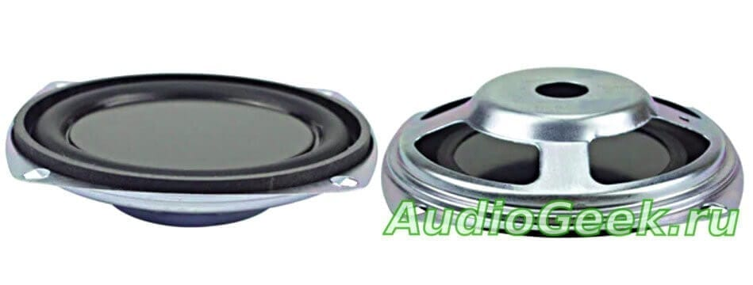
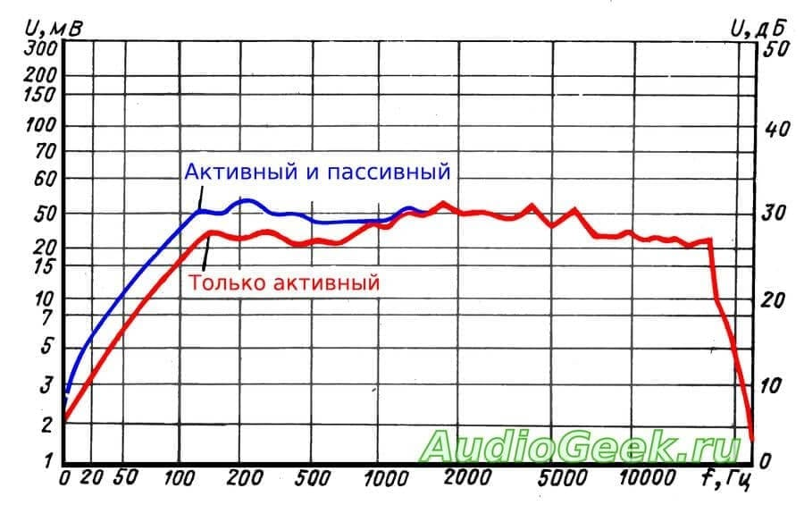
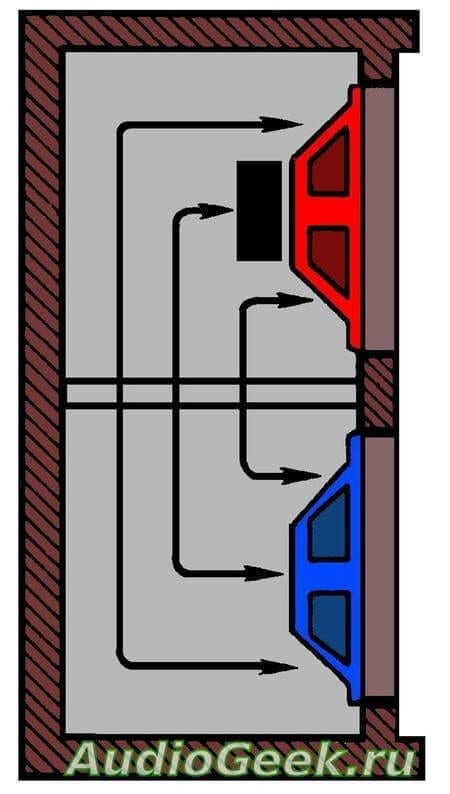
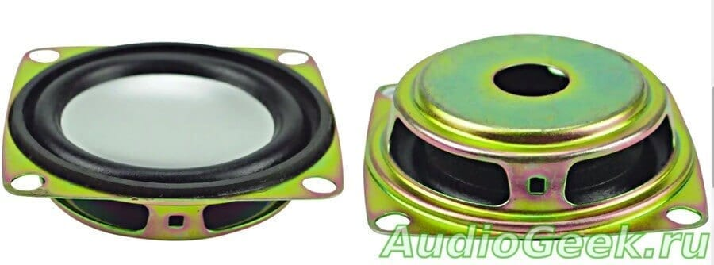
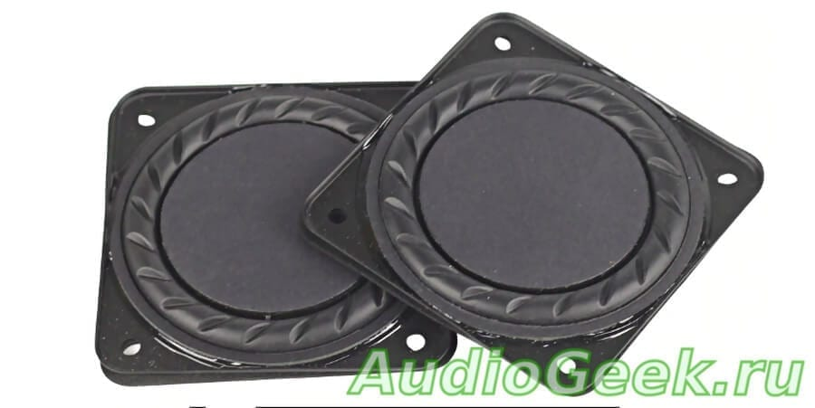
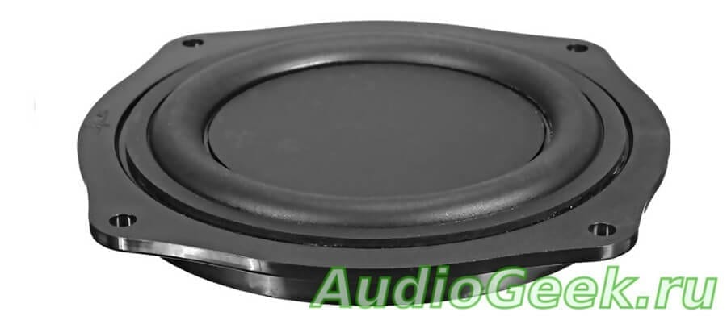

[Русский](./README.ru.md) | **English**

# A passive radiator boosts the bass of a speaker

**Published:** 2017-01-19  
**Category:** Misc, Speaker components  
**Tags:** sound quality  
**Original:** https://audiogeek.ru/passivniy-izluchatel/

---

Low frequencies are a big problem for any loudspeaker. A bass reflex port is most often used to raise their level. It is not hard to build, but it is quite hard to calculate correctly. It is much easier to boost a speaker's bass by fitting a DIY passive radiator. So in this article we will look at what a passive radiator is.

## What is a passive radiator

A **passive radiator** (also called a *drone cone* or *passive speaker*) is a radiator without a magnet system or voice coil. It cannot convert an electrical signal into sound vibrations, so it cannot work on its own and must be driven by an active driver mounted in the same sealed enclosure.

A passive radiator is most effective at low frequencies. At mid and high frequencies the sound pressure created by the active driver is simply not enough. So with a passive radiator you can significantly improve the bass of your speaker with your own hands.

## Frequency response of a speaker with a passive radiator

Fitting a passive radiator increases the area of the radiating surface. The two cones move together, so first, the level in the bass range rises, and second, the [***efficiency of the whole speaker***](../nizkiy-kpd-dinamika/) goes up.

As an example, consider a generalized frequency response of a speaker before and after adding a passive radiator.

The comparison graph shows that with a passive radiator the speaker's response rises significantly in the range from 20 to 500 Hz. That is the low-frequency region, the bass.

Both the active driver and each passive radiator have their own resonant frequency. At this frequency its vibration is at its maximum.

The lowest frequencies are usually the main difficulty for any speaker, so people always try to lower the resonant frequency. To do that, the cone of the passive radiator is made heavier.

## A speaker with a passive radiator

A fairly popular use of passive radiators today is in portable speakers. At their size it is not easy to get really good bass, and an acoustic passive radiator can improve things significantly.

> **If you want to build a portable speaker yourself, you face the question of battery charge control. For that I recommend the article [*A smart Li-ion charge controller: the TP4056 module*](../kontroller-zaryada-li-ion-modul/). Especially since such modules cost only 30 cents each.**

But even if the speaker is not portable but a desktop one, the diameter of the passive radiator's cone should be greater than or equal to that of the active driver.

The passive radiator's own resonance should lie below that of the main driver. Ideally, for desktop speakers it should be below 20 Hz. It is even better if the active driver has just as low a resonant frequency.

A passive radiator is used only in a sealed box, since it is driven only by the vibration of air inside the enclosure caused by the active driver. So any leak in the enclosure of a speaker with a passive radiator greatly reduces the bass output.

## A DIY passive radiator

You can easily **make a passive radiator yourself** by removing the magnet system and voice coil from a woofer. It is best to use a bass driver no smaller in diameter than the intended active driver. It will also help to add some weight to the cone.

You do not have to dissect a decent driver to make a passive radiator. It is better to use it as intended, and buy a cheap passive radiator on AliExpress to go with it.

The passive radiators shown above are great for building DIY portable speakers. They are 2 inches in diameter and cost about 143 rubles a pair (a few dollars) at the time of writing.

### An even more interesting option:

These passive radiators look less like ordinary drivers because they have no metal frame and are as thin as possible. They are 3 inches (79 mm) in diameter, so they can deliver better bass. They cost somewhat more, about 515 rubles a pair at the time.

### Bigger diameter, more bass:

This is a 4-inch bass passive radiator. Its price is not high either, about 260 rubles. Thanks to its larger diameter it gives even better low-frequency output.

## Conclusion

Passive radiators have long been used in many types of speakers in place of a bass reflex port. For example, a passive radiator suits a subwoofer very well, especially a car one. So it is definitely worth trying a DIY passive radiator in your speaker.

You may also be interested in: ***[How to place speakers in a room](../kak-razmestit-as-v-komnate/)***

*Originally written for [AudioGeek.ru](https://audiogeek.ru). Translated from Russian.*
