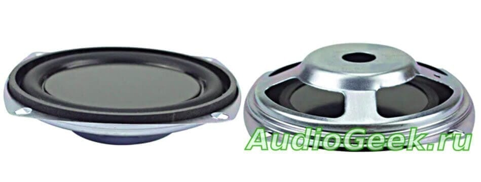
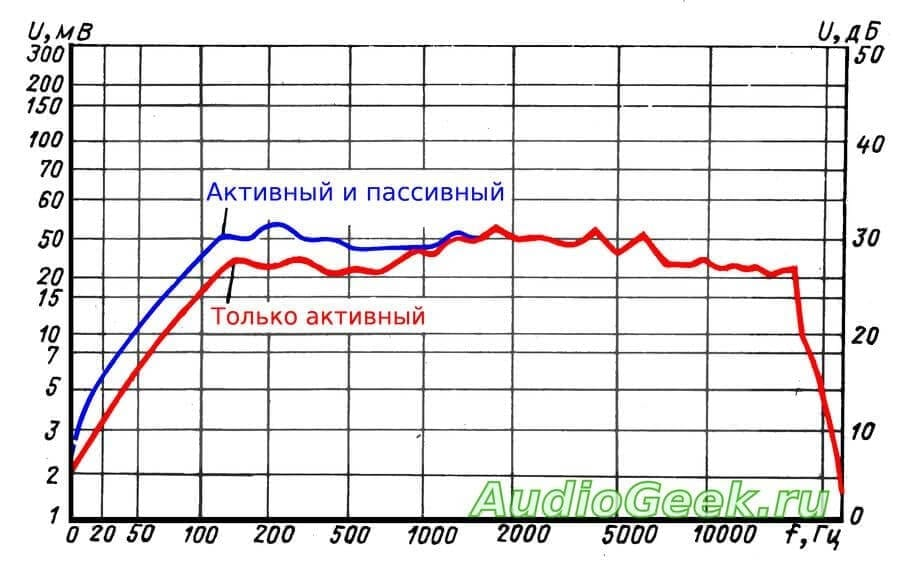
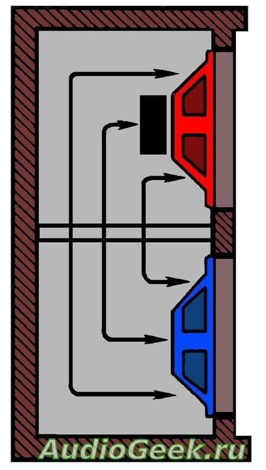
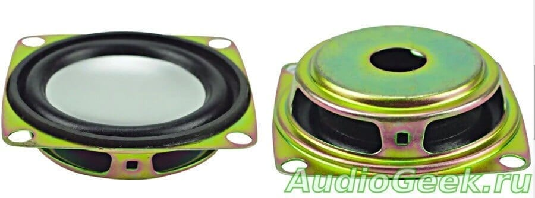
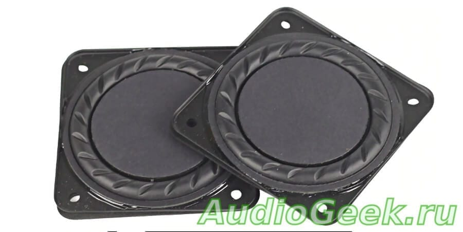
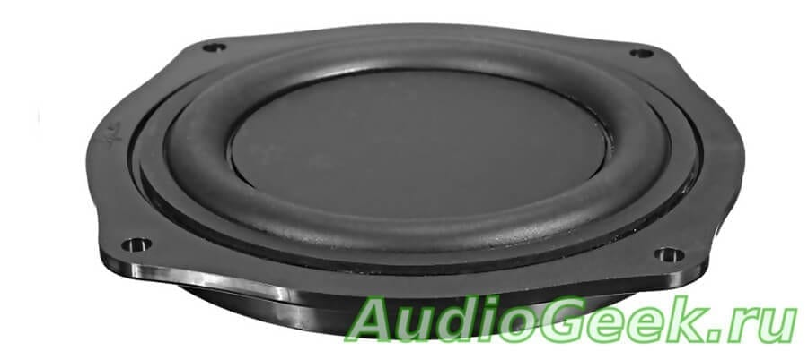

[English](./README.md) | **Русский**

# Пассивный излучатель поднимает НЧ акустической системы

**Рубрики:** Разное, Элементы АС  
**Метки:** качество звука  
**Оригинал:** https://audiogeek.ru/passivniy-izluchatel/

---

Большой проблемой для любой акустической системы являются низкие частоты. Чтобы поднять их уровень чаще всего применяется фазоинвертор. Он не сложен в изготовлении, но довольно сложно его правильно рассчитать. Намного проще поднять басы акустической системы, установив в них пассивный излучатель своими руками. Поэтому в этой статье рассмотрим подробнее что такое пассивный излучатель.

## Что такое пассивный излучатель

**Пассивный излучатель** (он же *пассивный динамик*) - это излучатель, лишенный магнитной системы и катушки. Он не способен преобразовывать электрический сигнал в звуковые колебания, а значит не может работать самостоятельно и должен возбуждаться активным излучателем, установленным в тот же закрытый корпус.

Наиболее эффективен пассивный излучатель на низких частотах. На средних и высоких частотах звукового давления, создаваемого активным излучателем, просто недостаточно. Поэтому используя пассивный динамик можно своими руками значительно улучшить басы вашей акустической системы.

## АЧХ колонки с пассивным излучателем

Установка пассивного излучателя приводит к увеличению площади излучающей поверхности. Два диффузора колеблются вместе, поэтому во-первых повышается уровень в НЧ диапазоне, а во вторых и повышается [***КПД всей акустической системы***](../nizkiy-kpd-dinamika/).

Для примера рассмотрим обобщенную АЧХ акустической системы до и после вставки пассивного излучателя.

На сравнительном графике видно, что при наличии пассивного излучателя, АЧХ акустической системы значительно повышается в диапазоне от 20 до 500Гц. А это и есть низкочастотная область, т.е. те самые басы.

Как активный, так и  каждый пассивный излучатель имеет свою резонансную частоту. На этой частоте его колебания максимальны.

Основную трудность для любой акустической системы обычно представляют самые низкие частоты, поэтому резонансную частоту всегда стараются понизить. Для этого диффузор пассивного динамика делают большей массы.

## Колонка с пассивным излучателем

Довольно популярная сегодня область применения пассивных излучателей - это портативные колонки. При их размерах не так то просто получить действительно хороший бас. Акустический пассивный излучатель может значительно улучшить ситуацию .

> **Если вы хотите своими руками сделать портативную колонку, то перед вами стоит вопрос контроля заряда аккумулятора. Для этих целей рекомендую глянуть статью [*Умный контроллер заряда литиевых аккумуляторов - модуль на tp4056*](../kontroller-zaryada-li-ion-modul/). Тем более что стоят такие модули всего 30 центов за штуку.**

Но даже если колонка не портативная, а настольная диаметр диффузора пассивного динамика должен быть больше или равен диаметру активного излучателя.

При этом собственный резонанс пассивного излучателя должен лежать ниже резонанса основного динамика. В идеале, для настольной акустики он должен лежать ниже 20Гц. Будет еще лучше, если такую же низкую резонансную частоту будет иметь и активный громкоговоритель.

Применяется пассивный излучатель только в корпусе типа закрытый ящик. Т.к. возбуждается он только колебаниями воздуха  внутри корпуса от активной головки. Следовательно любая негерметичность корпуса колонки с пассивным излучателем сильно снижает эффективность отдачи по басам.

## Пассивный излучатель своими руками

Можно легко **сделать пассивный излучатель своими руками**, удалив у низкочастотного динамика магнитную систему и подвижную катушку. Лучше использовать басовый динамик диаметром не меньше предполагаемого активного излучателя. Так же не лишним будет немного утяжелить диффузор.

Не обязательно препарировать нормальный динамик, чтобы сделать из него пассивный динамик своими руками. Лучше использовать его по назначению, а в дополнение к нему дешево купить пассивный излучатель на AliExpress.

Показанные выше пассивные излучатели отлично подходят для создания самодельных портативных колонок. Они обладают диаметром 2 дюйма и стоят всего 143 рубля за пару.  Покупать рекомендую ***в этом магазине***.

### **Еще более интересный вариант:**

Эти пассивные излучатели уже меньше похожи на обычные динамики потому, что лишены металлической корзины и имеют минимальную толщину. Они обладают диаметром 3 дюйма (79мм), за счет чего могу обеспечить лучшие басы. Обойдутся они несколько дороже - 515 рублей за пару.  ***Ссылка на магазин***.

### Больше диаметр - больше басов:

Это уже 4-х дюймовый пассивный излучатель басов. Его цена так же не столь велика и составляет 260 рублей. ***Купить его можно тут***. Однако благодаря большему диаметру он еще лучшую отдачу по низким частотам.

## Заключение

Пассивные излучатели уже давно используются во многих типах колонок, заменяя собой фазоинвертор. Например, пассивный излучатель отлично подходит для сабвуфера, особенно автомобильного. Поэтому определенно стоит попробовать встроить пассивный излучатель своими руками в вашу АС.

Возможно Вас так же заинтересует статья: ***[Как правильно разместить акустическую систему в комнате](../kak-razmestit-as-v-komnate/)***

***Материал подготовлен исключительно для сайта [AudioGeek.ru](https://audiogeek.ru)***
