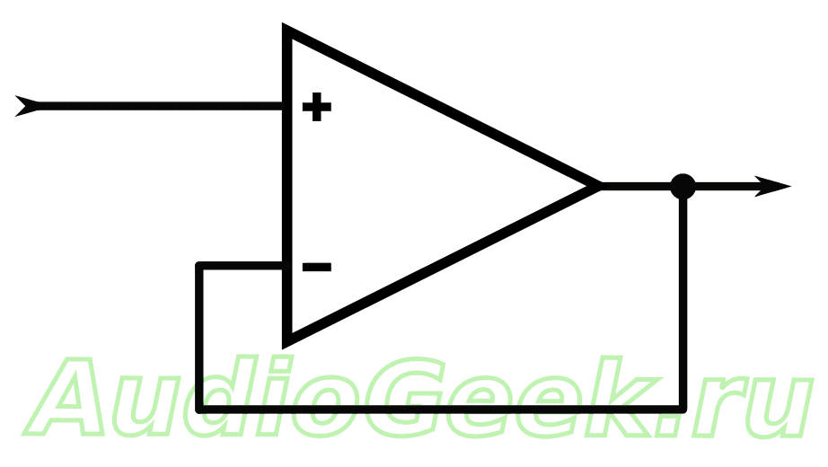
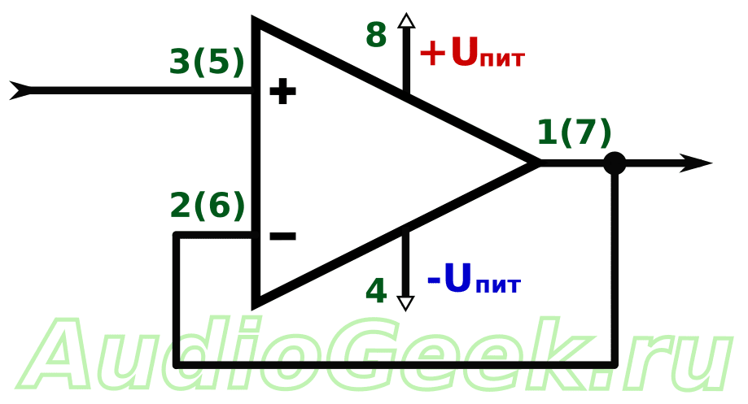
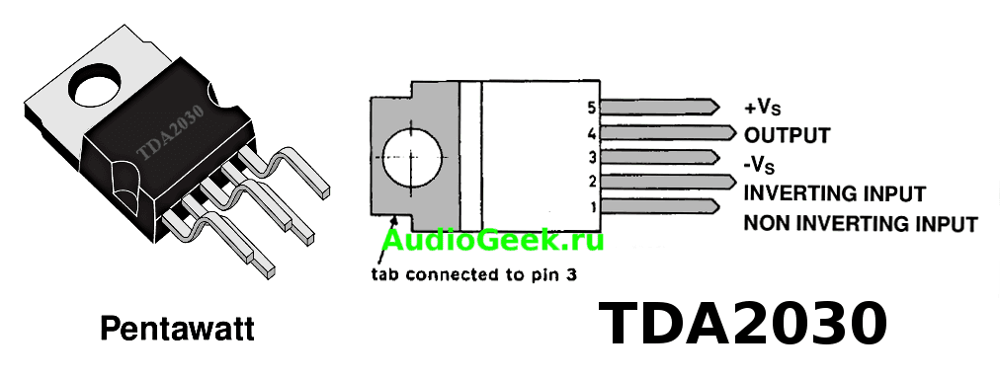
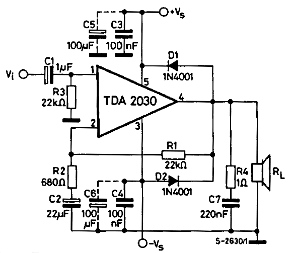
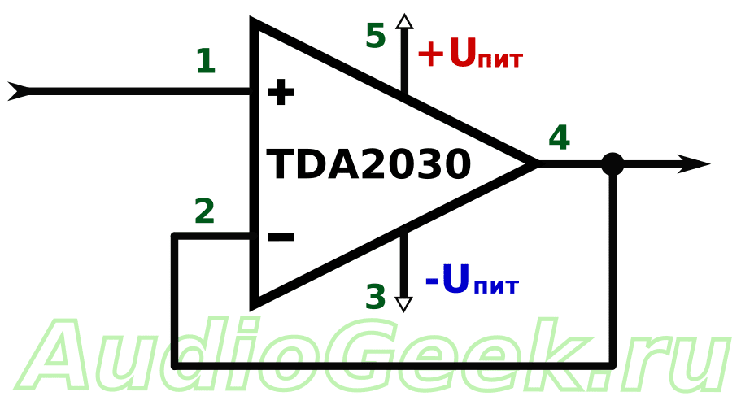

[Русский](./README.ru.md) | **English**

# An op-amp voltage follower circuit, and a powerful voltage follower on the TDA2030

**Published:** 2018-01-04  
**Category:** Useful circuits  
**Tags:** op-amp circuit  
**Original:** https://audiogeek.ru/povtoritel-opamp/

---

A voltage follower is a non-inverting amplifier with unity gain. It is made by closing the negative feedback loop and feeding the useful signal to the non-inverting input.

With this connection the op-amp tries to produce at its output an exact copy of the signal arriving at its input. At every moment **Uout = Uin**, which is why the circuit is called a follower. The op-amp follower circuit:

## **What a voltage follower is for**

***Why repeat what is already there?*** An amplifier with unity gain is also called a buffer or buffer stage. With its high input and low output impedance, the follower is ideally suited for matching stages by impedance.

This way the main rule of circuit design is observed: **the input impedance of the next stage must be at least 3 times, and preferably 10 times, greater than the output impedance of the previous stage**. In that case the signal is not distorted.

## **Op-amp parameters**

Modern op-amps have an enormous input resistance. The cheap and widespread TL062, for example, has an input resistance of 1012 Ω. For a dual op-amp (TL062, TL072, NE5532, LM833....) in a DIP-8 or SO-8 package, the follower connection is shown below:

As the gain of an op-amp increases, its frequency range narrows and its upper frequency drops. But in follower mode, working at unity gain, the op-amp can operate up to the highest frequencies it is capable of.

Either way, when choosing an op-amp for a follower, it is desirable to have a frequency margin of several times, preferably 10. Then you can definitely stop worrying about any phase distortion introduced by the op-amp itself.

When choosing a chip for a follower, besides the bandwidth, an important characteristic is the output current the op-amp can deliver into the load. If the op-amp cannot supply the output current the load requires, sagging and distortion begin. So with a low-impedance load that needs more than 100 mA, far from every op-amp can cope.

## **How to calculate the current the op-amp must supply?**

Very simply! Suppose the load is a 10 Ω resistor. The follower receives 5 volts, which it must pass on to the load. Applying Ohm's law (I = U/R), we find that to hold 5 volts across the resistor the op-amp must supply a current of 0.5 ampere. (*This is a rough estimate, but quite usable in practice.*)

Ordinary op-amps cannot handle such a task. Of course the output can be boosted with a transistor, but then using an op-amp follower becomes less justified.

For such purposes it is suggested to use the TDA2030, TDA2040 or TDA2050 connected as a follower. These chips are ready-made op-amps boosted with transistors, differing from one another in maximum output power.

## **The TDA2030 as a voltage follower**

As an example let us look at the TDA2030, since the other two are its more powerful siblings. The chip was originally designed for, and is used in, audio amplifiers. The vast majority of consumer amplifiers, especially 2.1 and 5.1 systems, are built on this chip. Which is logical and understandable: the chip is cheap and has good characteristics.

The chip comes in a five-pin package and needs a minimum of parts to work. In the follower connection, only supply capacitors are needed for normal operation. It is better to also leave a resistor at the input to tie the input to ground for DC, although it is not mandatory.

The standard connection of the chip as an audio-frequency amplifier:

In the standard connection of the chip (shown above), suggested by the datasheet, the gain is set to about 20. The operating frequency band is limited by the same datasheet to 140 kHz. However, working as a voltage follower with unity gain, the chip can operate up to frequencies of 0.5...1 MHz. At least the chip performed excellently at 100 kHz, supplied from a Wien bridge sine wave generator, to boost whose output it was used.

Elegant, beautiful and, most importantly, it works. The chip gets quite hot and it is desirable to use a heatsink with enough surface area. A PC processor heatsink fits perfectly. However, heat dissipation depends on the operating mode and the load resistance. It is not recommended to run the chip without a heatsink.

In my version the chip is powered from a regulated ±9 volts to keep the signal amplitude stable. The chip was expected to work at 2–3 watts, so the supply is regulated with 7809 and 7909 regulators, which can provide up to 1 A (provided they have heatsinks). The supply voltage range for the TDA2030 is **±6 ... ±18 volts**.

## **Conclusion**

The op-amp follower is perhaps the simplest, but very important, stage. When designing electronic devices, if one of the op-amps is left unused, it is definitely better to build a follower on it than to leave it idle. A voltage follower can also be used as an output current amplifier.

*Originally written for [AudioGeek.ru](https://audiogeek.ru). Translated from Russian.*
