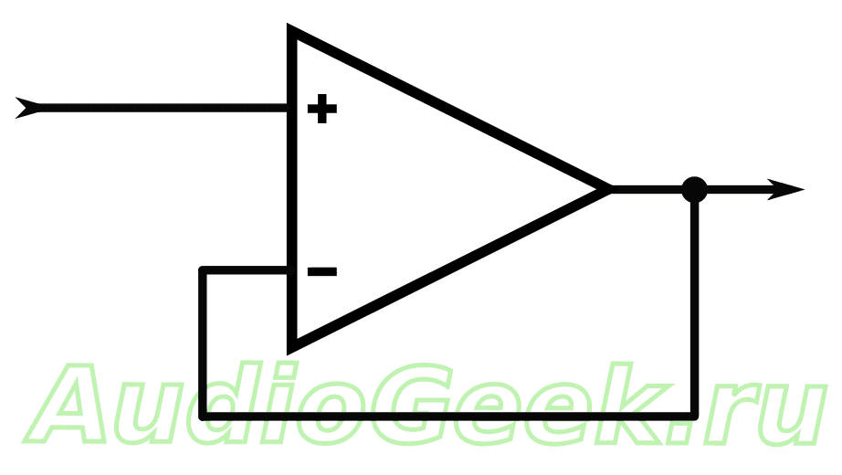
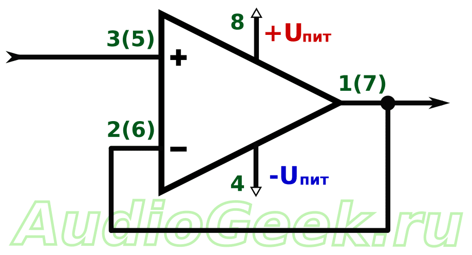
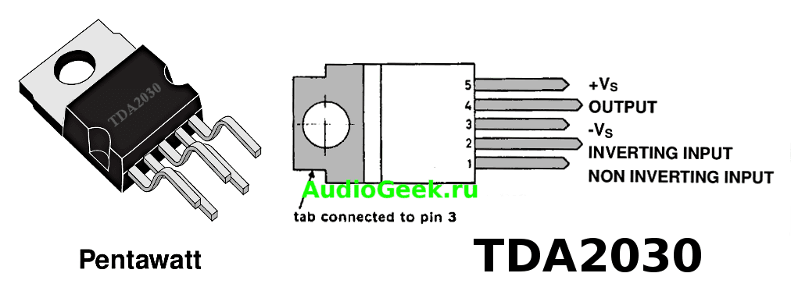
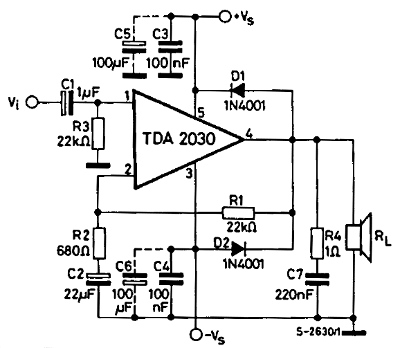
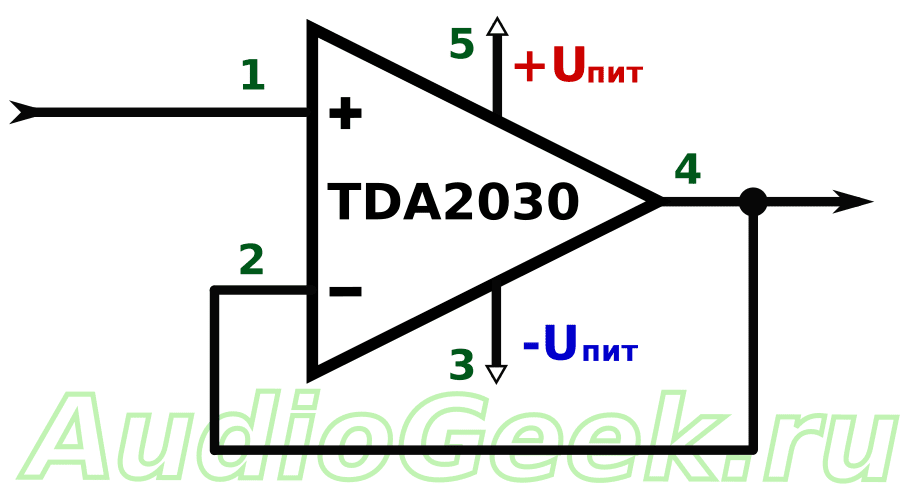

[English](./README.md) | **Русский**

# Схема повторителя напряжение на ОУ, мощный повторитель напряжения на TDA2030

**Рубрики:** Полезные схемы  
**Метки:** схема на ОУ  
**Оригинал:** https://audiogeek.ru/povtoritel-opamp/

---

Повторитель напряжения представляет собой неинвертирующий усилитель, обладающий единичным коэффициентом усиления. Реализуется это замыканием отрицательной обратной связи и подачей полезного сигнала на неинвертирующий вход.

При таком включении операционный усилитель старается обеспечить на выходе точную копию сигнала приходящего на его вход. В каждый момент времени **Uвых=Uвх**, поэтому описываемая схема и называется повторителем. Схема повторителя на ОУ:

## **Смысл применения повторителя напряжения**

***Зачем же повторять то, что уже есть?*** Усилитель с единичным коэффициентом усиления называют также буфером или буферным каскадом. Обладая большим входным и малым выходным импедансами, повторитель, как нельзя лучше, подходит для согласования каскадов по сопротивлению.

Таким образом соблюдается главное правило схемотехники - **входное сопротивление следующего каскада должно быть минимум в 3, а лучше в 10 раз больше выходного сопротивления предыдущего каскада**. В таком случае сигнал не претерпевает искажений.

## **Параметры операционных усилителей**

Современные операционные усилители обладают колоссальным входным сопротивлением. У того же дешевого и распространенного TL062 входное сопротивление составляет 1012 Ом. Для сдвоенного операционного усилителя (TL062, TL072, NE5532, LM833....) в корпусе DIP-8 или SO-8, включение по схеме повторителя показано ниже:

У операционных усилителей по мере увеличения коэффициента усиления сужается частотный диапазон и снижается верхняя передаваемая частота. Но в режиме повторителя, работая с единичным коэффициентом усиления, ОУ способен работать до максимально возможных для него частот.

Так или иначе, при выборе ОУ для повторителя, желательно иметь запас по частоте в несколько раз, лучше в 10. В таком случае можно однозначно не беспокоиться о каких либо фазовых искажения вносимых самим операционным усилителем.

При выборе микросхемы для повторителя, помимо ширины частотного диапазона, важной характеристикой является также выходной ток, который ОУ способен дать в нагрузку. Если операционный усилитель не способен обеспечить требуемый для нагрузки выходной ток, то начинаются просадки и искажения. Поэтому если речь идет о низкоомной нагрузке, для которой требуется ток более 100 мА, то с таким справится далеко не каждый операционный усилитель.

## **Как рассчитать величину тока, который должен обеспечивать ОУ ?**

Очень просто! Допустим, что в роли нагрузки выступает резистор сопротивлением в 10 Ом. На повторитель приходит напряжение в 5 вольт, которое он должен передать нагрузке. В таком случае, применяя закон ома (I=U/R), выясняем, что для поддержания 5 вольт на резисторе операционнику требуется обеспечивать ток в 0.5 ампера. (*Это грубая прикидка, но вполне применимая на практике*)

Обычные ОУ не смогут справиться с такой задачей. Конечно выход можно умощнить транзистором, но тогда применение повторителя на ОУ становится менее оправданным.

Для таких целей предлагается использовать TDA2030, TDA2040 или TDA2050 включенных по схеме повторителя. Микросхемы представляют собой уже готовые, умощненые транзисторами, операционные усилители, которые между собой отличаются максимальной выходной мощность.

## **TDA2030 как повторитель напряжения**

Для примера рассмотрим микросхему TDA2030, т.к. две другие являются её более мощными собратья. Исходно микросхема разрабатывалась и применяется в усилителях звука. Подавляющее большинство бытовых усилителей, особенно систем 2.1 и 5.1 построено на этой микросхеме. Что логично и понятно - микросхема дешевая и при этом обладает хорошими характеристиками.

Микросхема реализована в пяти-выводном корпусе и требует минимум деталей для работы. При включении по схеме повторителя для нормальной работы требуются только конденсаторы по питанию. Лучше оставить еще и резистор по входу для привязки входа к земле по постоянному напряжению, хотя и он не обязателен.

Стандартная схема включения микросхемы в качестве усилителя звуковой частоты:

В штатном включении микросхемы (показанном выше), предлагаемом дата шитом, коэффициент усиления задается около 20. При этом полоса рабочих частот ограничивается тем же дата шитом в 140кГц. Однако при работе по схеме повторителя напряжения с единичным коэффициентом усиления микросхема может работать до частот в 0,5...1 МГц. По крайней мере микросхема отлично себя проявила, при работе на частоте 100кГц, подаваемой с генератора синусоидального сигнала на мосту Вина, для умощнения выхода которого она и была применена.

Изящно, красиво, а главное - работает. Микросхема солидно греется и желательно применять радиатор с достаточной площадью поверхности. Отлично подойдет радиатор процессора ПК. Однако тепловыделение зависит от режима работы и сопротивления нагрузки. Не рекомендуется включение микросхемы без радиатора.

В авторском варианте микросхема запитанна стабилизированным напряжением ±9Вольт для обеспечения стабильности амплитуды сигнала. Работа микросхемы предполагалась с мощностью 2-3 Ватта, по этой причине стабилизация питания выполнена на кренках 7809 и 7909, способных обеспечивать ток до 1А(при условии наличия радиаторов). Диапазон питающих напряжений для микросхемы TDA2030 составляет  **±6 ... ±18 Вольт**.

## **Заключение**

Повторитель на ОУ, пожалуй самый простой, но при этом, очень важный каскад. При разработке электронных устройств, когда незадействованным остался один из ОУ, то определенно лучше построить на нем повторитель, чем оставлять его неиспользованным. Так же повторитель напряжения можно использовать как выходной усилитель тока.

*Материал подготовлен исключительно для сайта [AudioGeek.ru](https://github.com/SkyTrip-13/AudioGeek)*
