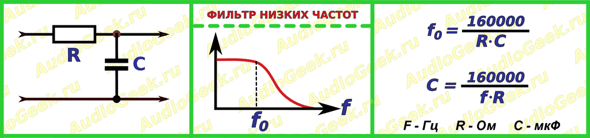
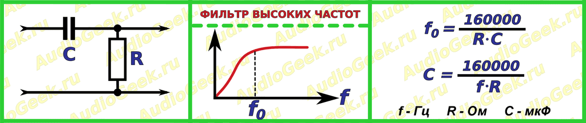
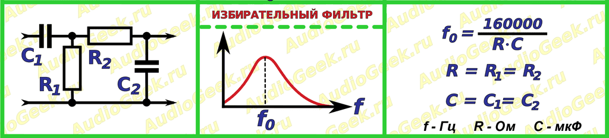
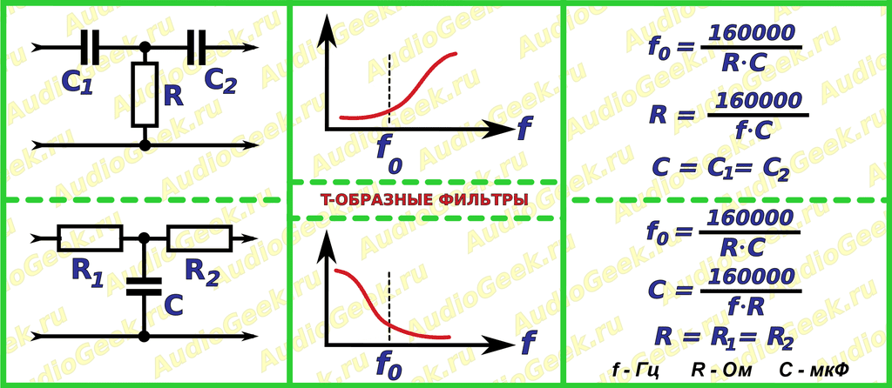
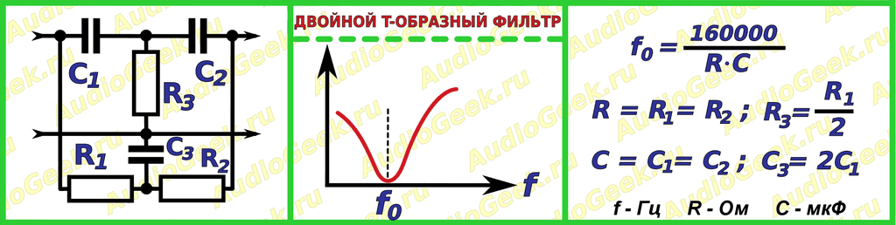

[Русский](./README.ru.md) | **English**

# RC circuits: the 5 most common filter circuits and how to calculate them

**Category:** Audio circuit design  
**Tags:** audio filters  
**Original:** https://audiogeek.ru/rc-circuit/

---

The RC circuit is an extremely common thing in electronics. Such filters are everywhere. Understanding how each filter affects the frequency response of a signal largely determines how correctly you can read a whole electronic schematic. This article collects the 5 basic RC filters and gives their frequency responses and simplified calculation formulas.

Contents:

- ***Introduction***
- ***1. Low-pass filter***
- ***2. High-pass filter***
- ***3. Band-pass filter***
- ***4. T-type filters***
- ***5. Twin-T filter***

In the early years of radio electronics, LC filters, that is, filters made of an inductor and a capacitor, were mostly used to shape the frequency response of a signal. Over time they were replaced by the RC circuit, which was firmly adopted by electronics thanks to its lower cost and size.

Of course, RC filters cannot completely displace their LC siblings. For example, LC filters are preferable in loudspeaker crossovers. But nearly all low-power electronics is dominated by RC circuits. One example is the double RC network in an **[RIAA preamp](../riaa-korrektor/)**.

> An interesting way to get rid of inductors is **[gyrator filters](../filtri-na-gyratorah/)**, where the behavior of an inductor is emulated by a capacitor and an op-amp.

## *Simplified formulas*

For simple filter calculations, simplified formulas borrowed from an engineering handbook are given below.

The formulas contain the coefficient **160000** (one hundred sixty thousand). This number appears for two reasons.

- First, it is assumed that the capacitance is taken in **microfarads** (10-6 farad) in the calculations
- Second, converting from angular frequency to cyclic frequency introduces a factor of 2π

Accordingly:

**1 / (2⋅π⋅10-6) = 159154 ≈ 160000**

So, let us move on to the filters themselves.

## ***1. Low-pass filter (LPF), also called an integrator:***

A **low-pass filter** passes frequencies below the cutoff frequency (f0) unchanged and attenuates frequencies above f0. At the cutoff frequency the amplitude is −3 dB. This is a first-order filter and the rolloff slope is 6 dB per octave. Such filters are most often used to cut off high-frequency interference and noise.

> ***An octave is a frequency interval whose end frequency is twice the starting one.***

## ***2. High-pass filter (HPF), also called a differentiator***

A high-pass filter attenuates frequencies below the cutoff frequency (f0) and passes frequencies above f0 unchanged. Just like the low-pass filter above, the signal at the cutoff frequency has an amplitude of −3 dB, and the slope is 6 dB per octave.

> ***Both the LPF and the HPF work as a voltage divider in which one arm is a constant resistor and the other is a capacitor, which has a frequency dependence.***

Such filters are often used at the outputs of audio amplifiers to cut off infrasonic frequencies that can damage speakers.

## ***3. Band-pass filter***

Such a filter selects a certain frequency or band of frequencies by suppressing the others. Essentially it is a low-pass and a high-pass filter connected in series. Accordingly, when the capacitances and resistances are equal, a particular frequency is selected and there is attenuation on both sides with a slope of 6 dB/octave.

But nothing stops you from widening the passband by calculating each RC network, R1C1 and R2C2, for a different f0.

## ***4. T-type filters***

T-type filters are the same L-type low-pass and high-pass filters with one more element added. But the special feature of T-type filters is that, compared with L-type ones, they load the circuits following the filter less.

## ***5. Twin-T filter (notch)***

The filter has practically infinite attenuation (*on the order of 60 dB*) at its notch frequency, which arises from the sum of two signals with a 180° phase difference at that frequency. Such a filter is very effective for eliminating an interfering signal, for example 50 Hz mains pickup.

> If you are interested in filters, you may also like: **[Phase response of filters and sound](../fazo-chastotnaya-harakteristika-filtrov/)**

*Originally written for [AudioGeek.ru](https://audiogeek.ru). Translated from Russian.*
