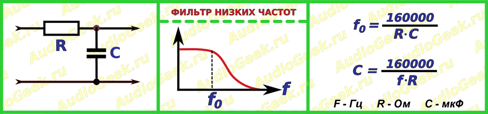
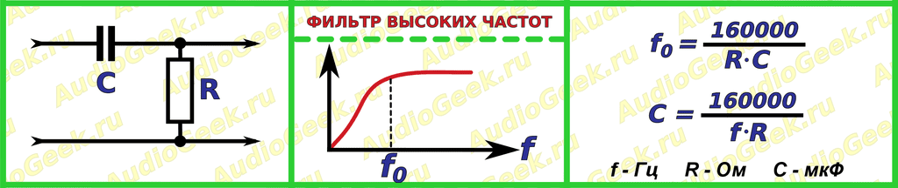
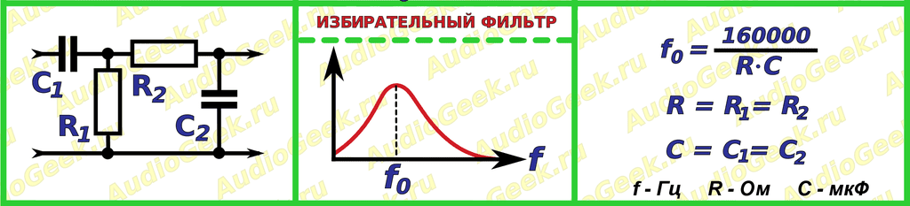
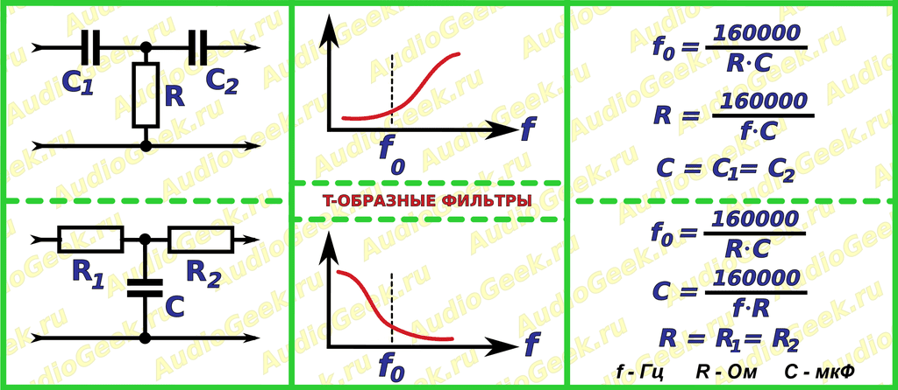
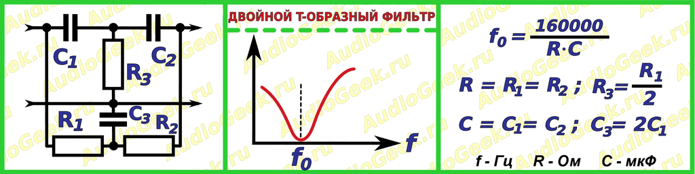

[English](./README.md) | **Русский**

# RC-цепи, 5 самых ходовых схем фильтров и их простой рассчет

**Рубрики:** Схемотехника аудиотракта  
**Метки:** звуковые фильтры  
**Оригинал:** https://audiogeek.ru/rc-circuit/

---

RC-цепь, такое частое явление радиоэлектроники. Такие фильтры стоят повсюду. Понимание того, как какой фильтр влияет на форму АЧХ сигнала во многом определяет правильность чтения всей электронной схемы. В статье собраны 5 основных RC-фильтров, приведены их АЧХ и упрощенные формулы расчета.

Содержание:

- ***Введение***
- ***1. Фильтр Низких Частот***
- ***2. Фильтр Высоких Частот***
- ***3. Избирательный фильтр***
- ***4. Т-образные фильтры***
- ***5. Двойной Т-образный фильтр***

В ранние годы развития радиоэлектроники для воздействие на Амплитудно - Частотную Характеристику (АЧХ) сигнала в основном применялись LC - фильтры, т.е. фильтры состоящие из катушки индуктивности и конденсатора. Со временем им на смену пришла RC-цепь, которая была плотно взята в оборот радиоэлектроникой ввиду меньшей стоимости и габаритов.

Конечно, фильтры на RC-цепях не могут полностью вытеснить LC собратьев. Например в фильтрах для АС предпочтительнее использование LC-фильтров. Но практически во всей маломощной электронике главенствуют именно RC-цепи. Например двойная RC-цепь в фильтре **[RIAA-корректора](../riaa-korrektor/)**.

> Интересным вариантом избавления от катушек являются **[фильтры на гираторах](../filtri-na-gyratorah/)**, где посредством конденсатора и операционного усилителя эмитируется работа катушки.

## *Упрощенные формулы*

Для простого расчета фильтров далее приведены упрощенные формулы, позаимствованные из инженерного справочника.

В формулах присутствует коэффициент **160000** (сто шестьдесят тысяч). Эта цифра возникает по двум причинам.

- Во-первых предполагается брать величину емкости при расчетах в **микрофарадах** (10-6 Фарада)
- Во-вторых при переходе от круговой частоты к цикличной возникает множитель 2π

Соответственно:

**1 / (2⋅π⋅10-6) = 159154 ≈ 160000**

Итак, давай те же перейдем к самим фильтрам.

## ***1. Фильтр Низких Частот (ФНЧ) - он же интегратор:***

**ФНЧ** - фильтр, пропускающий без изменения частоты ниже частоты среза (f0) и подавляющий частоты выше f0. На частоте среза имеет значение амплитуды в -3dB. Это фильтр первого порядка и крутизна среза составляет 6дБ/октаву. Чаще всего такие фильтры используются для отсечения высокочастотных помех и шумов.

> ***Октавой называется такой интервал частот, у которого конечное значение частоты больше начального в два раза.***

## ***2. Фильтр Высоких Частот (ФВЧ) - он же дифференциатор***

ФВЧ - фильтр, ослабляющий частоты ниже частоты среза(f0) и пропускающий без изменения частоты выше f0. Так же как и у приведенного выше ФНЧ, сигнал на частоте среза обладает амплитудой в -3дБ, а крутизна среза 6 дБ на октаву.

> ***И ФНЧ и ФВЧ работают как делитель напряжения, в котором одно плечо представлено постоянным резистором, а второе конденсатором, имеющим частотную зависимость.***

Такие фильтры часто применяются на выходах звуковых усилителей для отсечения инфранизких, которые могут повредить АС.

## ***3. Избирательный фильтр***

Такой фильтр выделяет определенную частоту или полосу частот за счет подавления других частот. По сути этот фильтр представляет из себя последовательное включение ФНЧ и ФВЧ. Соответственно при равенстве между собой емкостей и сопротивлений выделена будет определенная частота, а в обе стороны будет ослабление с крутизной 6 дБ/окт .

Но никто не мешает расширить полосу пропускания, если рассчитать каждую RC-цепь R1С1 и R2C2 для разных f0.

## ***4. Т- образные фильтры***

Т- образные фильтры это те же Г-образные фильтры низкой частоты и высокой частоты, к которым добавляется еще один элемент. Но особенностью Т-образных фильтров является то, что по сравнению с Г-образными, они оказывают меньшее шунтирующее действие на цепи стоящие за фильтром.

## ***5. Двойной Т-образный фильтр - пробка***

Фильтр имеет бесконечное затухание (*порядка 60дБ*) которое возникает благодаря сложению двух сигналов имеющих на частоте среза разность фаз 180. Применение такого фильтра весьма эффективно для устранения сигнала помехи. Например сетевой наводки 50Гц.

> Если Вам интересна тема фильтров, то возможно, Вас так же заинтересует: **[Фазово-частотная характеристика (ФЧХ) фильтров и звук](../fazo-chastotnaya-harakteristika-filtrov/)**

*Материал подготовлен исключительно для сайта [AudioGeek.ru](https://github.com/SkyTrip-13/AudioGeek)*
