[Русский](./README.ru.md) | **English**

# Headphone driver not working? How to repair a headphone driver

**Category:** Headphone repair  
**Tags:** DIY  
**Original:** https://audiogeek.ru/remont-dinamika-naushnikov/

---

The main component of any headphones is the driver. Unfortunately drivers, like anything else, sometimes depart for the other world. What to do if a headphone driver does not work, and can it be repaired with your own hands?

If your left or right earphone does not work, it does not yet mean that the problem is in the driver. In the vast majority of cases the problem is a break in the wire near the plug. The solution to that problem is given in the article: ***[Fixing headphones with your bare hands, no soldering iron!](../remont-naushnikov-bez-payalnika/)***

One day the right earphone of my on-ear Yamahas (RH5-MA) stopped playing. I hoped the driver was not working because a wire had broken. But the autopsy showed that the cause was in the driver itself. It was dead....
The simplest solution to the problem would have been throwing the headphones in the trash. But I decided to try to repair the driver. It was not easy and not perfect, but it turned out to be feasible. Read in this article what to do if a headphone driver does not work and how to repair it...

## The headphone driver does not work

As it turned out after opening it up, the headphone driver does not work because the lead wire broke right where it approaches the coil. The red arrow points at this annoying spot.

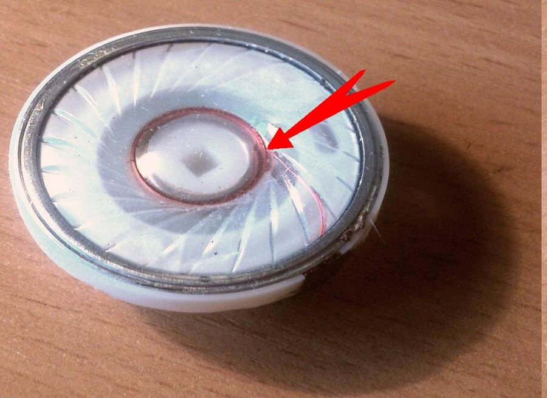
This driver has a diameter of 40 mm. Drivers of this size are used in the vast majority of on-ear and often in full-size headphones. ***[How do headphone types differ?](../headphones-types/)***

## Is this not the end?

The sad story of these headphones, which were incidentally only 2 months old, could have ended here. **But that is not interesting ))**

By analogy with loudspeaker drivers, the thought arose of transplanting the coil from another pair of headphones. But an attempt to carefully tear the coil off at home was unsuccessful and gave no positive emotions...

Almost immediately another idea came: transplant not just the coil but the coil together with the diaphragm from donor headphones.

There is simply no point in using headphones of the same price category, so of course the donors are cheaper headphones. Of course that is not good, and you can forget about the signature sound, but it is not all that bad.

In defense of this solution it can be said that the magnet system, which stays original, also has a very large effect on the sound, perhaps no less than the diaphragm. In addition, the original plastic part (the driver basket?) also stays, with its sound tubes and acoustic filters calculated by the manufacturer.

## **From idea to implementation**

The drivers of these headphones have one feature you have surely already noticed: a metal ring around the perimeter. The original diaphragm was pressed into it.

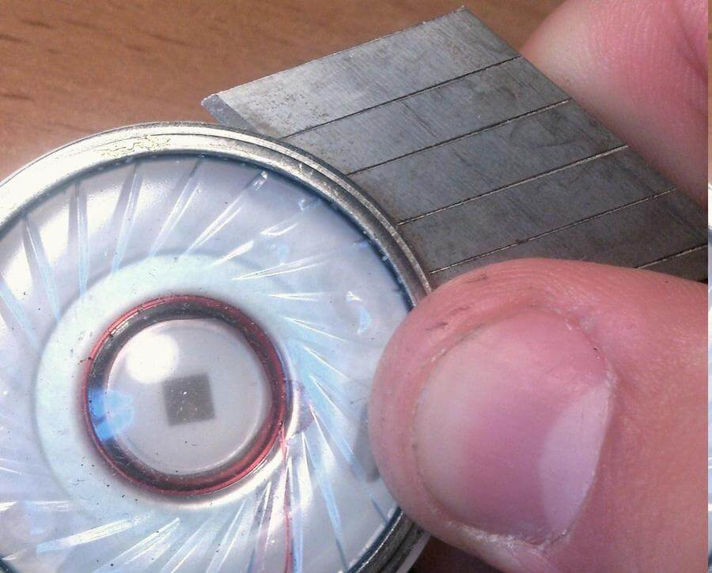

With the tip of a knife this ring was successfully pried off.

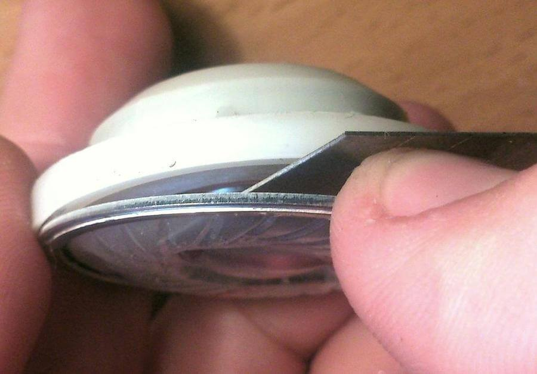

Care is by and large not required at this stage; you could brazenly tear it off and throw it away. But to make repairing the headphone driver easier, it is better to practice on the original one and understand how to do everything neatly. Because when you ruin the donor it will be too late :)

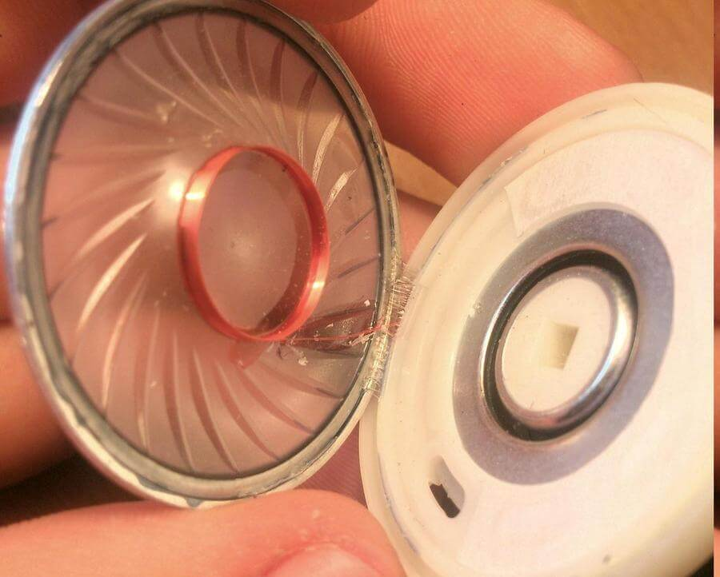

After peeling off the original diaphragms everything was thoroughly cleaned of glue residue. You should also examine the magnetic gaps very carefully, i.e. the places where the coil sits. They must be clean. If there is any dirt in them, clean it out with a cotton swab dipped in alcohol.

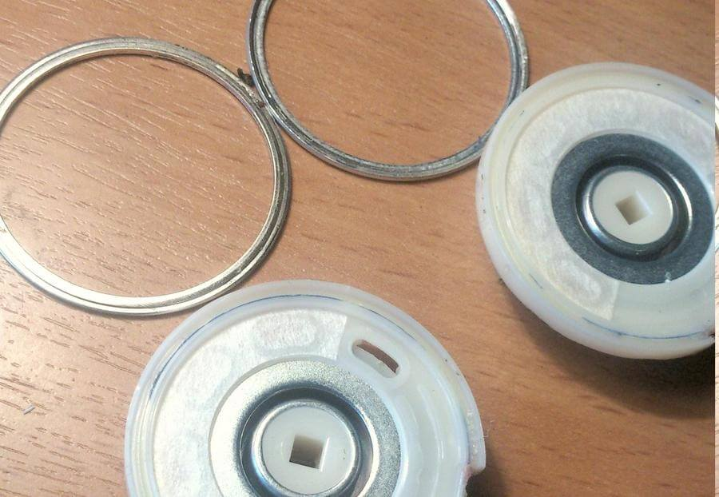

**The main thing is not to let metal particles get into the magnetic gap! If it does happen, the easiest way to remove them is to push adhesive tape into the gap. For convenience it is better to fold it in half, sticky side out, and collect all the particles on it.**

## **And here come the donors**

I think it is clear anyway that the donor headphone drivers must have the same dimensions. I was lucky: the drivers were 40 mm in diameter at the outer edge, with a coil diameter of about 13 mm. The vast majority of computer headphones have the same dimensions. But even among 40 mm drivers there are sometimes ones with a larger coil diameter.

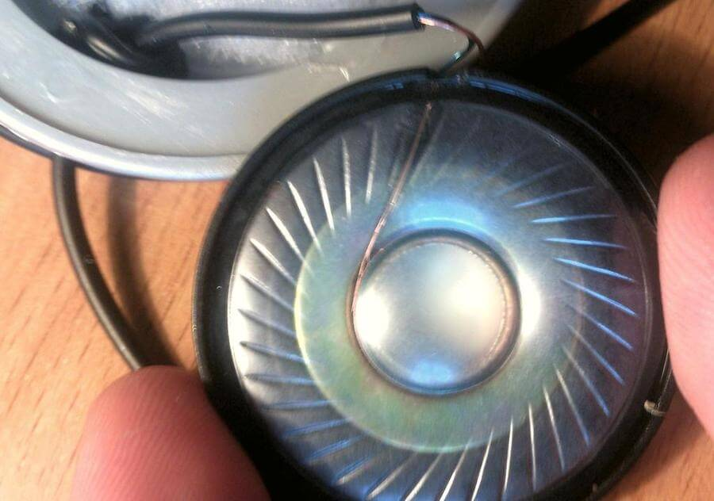

Now you need to gather all your concentration and, carefully, as if you were a cardiac surgeon, peel off the diaphragm. The diaphragm is glued around its perimeter with some kind of rubber glue.

A needle is great for lifting the diaphragm. The main thing is not to hurry. The diaphragm is a thin polyethylene film that stretches easily and tears fairly easily.

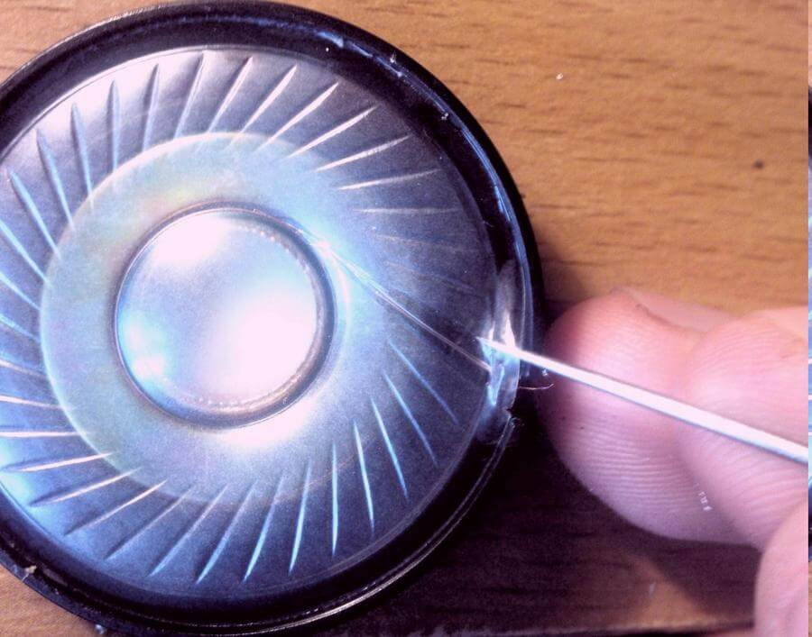

It turned out to be more convenient to start peeling from the place where the wires run. Before that, the wires were unsoldered from the contacts. While peeling I also used a knife actively. Slipping the tip of the knife under the diaphragm and pressing from above with a finger, slooowly peel the diaphragm off and move around the circle that way.

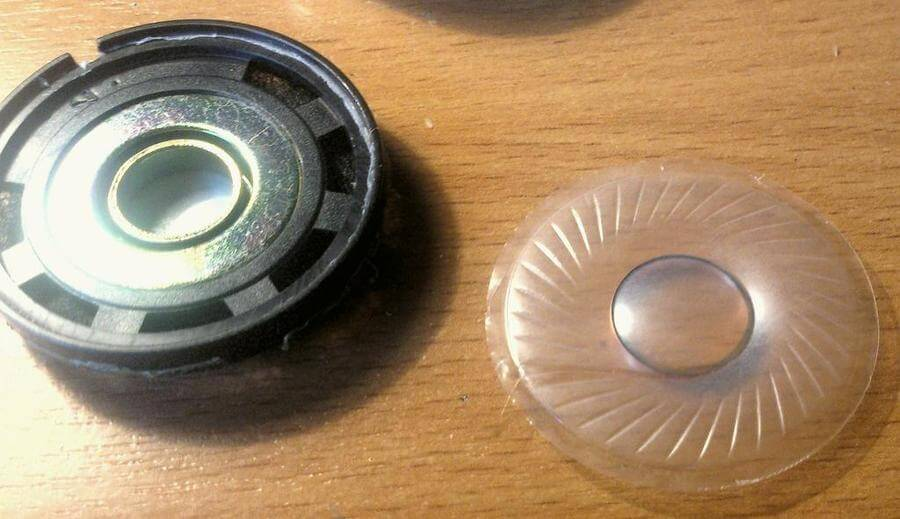

As a result we have what we needed: a donor for repairing the headphone driver. Do the same operations with the second driver.

## **Careful with the wires**

Very often manufacturers coat the wires running from the contacts to the coil with glue, and it is not always possible to extract them undamaged. Even if the wires tear off at the edge of the diaphragm you can do the following trick: peel the wires off the diaphragm. Then unwind a little from the coil and glue them back, but at a different angle.

If the coil unwinds reluctantly, do not overdo it, or you can easily tear the wires. It is better to glue them across the diaphragm. This way you can lengthen the protruding wire ends by almost a centimeter, which is more than enough.

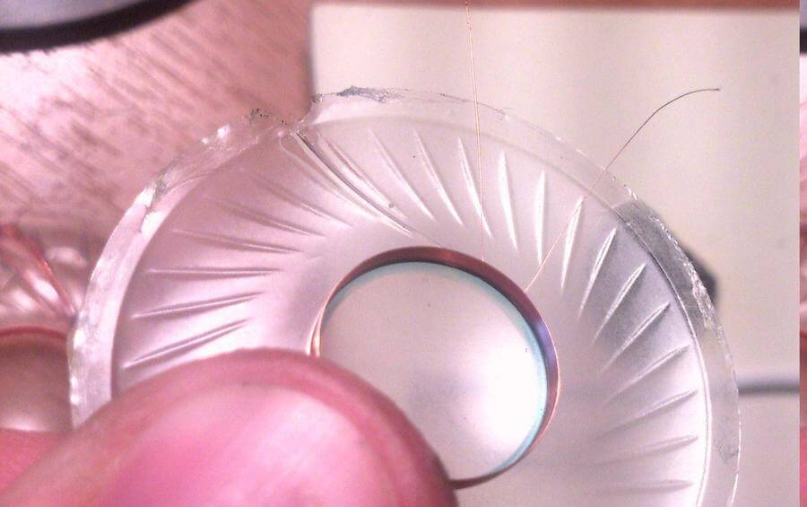

***The photo shows a test diaphragm used for experiments***

## **Tinning the wires**

So that you can later solder the wires to the contacts right away, it is better to tin them at this stage, i.e. coat them with tin.

**Attention:** do not forget that the wires touch the diaphragm directly, and the copper they are made of conducts heat very well. You can easily melt and deform the diaphragm that way.

Often the wires are coated with a lacquer that does not burn off even with a soldering iron. In that case an aspirin tablet helps. You can of course swallow it and it will help with yesterday's hangover, but in our case it is more useful to lay the wire on it and tin right on it. In any case, do not forget that everything must be done quickly, and wait for the wires to cool, otherwise the diaphragm goes to the trash.

**The fumes produced are toxic!** It is advisable to do these aspirin tricks in a well-ventilated room.
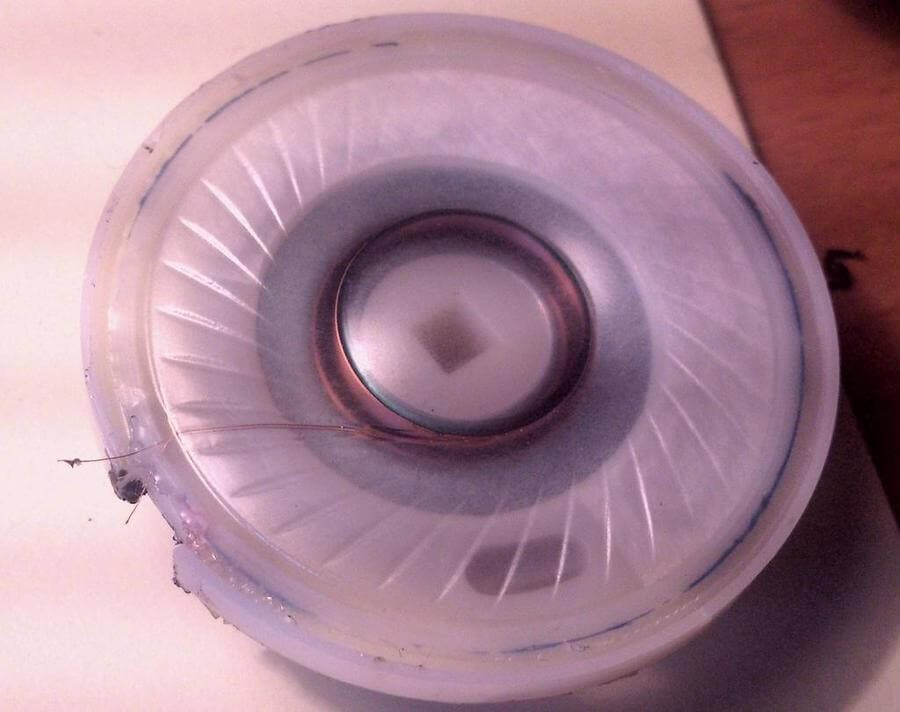

## **Soldering**

**What should be soldered where?** It is very simple. A driver's voice coil is *just a twisted and glued piece of wire*. The coil itself has no real concept of plus and minus. Usually the start of the coil is taken as plus and its end as minus.
But do not worry about it. The polarity is easily determined after soldering. It is better to solder so that both wires reach freely.
Each driver has a contact group. Most often it is a piece of glass-fiber laminate with four contacts. The left two are connected to each other and the right two to each other. The **coil wires** are soldered to the two upper contacts, and the wires coming from the plug to the two lower ones (**yellow** and **blue**). That is how the circuit is closed.
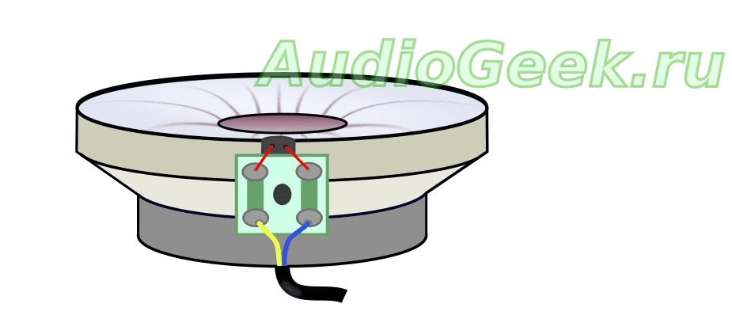

With the contacts sorted out, it is time to try on the new diaphragm. For that we need to solder the coil wires to the two upper contacts. If one or both wires do not reach the contacts, solder an extra piece of wire to the pads. And then solder the coil wires to that wire.

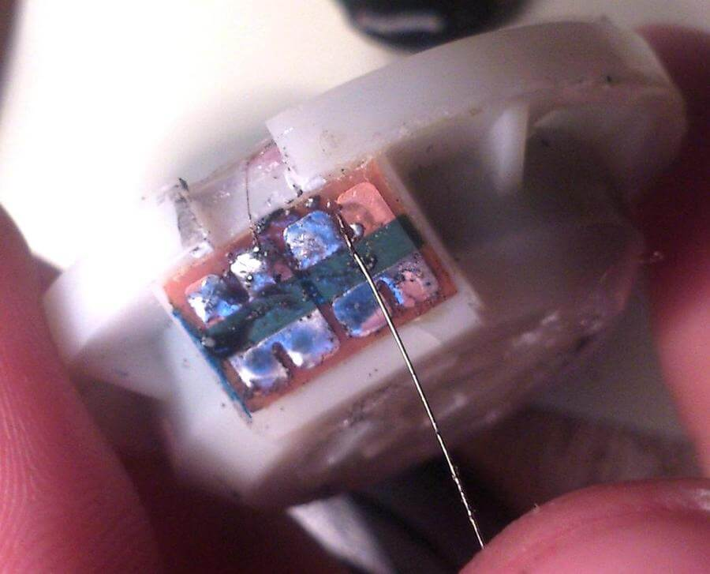

## **Gluing the diaphragm on**

It is time to glue the diaphragm to the plastic base. I preferred to use Moment (a Russian contact glue). Be sure to test the glue beforehand on a similar material. "Moment Supercement" glue caused partial melting and irreversible deformation. For maximum neatness when applying it, it is better to use a large needle.

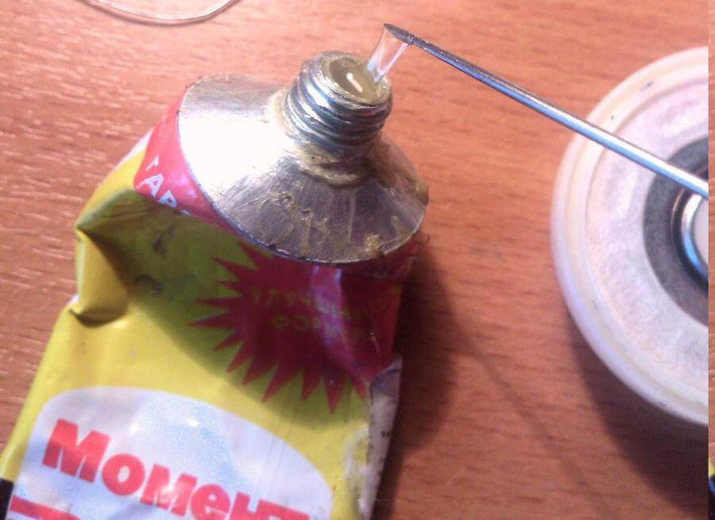

At this stage it is very important to center the driver correctly, otherwise the coil will later rub against the magnet system. For centering I soldered a wire to the not-yet-glued driver to connect it to an audio device, and played a track. I held the diaphragm so as not to tear off the wire. Do not play it too loud; even at low volume you will clearly hear buzzing when it rubs.

Try to find a position where the coil enters the gap as symmetrically as possible without rubbing. Remember it. Then, holding the diaphragm with your fingers, coat it with glue in the area of the wires, pushing the needle with glue under the diaphragm. The track can be left playing so you notice the slightest misalignment right away.

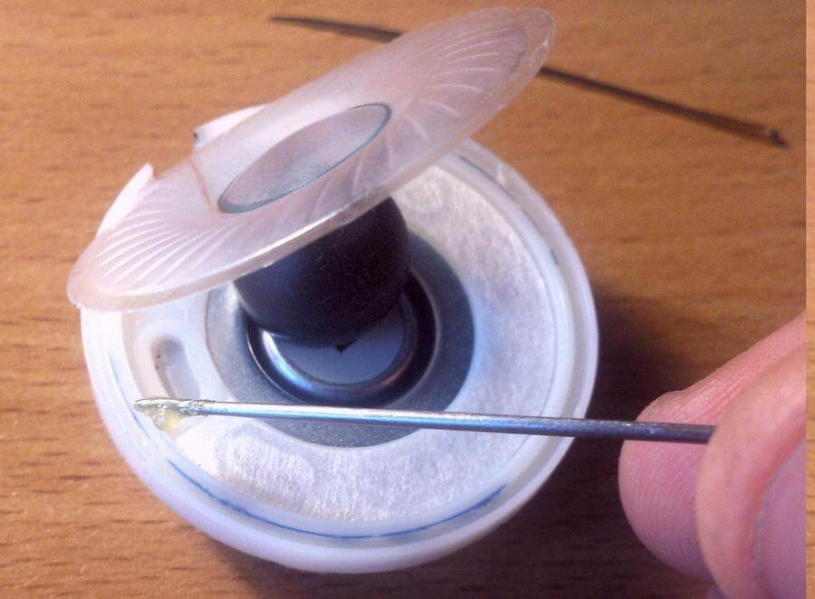

Put something under the driver and smear glue around the perimeter. Again, with the track playing, try to seat the diaphragm carefully so that nothing rings or buzzes.

After that it is desirable to press the edge of the diaphragm with the eye of the needle. If it has not stuck somewhere, first the driver will start to make extra noises, and second there will be a dip in the low frequencies. So additionally smear glue around the perimeter over the edge of the diaphragm.

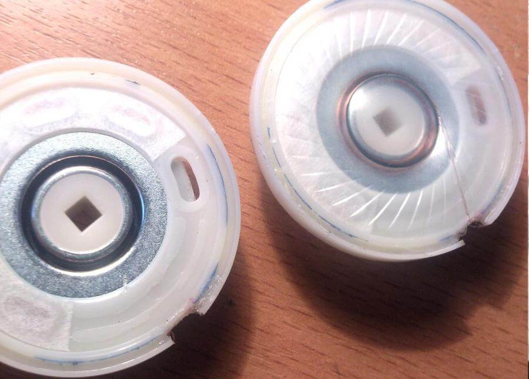

Do not forget to check the coil for breaks by measuring resistance. The resistance of such drivers is usually about 32 Ω. It is also worth checking the coil right after peeling it off the donors.

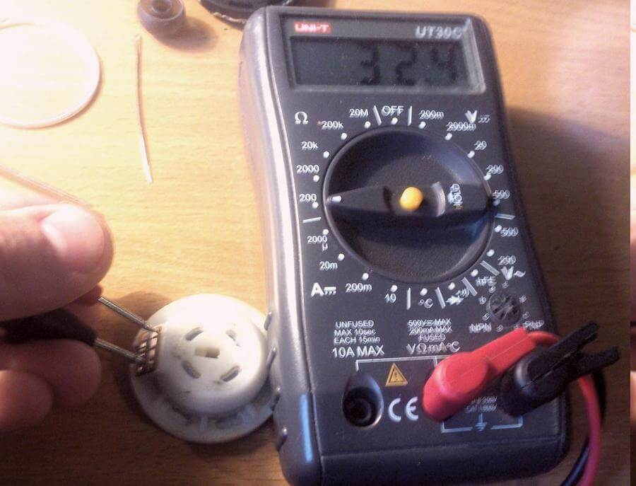

After applying glue, the ring was put back in its place.

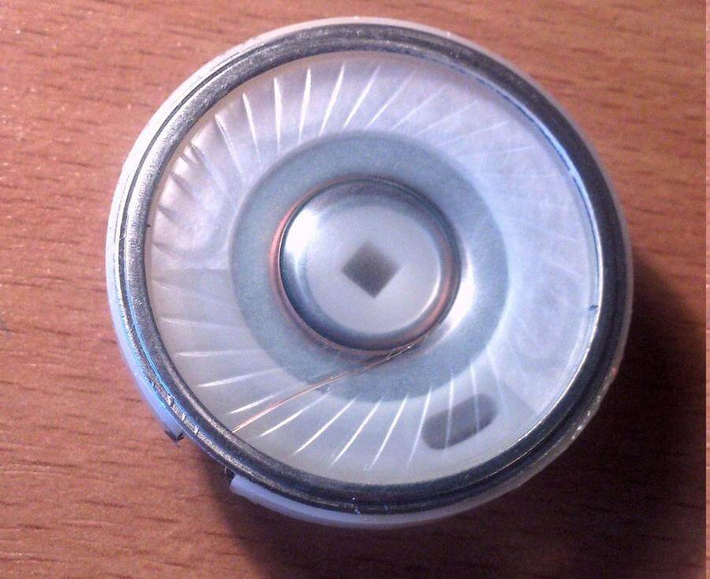

## **How to determine driver polarity**

During soldering the coil wires could have been swapped. To determine the phasing of the driver, it is easiest to use a small 1.5 volt battery. Solder a pair of wires to the driver and briefly touch their ends to the different poles of the battery.
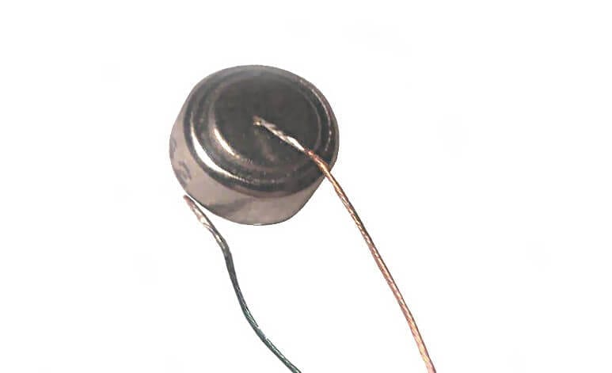
With one polarity the driver diaphragm will move up, with the opposite polarity it will be drawn into the coil. You can take the diaphragm rising as positive polarity. See how the battery is connected and mark plus and minus on the driver.
Do this with both drivers, then boldly solder the lead wires and assemble the headphones.

## The result

Of course the sound is not the same. It became better than that of the donors but somewhat worse than that of the original Yamaha drivers. But it is not even about the sound. Frankly, I even enjoyed the process itself :)

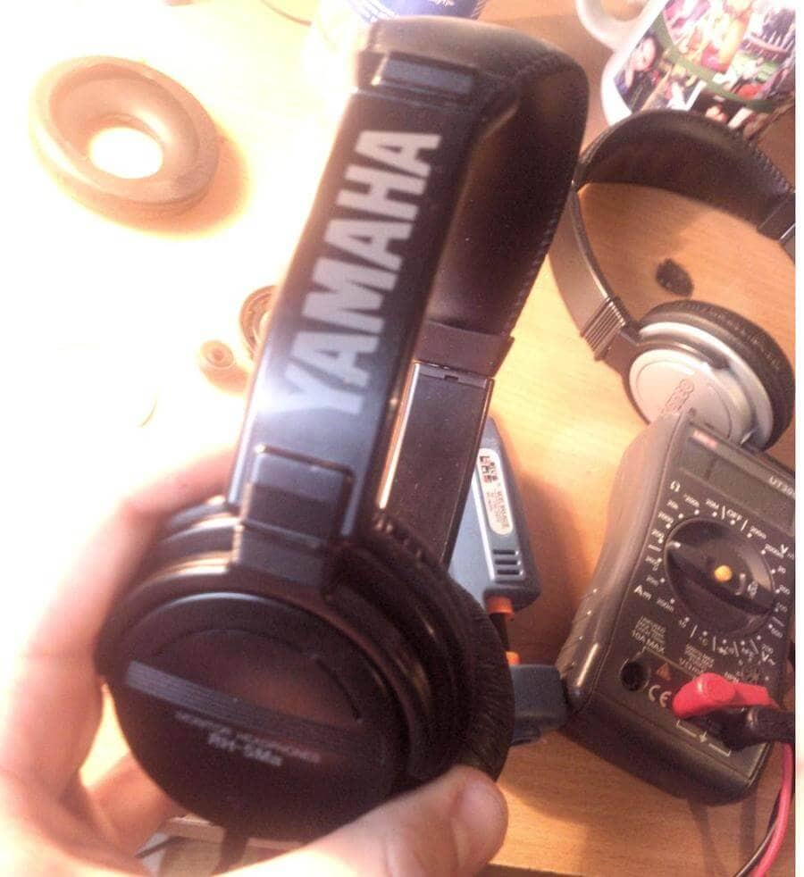

These headphones had to survive similar manipulations twice more for various reasons, and depending on the donor diaphragms used the sound took on different shades. In one case the lows increased and the highs sat down, apparently the diaphragm dome was not stiff enough. With very cheap donors the midrange stuck out.

There is a sea of paths for experiments with sound! A very absorbing pastime :) two hours pass in one breath while you tensely carry out painstaking manipulations, and then you rejoice like a child that it worked after all ))

*Originally written for [AudioGeek.ru](https://github.com/SkyTrip-13/AudioGeek). Translated from Russian.*
