[English](./README.md) | **Русский**

# Не работает динамик наушников? Как починить динамик наушников.

**Рубрики:** Ремонт наушников  
**Метки:** своими руками  
**Оригинал:** https://audiogeek.ru/remont-dinamika-naushnikov/

---

Главным компонентом любых наушников является динамик. К сожалению динамики, как любая другая вещь, иногда отправляются в мир иной.  Что делать если  не работает динамик наушников и можно ли его починить своими руками.

Если у вас не работает левый или правый наушник, это еще не означает что проблема в динамике. В подавляющем большинстве случаев проблема кроется в переломе провода около штекера. Решение этой проблемы дано в статье:***[Ремонт наушников голыми руками, без паяльника!](../remont-naushnikov-bez-payalnika/)***

В один из дней у накладных Ямах(RH5-MA) перестал играть правый наушник. Была надежда, что не работает динамик наушников потому, что переломился провод. Но вскрытие показало, что причина кроется в самом динамике. Он сдох.... 
Самым простым решением проблемы могло стать выкидывание наушников в мусорную корзину. Но было решено попытаться починить динамик. Это было не просто и не идеально, но оказалось реальным. Что делать если не работает динамик наушников и как его починить читайте в статье...

## Не работает динамик наушников

Как выяснилось после вскрытия, не работает динамик наушников от того, что прямо на подходе к катушке переломился подводящий проводок. На это досадное место указывает красная стрелочка. 

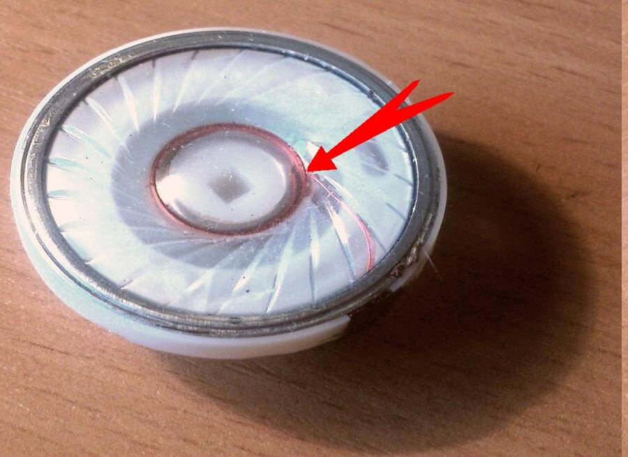
Этот динамик имеет диаметр 40 мм. Динамики такого размера применяются в подавляющем большинстве накладного типа и зачастую в полноразмерых наушниках. ***[Чем различаются типы наушников?](../headphones-types/)***

## Это еще не конец?

На этом печальная история наушников, которым кстати было только 2 месяца, могла и закончиться. **Но так же не интересно))**

По аналогии с динамиками для акустических систем, возникла мысль переселить катушку от динамика других наушников. Но попытка аккуратно оторвать катушку в домашних условиях не увенчалась успехом и положительных эмоций не дала...

Практически сразу пришла другая идея - трансплантировать не просто катушку, а катушку вместе с диффузором от наушников доноров.

Использовать наушники той же ценовой категории просто не имеет смысла, поэтому разумеется доноры - более дешевые наушники. Конечно это не есть хорошо, и про фирменный звук можно забыть, но не все так уж плохо.

В защиту такого решения можно сказать, что магнитная система, которая останется родной, так же оказывает очень большое влияние на звук, возможно даже не меньшее чем диффузор. Помимо этого родной также останется и пластмаска (корзина динамика?), в которой есть звуководы с акустическими фильтрами, рассчитанными производителем.

## **От идеи к реализации**

У динамиков этих наушников есть одна особенность, которую вы наверняка уже заметили - металлическое колечко по периметру. В него был запрессован родной диффузор.

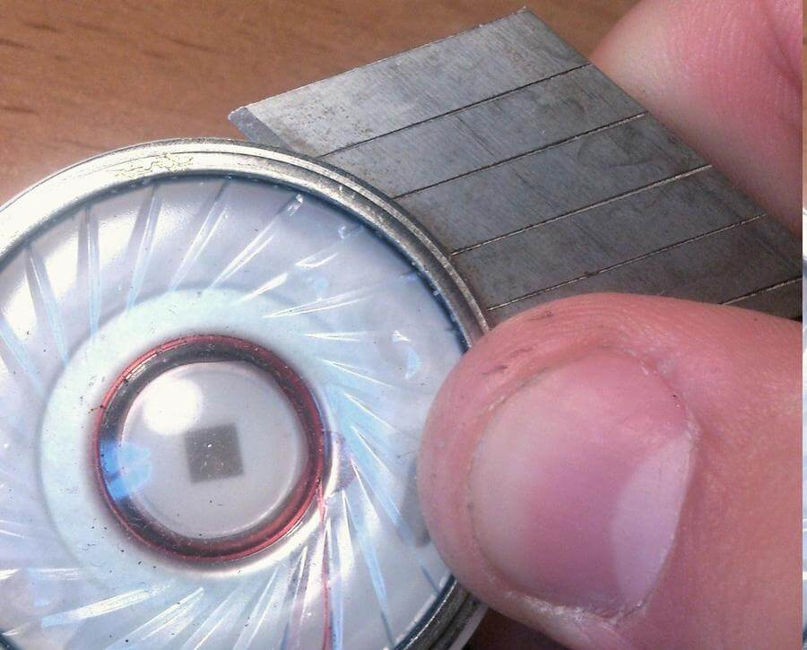

Поддеванием ножа это кольцо было благополучно отклеено.

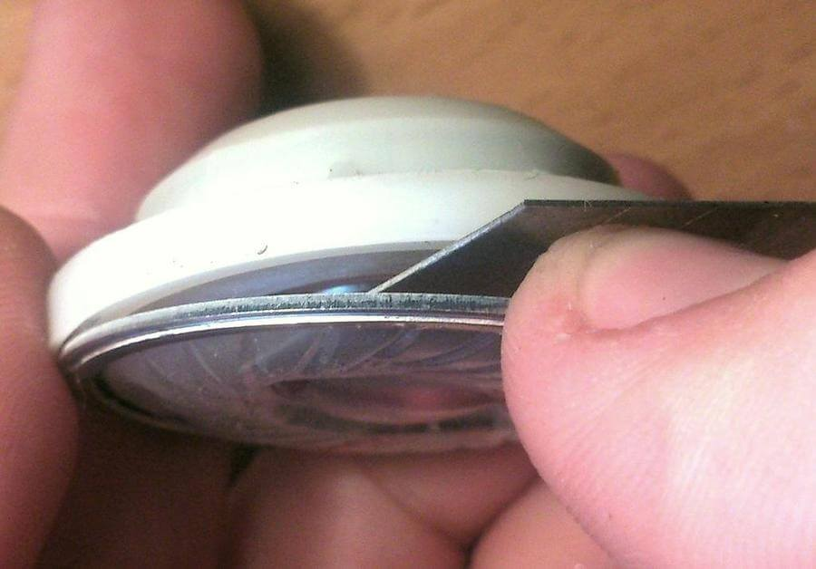

Аккуратность на этом этапе, по большому счету, не требуется - можно нагло оторвать и выкинуть. Но чтобы починить динамик наушников было проще, лучше уже на родном потренироваться и понять как можно сделать все аккуратно. А то когда запорите донора будет уже поздно)

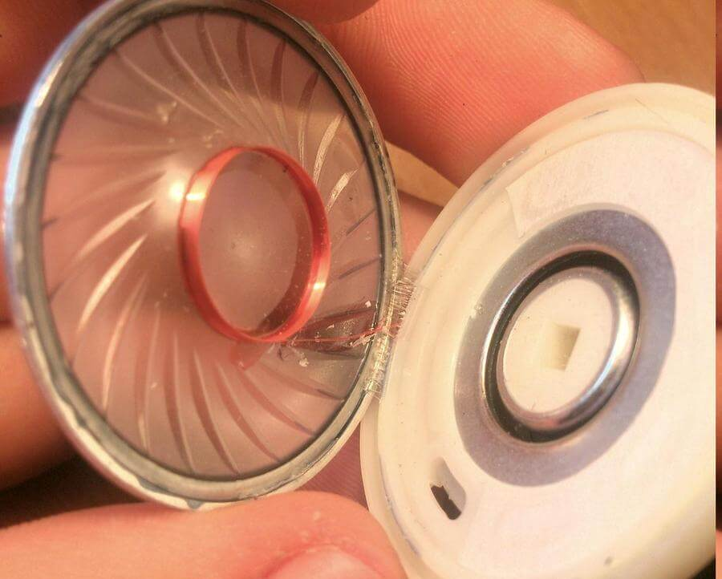

После отклейки родных диффузоров все было тщательно очищено от остатков клея. Следует так же очень внимательно осмотреть магнитные зазоры, т.е. те места где располагается катушка. Они должны быть чистыми. Если в них присутствует какая либо грязь - вычистите ее ватной палочкой смоченной в спирте.

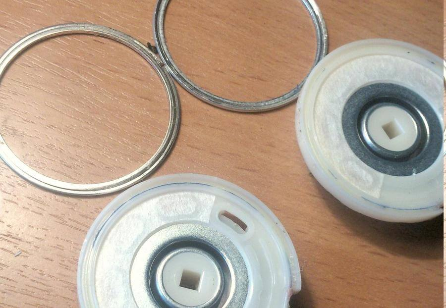

**Главное не допускайте попадания металлических частиц в магнитный зазор! Если это все же произошло, то самый простой способ их от туда убрать - просовывать в зазор скотч. Для удобства его лучше сложить пополам, клейкой стороной наружу и собирать на него все частички.**

## **А вот и доноры подоспели**

Я думаю итак понятно, что динамики наушников доноров должны обладать теми же размерами. Мне повезло, динамики были диаметром 40мм по внешнему краю, и около 13мм диаметр катушки. Такими же размерами обладает подавляющая часть компьютерных наушников. Но даже среди 40-ка миллиметровых встречаются иногда такие динамики, у которых диаметр катушки больше.

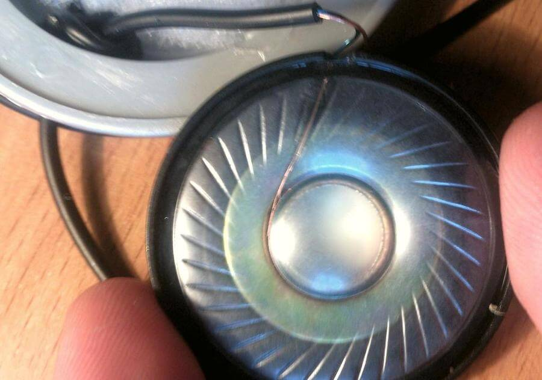

Теперь необходимо собрать всю сосредоточенность в кулак и аккуратно, словно вы кардиохирург, отклеить диффузор. Диффузор проклеен по периметру каким-то резиновым клеем.

Для того чтобы подцепить диффузор отлично подойдет иголка. Главное - не торопитесь. Диффузор - это тонкая полиэтиленовая пленочка, которая легко тянется и довольно легко рвется.

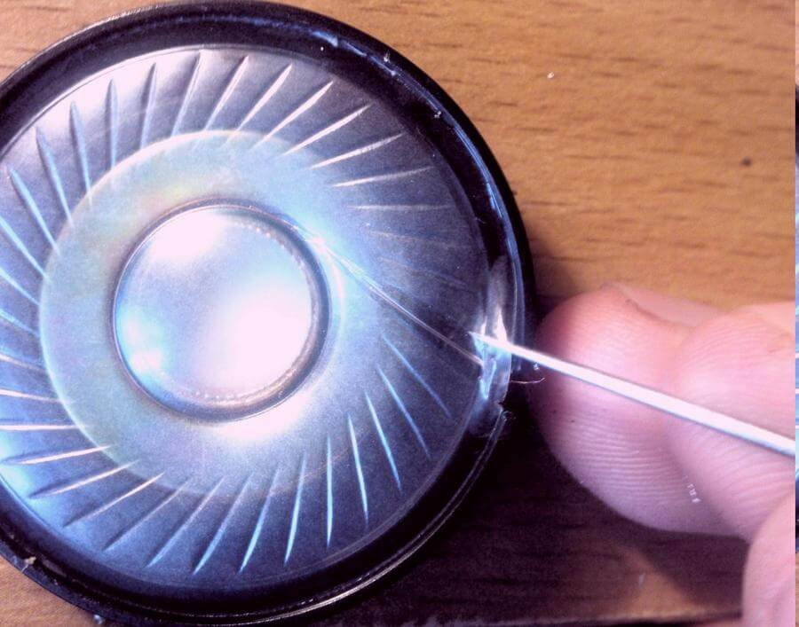

Отклеивать удобнее оказалось с того места, где проходят проводки. Перед этим проводки были отпаяны от контактов. По мере отклеивания так же активно использовался нож. Поддевая острие ножа под диффузор и прижимая сверху пальцем мееедленно отклеиваем диффузор и продвигаемся так по кругу.

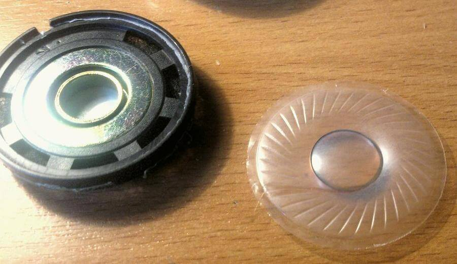

Как итог имеем то что нам и требовалось - донора для ремонта динамика наушников. Проделываем аналогичные операции и со вторым динамиком.

## **Аккуратнее с проводками**

Очень часто производители заливают клеем проводки идущие от контактов к катушке и не всегда можно извлечь их неповрежденными. Даже если проводки оторвались на краю диффузора можно проделать следующий трюк- отклеить проводки от диффузора. Затем немного отмотать с катушки, после чего  приклеить их обратно, но уже под другим углом.

Если катушка разматывается неохотно, то не стоит усердствовать - можно легко порвать проводки. Лучше приклеить их поперек диффузора. Так можно удлинить торчащие конци проводков практически на сантиметр, чего более чем достаточно.

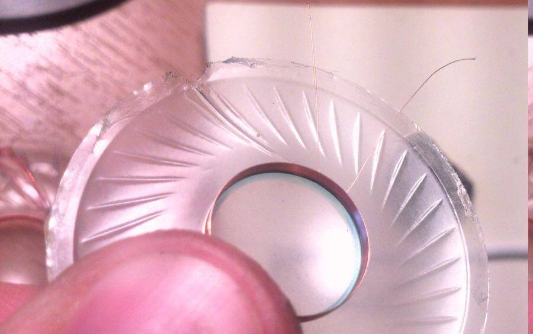

***На фото - тестовый диффузор с которым проводились эксперименты***

## **Лудим проводки**

Для того чтобы потом можно было сразу подпаять проводки к контактам - лучше уже на этом этапе их залудить, т.е. Покрыть их оловом.

**Внимание** - **не забывайте тот факт, что проводки непосредственно касаются диффузора, а медь, из которой они изготовлены, отлично проводит тепло. Так можно легко оплавить и деформировать диффузор.**

Часто проводки покрывают лаком, который не сгорает даже от паяльника. В таком случае поможет таблетка аспирина. Можно конечно ее выпить и она поможет от вчерашнего похмелья, но в нашем случае от нее будет больше толку, если положить на нее проводок и лудить прямо на ней. Но в любом случае не забываем, что делать все нужно быстро и ждать пока проводки остынут иначе диффузор отправится в мусорку.

**Образующиеся пары токсичны!** Указанными фокусами с аспирином желательно заниматься в хорошо проветриваемом помещении.
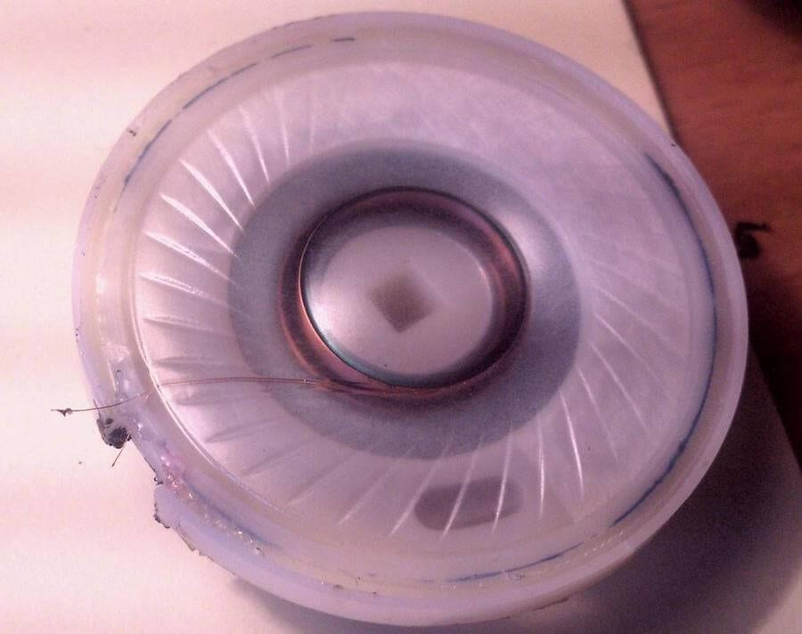

## **Припаиваемся**

**Куда и кого следует припаивать?**Все очень просто. Катушка динамика - *это просто скрученный и склеенный кусок провода*. Как такового понятия плюса и минуса у самой катушки нет. Обычно за плюс принимают начало катушки, а за минус его конец.
Но не стоит заморачиваться. Полярность легко определяется после припайки. Лучше припаивать так, чтобы оба проводка свободно дотягивались.
У каждого динамика есть контактная группа. Чаще всего это кусочек стеклотекстолита с четырьмя контактами. При этом левые два замкнуты между собой, а правые два- между собой. **Проводки катушки** припаиваются к двум верхним контактам, а провода, идущие от штекера к двум нижним (**желтый** и **синий**). Таким образом цепь и замыкается.
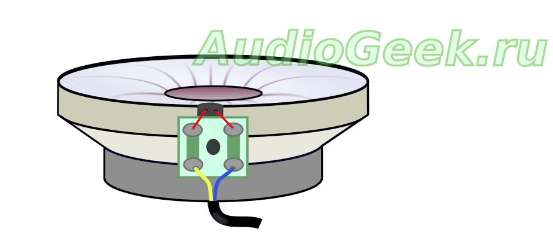

С контактами разобрались. Настала пора примерить новый диффузор. Для этого нам какраз и потребуется припаять проводки катушки к верхним двум контактам. Если один или обо проводка не дотягиваются до контактов - то припаиваем дополнительно кусочек проволочки к площадкам. А уже к проволочке припаиваем проводки катушки

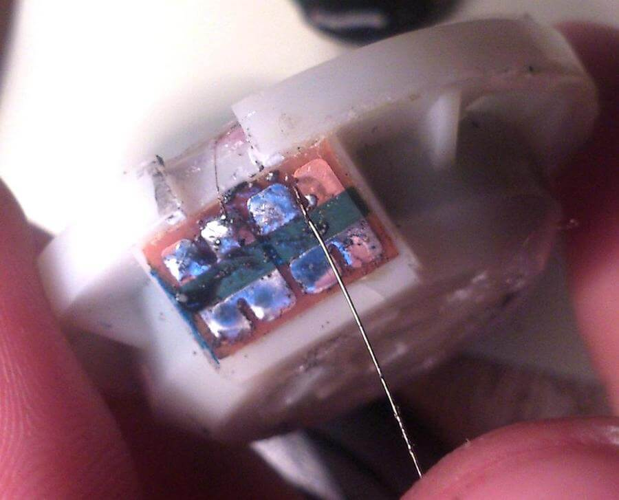

## **Приклеиваем диффузор**

Настал черед приклейки диффузора к пластиковой основе. Я предпочел использовать Момент. Обязательно предварительно опробуйте клей на аналогичном материале. Клей Момент суперцемент - привел к подплавлению и необратимой деформации. Для максимальной аккуратности при нанесении лучше использовать большую иглу.

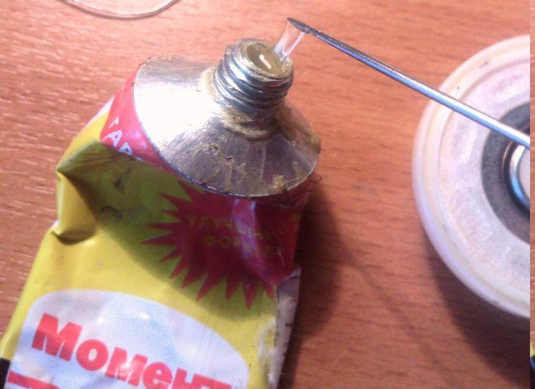

На этом этапе очень важно правильно отцентрировать динамик, иначе потом он будет задевать катушкой магнитную систему. Для центровки я подпаял к еще непроклеенному динамику провод, для его подключения к аудиоустройству и включил трек. При этом придерживая диффузор, дабы не оборвать провод. Не стоит включать слишком громко, даже на малой громкости вы отчетливо услышите жужжание при задевании.

Постарайтесь найти положение, чтобы катушка максимально симметрично входила в зазор и при этом не задевала. Запомните его. После этого придерживая пальцами диффузор промажьте его клеем в районе проводов, просовывая иголку с клеем под диффузор. При этом трек можно оставить включенным, чтобы сразу обнаружить малейший перекос.

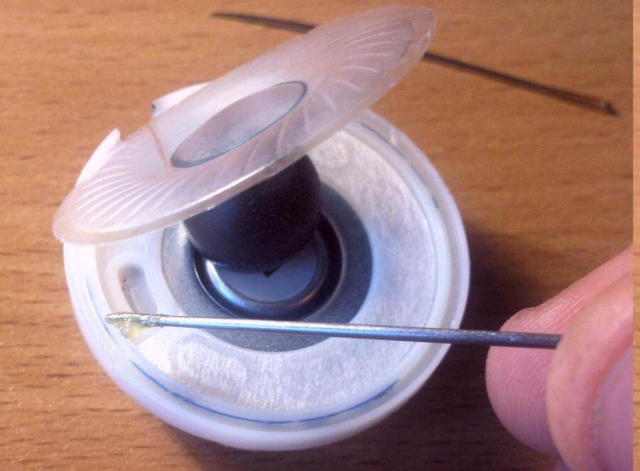

Подкладываем что-либо под динамик и мажем клеем по периметру. И опять же следует при включенном треке, постараться аккуратно посадить диффузор так, чтобы ничего не звенело и не пердело.

После этого желательно придавить ушком иголки краешек диффузора. Если где-то он не приклеился, то во первых динамик начнет издавать призвуки, а во вторых будет провал по низким частотам. Поэтому дополнительно промазываем клеем по периметру поверх края диффузора.

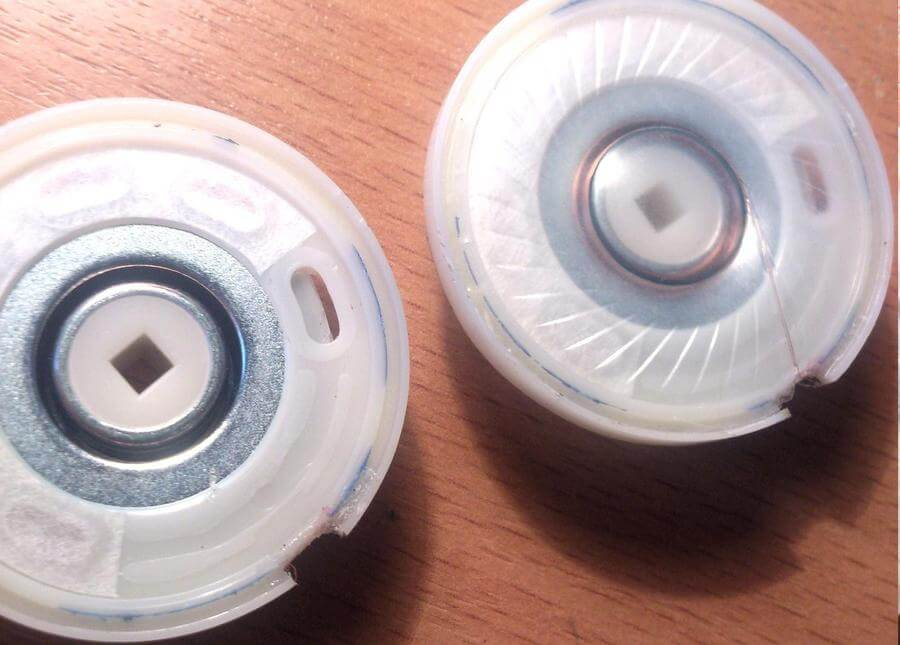

Не забываем проверять катушку на обрыв измерением сопротивления. Сопротивление подобным динамиков как правило около 32 ом. Проверить катушку стоит так же сразу после отклейки ее от доноров.

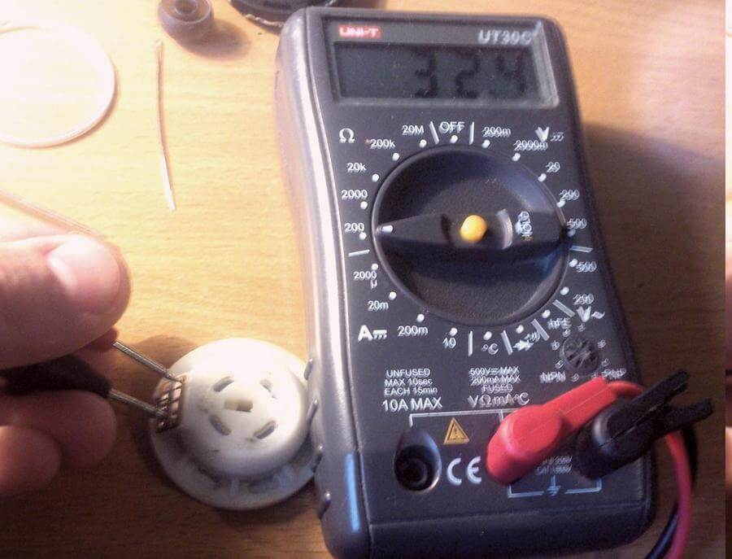

Промазав клеем, кольцо было вставлено на положенное место.

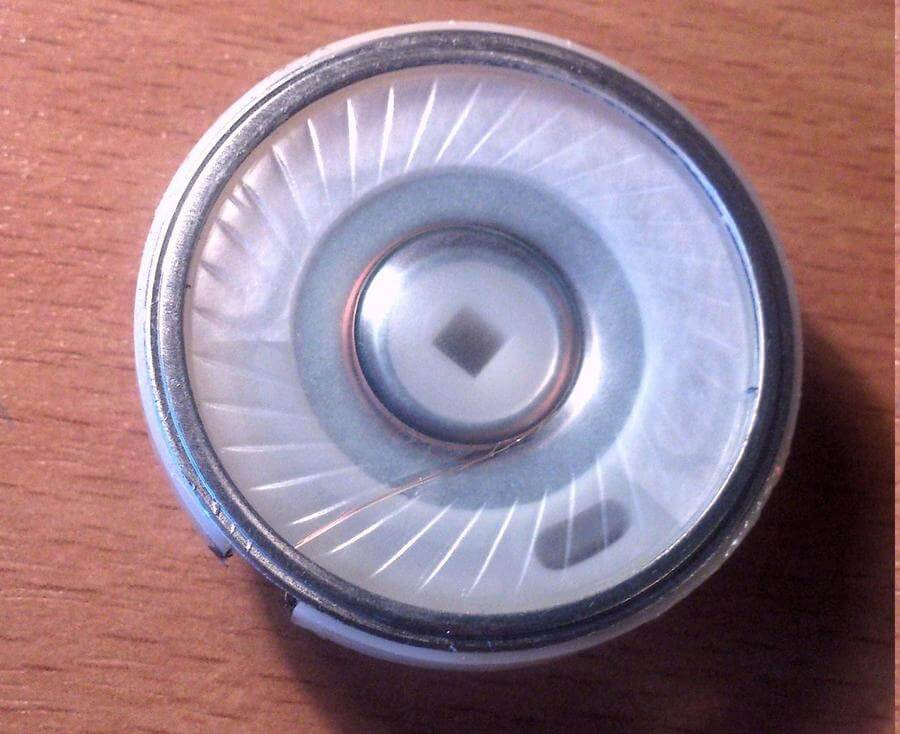

## **Как определить полярность динамиков**

В процессе пайки проводки катушки могли быть перепутаны. Для того, чтобы определить фазировку динамика, удобнее всего воспользоваться маленькой батарейкой на 1.5 вольта. Припаиваем пару проводков к динамику и их концами ненадолго прикасаемся к разным полюсам батарейки.
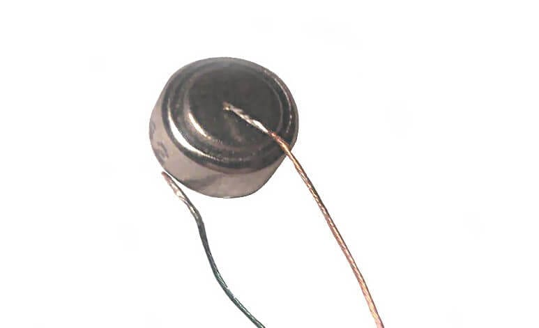
При одной полярности диффузор динамика поднимется, при противоположной полярности - втянется в катушку. Можно принять за положительную полярность подъем диффузора. Смотрим как подключена батарейка и на динамике отмечаем плюс и минус. 
Проделываем это с обоими динамиками, после чего смело припаиваем подводящие провода и собираем наушники.

## Что получилось

Конечно звук уже не тот. Он стал лучше того, что было у доноров, но несколько хуже, чем у оригинальных динамиков ямах. Но дело даже не в звуке. Я, честно говоря, даже получил удовольствие от самого процесса)

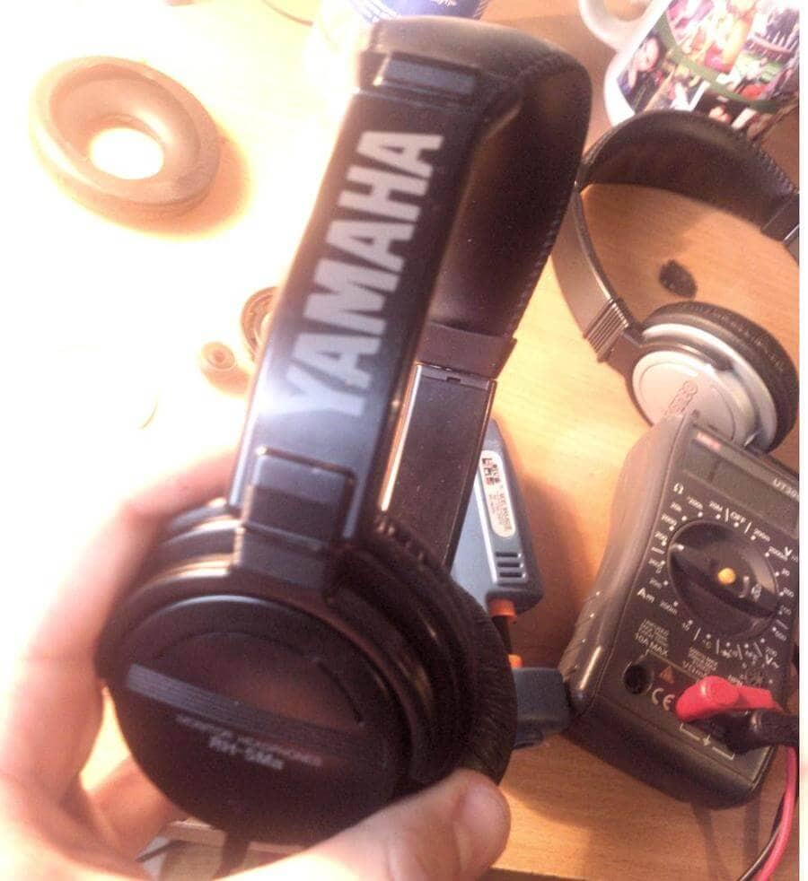

Эти наушникам пришлось еще дважды пережить подобные манипуляции по разным причинам, и в зависимости от использованных диффузоров доноров звук приобретал разные оттенки. В одном случае НЧ прибавились, а ВЧ присели - видимо купол диффузора был недостаточно жестким. При совсем дешевых донорах - выпятились средние частоты.

Путей для экспериментов со звуком - море! Очень увлекательное времяпровождение :) два часа проходят как на одном дыхании, пока напряженно занимаешься кропотливыми манипуляциями, а потом радуешься как ребенок, что все таки получилось))

***Материал подготовлен исключительно для сайта* [AudioGeek.ru](https://audiogeek.ru)**
