[Русский](./README.ru.md) | **English**

# Fixing headphones with your bare hands, no soldering iron!

**Category:** Headphone repair  
**Tags:** DIY  
**Original:** https://audiogeek.ru/remont-naushnikov-bez-payalnika/

---

Not everyone has a soldering iron these days. But practically everyone has headphones, and often more than one pair. And as everyone knows, any headphones tend to die... And, as always, at the most inconvenient moment. So today we will improvise and you will learn how to fix headphones without a soldering iron. The only tools needed are a knife, a lighter and tape :)

Of course such a repair can hardly be called perfect. But it is perfect if, for example, you have a many-hour trip on a commuter train ahead and your headphones have suddenly died in the most underhanded way.

> **If you are too lazy to read a lot of text, I made a short video specially for this article showing the whole repair process. Enjoy watching ))**

> ▶ **[Watch the video on YouTube](https://www.youtube.com/watch?v=vskMWb4KIs8)**

> **Please spend an extra minute on a like/dislike or a comment; it would be a huge help to my project**

## How to fix headphones without a soldering iron

**You cannot solder headphones without a soldering iron, alas.** Of course, if you want, you can solder with a red-hot nail. But that is a story for another time. So we will forget about soldering.

**We will need an AUX cable.** AUX cables are now sold in any kiosk or underpass for absolutely ridiculous money. It is used to connect your audio device to a subwoofer or car stereo and looks like this:

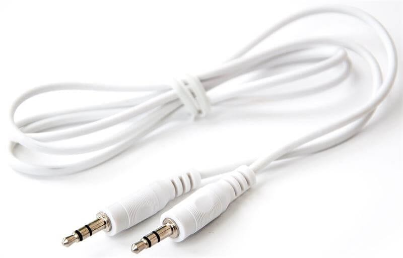

> **An AUX cable costs pennies, but it has no microphone. So if you have a headset you will have to put up with losing its powers: the microphone and buttons.**

**But how nice it is to fix headphones with your own hands without a soldering iron, and the absence of buttons can be survived.**

Thanks to our Chinese brothers, quite decent cords can now be found starting from $0.5. The wire used in the article cost about a dollar. As for the paper knife, lighter and tape, I think everyone has them lying around in a closet.

**So, we scraped the barrel, found all the tools, ran to the kiosk for *~~beer~~* a cable. What next?**

## Unceremoniously cut the AUX cable

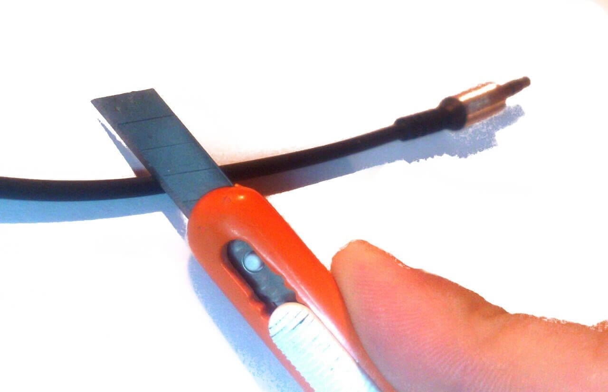

Cut the wire 7–10 centimeters from the connector, or better still farther. Do not cut shorter. If you botch it, there will be no spare length for a second attempt. It is also better when the joint is farther from the connector.

## Strip the cable braid

> **A specially dull knife was found for this article, to experience all the difficulties first-hand :)**

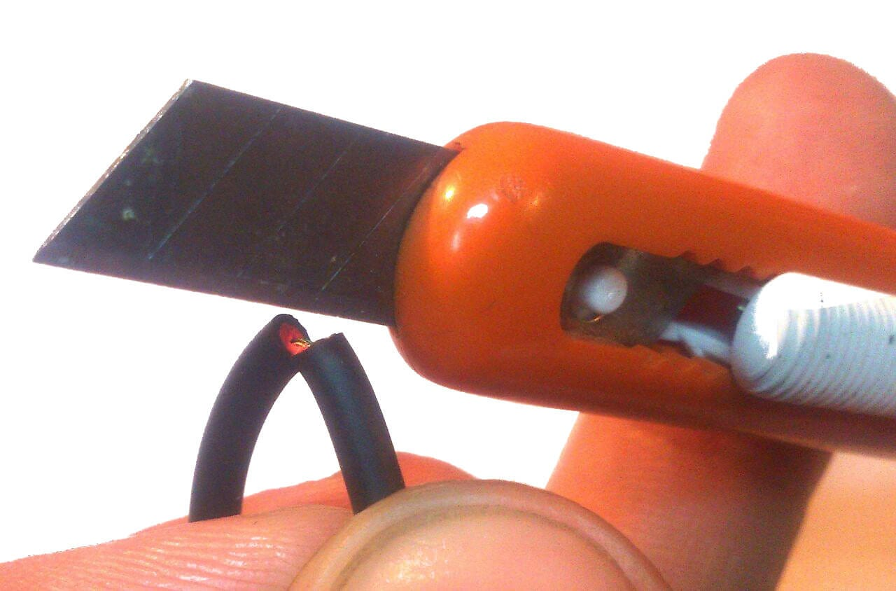

It is easiest to cut the braid exactly as in the photo. You do not need to press the blade hard. Thanks to the bending, the braid will part by itself, whatever its shape. Rotate the wire making cuts, and when you have gone around, pull off the braid. The main thing is not to cut the wires.

> **It is better to expose about 2 centimeters of wires, so it is easier for us and the contact area is larger, which increases contact reliability.**

The wires are coated with lacquer, which must be scraped off. You can do it with a knife. But if your knife is dull like mine, the result will not please you.

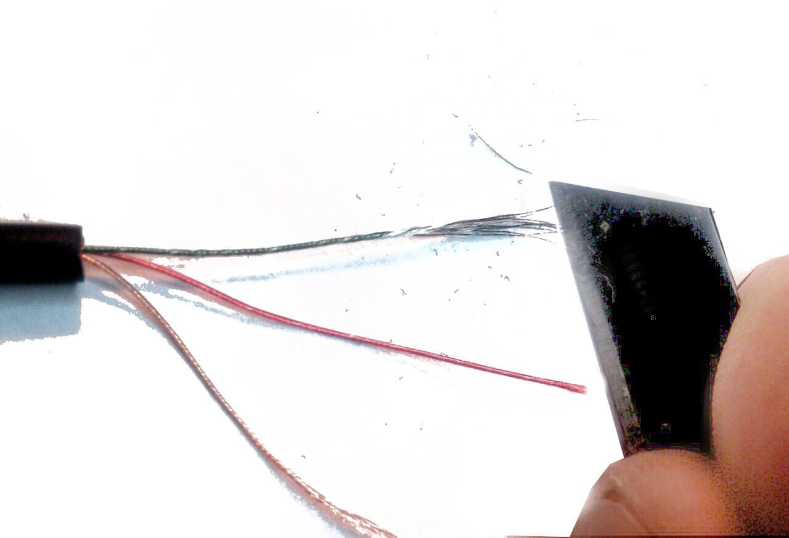

The wires are very thin, and the dullness of the knife makes them tear off together with the lacquer. In principle it is quite easy with a sharp knife. But we have no sharp knife, so we will use a lighter or any other source of fire.

## Burning the lacquer off with a lighter

Headphone wires are intertwined with a nylon thread. And nylon, as is well known, burns well. It is quite possible, by the way, that the lacquer burns too.

For a fraction of a second, put the end of the wire in the flame. It quickly flares up and lightly catches fire. When 1–1.5 centimeters have burned, put it out with your fingers.

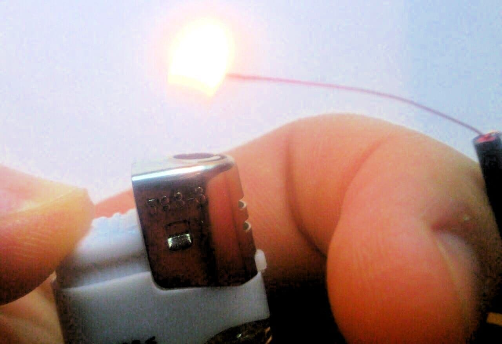

The lacquer and nylon leave a small deposit of soot, which is easily scraped off with a fingernail. As a result we have undamaged wires cleaned of lacquer.

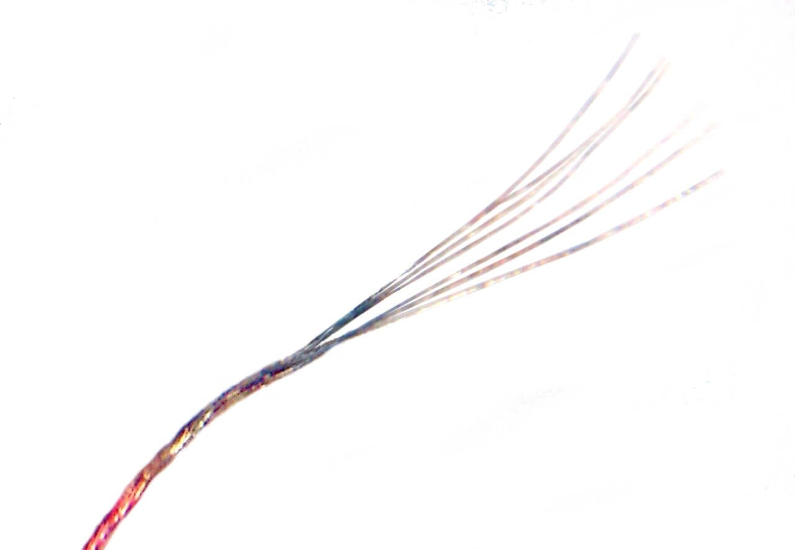

> **The main thing is not to hold the wires in the fire too long: they may simply burn up and fall off (( To some, the knife option may seem more convenient.**

## Cut the connector off the headphones

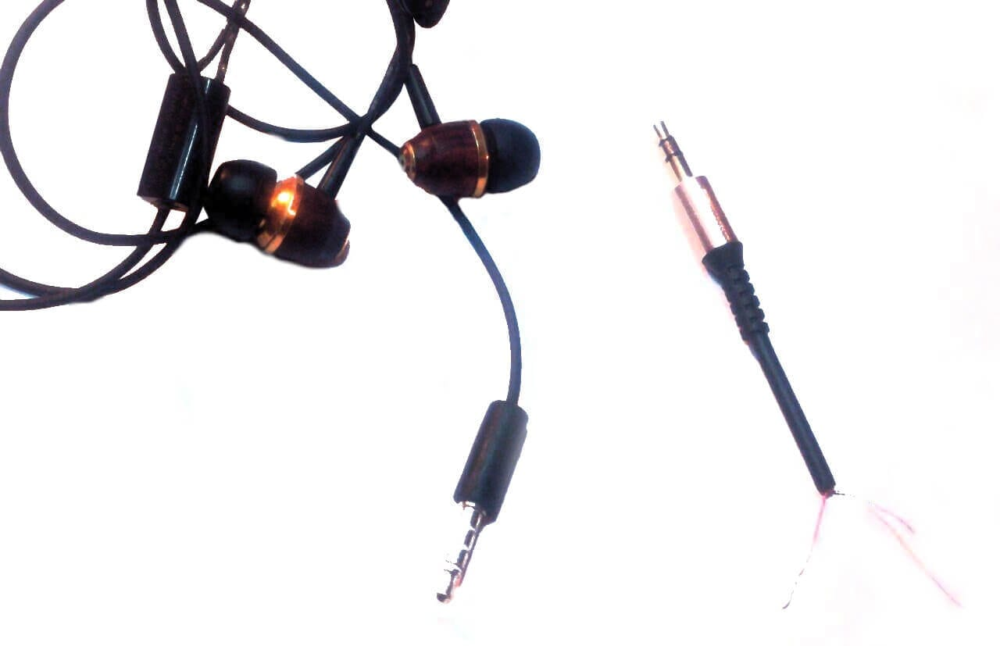

Headphone wires usually break right where they leave the connector. To be sure to cut off the broken part, cut 2–3 or 5 cm above the connector. You can go higher still; that is up to you.

The connector itself has no value for us, so it goes in the trash.

## Many wires

After cutting off the headphone connector, strip the insulation from the wire. Do everything the same as with the AUX cable. But there is a small catch.

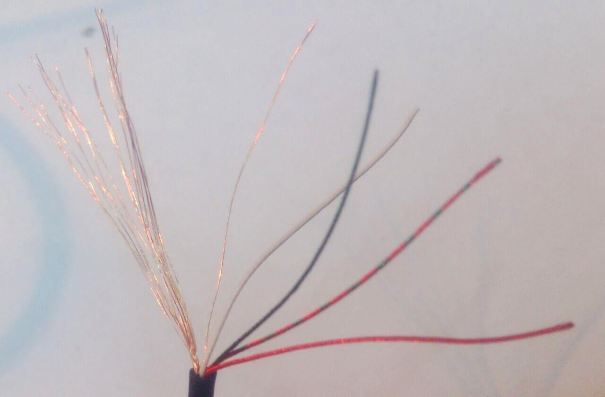

There are clearly more than three wires in a headset: five. Two wires are for the microphone and three for the earphones. Those are what we need.

The frayed ***golden wire*** (ground) was wound over the thin white microphone one. Twist it into a separate wire and clean all the wires of lacquer.

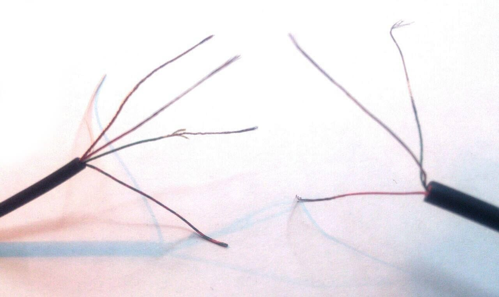

Now an overwhelming task faces us: twisting the right wires together. **In fact it is all simple!** The three AUX wires need to be joined to the three headphone wires.

**In my case the wire colors happened to match. And what if they do not?**

## How to determine the purpose of the headphone wires

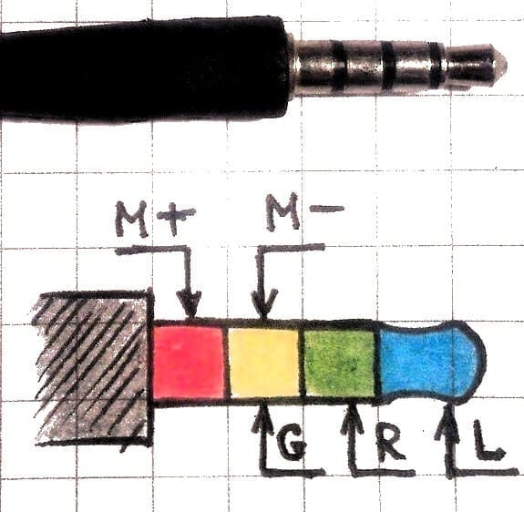

**Put simply, you can use this very simple method:**

Plug our connector into any audio device at hand. Turn on music, and now we will twist the wires together while it plays.

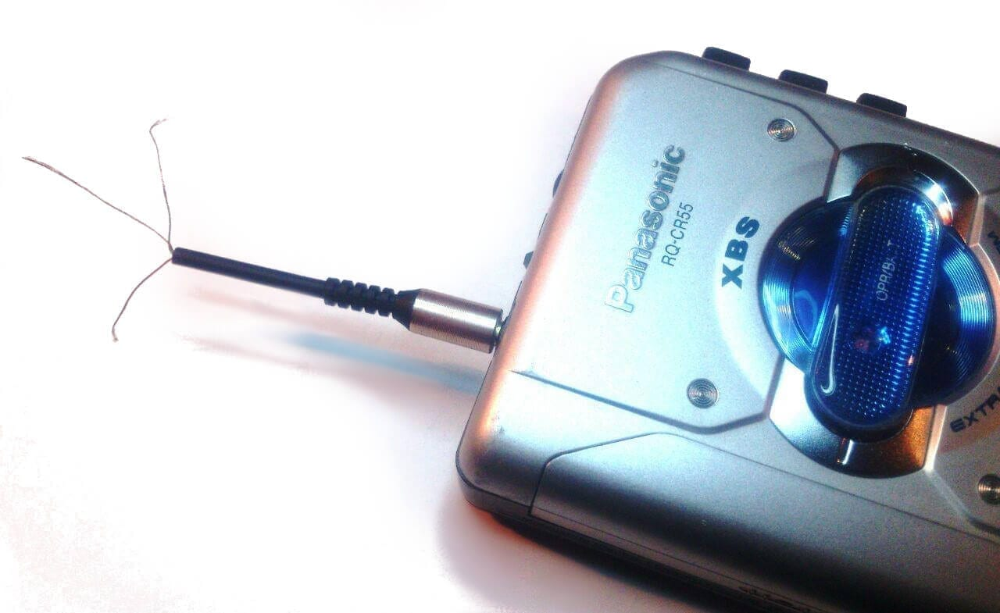

## The most common color scheme

- **ground (common): yellow (gold)**
- **left: blue (green)**
- **right: red**

> ***In fact the common wire is neither yellow nor gold; it is the color of bare copper coated with clear lacquer. But for clarity let us call it yellow.***

As with any rule, this one has exceptions too, especially for headsets. For example it happens that **right is green, left is blue, and red is the microphone.** Sometimes the wires are not entirely one color but striped in combination with **yellow**.

But pure **YELLOW** is always **GROUND**. Mixtures of colors with yellow are in most cases ground too, but this has to be checked.

> **Yellow goes to both earphones, which is why it is common: current flows out of each driver through it, and through the two other colored wires current flows into the drivers. Well, that is if you are being very, very rough :-)**

**So first twist together the yellow wires of the headphones and the AUX cable.**

Now twist the headphone wires with the AUX cable wires one by one. The point is that the red wire of the AUX cable's connector must be twisted with the red wire of the headphones, and then the right earphone will sing.

> **To ensure maximum contact, it is better to first fray (untwist) the two wires to be twisted, lay one over the other, and then twist them tightly.**

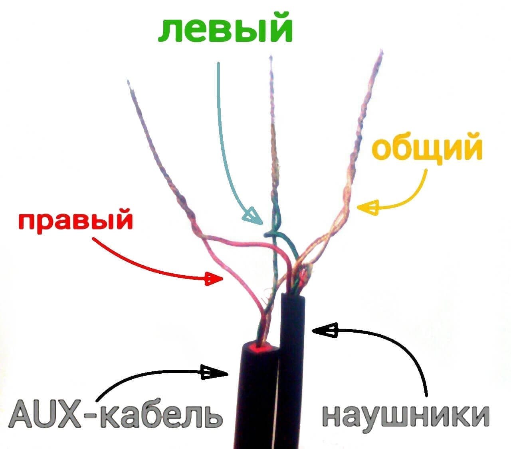

> **In your case the colors may differ, and it may be that red has to be twisted with blue or in some other way. The main thing is yellow with yellow, and the rest connected so that both earphones play.**

**Figured it out? Great!** Now the unused wires can simply be cut off.

**So the wires are twisted, the headphones sing, and there is a smile on your face :)**

## Insulating the wires

We scraped the lacquer off the wires, which means they now have no insulation.

If the twists touch each other, you will either make yourself mono or cut out one channel. So they need to be insulated to prevent shorting between them.

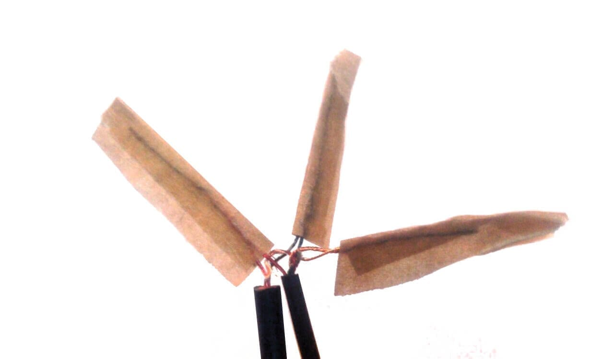

First insulate each twist separately. Besides insulating, this also strengthens the joints. For some reason I did it with masking tape, probably it was lying closer. It does not matter.

Now wrap everything together with wide tape, in 3–4 or 5 layers, a matter of taste :)

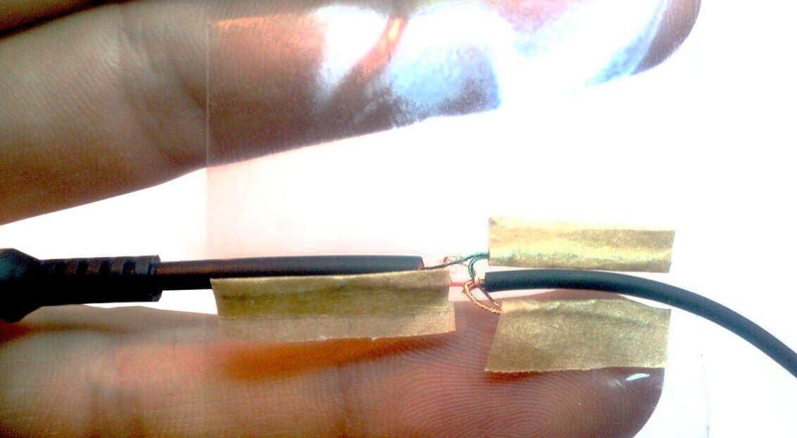

It is better to space the twists well apart from each other to rule out any short circuit as much as possible.

## DONE!

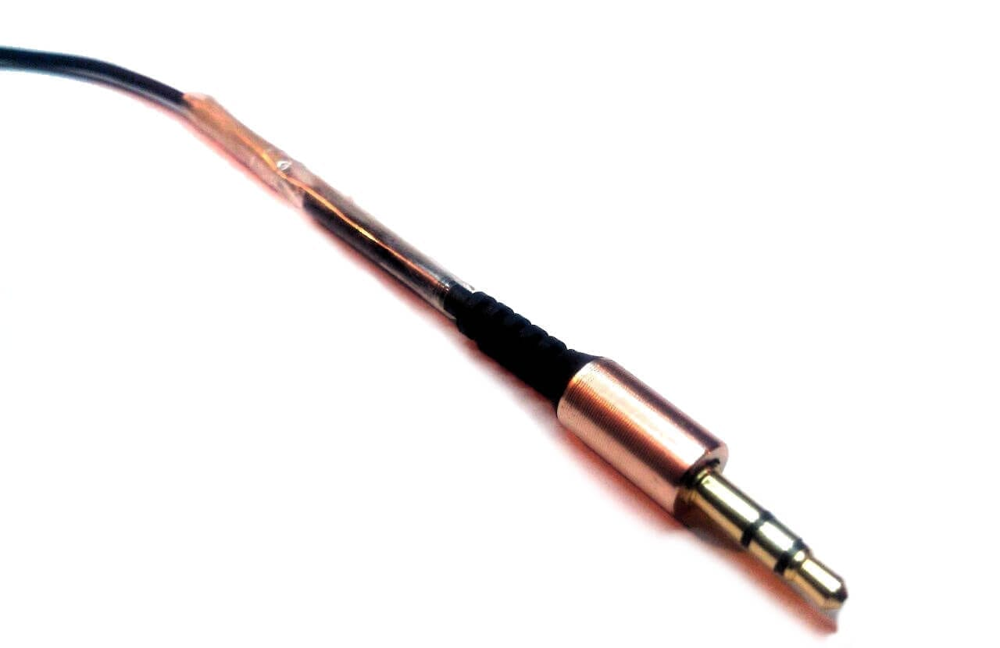

**Here is the long-awaited result of all our efforts :-)**

Perhaps this looked like something long, but it is not so! 10 minutes is enough for the whole process. The main thing is to understand what you are doing.

## Heat-shrink tubing instead of tape

Using tape is not quite kosher. So I suggest improving the technique a little, again without a soldering iron.

You will have to buy heat-shrink tubing at an electronics or hardware store. It is a clever tube that shrinks in diameter by at least half when heated. This miracle costs about $0.1–0.5 per meter.

We will need two heat-shrink tubes of different diameters: 1–2 mm for the first and 4–5 mm for the second.

Put pieces of the thin heat-shrink tube over our twists. Cut the pieces with a 50% margin.

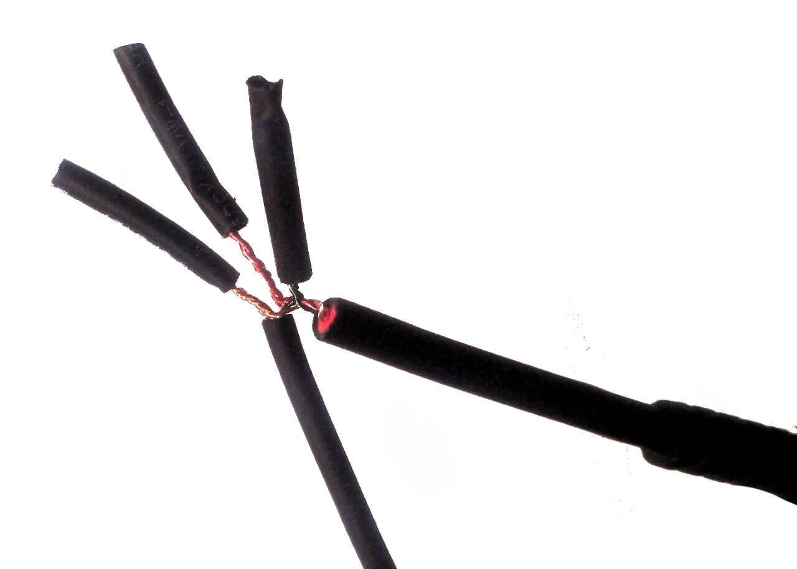

Now the tubing has to be heated. Usually I did this with a soldering iron, but we agreed I do not have one, and the story is precisely about how to fix headphones without a soldering iron, so I had to improvise.

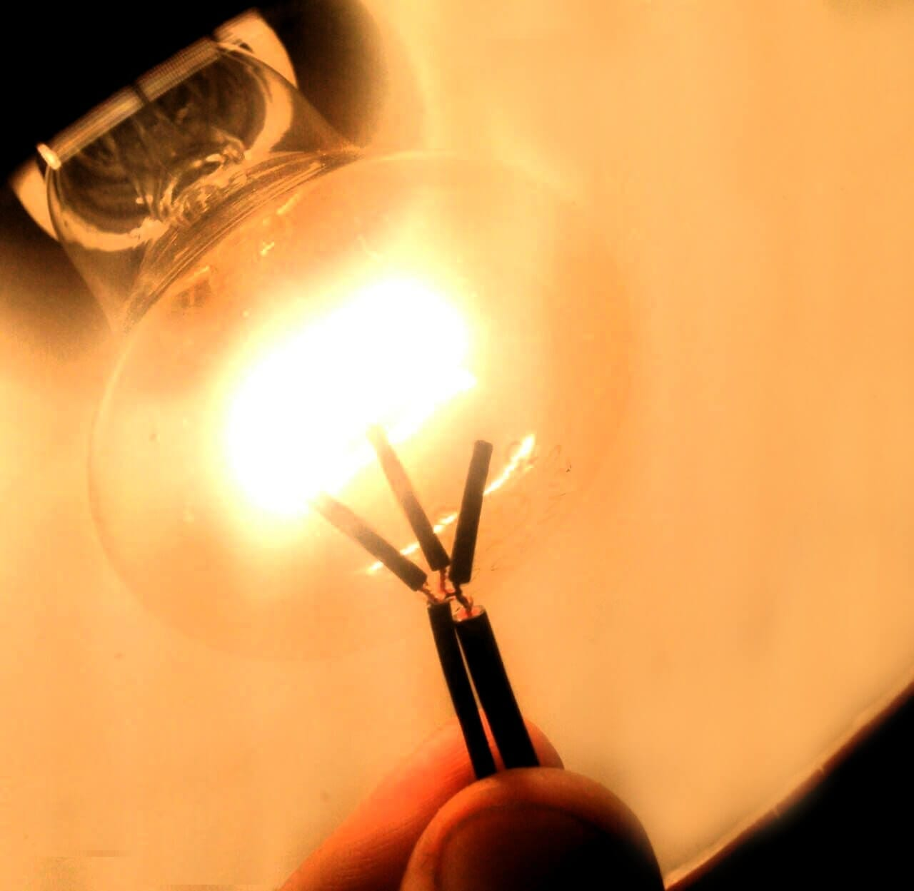

The method turned out to be quite effective and the tubes shrank. You can also use any other heater or dip it in boiling water like Easter eggs. In principle people manage with an ordinary hair dryer.

While the tubing is still hot you can additionally flatten it with your fingers, and then it will slightly stick together inside.

> **But the thick heat-shrink tube must not be forgotten: put it on the cable before you twist the wires. It will no longer pass over the connector.**

This tube must later be slid over the joint and also shrunk with the heat of a lamp. In general you can shrink it over a lighter flame too, but you may accidentally set something else on fire.

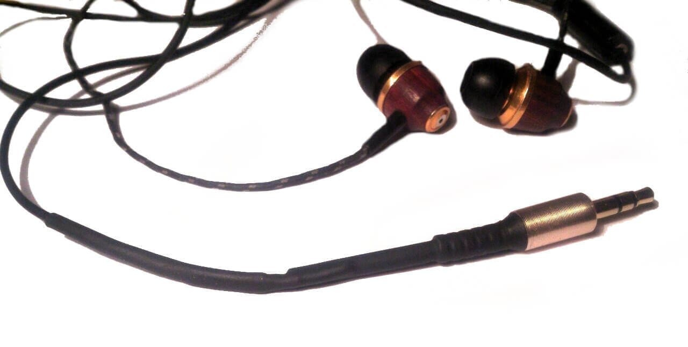

I used a piece 8–10 cm long. To strengthen the construction, the end of the tube was slid directly over the rubber strain relief of the connector.

## Conclusion

As you see, it is not at all as hard as it seems. Now you know how to fix headphones without a soldering iron. Such a repair cannot be called full-fledged; it is rather an alternative for emergencies.
Of course it is possible that your headphones will work for a very, very long time after such a repair. But in any case it is more reliable to solder the twisted headphone wires. It is not hard at all. Read how: ***[How to easily learn to solder wires properly, using headphones as an example](../kak-nauchitsya-payat-naushniki/)***

*Originally written for [AudioGeek.ru](https://audiogeek.ru). Translated from Russian.*
