[English](./README.md) | **Русский**

# Ремонт наушников голыми руками, без паяльника!

**Рубрики:** Ремонт наушников  
**Метки:** своими руками  
**Оригинал:** https://audiogeek.ru/remont-naushnikov-bez-payalnika/

---

Паяльник в наши дни есть далеко не у всех. А вот наушники имеются практически у каждого, а то и не одни. И как все знают, любым наушникам свойственно дохнуть... И как всегда в самый неподходящий момент. Так что сегодня будем выкручиваться и вы узнаете как починить наушники без паяльника. Из инструментов потребуется только нож, зажигалка и скотч :)

Конечно такой ремонт трудно назвать идеальным. Но он идеально подходит, например, если Вас ждет многочасовая поездка на электричке, а наушники скоропостижно скончались самым подлым образом.

> **Если вам лень читать много буковок, то специально для этой статьи я снял короткий ролик, в котором показан весь процесс ремонта. Приятного просмотра))**

> ▶ **[Смотреть видео на YouTube](https://www.youtube.com/watch?v=vskMWb4KIs8)**

> **Пожалуйста потратьте лишнюю минутку на лайк/дизлайк или коммент - это будет огромная помощь моему проекту**

## Как починить наушники без паяльника

**Запаять наушники без паяльника, увы не получится**. Конечно, при желании, можно паять и раскаленным гвоздем. Но об этом как-нибудь в другой раз. Так что про пайку мы забудем.

**Нам потребуется AUX - кабель**. AUX- кабель сейчас продается в любом ларьке или переходе за абсолютно смешные деньги. Используется он для подключения вашего аудио устройства к сабвуферу или авто-магнитоле и выглядит следующим образом:

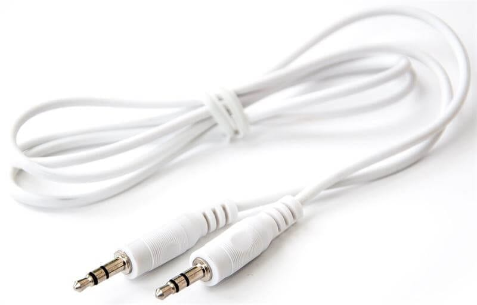

> **AUX-кабель стоит копейки, но в нем нет микрофона. Поэтому если у Вас гарнитура то придется смириться с ее урезанием в полномочиях и лишением микрофона и кнопочек.**

**Зато как приятно починить наушники своими руками без паяльника, а отсутствие кнопочек можно пережить.**

Спасибо братьям китайцам, сейчас встречаются вполне сносные шнурки начиная от 0.5$. Провод, использованный в статье, стоил около доллара. Ну а ножик для бумаги, зажигалка и скотч я думаю и так у каждого дома по шкафам валяются.

**Итак поскребли по сусекам, нашли весь инструментарий, сгоняли в ларек за *~~пивом~~* шнурком, что дальше то?**

## Бесцеремонно перерезаем AUX-кабель

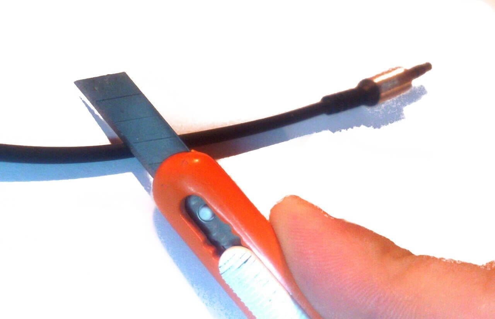

Отрезаем провод в 7-10 сантиметрах от разъема, а лучше еще дальше. Резать короче не стоит. Если запороть, то не останется запаса на повторный маневр. Так же лучше когда место соединения располагается подальше от разъема.

## Снимем оплетку кабеля

> **Специально для этой статьи был найден самый тупой нож, дабы испытать все трудности на себе :)**

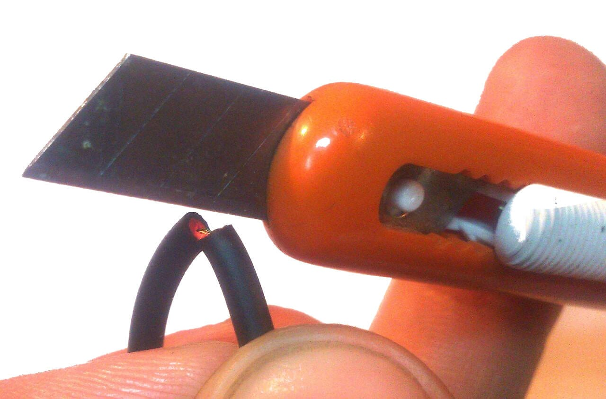

Удобнее всего надрезать оплетку именно как на фотографии. Не нужно сильно прижимать лезвие. Благодаря сгибанию, оплетка будет расходиться сама, независимо от ее формы. Проворачиваем провод, делая надрезы и, когда прошли круг, стягиваем оплетку. Главное не прорезать проводки.

> **Лучше оголить около 2-х сантиметров проводков, так и нам будет проще и площадь контакта больше, что увеличит надежность контакта.**

Проводки покрыты лаком и его необходимо счистить. Можно сделать это ножом. Но если Ваш нож, как и мой туповат, то результат не очень порадует.

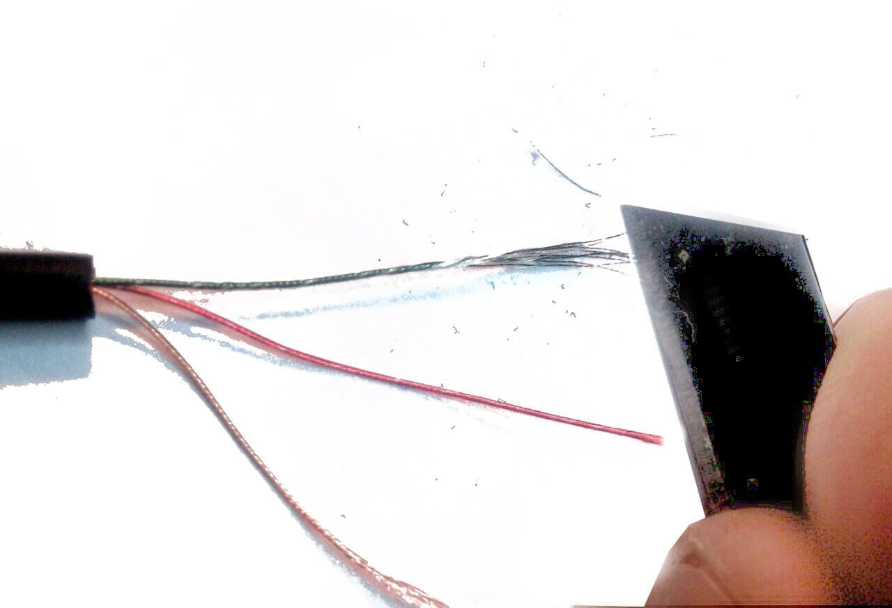

Проводки очень тонкие и тупость ножа приводит к их отрыванию вместе с лаком. В принципе острым ножом это делается достаточно легко. Но острого ножа у нас нет, поэтому воспользуемся зажигалкой или любым другим источником огня.

## Счищаем лак зажигалкой

Проводки наушников переплетены с капроновой ниткой. А капрон, как известно, хорошо горит. Не исключено, кстати, что лак тоже горит.

На доли секунды вносим конец провода в огонь. Он быстренько вспыхивает и слегка загорается. Когда прогорит 1-1.5 сантиметра тушим его пальцами.

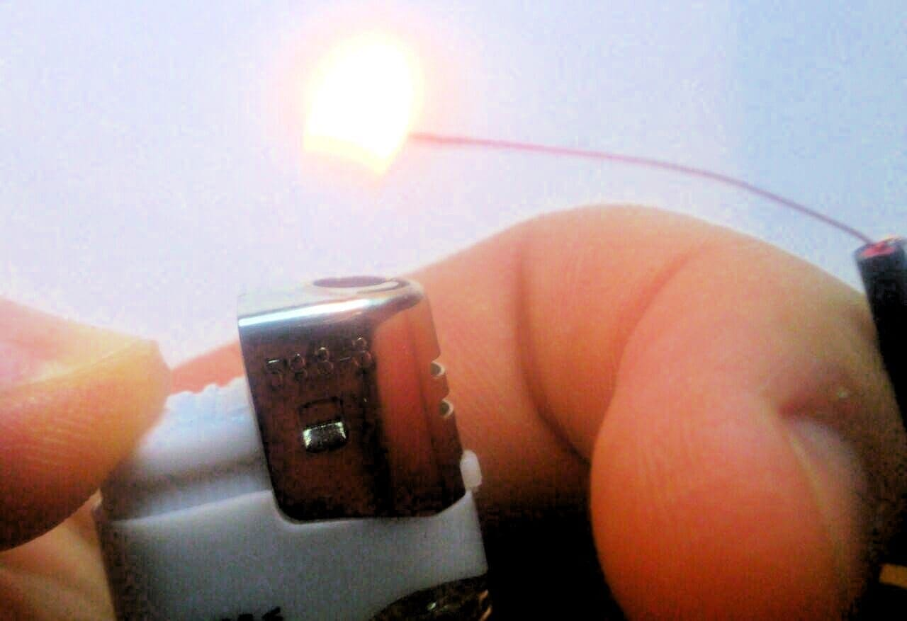

Лак и капрон оставляют небольшой нагар, который в легко счищается ногтем. В итоге мы имеем очищенные от лака неповрежденные проводки.

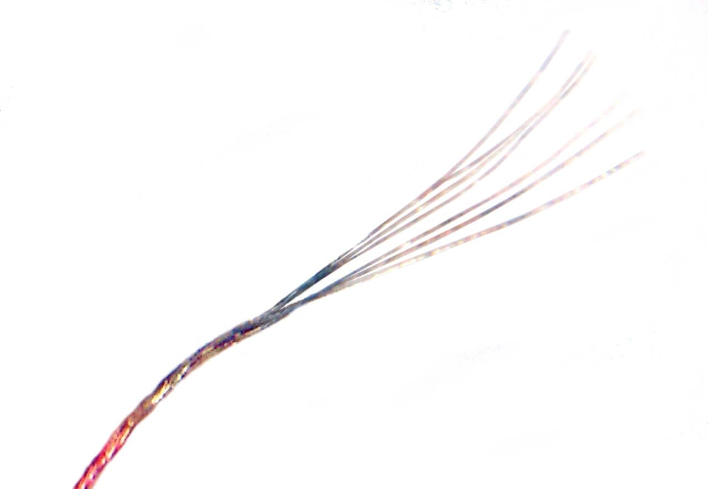

> **Главное не держать проводки в огне слишком долго - они могут просто сгореть и отвалиться(( Кому-то вариант с ножом может показаться удобнее.**

## Отрезаем наушникам разъем

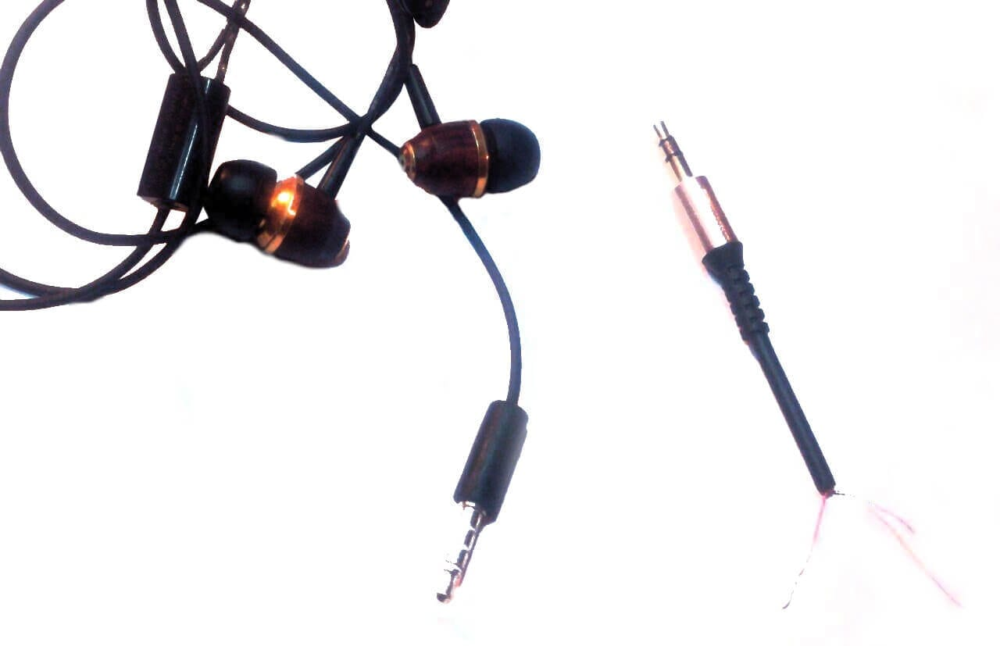

Обычно провода наушников переламываются прямо на выходе из разъема. Чтоб уж наверняка отрезать перебитую часть, отрезаем на 2-3 или 5 см выше разъема. Можно и еще выше - тут уже на Ваш вкус.

Сам разъем не представляет для нас ценности, поэтому отправляется в мусорку.

## Много проводов

После отрезания разъема наушников снимаем изоляцию с провода. Делаем все так же, как с AUX-кабелем. Но тут есть небольшой подвох.

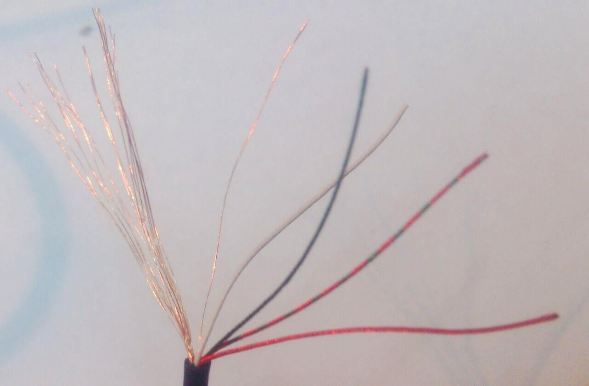

Проводков в гарнитуре явно побольше чем три - их пять. Два провода отвечают за микрофон, и три за наушники. Они то нам и нужны.

Разлохмаченный ***золотой провод***(земля) был накручен поверх тонкого белого - микрофонного. Скручиваем его в самостоятельный провод и зачищаем все проводки от лака.

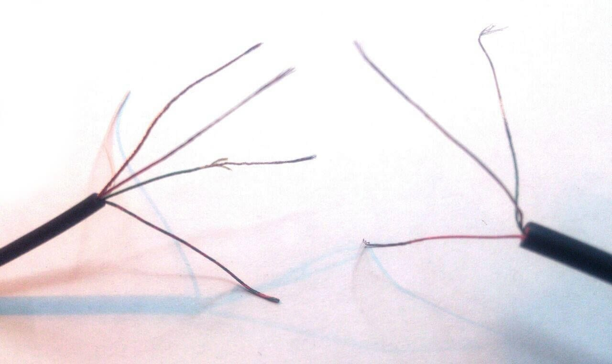

Теперь перед нами встает непосильная задача -- скрутить нужные проводки вместе. **На самом деле все просто!** Три AUX-проводка нужно прикрутить к трем проводкам наушников.

**В моём случае получилось, что расцветки проводков совпали. А что если нет?**

## Как определить назначение проводов наушников

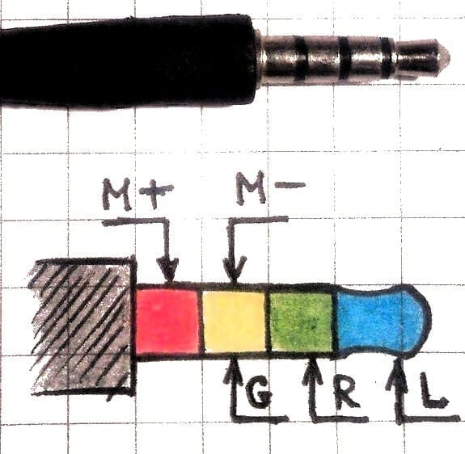

**Если по простому, то можно воспользоваться таким простейшим способом:**

Втыкаем наш разъем в любое аудио устройство лежащее под рукой. Включаем музыку и сейчас мы будем скручивать проводки прям во время работы.

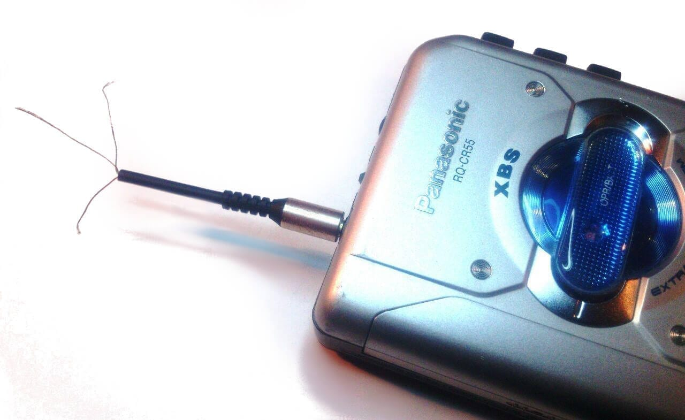

## Чаще всего встречается расцветка

- **земля (общий) - желтый (золотой)**
- **левый - синий (зеленый)**
- **правый - красный**

> ***на самом деле общий провод и не желты и не золотой, это цвет чистой меди, покрытой прозрачным лаком. Но для однозначности обзовём его желтым.***

Как и у любого правила, у этого тоже есть исключения, особенно это касается гарнитур. Например бывает, что **правый - зеленый, левый - синий, а красный -** это **микрофон.** Иногда провода не полностью одного цвета, а в цветную полосочку в сочетании с **желтым**.

Но чисто **ЖЕЛТЫЙ** всегда **ЗЕМЛЯ**. Смеси цветов с желтым, в большинстве случаев тоже земля, но нужно проверять.

> **Желтый идет к обоим наушникам, поэтому он и общий, по нему ток как бы вытекает из каждого динамика, а по двум другим цветным проводкам ток в динамики втекает. Ну это если оооочень грубо :-)**

**Поэтому первым делом скручиваем между собой желтые провода наушников и AUX-кабеля.**

Теперь поочередно скручиваем проводки наушников с проводками AUX-кабеля. Суть в том, что красный проводок разъема AUX-кабеля нужно скрутить с красным проводком наушников и тогда правый наушник запоет.

> **Для того чтобы обеспечить максимальный контакт, лучше сначала размохрить (раскрутить) два скручиваемых проводка, наложить один на другой, а затем плотно скрутить.**

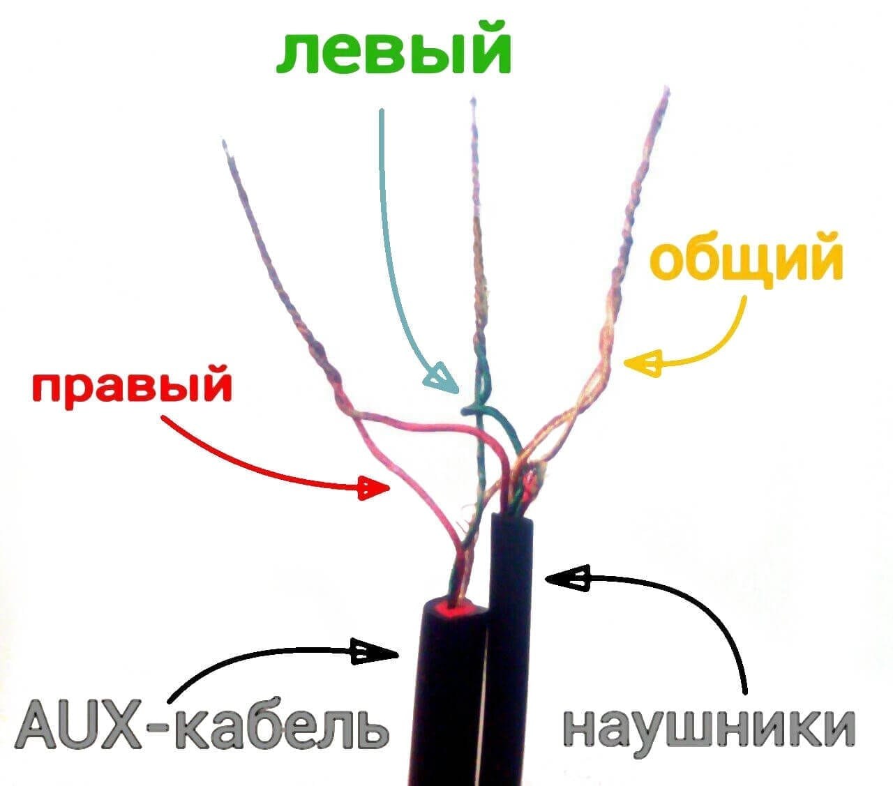

> **В вашем случае цвета могут отличаться и может быть что красный нужно скрутить с синим или как-то по другому. Главное желтый с желтым, а остальное прикрутить так, чтобы оба наушника играли.**

**Определили? Отлично!** Теперь проводки, оставшиеся невостребованными,можно просто отрезать.

**Итак, проводки скручены, наушники поют - на лице улыбка)**

## Изолируем проводки

Лак с проводков мы счистили, а значит теперь у них нет изоляции.

Если замкнуть скрутки между собой то либо вы сделаете себе моно либо отрубите один канал. Поэтому нужно их изолировать, чтобы исключить замыкание между собой.

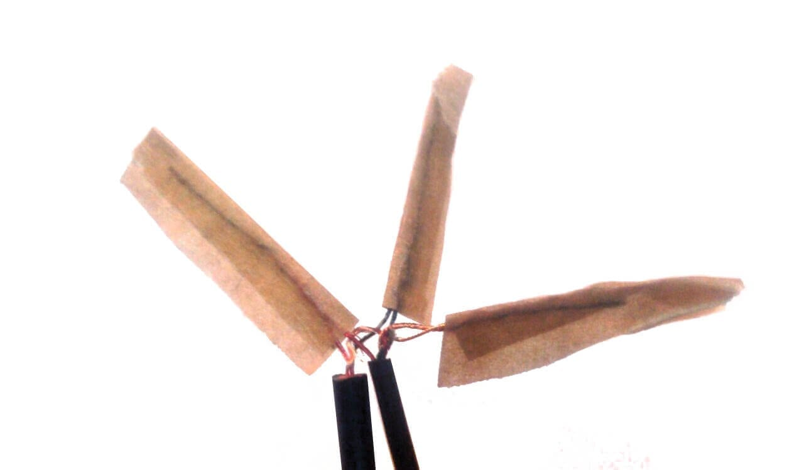

Сначала изолируем каждую скрутку по отдельности. Помимо самой изоляции это еще и упрочнит соединения. Почему-то я сделал это малярным скотчем, наверное лежал ближе. Это не важно.

Теперь замотаем все вместе широким скотчем, слоя в 3-4 или 5 - дело вкуса)

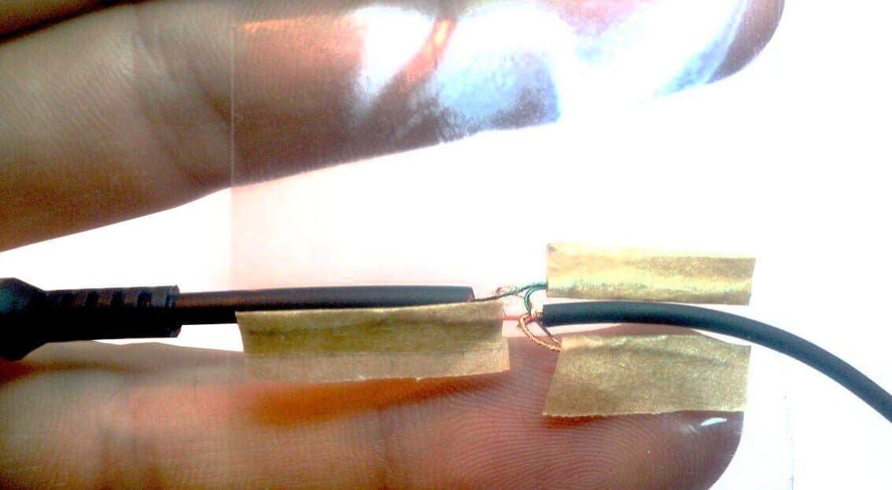

Лучше разнести места скруток подальше друг от друга, чтобы максимально исключить любое замыкание.

## ГОТОВО!

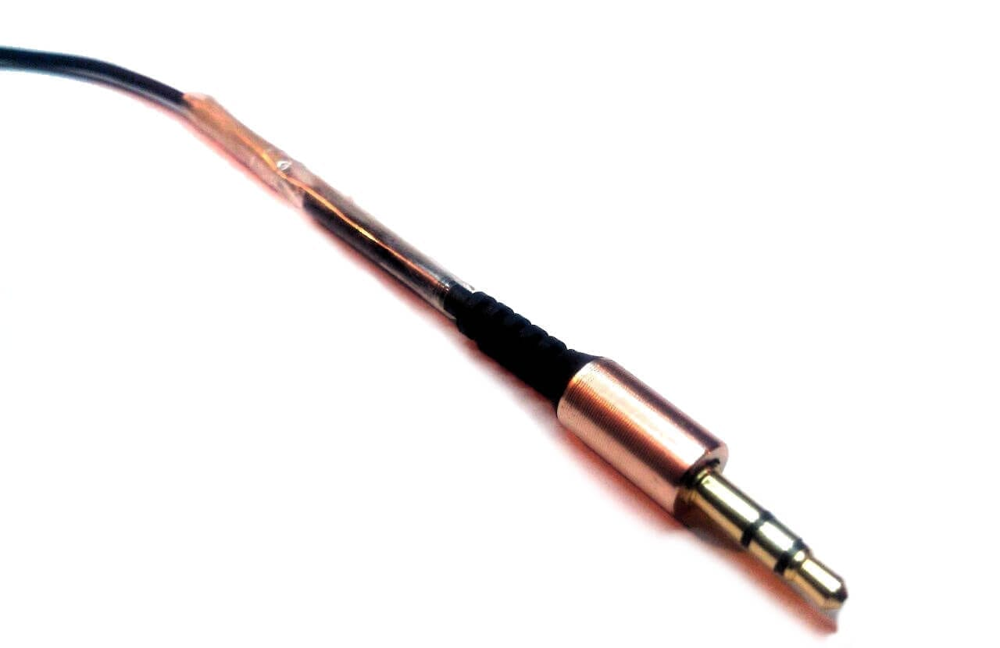

**Вот и долгожданным итог всех наших стараний :-)**

Возможно это и выглядело чем-то долгим, но это совсем не так! На весь процесс хватит и 10 минут. Главное понимать, что вы делаете.

## Термотрубка вместо скотча

Использовать скотч - не совсем кошерно. Поэтому предлагаю немного улучшить технологию, опять таки без паяльника.

Придется прикупить в магазине электроники или хоз-маге термоусадочную трубку, она же термокембрик. Это такая хитрая трубка, которая умеет при нагревании сжиматься в диаметре как минимум вдвое. Стоит сие чудо около 0.1 - 0.5$ за метр.

Нам понадобятся две термо-трубки с разыми диаметрами: 1-2 мм первая и 4-5 мм вторая.

Надеваем кусочки тоненькой термо-трубки на наши скрутки. Кусочки отрезаем с полуторным запасом.

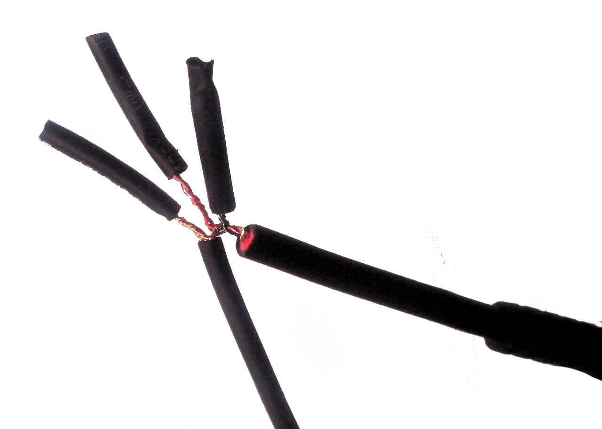

Теперь нужно термо-трубку нагреть. Обычно я делал это паяльником, но мы ведь договорились, что его у меня нет, да и рассказ именно о том как починить наушники без паяльника, поэтому мне пришлось выкручиваться.

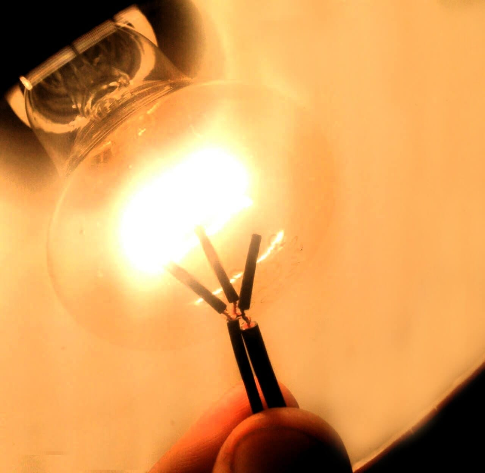

Метод оказался достаточно эффективным и термо-трубки сжались. Так же можно использовать любой другой нагреватель или опустить в кипяток как пасхальные яички. В принципе народ и обычным феном справляется.

Пока термотрубка еще горячая ее можно дополнительно сплющить пальцами тогда она слегка склеится внутри.

> **А вот толстую термо-трубку нужно не забыть одеть на кабель до того как вы скрутите провода. Через разъем она уже не пролезет.**

Эту термо-трубку в последствии нужно надеть на место стыка и так же сжать теплом лампы. Вообще можно и на огне зажигалки сжимать, но можно случайно поджечь лишнее.

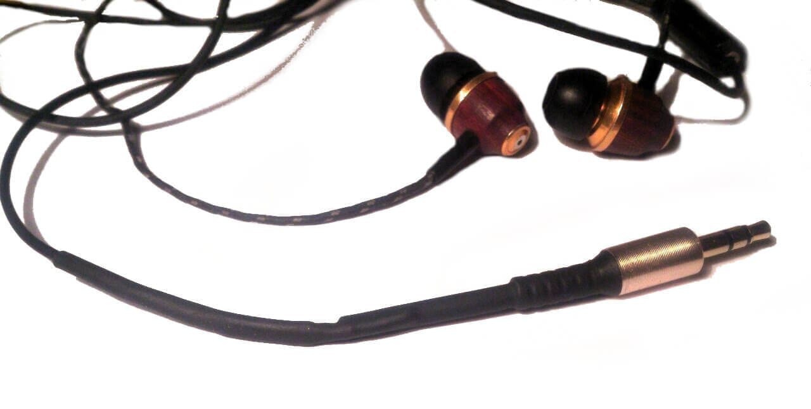

Я использовал кусок длинной 8-10 см. Для упрочнения конструкции конец термо-трубки был одет непосредственно на резиночку разъема.

## Заключение

Как видите это совсем не сложно, как кажется. Теперь вы знаете как починить наушники без паяльника. Подобный ремонт нельзя назвать полноценным, это скорее альтернатива для экстренных случаев.
Конечно возможно, что ваши наушники проработают еще много-много времени после такого ремонта. Но в любом случае, надежнее будет спаять скрученные провода наушников. Сделать этот совсем не сложно. Читайте как: ***[Как просто научиться паять на примере наушников](../kak-nauchitsya-payat-naushniki/)***

***Материал подготовлен исключительно для сайта* [AudioGeek.ru](https://github.com/SkyTrip-13/AudioGeek)**
