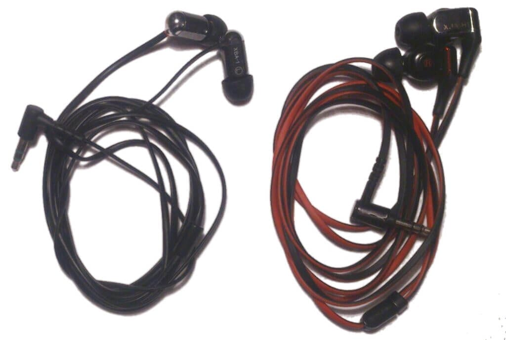
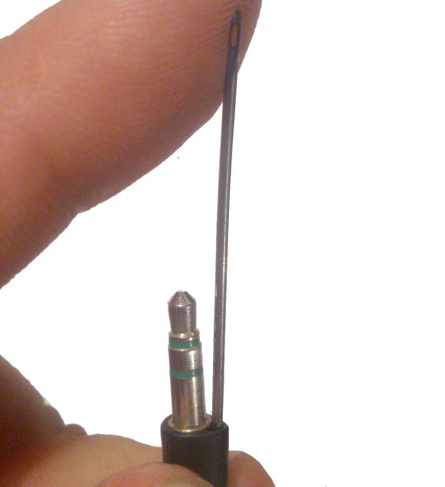
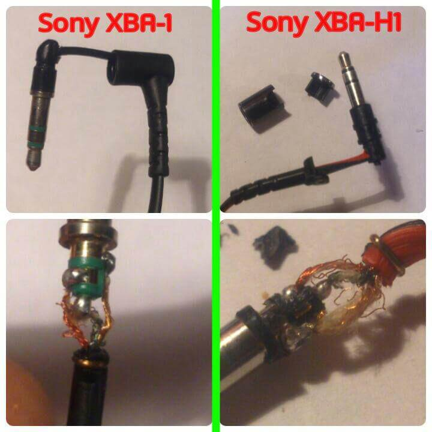
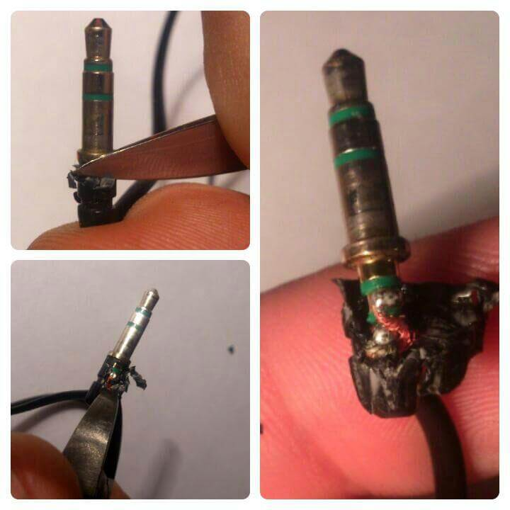
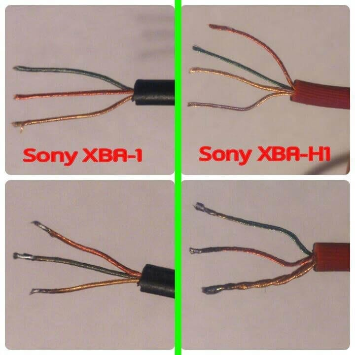
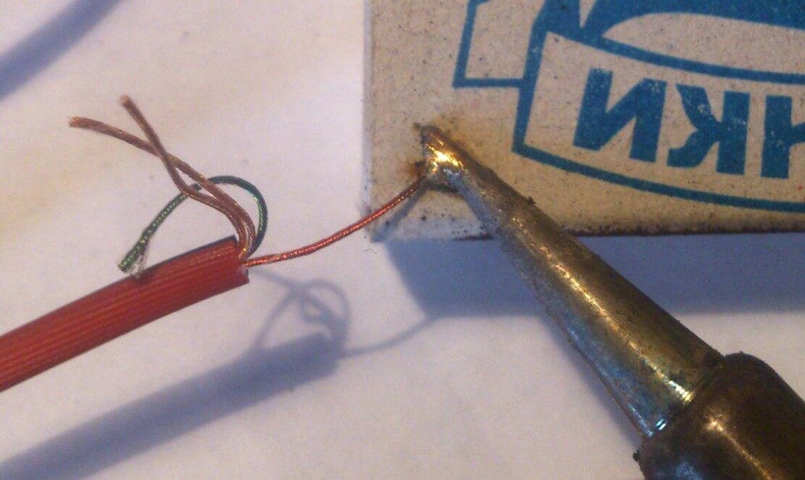
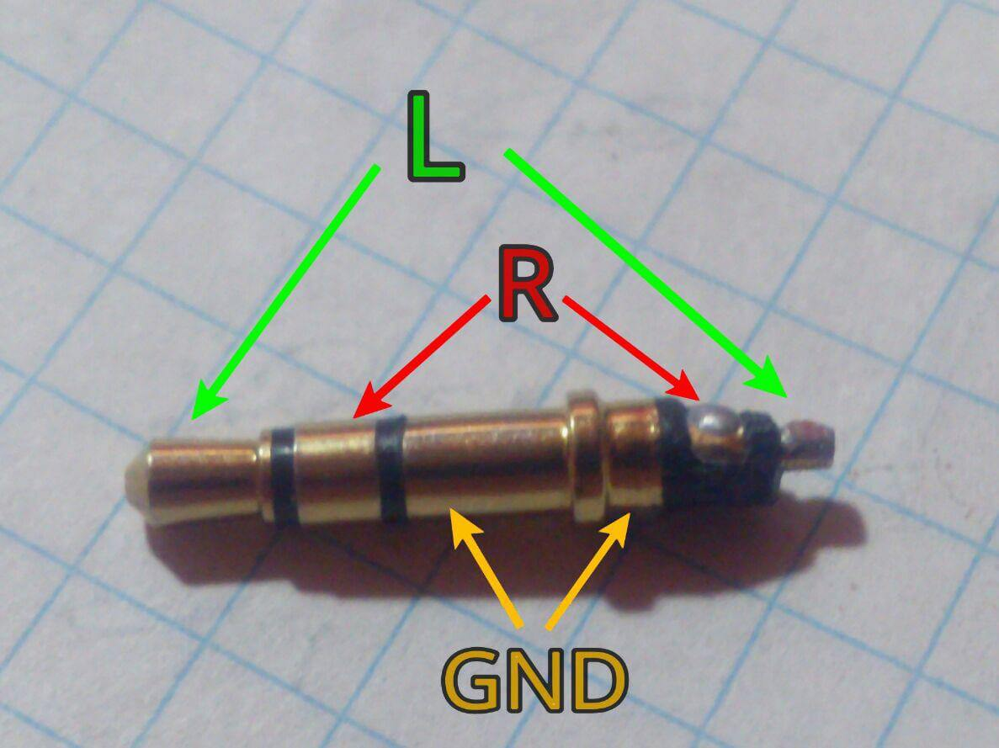
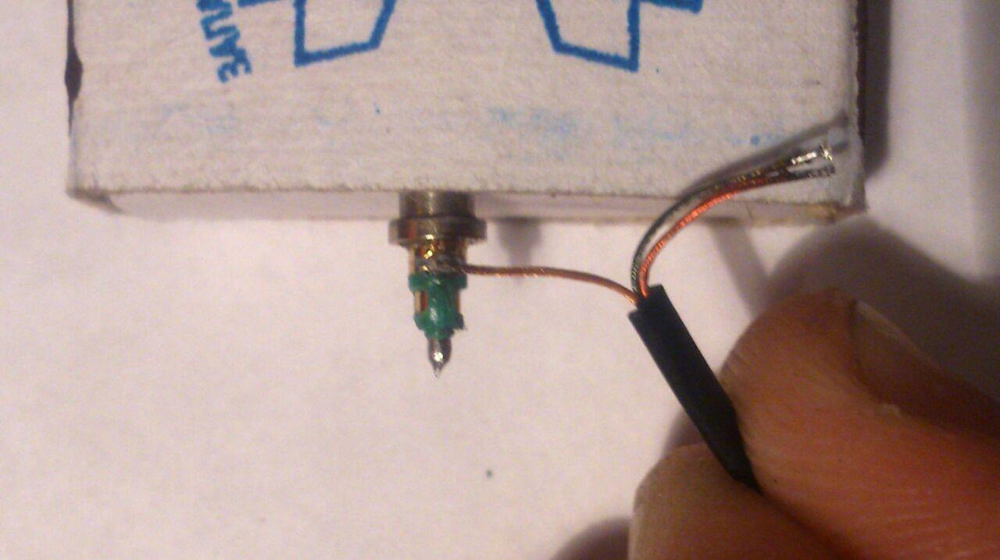

[Русский](./README.ru.md) | **English**

# Headphone repair: how to solder a plug onto headphones

**Category:** Headphone repair  
**Original:** https://audiogeek.ru/remont-razyoma-naushnikov/

---

Why buy new headphones, when in 9 cases out of 10 headphones stop working because of a broken wire near the plug? Today's article covers in detail how to fix headphones yourself, or more precisely how to solder a plug onto headphones.

> The method described assumes at least the presence of a soldering iron. To learn how to fix headphones without a soldering iron, read: ***[Fixing headphones with your bare hands, no soldering iron!](../remont-naushnikov-bez-payalnika/)***

> **A video was made specially for this article showing the whole process of repairing headphones:**

> ▶ **[Watch the video on YouTube](https://www.youtube.com/watch?v=Jjh77Q2CN9w)**

To show how to solder headphones to a plug, I prepared clear photos of the repair of two Sony headphones, the XBA-1 and XBA-H1. In both cases the headphones do not work precisely because of a broken wire.

The first headphones are purely balanced-armature, the second a hybrid of balanced-armature and dynamic drivers, but that does not matter. Today all headphones come with a 3.5 mm plug (jack), and the repair of both headphones' plugs will be shown in parallel.

## **How to take apart a headphone plug**

To fix the headphones, the first thing to do is take apart their plug. The vast majority of headphones have a rubber sleeve on the connector, which can be carefully removed. It is easier to do this with a thick needle or an awl:

Insert the needle shallowly at first and, gradually working around the circle, push the needle in to the full depth of the connector. After that you can pull off the rubber coating.
On the second headphones (XBA-H1) the connector turned out to be a takedown type.

As the picture shows, the next step is to expose the plug contacts, which are potted in plastic. I cut carefully, to show what is originally there. Usually I cut everything off together with the wires :)

## **Cleaning the plug contacts:**

All the wires must be unsoldered from the connector. Even if they are cut or torn off, pieces of wire will still remain in the drops of tin on the contacts, which can later short the contacts. In any case the drops of tin on the contacts should be refreshed, melting them with an iron dipped in rosin and pulling out the stray bits of wire.

With the connector done for now, let us prepare the wire. Often the wire dies right where it leaves the connector, so cut it 2–3 or even 5 cm above the connector. Then, with a sharp knife or scalpel, cut around the wire's braid 1–1.5 cm from the end and strip off the covering, exposing the wires.

## **Tinning the wires before soldering the headphones**

***Note that the first headphones have 3 wires inside and the second 4.***

***Each wire is a mix of twisted nylon threads and copper strands coated with lacquer.***
Before soldering, the wires must be **tinned**, i.e. coated with a layer of tin. First twist the wire, since its end has surely frayed. Then lay its tip on rosin and press it with a heated iron, slightly dipping it into the melting rosin.
After that, lay the edge of the wire on a matchbox and, pressing it with the iron carrying a drop of tin, rotate the whole headphone cord. The wire should twist together and be evenly coated with tin. It is enough to tin only the very tip. But nobody forbids tinning more and then cutting off the excess, leaving 2–3 mm covered with tin. The main thing is to leave an untinned part of the wires long enough to reach the plug contacts.

That is it, the tedious but important preparatory part is over. Now a more interesting task: soldering the wire to the connector. First let us find out what goes where.

## **Where to solder the headphone wires**

I think the letters **L** and **R** are familiar to everyone, and so is what they stand for: the **left (Left)** and **right (Right)** channels :) But what is **GND**?
It is simple: it is **GrouND**. You have probably heard that a light bulb can glow only when current flows into it through one wire and out of it through another. That is called a closed circuit. The same applies here: a headphone will sing if one of its wires is soldered to **L** or **R** and the other to **ground (GND).** So we simply have no choice but to solder the **left** earphone to **L** and **GND**, and the **right** one to **R** and **GND**.
The colors of the labels and arrows are not chosen randomly; this is the standard coloring that more than half of headphones have, and in the other half blue is used instead of green. In very rare cases other colors occur, but ground (GND) is always yellow. **Always...**
If you have trouble determining which channel is which, solder the ground, plug the headphones into a player or phone and poke the contacts of the plug with the tinned wire, watching where it starts to play :)

## How to solder the headphone wires

This is the most convenient way :) I strongly advise against holding it in your fingers: it is easy to get burned. While soldering, try not to touch the connector with the iron for more than 3 seconds, otherwise the plastic separating the contacts in the connector may melt, causing a short circuit and ruining the plug repair (((

## **Filling the headphone plug with glue**

When all the wires are soldered, all that remains is to fill the connector with polyethylene hot-melt glue **(1)** and, before the glue sets, push it into the rubber sleeve **(2)**. It is desirable to fill the whole volume of the headphone connector, so first pour glue into the connector, and then make a juicy drop on the connector contacts. After inserting the plug into the sleeve, remove the excess squeezed-out glue with your fingers. Now you still have 5–10 seconds to give the connector the desired position **(3)**. Hold it like that until the glue is fully hardened. Then cut off the last residue with a sharp knife **(4)**.

I hope the article managed to show how to repair headphones with your own hands. Maybe it is still unclear how to solder a plug onto headphones or something remained "off-screen"; do not be shy to express your indignation or delight in the comments.

> **This method has one weak spot: the use of hot-melt glue.** Over time it can soften.

*Originally written for [AudioGeek.ru](https://audiogeek.ru). Translated from Russian.*
