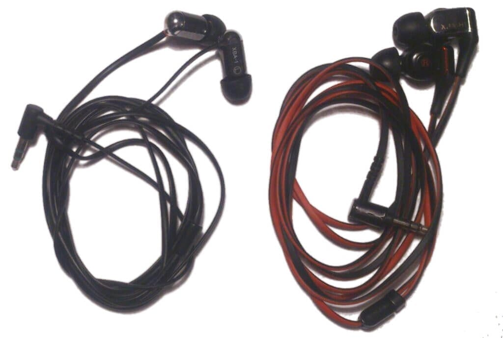
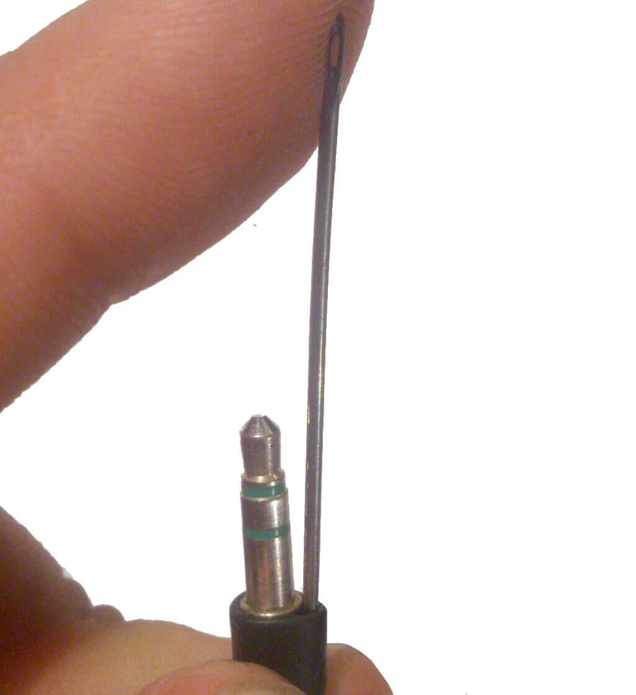
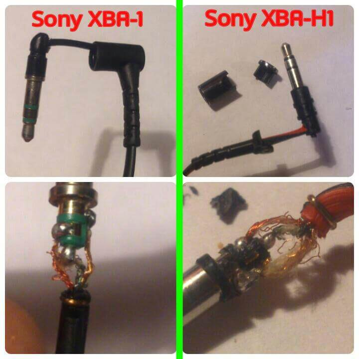
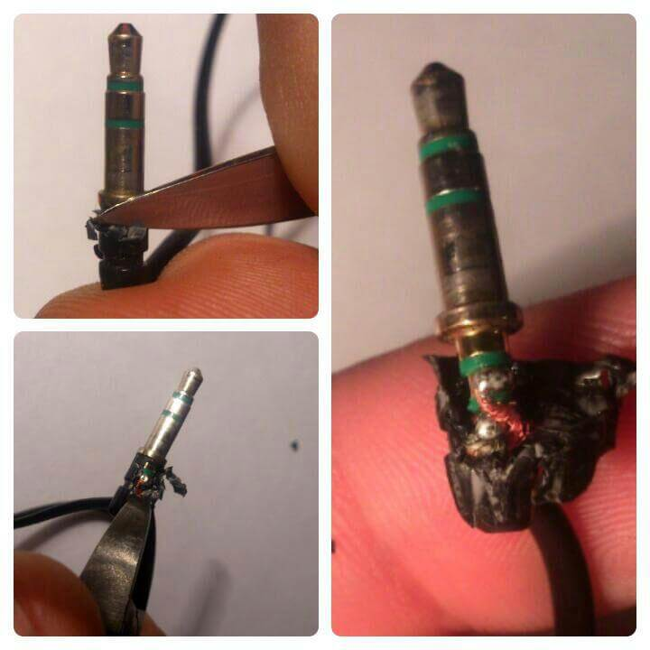
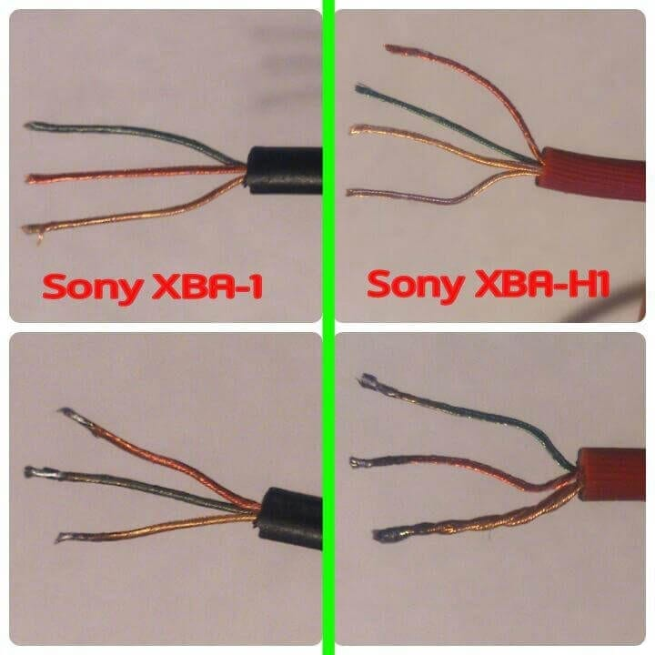
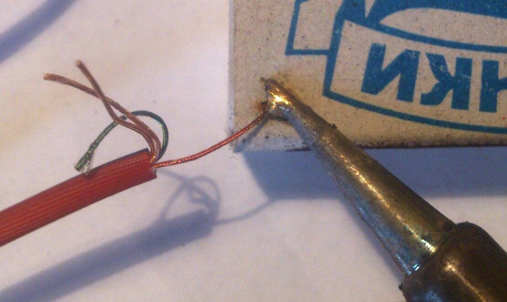
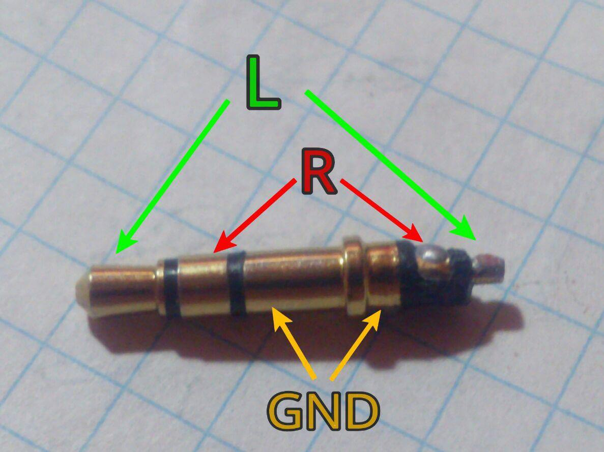
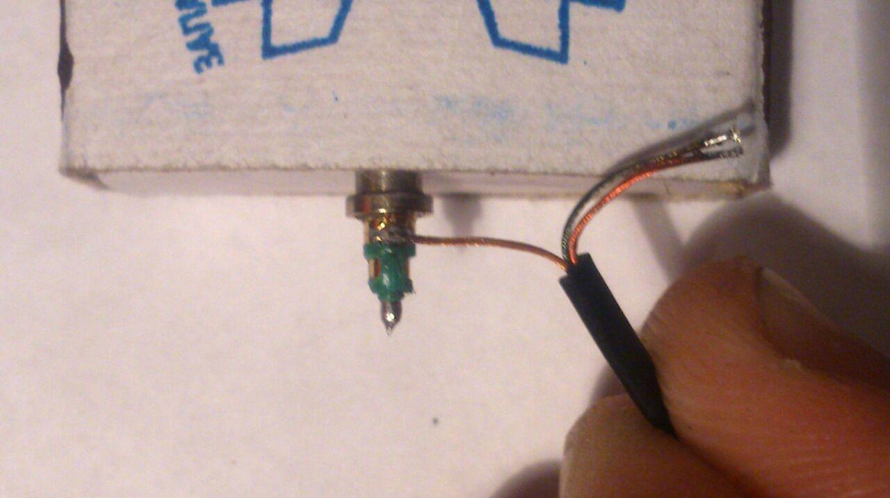

[English](./README.md) | **Русский**

# Ремонт наушников - как припаять штекер к наушникам

**Рубрики:** Ремонт наушников  
**Оригинал:** https://audiogeek.ru/remont-razyoma-naushnikov/

---

Зачем покупать новые наушники, если в 9 случаях из 10 не работают наушники из-за разрыва провода около штекера. Тому, как починить наушники своими руками, а точнее как припаять штекер к наушникам подробно рассмотрено в сегодняшней статье.

> Описываемый метод предполагает как минимум наличие паяльника. О том как починить наушники безе паяльника читайте: ***[Ремонт наушников голыми руками, без паяльника!](../remont-naushnikov-bez-payalnika/)***

> **Специально для этой статьи было снято видео в котором показан весь процесс ремонта наушников :**

> ▶ **[Смотреть видео на YouTube](https://www.youtube.com/watch?v=Jjh77Q2CN9w)**

 
Чтобы показать, как припаять наушники к штекеру подготовлены наглядные фотографии ремонта двух наушников компании Sony. Это модели XBA-1 и XBA-H1. В обоих случаях не работают наушники именно из-за переломленного провода.

Первые наушники чисто арматурные, вторые гибрид арматурного с динамическим излучателем, но это не важно. Сегодня все наушники комплектуются штекером 3.5 мм (джек или jack 3.5mm) и ремонт штекеров обоих наушников будет показан параллельно.

## **Как разобрать штекер наушников**

Чтобы починить наушники, первым делом необходимо разобрать их штекер. Подавляющее большинство наушников имеют на разъеме резиновую оболочку, которую можно аккуратно снять. Удобнее делать это толстой иглой или шилом:

Вставляем иголку сначала неглубоко, и постепенно продвигаясь по кругу, углубляемся иголкой на всю глубину разъема. После этого можно стянуть резиновое покрытие.
У вторых наушников(XBA-H1) разъем оказался разборным.

Как видно из картинки, следующий шаг - это оголение залитых пластиком контактов штекераа. Я срезал аккуратно, для демонстрации, того что там изначально находится. Обычно я срезаю все вместе с проводами :)

## **Чистим контакты штекера:**

На разъеме нужно отпаять все провода. Даже если срезать их или они будут оторваны, то в капельках олова на контактах все равно останутся кусочки проводков, которые потом могут перемкнуть контакты. В любом случае капельки олова на контактах нужно освежить, расплавив их паяльником, смоченным в канифоли, и вытащив из них лишние кусочки проводков.

С разъемом пока закончили, теперь подготовим провод. Зачастую провод умирает на выходе из разъема, поэтому срезаем его на 2-3 или даже 5 см выше разъема. Затем острым ножом или скальпелем прорезаем по кругу оплетку провода в 1-1.5 см от конца и снимаем покрытие, оголяя проводки.

## **Лудим провода перед пайкой наушников**

***Обратите внимание, что у первых наушников внутри 3 проводка, а у вторых 4.***

***Каждый проводок представляет из себя смесь скрученных  капроновых ниточек и медных жилок, покрытых  лаком***.
Перед пайкой проводки необходимо **залудить**, т.е. покрыть слоем олова. Для начала скручиваем проводок, т.к. наверняка его конец размахрился. Затем кладем его кончик на  канифоль и придавливаем разогретым паяльником слегка окуная его в плавящуюся канифоль.
После этого кладем краешек провода на спичечный коробок и, прижимая паяльником с каплей олова, проворачиваем весь шнур наушников. При этом проводок должен скрутиться и равномерно покрыться оловом. Достаточно залудить самый кончик. Но никто не запрещает залудить больше,  а затем срезать лишнее, оставив 2-3 мм покрытых оловом. Главное - оставить незалуженную чати проводков достаточной длины,  чтобы дотянуться до контактов штекера.

ВсЁ, с нудной, но важной подготовительной частью покончено. Теперь задача по интереснее - припаять провод к разъему. Для начала выясним что и куда.

## **Куда припаять провода наушников**

Думаю буковки **L** и **R** знакомы всем и то, что они обозначают **левый (Left)** и **правый (Right)** каналы тоже :) . А вот что такое **GND**?
 Все просто - это **GrouND** или по нашенскуи - **земля**. Наверное вы слышали что лампочка может гореть только когда по одному проводу ток в нее втекает, а по другому ток из нее вытекает. И что называется это дело замкнутая цепь. Так вот и здесь тоже самое - наушник запоет если один его провод припаян к **L** или **R**, а второй к **земле ( GND ).** Так что у нас просто нет другого выхода как припаять **левый** наушник к **L** и **GND**, а **правый** к **R** и **GND**.
Цвета надписей и стрелочек выбраны не случайно, это стандартная расцветка, которую имеют больше половины наушников, а у остальной половины вместо зеленого - синий. В особо редких случаях встречаются другие цвета, но земля(GND) всегда желтая. **Всегда...**
Если затрудняетесь с определением где какой канал - припаяйте землю, включите наушники в плеер или телефон и залуженным проводком тыкайтесь в контакты штекера. смотрите где заиграет)
## Как припаять провода наушников

Это самый удобный вариант) Держать пальцами крайне не советую - легко обжечься. В процессе пайки стараемся не касаться разъема паяльником более 3-х секунд, иначе может поплавиться пластик, разделяющий контакты в разъеме и будет КЗ и ремонт штекера накроится(((

## **Заливаем штекер наушников клеем**

Когда все проводки припаяны остается залить разъем полиэтиленовым термоклеем **(1)** и, пока клей не застыл, всунуть в резиновую оболочку **(2)**. Желательно заполнить весь объем разъема наушников, поэтому сначала наливаем клей в разъем, а затем делаем смачную каплю на контактах разъема. Вставив штекер в оболочку, убираем излишки выдавившегося клея пальцами. Теперь  есть еще 5-10 секунд на придание разъему нужное положение**(3)**. Держим так до полного затвердевания клея. А потом острым ножом срезаем последние остатки**(4)**.

Надеюсь, что в статье удалось показать ремонт наушников своими руками. Возможно вам до сих пор не понятно как припаять штекер к наушникам или что-то осталось 'за кадром', не стесняемся выражать свое негодование или годование в комментах.

> **У этого метода есть одно слабое место - использование термоклея**. Со временем он может размягчаться.

*Материал подготовлен исключительно для сайта [AudioGeek.ru](https://github.com/SkyTrip-13/AudioGeek)*
