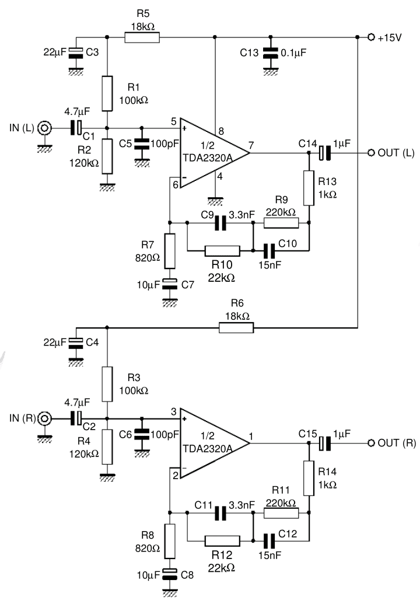
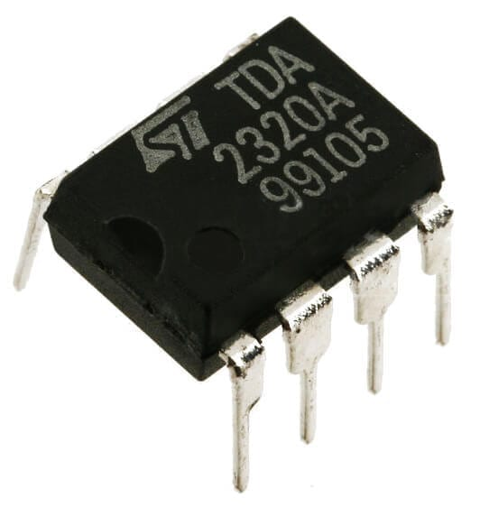
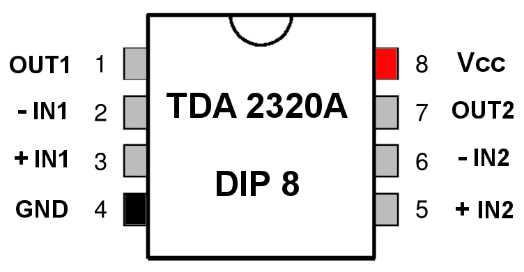
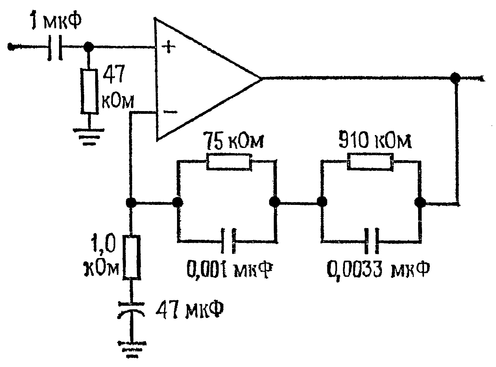
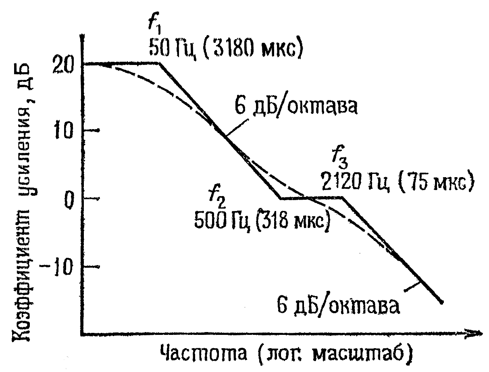

[Русский](./README.ru.md) | **English**

# Vinyl RIAA preamp: proven simple circuits

**Category:** Vinyl, Audio circuit design  
**Tags:** audio filters, op-amp circuit  
**Original:** https://audiogeek.ru/riaa-korrektor/

---

A **phono (RIAA) preamp** is an essential part of any vinyl turntable system. The playback quality depends directly on its quality. Today let us look at proven, repeatedly tested circuits you can use to build a phono preamp.

I have already explained **[what RIAA equalization is and why it is needed](../riaa-vinil-korrekciya/)**. Today we will look at a couple of op-amp phono preamp circuits. Both circuits were built and tested personally, and have worked perfectly for more than 5 years.

## A phono preamp from the TDA2320A datasheet

The circuit is borrowed from the datasheet of the TDA2320A. It is essentially just a dual op-amp, which can be replaced with any other dual op-amp without changing the circuit.

Operation from a single supply is achieved by applying half the supply voltage to the non-inverting inputs (pins 3 and 5) through the dividers R1-R2-R5 and R3-R4-R6.

Capacitors C1, C2 and C14, C15 at the input and output of each channel are needed to block DC. The 0.1 µF capacitor C13, needed to filter high-frequency interference on the supply, should be placed as close as possible to the chip pin, and a 10–100 µF capacitor can be connected in parallel with it.

## What is interesting about the TDA2320A

The special feature of this chip is that it is a class A amplifier. That means both half-waves of the signal are amplified by one stage. In class B, the positive and negative half-waves are amplified by different stages inside the chip.

A class A amplifier guarantees less nonlinear distortion. This chip can operate from a single supply of 3 to 36 volts, or from a dual supply of ±1.5 to ±18 volts. The pinout is the standard op-amp pinout:

The chip was designed specifically for audio circuits, and its ability to work at a supply as low as 3 volts lets you use it in portable devices, such as a cassette player. The datasheet also gives examples of other filter and equalizer circuits.

## A phono preamp with a dual supply

The next circuit was found in "The Art of Electronics" by P. Horowitz and W. Hill (page 167). The diagram shows one channel of the phono preamp:

It is essentially the same circuit. But now a dual supply is used, and the frequency-determining networks are calculated differently. A dual supply lets you drop both the dividers for forming half the supply voltage and the output capacitor. The input capacitor should stay, to block any DC from the previous stage and also as part of the input RC network.

In this circuit, as in the previous one, put 10–100 µF and 0.1 µF supply capacitors as close as possible to the op-amp power pins. The grounded 47 µF capacitor reduces the DC gain to unity.

The graph is the frequency response of the playback amplifier, plotted relative to a gain of 0 dB at 1 kHz.

TL062 and TL072 can also be used as the op-amps, but it is better to prefer the TDA2320, L4558, LM833 and other op-amps designed for audio circuits, or ones with high input impedance (>1 MΩ), low noise and a high slew rate.

## Instead of a conclusion

Which version to build and on which op-amps is up to you. I personally prefer the dual-supply op-amp circuit because it has no extra parts, but the single-supply circuit does its job just as well, and good op-amps and components give a significant improvement in sound quality.

*Originally written for [AudioGeek.ru](https://github.com/SkyTrip-13/AudioGeek). Translated from Russian.*
