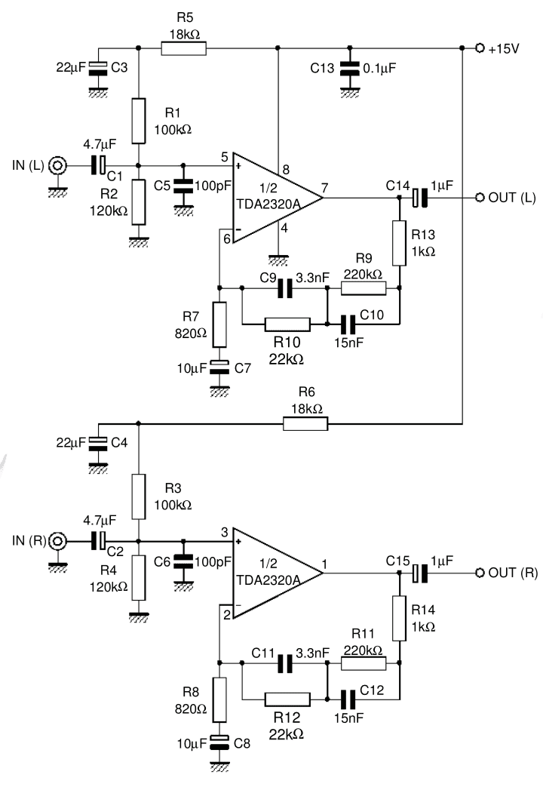
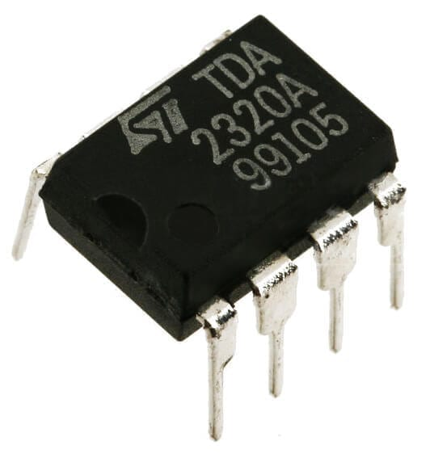
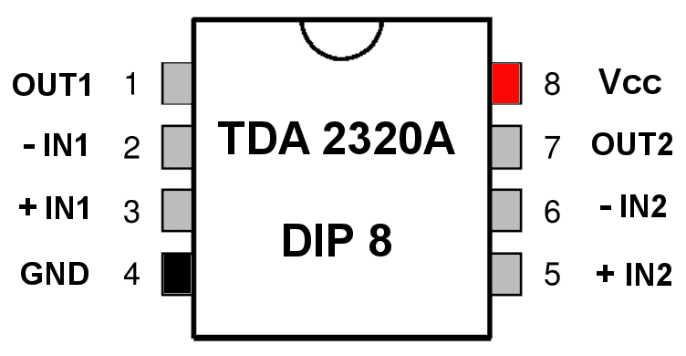
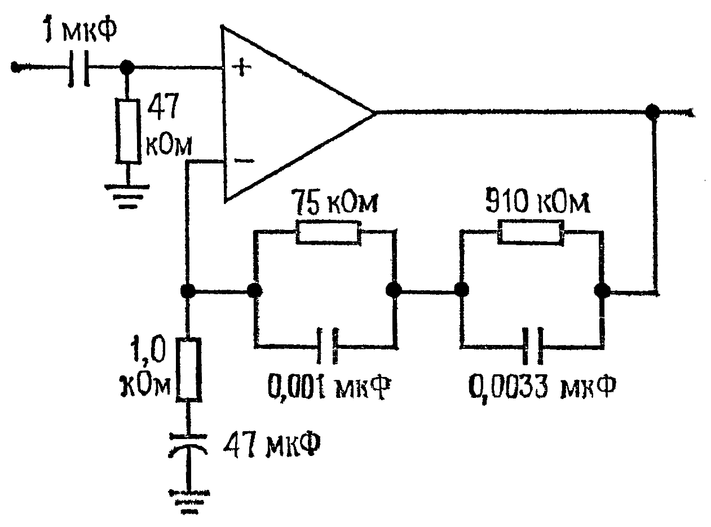
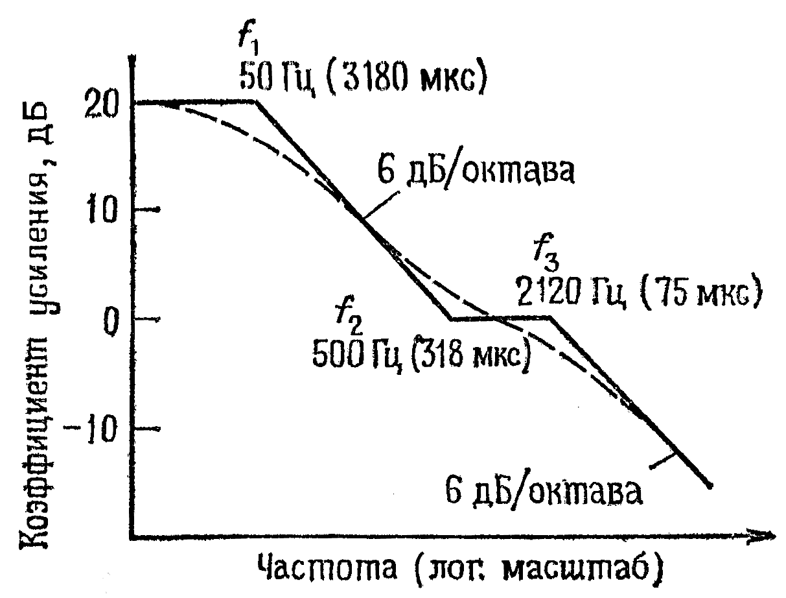

[English](./README.md) | **Русский**

# Винил корректор, проверенные простые схемы

**Рубрики:** ВИНИЛ, Схемотехника аудиотракта  
**Метки:** звуковые фильтры, схема на ОУ  
**Оригинал:** https://audiogeek.ru/riaa-korrektor/

---

**Винил корректор** - обязательная составляющая любого проигрывателя виниловых дисков. От его качества напрямую зависит качество воспроизведения. Рассмотрим сегодня зарекомендовавшие себя и многократно опробованные схемы, по которым можно собрать винил корректор.

Я уже рассказывал **[что такое RIAA коррекция и для чего она нужна](../riaa-vinil-korrekciya/)**. Сегодня же рассмотрим пару схем винил корректора на ОУ. Обе схемы собирались и проверялись лично, и прекрасно работают уже более 5 лет.

## Винил корректор, схема из даташита на TDA2320A

Схема позаимствована из даташита на микросхему TDA2320A. По сути это просто сдвоенный операционный усилитель который может быть заменен на любой другой сдвоенный операционный усилитель без изменения схемы .

Работа при однополярном напряжение питания обеспечивается подачей на неинвертирующие входы (3 и 5) половинного напряжения питания посредством применения делителей напряжения R1-R2-R5 и R3-R4-R6.

Емкости С1,С2 и С14,С15 на входах и выходах каждого канала нужны для отсечения постоянного напряжения. Конденсатор С13 в 0.1 мкФ, необходимый для фильтрации ВЧ помех по питанию, желательно расположить как можно ближе к ножке микросхемы, параллельно ему можно включить конденсатор емкостью 10-100мкФ

## **Чем интересна сама TDA 2320A**

Фишкой данной микросхемы является то, что она является усилителем класса А. Это означает, что обе полу-волны сигнала усиливаются одним каскадом . В случае же класса B положительные и отрицательные полу-волны усиливаются разными каскадами внутри микросхемы.

Усилитель класса А гарантирует меньшее количество нелинейных искажений. Данная микросхема может работать как при однополярном напряжении питания от 3 до 36 вольт так и при двуполярном от +-1.5 до +-18 вольт соответственно. Распиновка микросхемы стандартная для операционных усилителей:

Данная микросхема разработана специально для использования в звуковых цепях, а возможность работы при таком низком напряжении питания в 3 вольта, позволяет использовать ее для портативных устройств, например для кассетного плеера. В даташите приведены примеры и других схем фильтров и корректоров.

## **Винил корректор с двухполярным питанием**

Следующая схема была найдена в книге “”Искусство схемотехники”- П.Хоровиц, У.Хилл (стр. 167). На схеме изображен один канал винил корректора:

По сути эта та же самая схема. Но теперь уже используется двухполярное питание, а так же иначе рассчитаны номиналы частотозадающих цепей. Использование двухполярного питания позволяет отказаться как от применения делителей для формирования половинного напряжения питания, так и от выходного конденсатора. Входной конденсатор следует оставить для отсечениея возможного постоянного напряжения предыдущего каскада, а так же как элемент входной RC цепи.

В данной схеме, как и в предыдущей следует установить емкости по питанию 10-100 мкФ и 0.1 мкФ максимально близко к ножкам питания ОУ. Заземленный конденсатор в 47 мкФ уменьшает коэффициент усиления по постоянному току до единицы.

График представляет из себя частотную характеристику усилителя воспроизведения, построенную относительно значения коэффициента усиления 0 дБ при частоте 1кГц.

В качестве операционных усилителей могут быть применены и TL062, TL072, но лучше отдать предпочтение TDA2320, L4558, LM833 и другим ОУ, предназначенным для звуковых цепей, либо обладающими высоким входным сопротивление (>1МОм), низким уровнем шумов и высокой скоростью нарастания сигнала.

## **Вместо заключения**

Какой вариант и на каких операционных усилителях собирать винил корректор - решать вам. Я лично предпочитаю схему на ОУ с двухполярным питанием, ввиду отсутствия лишних элементов, однако схема с однополярным питанием справляется со своей задачей ни чуть не хуже, а применение качественных операционных усилителей и компонентов позволит добиться значительного прироста в качестве звука.
