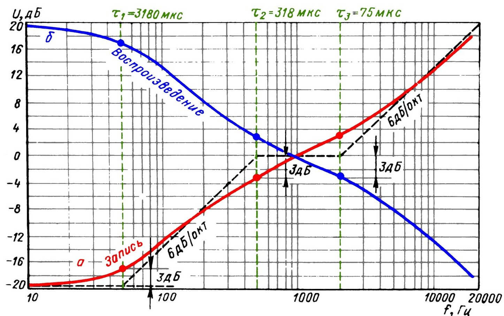

[Русский](./README.ru.md) | **English**

# Vinyl RIAA equalization

**Published:** 2017-01-15  
**Category:** Vinyl, Misc  
**Original:** https://audiogeek.ru/riaa-vinil-korrekciya/

---

The RIAA standard was approved back in 1955. Before then, record manufacturers cut records to all sorts of characteristics, often their own. This situation required an amplifier to provide several kinds of record equalization, or to use tone controls.

As records spread as the main sound carrier, this approach became more and more impractical. The number of record labels grew, and with it the number of standards.

For these reasons the International Electrotechnical Commission (IEC) adopted, from 1958, equalization according to the RIAA (Recording Industry Association of America) standard, which became part of the standards of most countries, for example GOST 7893-72 and DIN 45 541.

Records are cut with a cutting head. The velocity of the cutter around its equilibrium point (the midrange) is directly proportional to the signal applied to it. Consequently, for a signal of constant amplitude the velocity also stays constant. And the amplitude of the cutter, and therefore the groove width, is inversely proportional to the signal frequency. Put simply, at high frequencies the groove width decreases and the signal-to-noise ratio worsens. At low frequencies the groove width increases, which requires more space between grooves and leads to higher distortion. From all this follows the need to reduce the amplitude at low frequencies and raise it at high frequencies. Applying RIAA equalization ultimately improves the signal-to-noise ratio, evens out and narrows the grooves on the record and, accordingly, gives a longer playing time per record.

The recording characteristic approved by the RIAA standard is suitable for both mono and stereo recording.

## **The RIAA standard defines three zones**

- The low-frequency (LF) zone, where the signal falls by 6 dB per octave
- The mid-frequency (MF) zone, where the inflection point at 1 kHz lies at the 0 dB level
- The high-frequency (HF) zone, where the signal rises by 6 dB per octave.

**This characteristic is obtained with three time constants τ**

- 3180 µs, corresponding to 50 Hz
- 318 µs, corresponding to 500 Hz
- 75 µs, corresponding to 2100 Hz

These three points define the zigzag shape of the recording curve, and the three time constants are used in calculating the values of the elements of the equalizing filters.

The crystal pickups used earlier had the inverse characteristic and needed no correction, since the frequency compensation came automatically. But such pickups do not meet high sound quality requirements and were completely displaced by magnetic pickups. Magnetic pickups, in turn, have a linear frequency response, which creates the need for an RIAA equalizer for the pickup signal.

There is a huge number of circuit solutions for such equalizers. They are built with tubes, with transistors and with op-amps. Simple circuits that are easy to repeat and that meet the RIAA vinyl equalization standard are covered in detail in the article [**Vinyl RIAA preamp: proven simple circuits**](../riaa-korrektor/).

*Originally written for [AudioGeek.ru](https://audiogeek.ru). Translated from Russian.*
