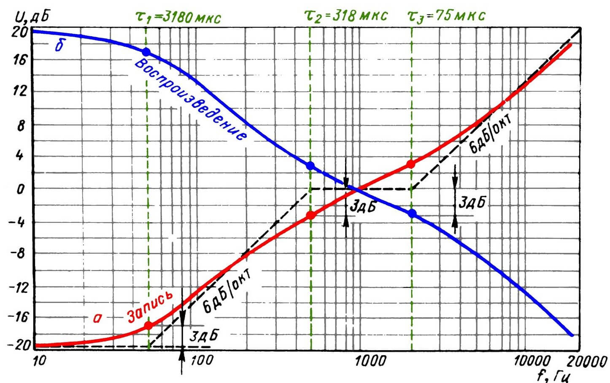

[English](./README.md) | **Русский**

# Винил коррекция по стандарту RIAA

**Дата:** 2017-01-15  
**Рубрики:** ВИНИЛ, Разное  
**Оригинал:** https://audiogeek.ru/riaa-vinil-korrekciya/

---

Стандарт RIAA был утвержден еще в 1955 году. До этого времени фирмы изготовители пластинок делали записи по самым различным, зачастую собственным стандартам на характеристики. Такое положение требовало предусматривать в усилителе несколько видов коррекции грамзаписей или же использовать регуляторы тембра.

По мере распространения грампластинок, как основных носителей звука, такой подход становился все более и более некорректным. Количество фирм записи росло, а с ними росло и количество стандартов.

По этим причинам Международной электротехнической комиссией (МЭК) с 1958 г. была принята коррекция по стандарту RIAA (Recording Industries Association of America), которая вошла в стандарты большинства стран, например ГОСТ 7893-72, DIN 45 541.

Запись на пластинки осуществляется головкой-резцом. Скорость движения резца около точки равновесия (СЧ область) прямо пропорциональна значению подаваемого на него сигнала. Следовательно, при постоянном по амплитуде сигнале скорость также остается постоянной. А амплитуда резца и, соответственно, ширина канавки будут обратно пропорциональны частоте сигнала. Говоря проще, на высоких частотах ширина канавки буде уменьшаться и соотношение сигнал/шум ухудшится. На низких частотах ширина канавки увеличивается, что требует увеличения расстояния между канавками и приводит к повышению уровня искажений. Из всего этого и следует необходимость уменьшения амплитуды на НЧ и ее увеличение на ВЧ. Применение RIAA коррекции в конечном счете приводит к улучшению соотношения сигнал/шум, выравниванию и уменьшению ширины дорожек на пластинке и, соответственно, к большей продолжительности звучания одной пластинки.

Характеристика записи, утвержденная стандартом RIAA пригодна как для моно-, так и для стерео- записи.

## **Стандарт RIAA определяет три зоны**

- Зона низких частот (НЧ), где сигнал затухает на 6 дБ на октаву
- Зона средних частот (СЧ), где на частоте 1кГц на уровне 0 дБ находится точка перегиба
- Зона высоких частот (ВЧ), где сигнал повышается на 6 дБ на октаву.

**Такая характеристика получается с помощью трех постоянных времени τ**

- 3180мкс - соответствующей 50Гц
- 318мкс - соответствующей 500Гц
- 75мкс - соответствующей 2100Гц

Эти три точки определяют зигзагообразность кривой записи, а три постоянные времени используются при расчетах величин элементов корректирующих фильтров.

Кристаллические звукосниматели, которые использовались ранее имели обратную характеристику и не требовали корректировки т.к. частотная компенсация получалась автоматически. Однако такие звукосниматели не отвечают высоким звуковым требованиям и были полностью вытеснены магнитными звукоснимателями. Магнитные звукосниматели, в свою очередь имеют линейную частотную характеристику. Что вызывает необходимость использования RIAA - корректора сигнала звукоснимателя.

Существует колоссальное количество схемных решений подобных корректоров. Они реализуются и на лампах, и на транзисторах, и на операционных усилителях. Несложные схемы, доступные для повторения, отвечающие стандарту RIAA винил коррекции, подробно рассмотрены в статье [**Винил корректор, проверенные простые схемы**](../riaa-korrektor/).
