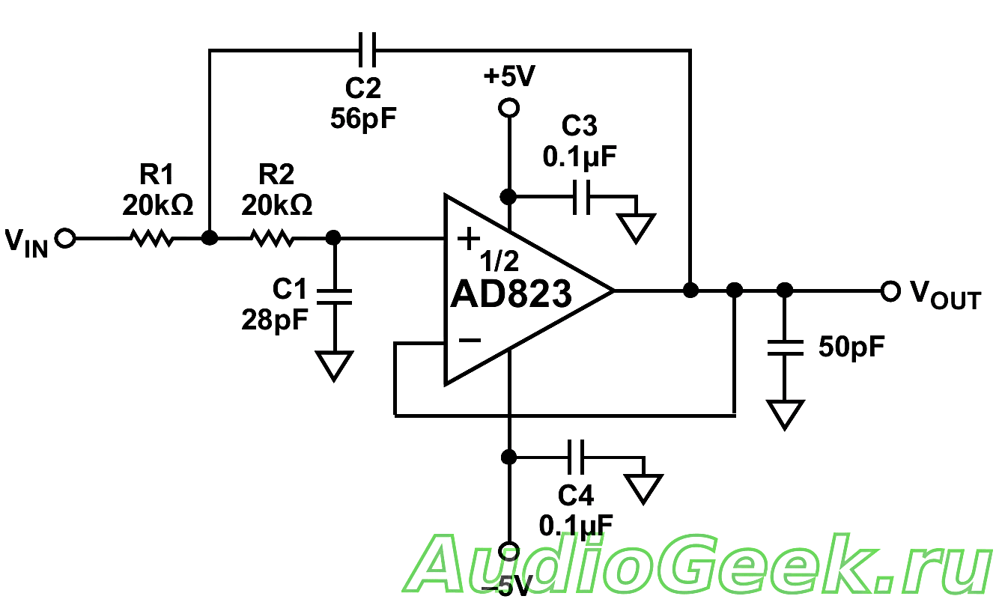
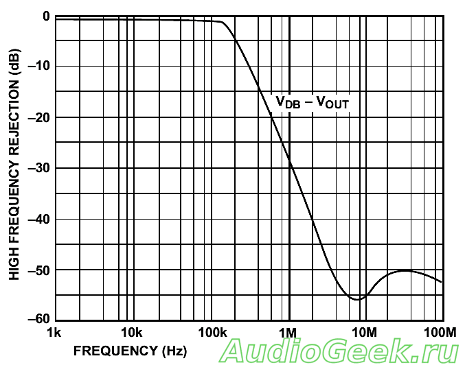
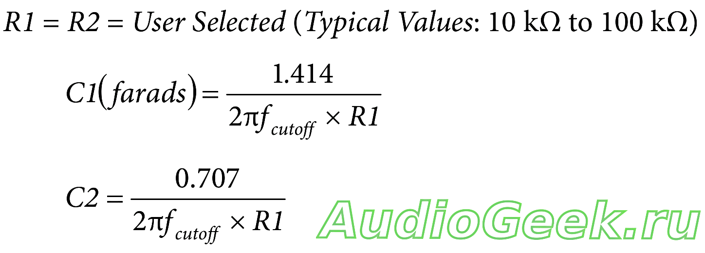
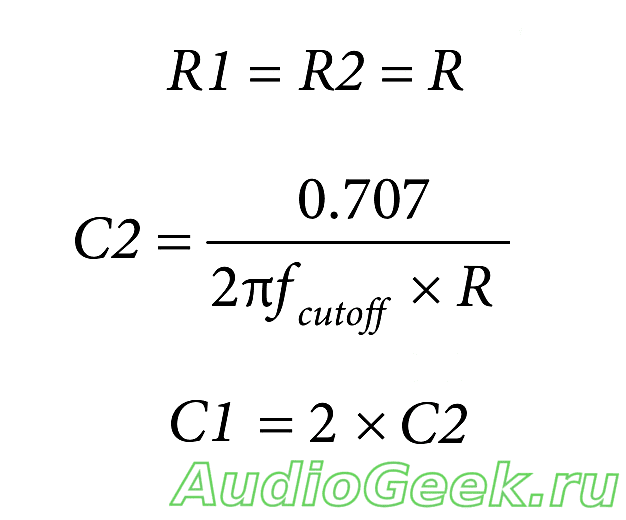
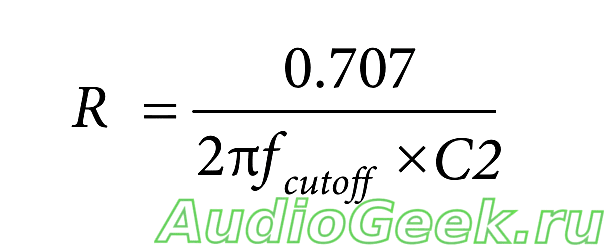
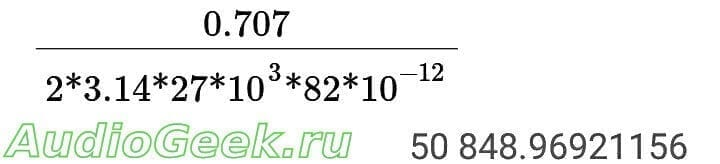
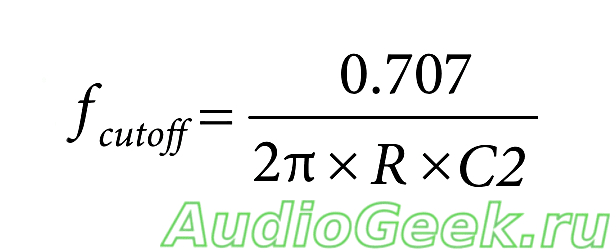
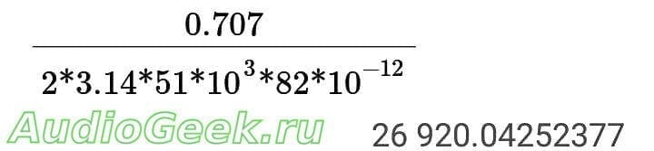

[Русский](./README.ru.md) | **English**

# A 2nd-order Butterworth low-pass filter circuit

**Category:** Audio circuit design  
**Tags:** audio filters, op-amp circuit  
**Original:** https://audiogeek.ru/second-order-low-pass-filter/

---

In radio electronics there is regularly a need for various filters. The most common need is for a low-pass filter (LPF). Often a plain RC network is enough. But in some cases a steeper rolloff of the frequency response is required. The Butterworth filter can be called fairly universal. Let us look at a 2nd-order low-pass filter circuit.

## **The 2nd-order low-pass filter circuit**

In the ***[AD823 datasheet](./AD823.pdf)*** I found a second-order low-pass filter circuit that is convenient to build. With the component values R1, R2, C1 and C2 given in the datasheet, the cutoff frequency of the filter is 200 kHz.

The frequency response of the signal after the filter is shown in the next picture:

## Formulas for calculating the 2nd-order low-pass filter

The folks at Analog Devices recommend choosing resistor values in the range of 10 to 100 kΩ and then calculating the capacitances from the given formulas.

The number 1.414 in the numerator is √2, and 0.707 is 1/√2. Dividing one by the other, we find that the capacitance C1 is twice the capacitance C2.
This is also visible from the formulas themselves. I do not know why they could not give a formula for C2 only and write C1 = C2·2. It would look like this.

While digging deeper into filters I noticed that most authors start the calculation by choosing the resistor value and then calculating the capacitances.
I do not know about you, but precision capacitors are not that common for me. For this reason, in my opinion, it is easier to take the capacitance of a capacitor you have on hand as the starting point and pick resistors for it.
For the calculation it is enough to simply swap R and C in the formula for C2.

## Calculating the elements of the 2nd-order low-pass filter

In the depths of my parts drawers I found 82 pF capacitors with 1% accuracy. A cutoff frequency of 27 kHz was required. In the calculation the capacitance must be taken in farads, and then we get the resistance in ohms.
Substituting the needed values into the reworked formula for C2, we find the required resistance.

So it turns out that we need a resistor of 50849 Ω. Great, that fits in the recommended range of 10–100 kΩ. The closest value in the standard series is 51 kΩ.
Now let us calculate what the cutoff frequency of the resulting circuit will be, given the choice of a nearby resistor. To calculate **fcutoff** our formula looks as follows:

Substitute the values into the formula and do the simple calculations.

Excellent! I think an error of 0.3% is no error at all. The accuracy of the component values here is ±1% anyway.
And what about capacitor C1, where do we get 162 pF? For that we simply solder two of the same 82 pF capacitors in parallel.

## The last capacitor

Note that the circuit also has a 50 pF capacitor connected from the output to ground. You can think of this capacitor as connected to the inverting input of the amplifier, tying it to ground for AC. I also used 82 pF for it.
Without this capacitor the op-amp may oscillate. This is especially relevant if you use fast op-amps, such as the same AD823.

## Instead of a conclusion

Ideally, buffers should be placed before and after the filter, for isolation and impedance matching. This applies to any filter. Buffers have their own article: ***[An op-amp voltage follower circuit. A powerful voltage follower on the TDA2030.](../povtoritel-opamp/)***

*Originally written for [AudioGeek.ru](https://audiogeek.ru). Translated from Russian.*
