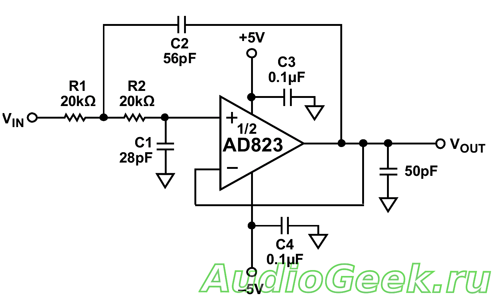
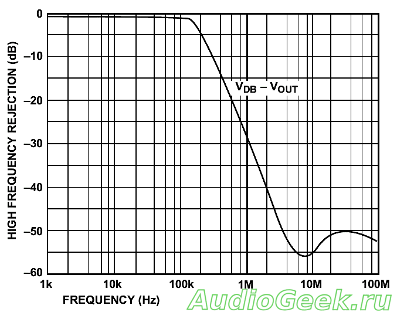
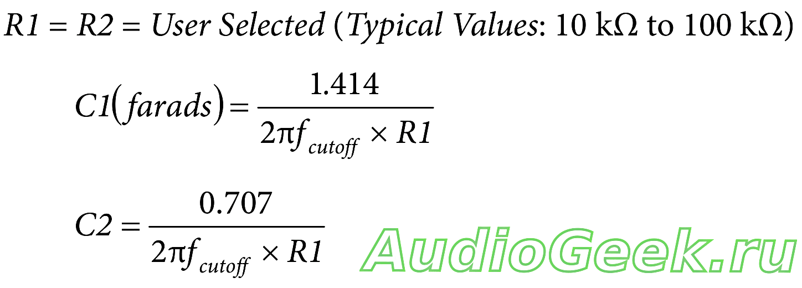
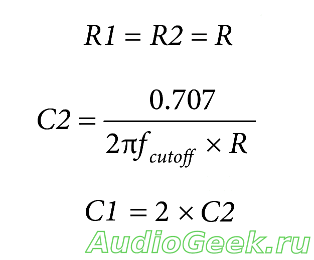
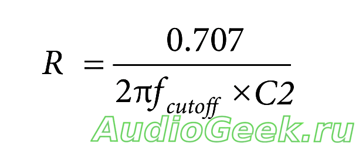
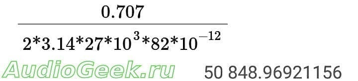
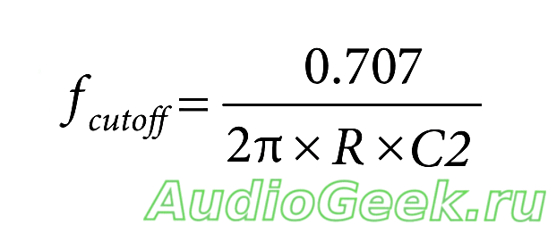

[English](./README.md) | **Русский**

# Схема ФНЧ 2-го порядка по Баттерворду

**Дата:** 2018-10-28  
**Рубрики:** Схемотехника аудиотракта  
**Метки:** звуковые фильтры, схема на ОУ  
**Оригинал:** https://audiogeek.ru/second-order-low-pass-filter/

---

В радиотехнике регулярно возникает необходимость в использовании различных фильтров. Чаще других возникает необходимость в построении Фильтра Низких Частот (ФНЧ). Зачастую обходятся обычной RC-цепочкой. Но в некоторых случаях требуется более крутой спад частотной характеристики. Довольно универсальным можно назвать фильтр Баттерворда. Рассмотрим схему ФНЧ 2-го порядка.

## **Схема ФНЧ 2-го порядка**

В ***[даташите на AD823](./AD823.pdf)*** была найдена удобная для повторения схема ФНЧ второго порядка. С приведенными в даташите номиналами деталей R1, R2, C1 и C2 частота среза фильтра равна 200кГц.

АЧХ сигнала после фильтра приведена на следующей картинке:

## Формулы для расчета ФНЧ 2-го порядка

Ребята из Analog Devices рекомендуют выбрать величину номинала резисторов, в пределах от 10 до 100кОм, а затем по приводимым формулам рассчитать емкости конденсаторов.

Стоящее в числителе число 1.414 это √2, а число 0.707, это 1/√2. Если поделить одно на второе получим, что емкость С1 в два раза больше емкости С2.
Это видно и из самих формул. Не знаю почему нельзя было привести формулу только для С2 и написать что С1=С2\*2. Выглядело бы это следующим образом.

В процессе углубления в тему фильтров было замечено, что большинство авторов начинают рассчет с того, что выбирают величину резистора, а затем рассчитывают величины емкостей.
Не знаю как у Вас, но у меня прецизионные конденсаторы не такое частое явление. По этой причине, на мой взгляд, проще взять за основу емкость имеющегося в наличии конденсатора и уже под него подобрать резисторы.
Для расчетов достаточно просто поменять местами R и C в формуле для C2.

## Расчет элементов ФНЧ 2-го порядка

В закромах родины были найдены конденсаторы на 82 пФ точностью 1%. Требовалась частота среза в 27 кГц. При расчетах величину конденсатора следует брать в фарадах, тогда величину резистора мы получим в Омах.
Подставляя нужные значения в переделанную формулу для С2 находим нужную величину сопротивления.

Итак, получилось, что нужен резистор номиналом в 50849Ом. Отлично, это укладывается в рекомендуемый диапазон 10-100кОм. Самая близка величина резистора в стандартном ряду - 51кОм.
Теперь подсчитаем какой будет частота среза получившейся цепи с учетом выбора близкого резистора. Для подсчета **fcutoff** наша формула будет выглядеть следующим образом:

Подставляем величины в формулу и проводим несложные расчеты.

Отлично! Думаю что ошибка в 0.3% и не ошибка вовсе. Тут точность номиналов элементов то +-1%.
А что же делать с конденсатором C1, где взять 162пФ? Для этого просто припаиваем два таких же конденсатора по 82 пФ параллельно.

## Последний конденсатор

Обратите внимание, что на схеме так же присутствует конденсатор в 50пФ, включенный с выхода на землю. Можно считать, что этот конденсатор включен к инвертирующему входу усилителя и обеспечивает его привязку к  земле по переменке. Его я так же установил 82 пФ.
Отсутствие этого конденсатора может приводить к самовозбуждению ОУ. Особенно это актуально, если вы используете скоростные ОУ, например тот же AD823.

## Вместо заключения

По хорошему, до и после фильтра желательно установить повторители, для развязки и согласованию по сопротивлениям. Это касается любого фильтра. Вопросу повторителей посвящена отдельная статья:***[Схема повторителя напряжение на ОУ. Мощный повторитель напряжения на TDA2030.](../povtoritel-opamp/)***
