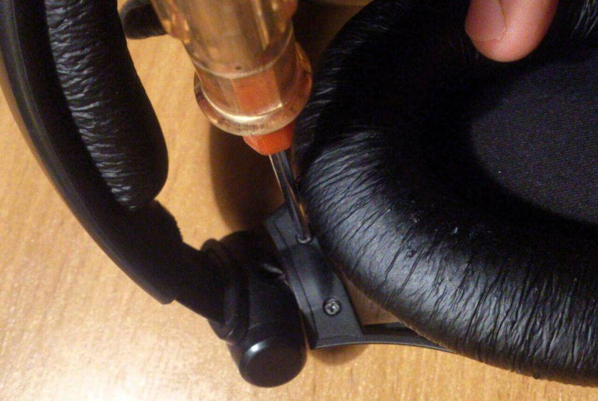
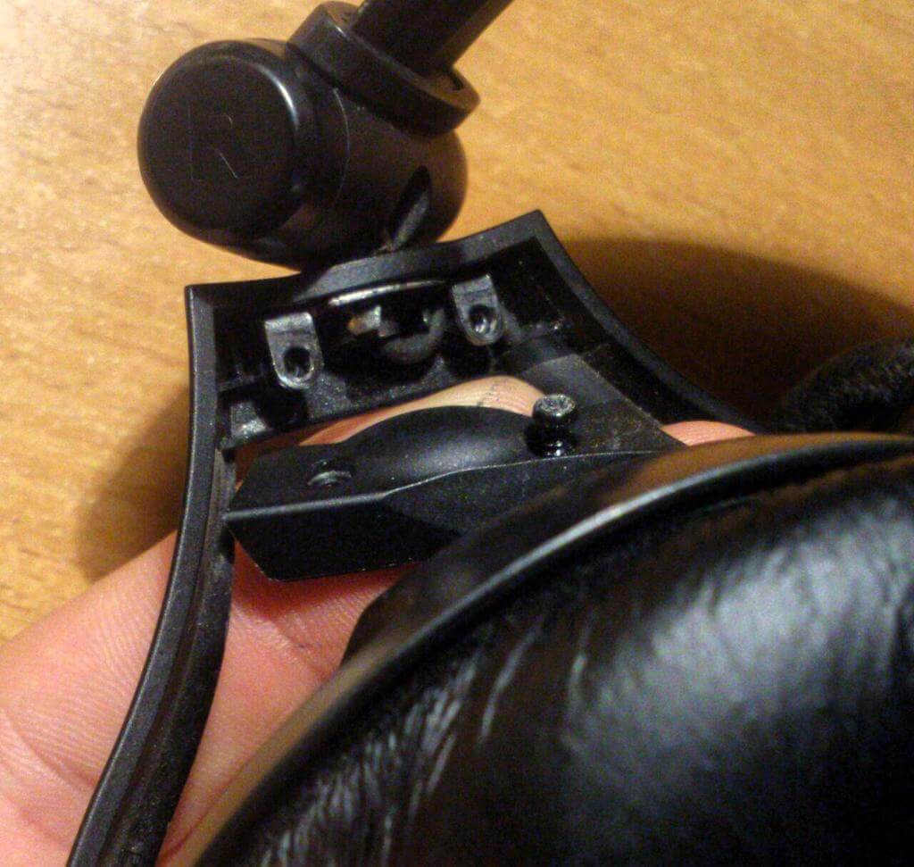
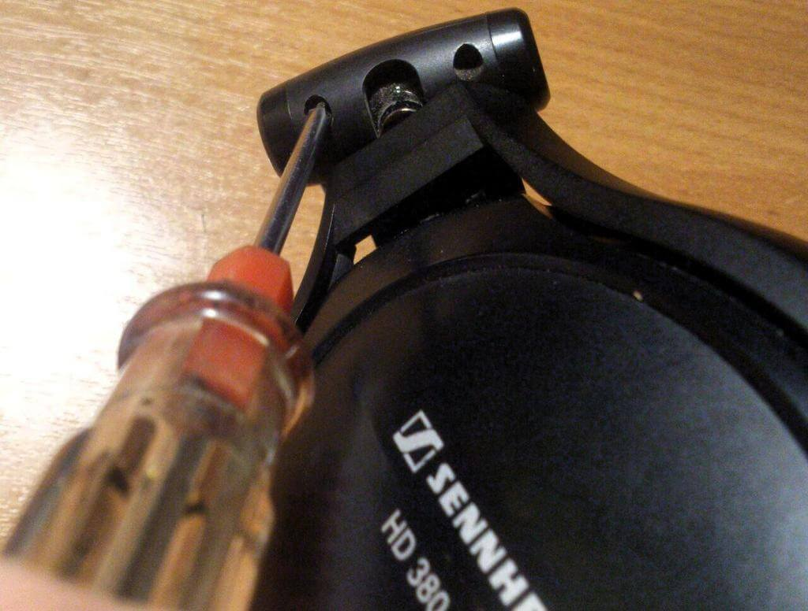
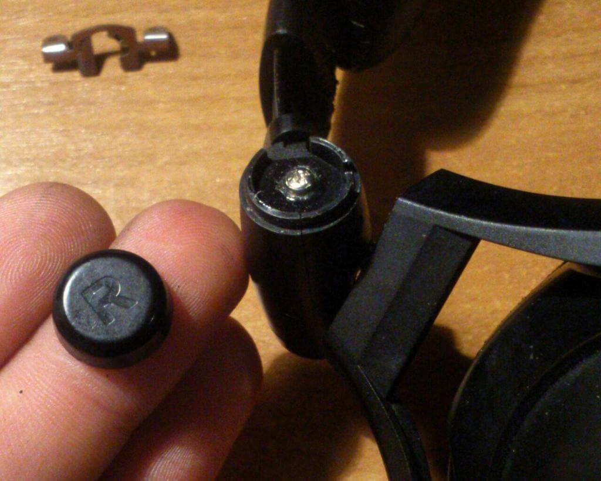
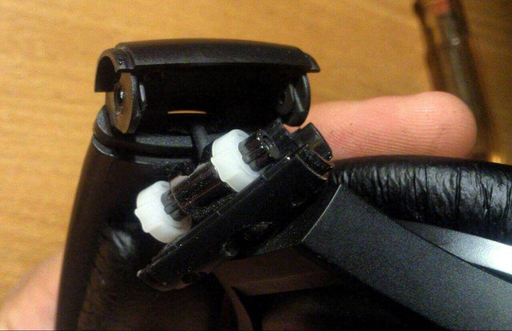

[Русский](./README.ru.md) | **English**

# Sennheiser HD 380 Pro and PXC 350: taking the hinges apart

**Published:** 2017-10-16  
**Category:** Headphone repair  
**Tags:** sennheiser hd380 pro  
**Original:** https://audiogeek.ru/sennheiser-hd380pro-sharnir/

---

A folding design is very convenient for transport, which is especially noticeable with full-size headphones such as the Sennheiser HD 380 Pro or their sibling the Sennheiser PXC 350. However, the hinges that let the headphones fold so easily are points of increased wear. And that applies not so much to the hinges themselves, which are metal here, as to the wire running inside and being bent constantly. But to get to it you have to take the hinge apart...

This applies only to the right earcup, because its wire runs from the left earcup and passes through both hinges.

## **Taking it apart**

First I decided to unscrew the two screws on the cup holder.

You can unscrew them later, but I decided to start with them. The screws hold a decorative plastic piece and the metal bracket hidden under it.

The metal bracket can now be taken out, and the hinge tube through which the wire runs will come out of the cup holder freely.

Time to take apart the second half of the hinge. For that, unscrew two more screws.

But that is not enough. The main part of the hinge is held by two other small screws that the Sennheiser engineers thoughtfully hid from prying eyes under caps marked R and L. These caps come off easily if you pry them with a thin screwdriver or even a fingernail.

## Removing the hinge

Unscrew the screws on both sides and the main part of the hinge falls into your hands.

The hinge is disassembled. Assembly is in reverse order. The caps have special teeth for correct positioning, and when assembling it is better to put a drop of rubber cement on them so you do not lose them later.

If during disassembly you find that the wire is pinched, the problem most likely lies in this spot.

If you need to replace the wire going to the right earcup, the headphones will have to be completely taken apart. Taking apart the earcup was already covered in the article:

**[Vibration damping of headphones: how and why](../vibro-dempfirovanie/)**

*Originally written for [AudioGeek.ru](https://audiogeek.ru). Translated from Russian.*
