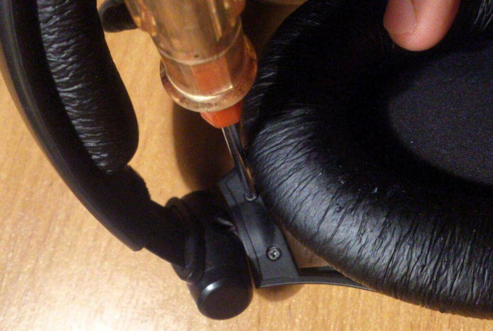
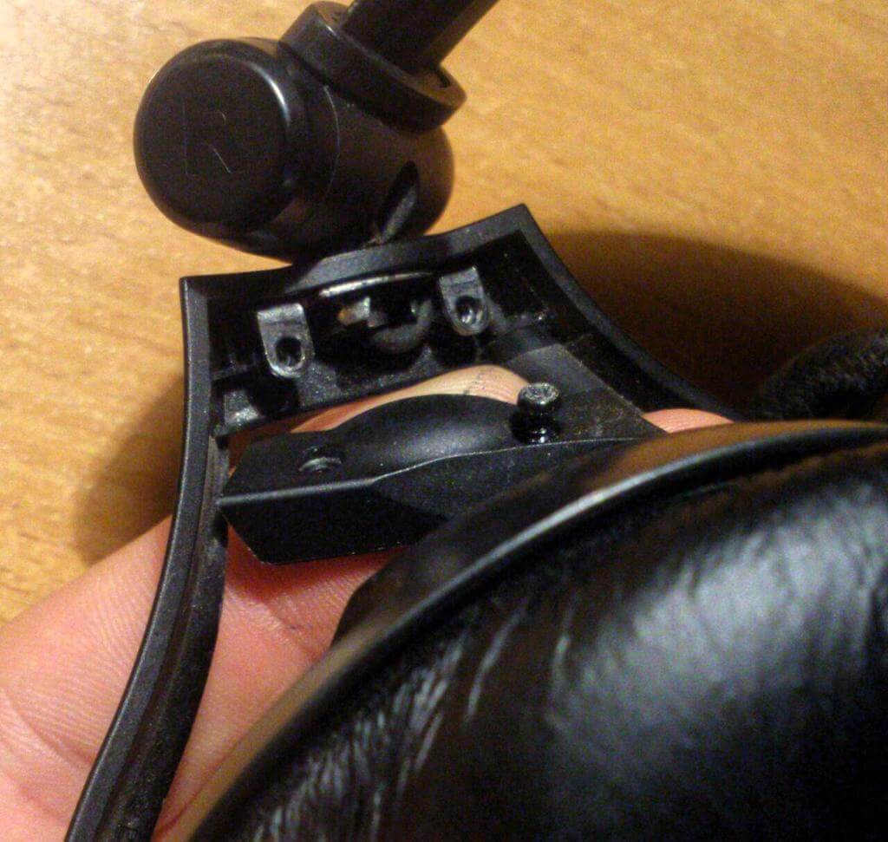
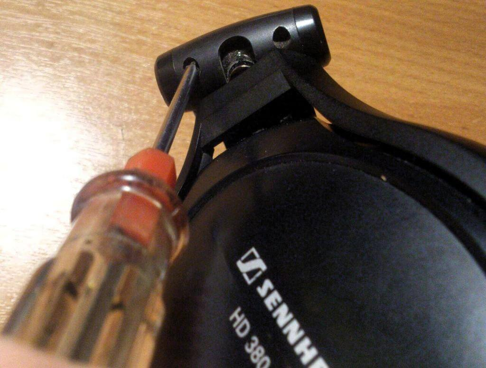
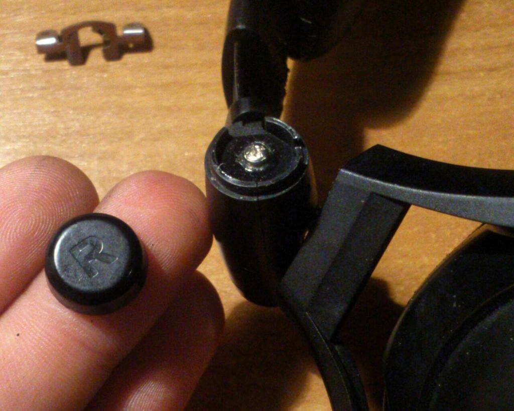
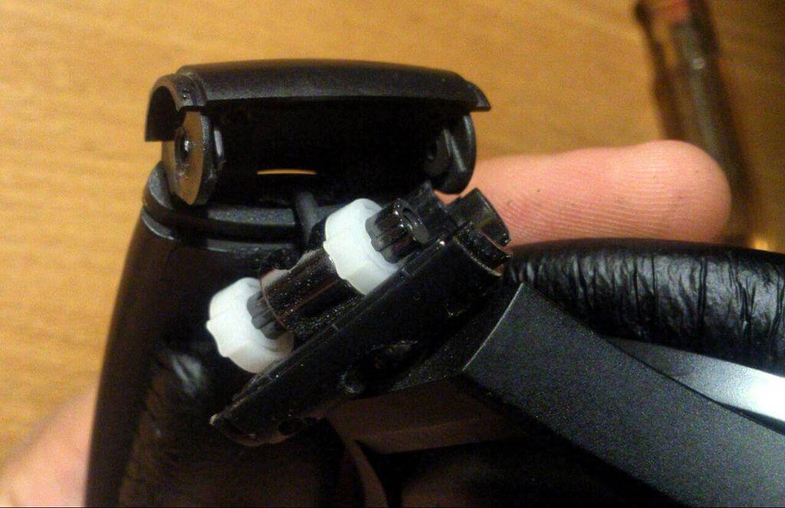

[English](./README.md) | **Русский**

# Sennheiser HD 380 pro и PXC 350 разбор шарниров

**Рубрики:** Ремонт наушников  
**Метки:** sennheiser hd380 pro  
**Оригинал:** https://audiogeek.ru/sennheiser-hd380pro-sharnir/

---

Складная конструкция наушников очень удобна при транспортировке, особенно это ощущается когда наушники полноразмерные, например, такие как Sennheiser HD 380 Pro или их родной брат Sennheiser PXC 350. Однако шарниры, которые позволяют наушникам так легко складываться являются местами повышенного износа. И это больше относится даже не к самим шарнирам, который тут металлические, сколько к проводу, проходящему внутри и претерпевающему постоянные изгибы. Но чтобы до него добраться потребуется разобрать шарнир...

Это справедливо только для правого наушника, т.к. его проводок тянется от левого наушника и проходит через оба шарнира.

## **Разбираем**

Первым делом было решено открутить два винта на держателе чаши.

Можно открутить их и позже, но я решил начать с них. Винты держат декоративную пластмаску, и скрывающуюся под ней металлическую скобу.

Металлическую скобу теперь можно вынуть, и трубочка шарнира, через которую пущен провод теперь спокойно выйдет из держателя чаши.

Настало время разбирать вторую половину шарнира. Для этого откручиваем еще два винта.

Однако этого недостаточно. Основная деталь шарнира держится на других двух винтиках, которые инженеры Sennheiser заботливо спрятали от посторонних глаз под колпачками с буквами R и L. Эти колпачки легко снимаются, если поддеть их тонкой отверткой или даже ногтем.

## Вынимаем шарнир

Откручиваем винтики с обеих сторон и нам в руки выпадает основная деталь шарнира.

Шарнир разобран. Сборка производится в обратном порядке. У колпачков есть специальные зубчики для правильного расположения, а при сборке лучше капнуть немного резинового клея, чтобы потом их не потерять.

Если при разборке было обнаружено, что провод передавлен, то с большей вероятностью, проблема в данном месте.

В случае замены провода, идущего к правому наушнику потребуется полный разбор наушников. Разборка чаши наушников уже была освещена в статье:

**[Вибродемпфирование наушников как и зачем это нужно.](../vibro-dempfirovanie/)**
