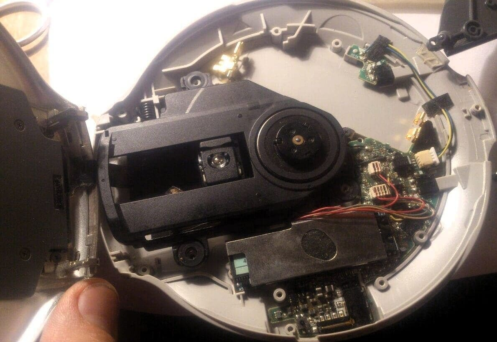
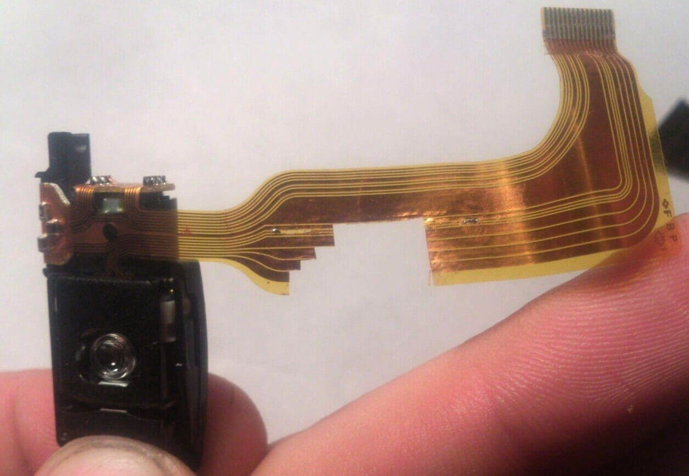
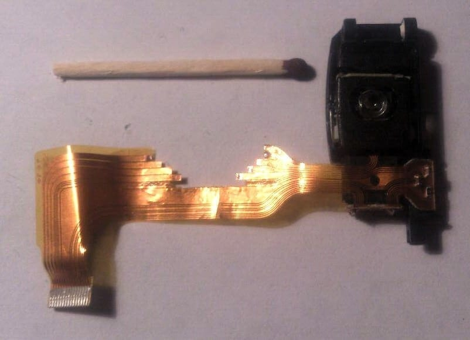
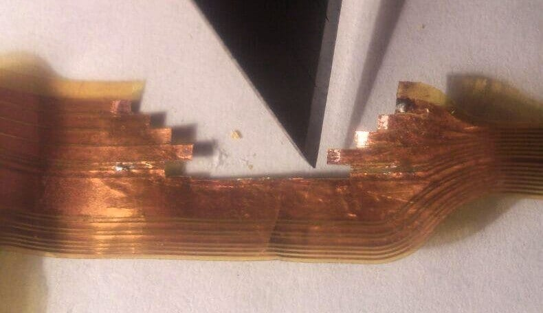
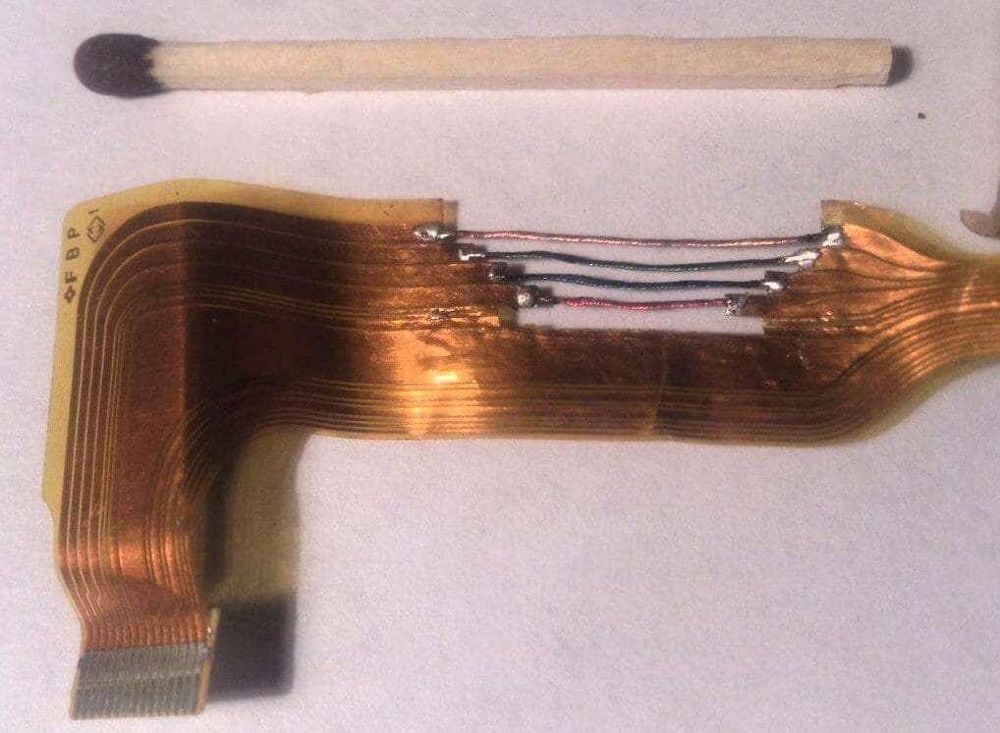
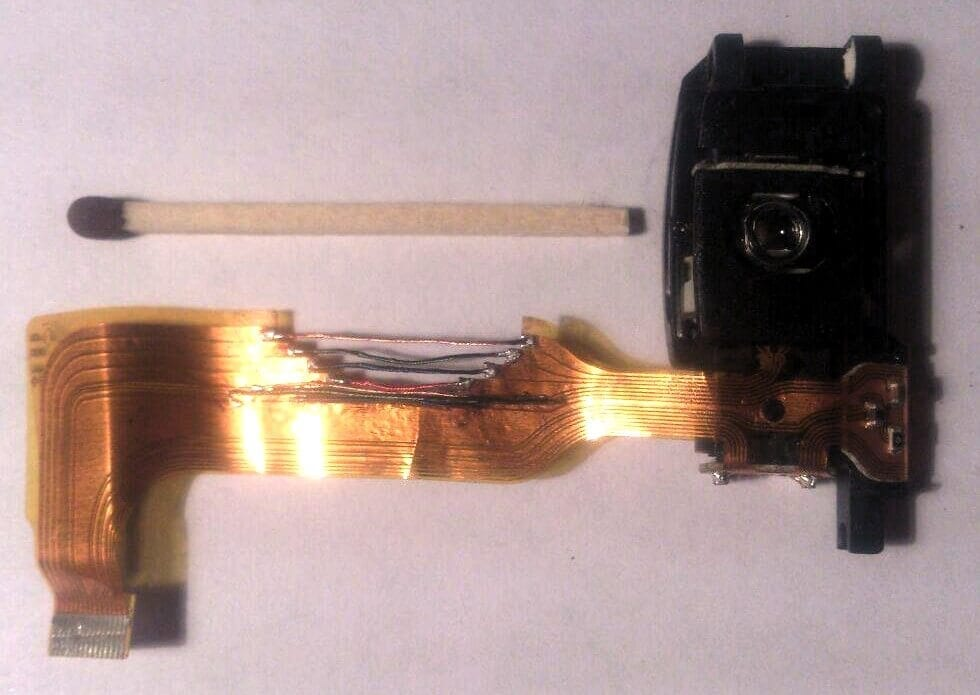
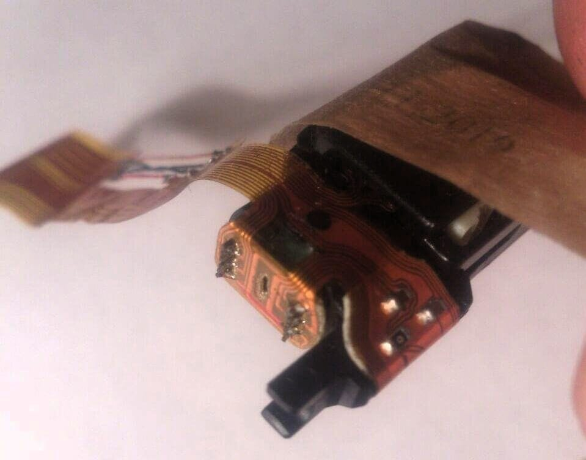
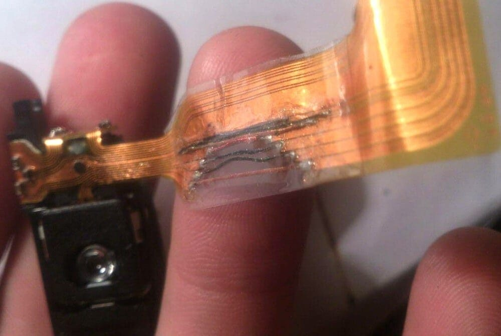
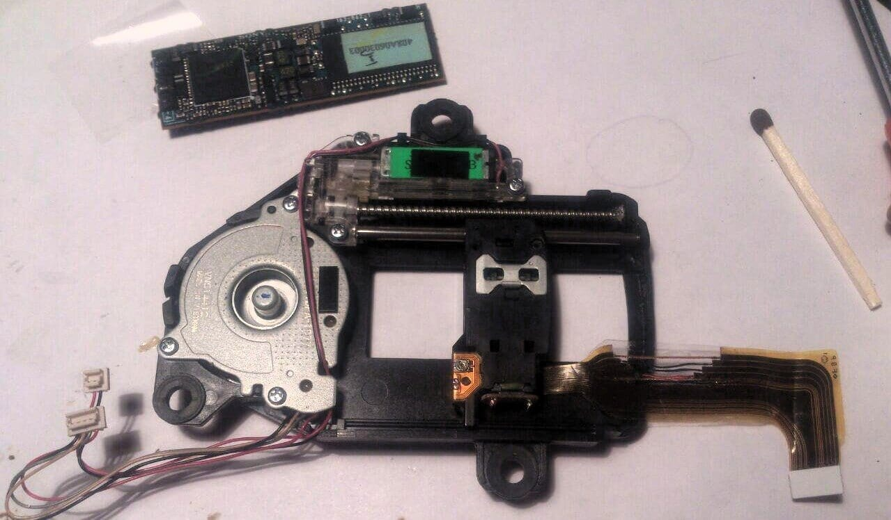

[Русский](./README.ru.md) | **English**

# How to repair the flat cable of a CD player's pickup head

**Published:** 2017-01-12  
**Category:** Repair and testing  
**Original:** https://audiogeek.ru/shleyf-cd-pleera/

---

A Walkman CD player (D-NE920) turned up on a shelf at home. A good player, BUT... it does not work. After taking it apart it turned out the cause was a broken flat cable to the pickup head, so today I will show how to repair a flat cable with your own hands.

## **Disassembly**

There is nothing special inside. The standard guts of a CD player: the head with its mechanical drive, and the electronics.

Even before disassembly I had established that half of the flat cable going to the head was broken. Unfortunately I lost the very first photo of how the cable originally looked ((

I was lucky because the cable was single-sided, though there are double-sided ones too. If the conductors run on both sides, repairing such a cable becomes much harder, although it all depends on dexterity and the width of the conductors. I have not come across one. Double-sided flat cables are usually used in cell phones and laptops to save space.

The player itself came to me already in a sorry state and lay quietly on a shelf for a long time. Frankly, I do not even understand how one could manage to tear the cable like that.

Here is the player's head with the torn cable. All the tatters and damaged spots have been cut off. ***Now I will show how to repair the flat cable.***

## **How to repair the flat cable, here we go...**

The photo above shows that the cut on the head side is not straight but stepped. The steps follow the cable's conductors.

*And here are the steps on both sides of the break in the cable.*

To restore the cable to full working order, all the broken tracks must be connected, which means soldering wires in place of the missing parts of the cable. To reduce the chance of the solder points of the wires shorting to each other, it is better if they are not on one line but staggered in steps.

## **Tinning the conductors**

To make everything go smoothly, it is better to tin the wires right away (you can see how in the [article about repairing headphones](../remont-razyoma-naushnikov/)) and also tin the conductors on the cable. For that you must scrape off the top insulating layer.

I did it with the tip of a utility knife. It is enough to scrape off a small pad, then touch it with a soldering iron carrying tin and dipped in rosin. You should end up with a small drop of tin.

In place of the missing parts of the cable there will be wires from headphones. They are convenient for three reasons:

1. There will **always be** dead headphones at home.
2. Such wires are a mix of thin copper wires and nylon threads. Thanks to this they **bend easily**, are more durable and thinner.
3. They are **lacquer-coated** along their whole length. Accordingly they need no outer insulating braid, which would only make them thicker and stiffer.

## **Soldering the wires**

First the outermost conductors were restored. In fact it does not matter where you start; the outer contacts just turned out to be thicker, and I practiced on them :)

Three thin (~0.1 mm) conductors remained in the center. Cutting them out together with the cable base seemed pointless to me, and to stagger the solder points, the extra parts of the conductors were simply torn off.

Now that all the wires are soldered, make sure there are no mistakes made in soldering. Take a multimeter, switch it to resistance mode and first check that we have not shorted neighboring conductors together. If all is well, now ring out each conductor from the start of the cable (the connector) to the place where anything is soldered to the cable:

## **Protective coating**

If something is wrong, find and fix it. When everything is OK, only the final touch remains. To protect against *whatever might happen*, I painted the solder joints with nail polish and covered the problem spot with tape.

Frankly, I had some doubts about the tape: the cable must bend easily as the head moves, and because of the tape it became a bit stiff, but it did bend :)

## **Assembling and trying...**

And here the biggest disappointment awaited me.... The problem was not only the cable but the electronics too. When I connected the player to the charger it showed charging on its little display, but after lighting up for a couple of seconds it went dark, and after that it did not respond to any buttons. Disconnecting and reconnecting the charger only repeated the same thing...

*It was 2 a.m., my enthusiasm for repairing had dropped noticeably, and the player went back to gathering dust on the shelf...* *Such a sad story  :-(*

**I hope this information about repairing a flat cable was useful to you!))**

*Originally written for [AudioGeek.ru](https://audiogeek.ru). Translated from Russian.*
