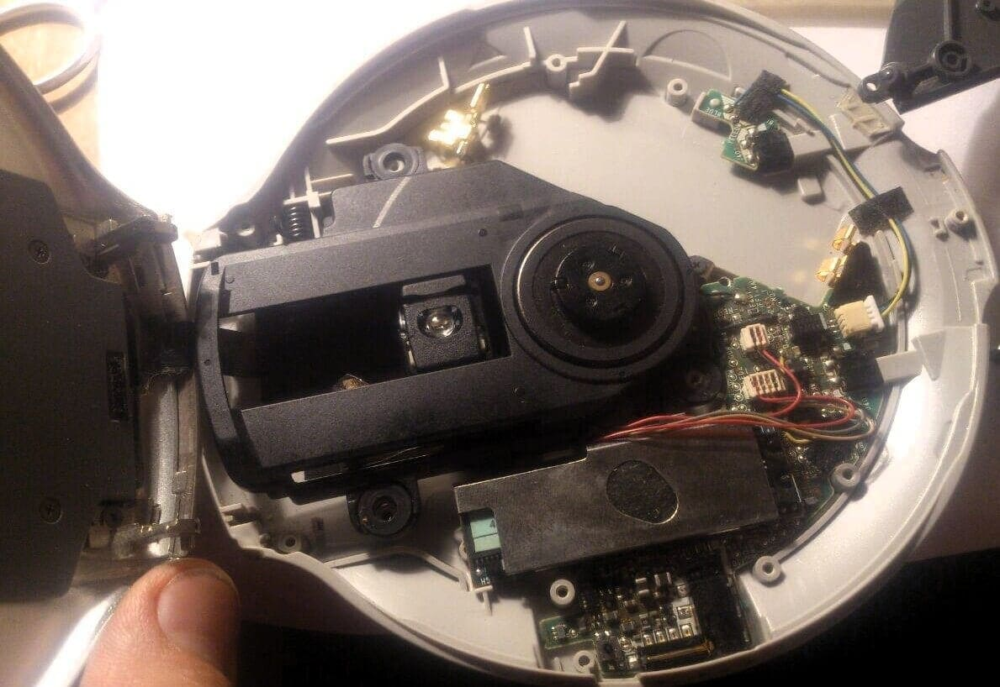
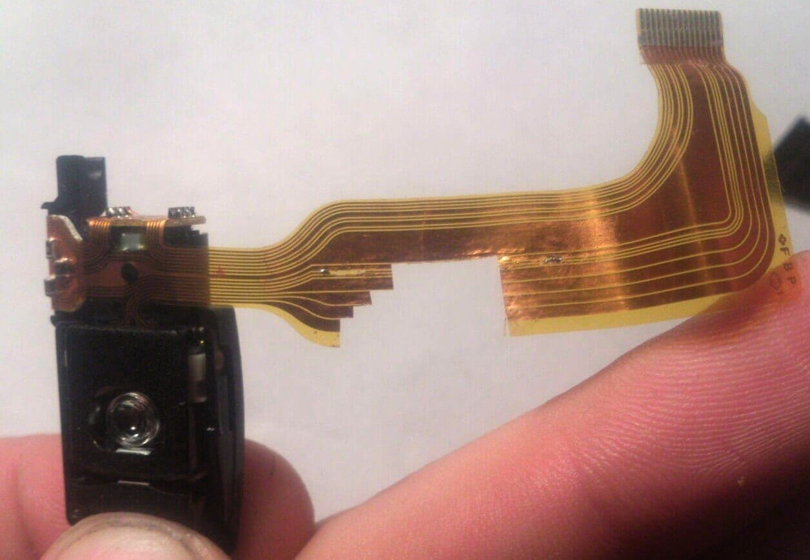
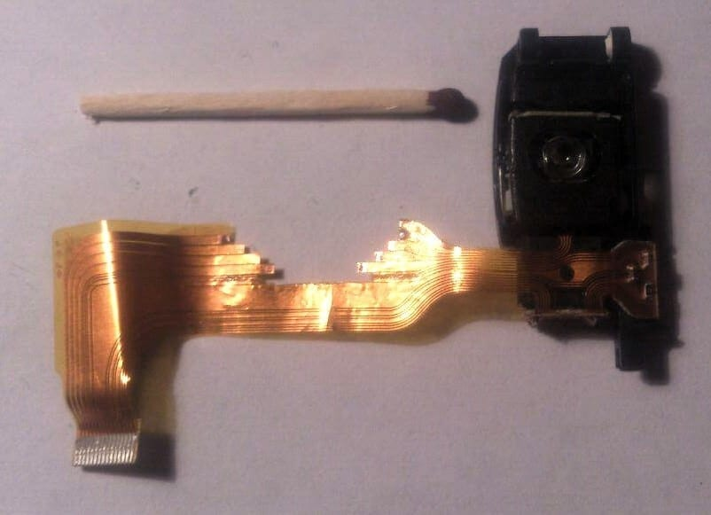
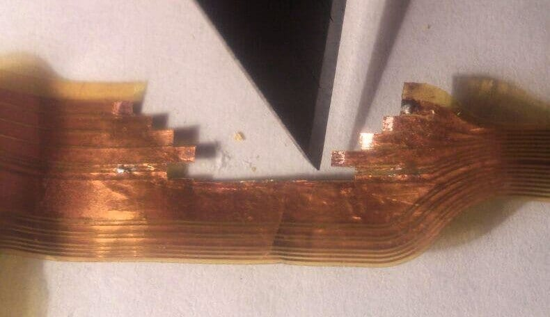
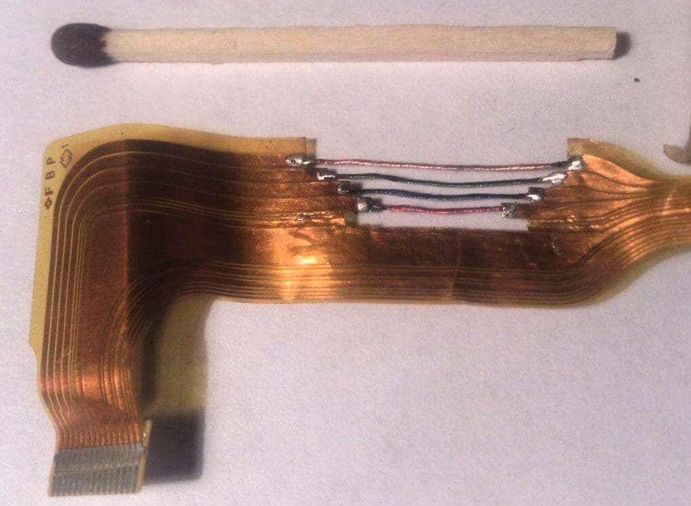
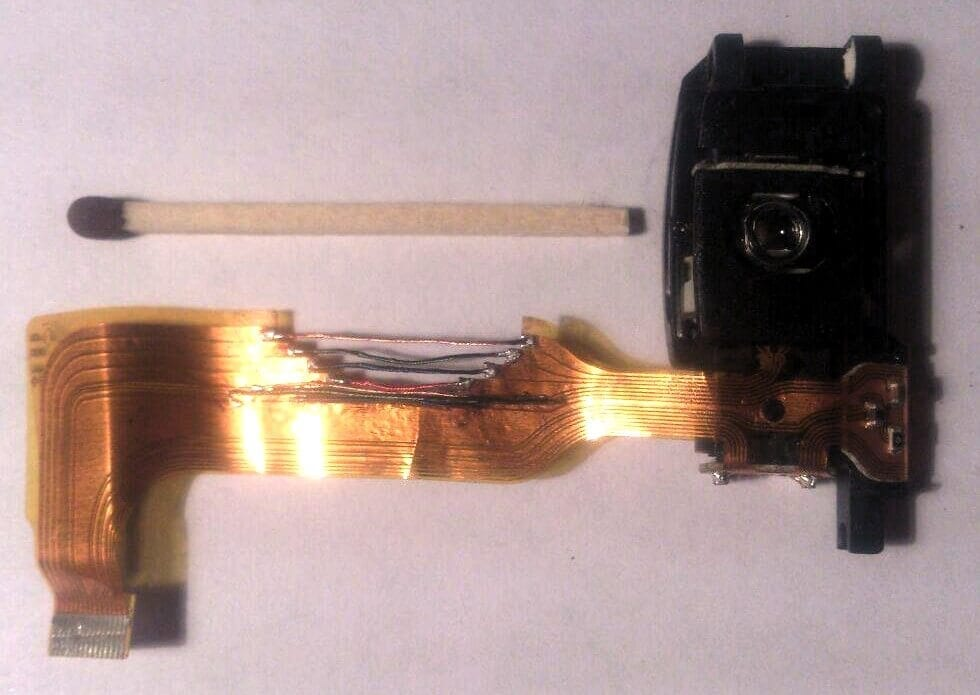
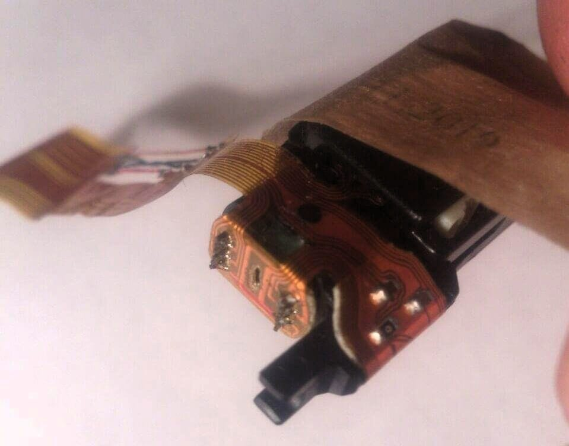
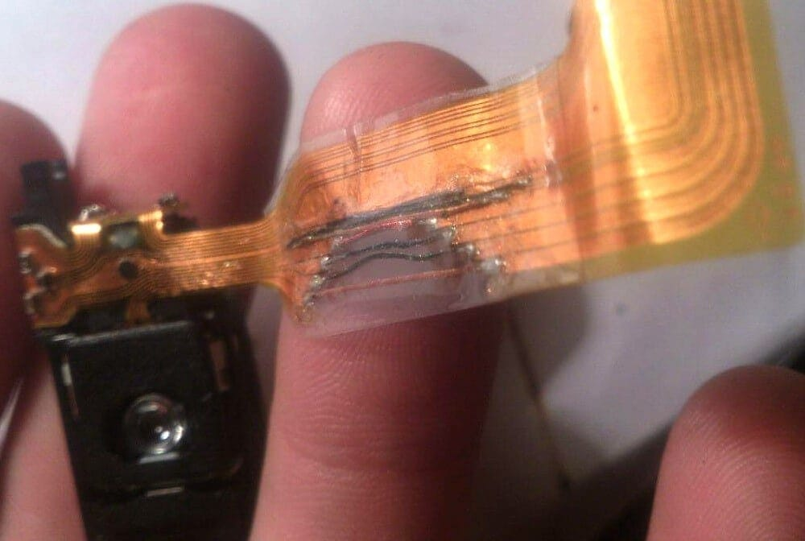
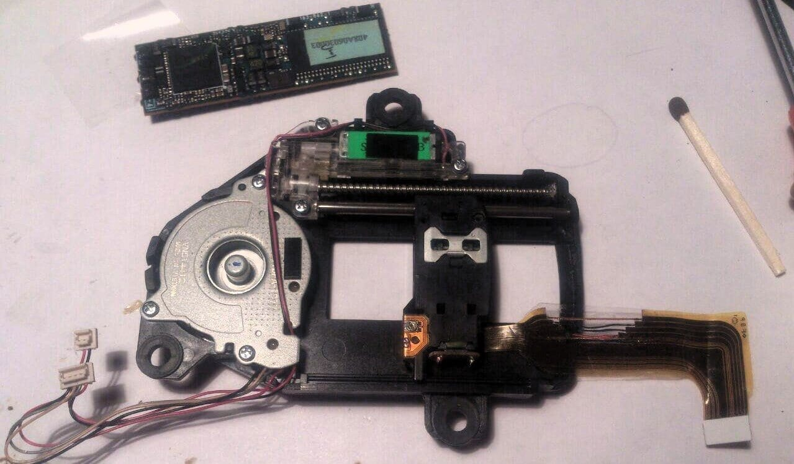

[English](./README.md) | **Русский**

# Как починить шлейф головки CD-плеера

**Рубрики:** Ремонт и проверка техники  
**Оригинал:** https://audiogeek.ru/shleyf-cd-pleera/

---

Завалялся дома на полке сидишник от Walkman (D-NE920). Хороший плеер,  НО..... Он не пашет. После разбора выяснилось что причина кроется в перебитом шлейфе головки, поэтому сегодня будет показано как починить шлейф своими руками.

## **Разборка**

Внутри собственно ничего особенного. Стандартные потроха для си-ди плеера - головка с механическим приводом и электроника.

Еще до разборки было установлено, что перебита половина шлейфа, идущего к головке. К сожалению самую первую фотку, как выглядел шлейф изначально я потерял((

Мне повезло, т.к. шлейф был односторонним, хотя встречаются и двухсторонние. Если проводники проходят с двух сторон, то возможность ремонта такого шлейфа сильно усложняется. Хотя все зависит от ловкости рук и ширины проводников. Я с таким не сталкивался. Обычно двусторонние шлейфа используют в сотовых телефонах и ноутбуках для экономии места.

Сам плеер достался мне уже в плачевном состоянии и долгое время приспокойно лежал на полочке. Как можно было умудриться так порвать шлейф я, честно говоря, даже не понимаю.

Вот головка плеера с порванным шлейфом. Были обрезаны все лохмотья и поврежденные места.  ***Сейчас я покажу как починить шлейф.***

## **Как починить шлейф, поехали...**

На фотографии выше видно, что со стороны головки обрезано не ровно а лесенкой. Лесенка идет по проводникам шлейфа.

*А вот лесенка уже с обоих сторон от разрыва шлейфа.*

Для восстановления и полноценной работы шлейфа необходимо соединить все разорванные дорожки, а для этого необходимо припаивать вместо отсутствующих частей шлейфа провода. Для уменьшения вероятности замыкания мест припайки проводов между собой, лучше если они находятся не на одной линии а разнесены лесенкой.

## **Лудим проводники**

Для того чтобы все прошло гладко лучше сразу залудить проводки (как это сделать можете посмотреть в [статье о ремонте наушников](../remont-razyoma-naushnikov/)) а также залудить проводники на шлейфе. Для этого необходимо счистить верхний изоляционный слой.

Я делал это острием канцелярского ножа. Достаточно счистить маленькую площадочку, в которую затем нужно ткнуть паяльником с оловом, смоченном в канифоли. В итоге должна получиться оловянная капелька.

Вместо отсутсвующих частей шлейфа будут проводки из наушников. Удобны они по трем причинам:

1. Дома **всегда найдутся** дохлые наушники.
2. Такие провода представляют из себя смесь тонких медных проводков и капроновых ниточек. Благодаря этому они **легко гнутся**, более выносливы и более тонкие.
3. Они **покрыты лаком** по всей длине. Соответственно им не нужна никакая наружная изоляционная оплетка, которая будет их только утолщать и препятствовать их гибкости.

## **Припаиваем проводки**

Первым делом были восстановлены крайние проводники. Вообще-то с чего начинать разницы нет, просто крайние контакты оказались толще и на них производилась тренировка)

Оставалось еще три тоненьких ( ~0.1 мм) проводника по центру. Вырезать их вместе с основанием шлейфа мне показалось бессмысленным и для того, чтобы разнести места припайки лишние части проводников просто отрывались.

Теперь, когда все проводки подпаяны необходимо убедиться в отсутствии ошибок, допущенных при пайке. Берем в руки мультиметр, включаем режим измерения сопротивления и проверяем первым делом, а не замкнули ли мы соседние проводники между собой. Если все нормально то теперь необходимо прозвонить каждый проводник от начала шлейфа (разъема) до места где к шлейфу что либо подпаивается:

## **Защитное покрытие**

Если что-то не так ищем и исправляем. Когда все окай, остается лишь финальный штрих. Для защиты от *мало ли чего* я прокрасил места пайки лаком для ногтей и залепил проблемное место скотчем.

Честно говоря в скотче я немного сомневался, все-таки шлейф должен легко гнуться при перемещениях головки, а из-за скотча шлейф стал жестковат, но гнулся)

## **Собираем, пробуем...**

Вот тут то меня и ждало самое больше разочарование.... Проблема была не только в шлейфе, но и электронике. При подключении плеера к зарядке он на экранчике показывал зарядку, но загораясь на пару секунд гас, и после, уже не реагировал ни на какие кнопки. Отсоединение и повторное подключение зарядки лишь приводило к повторению описанного...

*Было 2 часа ночи настроения чинить заметно поубавилось и плеер отправился дальше пылиться на полку...* *Вот такая вот печалька   :-(*

**Надеюсь, что информация о ремонте шлейфа оказалась для Вас полезна))**

*Материал подготовлен исключительно для сайта [AudioGeek.ru](https://github.com/SkyTrip-13/AudioGeek)*
