[Русский](./README.ru.md) | **English**

# A simple, high-quality sine wave generator based on a Wien bridge

**Category:** Useful circuits  
**Tags:** measurements, op-amp circuit  
**Original:** https://audiogeek.ru/sinus-generator/

---

A sine wave generator comes in handy in all kinds of hobby electronics work. Here is how to build a Wien bridge sine generator with stable amplitude and frequency.

> This article is about designing a sine generator circuit. If all you need is a tone of a given frequency, you can also generate it in software: [Audacity as a simple tone and noise generator](../generaciya-signalov-audacity/)

From the point of view of assembly and tuning, the most convenient sine generator is one built on a Wien bridge with a modern op-amp.

## The Wien bridge

The Wien bridge is a band-pass filter made of two [RC filters](../rc-circuit/). It passes the center frequency and suppresses all the others. It was invented by Max Wien back in 1891. On a schematic the bridge is usually drawn like this:

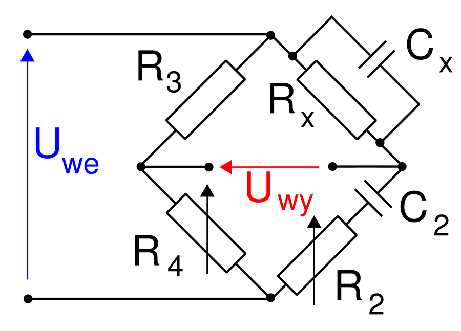

***The picture is borrowed from [Wikipedia](https://en.wikipedia.org/wiki/Wien_bridge_oscillator)***

The ratio of the bridge's output voltage to its input voltage is ***b = 1/3***. This matters because it defines the condition for stable oscillation. More on that in a moment.

## How to calculate the frequency

Wien bridges are often used to build oscillators and inductance meters. To keep things simple, people usually take ***R1 = R2 = R*** and ***C1 = C2 = C***, which simplifies the formula. The bridge's center frequency is:

***f = 1/2πRC***

Almost any filter can be treated as a frequency-dependent voltage divider. So when choosing the resistor and capacitor values, it is best if at the resonant frequency the impedance of the capacitor (Z) is equal to the resistance of the resistor, or at least of the same order.

***Zc = 1/ωC = 1/2πνC***

where ***ω*** (omega) is the angular frequency, ***ν*** (nu) is the ordinary frequency, and ***ω = 2πν***.

## The Wien bridge and an op-amp

By itself the Wien bridge is not a signal generator. To get oscillation, it has to be placed in the positive feedback path of an op-amp. You could build such an oscillator on a transistor too, but an op-amp makes life easier and gives better performance.

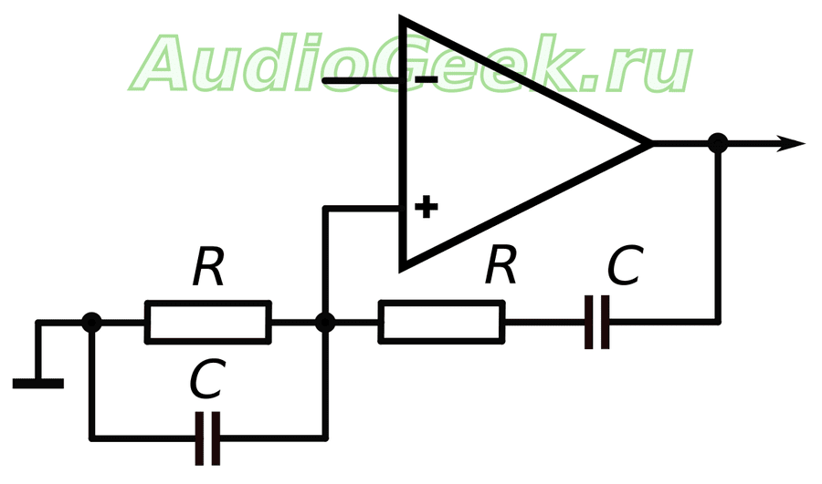

## A gain of exactly three

The bridge has a transmission ratio of ***b = 1/3***, so the condition for oscillation is that the op-amp provides a gain of three. Then the product of the bridge's transmission and the op-amp's gain is 1, and the circuit oscillates stably at the chosen frequency.

In an ideal world you would set the required gain with the resistors in the negative feedback path and have a finished generator.

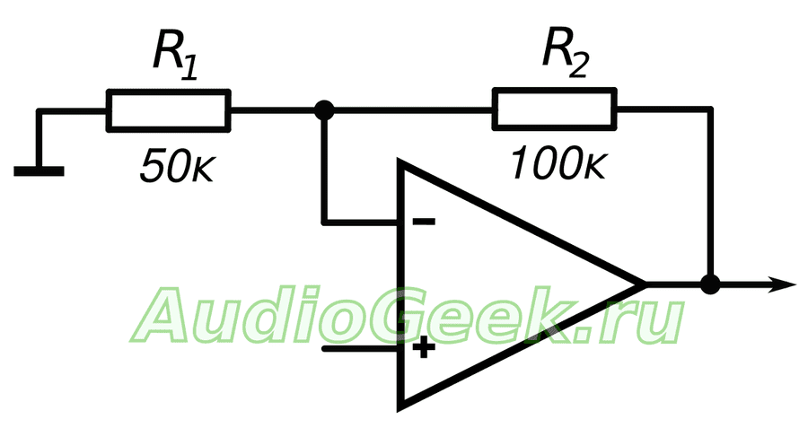

> **This is a non-inverting amplifier, and its gain is: K = 1 + R2/R1**

***But the world is not ideal.*** In practice, to start oscillating the gain has to be slightly above 3 at the very beginning, and then be held at exactly 3 for stable oscillation.

> **If the gain is below 3, the oscillation dies out. If it is above 3, the signal grows until it reaches the supply voltage, starts to distort, and the amplifier saturates.**

In saturation the output sits near one of the supply voltages and switches chaotically between them.

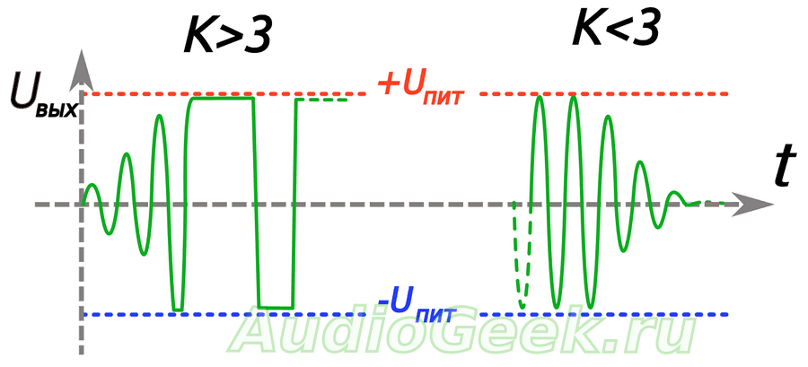

That is why a Wien bridge generator uses a nonlinear element in the negative feedback path to regulate the gain. The generator then balances itself and keeps oscillating at a constant level.

## Amplitude stabilization with an incandescent lamp

In the classic op-amp Wien bridge oscillator, a miniature low-voltage incandescent lamp takes the place of one resistor.

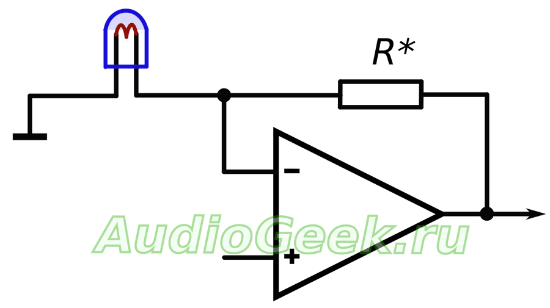

When the generator is switched on, the filament is cold and its resistance is low. That helps the oscillation start (K > 3). As the filament heats up its resistance rises and the gain falls until it reaches equilibrium (K = 3).

The positive feedback path containing the Wien bridge stays unchanged. The complete circuit looks like this:

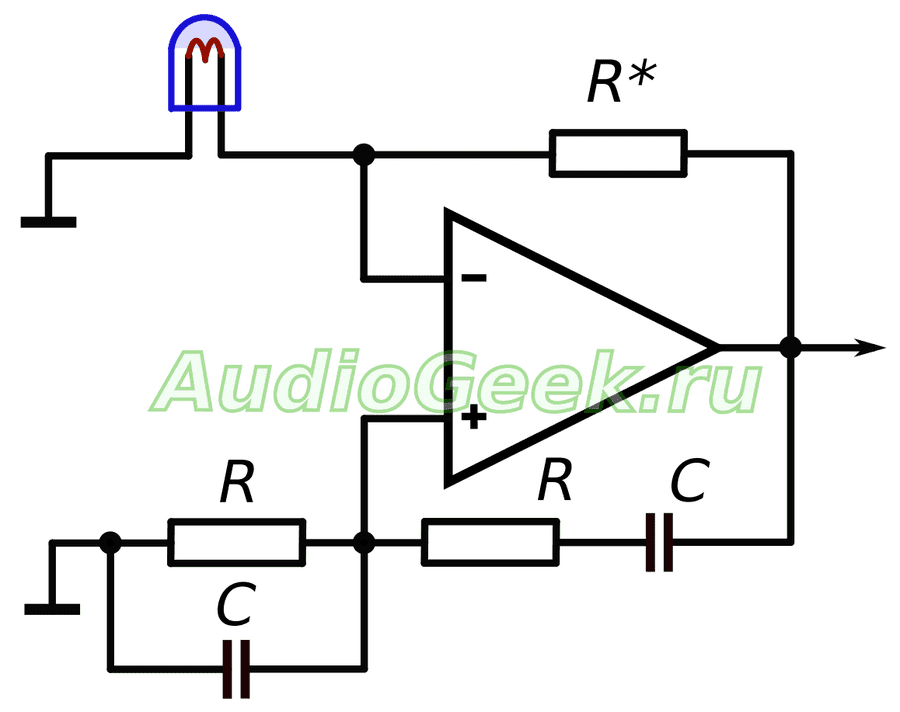

> **The positive feedback elements of the op-amp set the oscillation frequency. The negative feedback elements set the gain.**

The idea of using a lamp as the control element is very neat and is still used today. But the lamp has several drawbacks:

- the lamp and the current-limiting resistor R\* have to be selected by trial
- with regular use a lamp usually lasts only a few months
- the lamp's regulating behavior depends on room temperature

Another interesting option is a directly heated thermistor. It is essentially the same idea, with a thermistor in place of the filament. The problem is that you first have to find one, and then again match it and its current-limiting resistors.

## Amplitude stabilization with LEDs

An effective way to stabilize the output amplitude of a sine generator is to put LEDs (***VD1*** and ***VD2***) in the op-amp's negative feedback path.

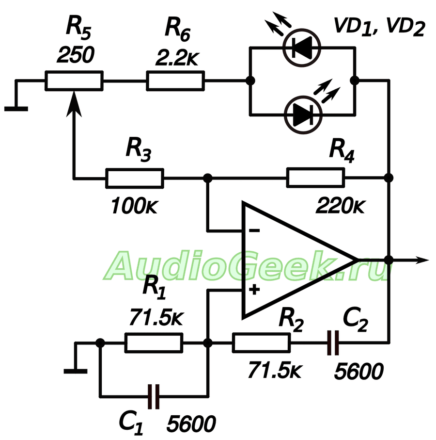

The main gain is set by resistors ***R3*** and ***R4***. The remaining elements (***R5***, ***R6*** and the LEDs) adjust the gain within a small range and keep the oscillation stable. Resistor ***R5*** lets you adjust the output voltage in a range of roughly 5–10 volts.

It is best to use low-value resistors (***R5*** and ***R6***) in the additional feedback path. That lets a considerable current (up to 5 mA) flow through the LEDs, keeping them in their optimal operating region. They even glow a little :-)

> **In the circuit above, the Wien bridge elements are calculated for 400 Hz, but they are easy to recalculate for any other frequency using the formulas at the beginning of the article.**

## Oscillation quality and component choice

The op-amp must be able to supply the current needed for oscillation and have enough bandwidth. The popular TL062 and TL072 gave very poor results at 100 kHz: the waveform could hardly be called a sine, it was closer to a triangle. The TDA2320 did even worse.

The NE5532, on the other hand, did very well and produced a signal that looked very much like a sine wave. The LM833 handled the job just as well. So the NE5532 and LM833 are recommended as affordable, widely available, good op-amps. At lower frequencies the other op-amps will do much better too.

The accuracy of the oscillation frequency depends directly on the accuracy of the frequency-determining components. And here it matters not only that the value matches the marking, but also that more precise parts keep their values better when the temperature changes.

In my version I used C2-13 resistors (±0.5%) and mica capacitors (±2%). These resistors were chosen for their low temperature dependence. Mica capacitors are also very stable with temperature and have a low temperature coefficient of capacitance.

## The downsides of LEDs

The LEDs deserve a separate discussion. They are used in the sine generator because of their forward voltage drop, usually 1.2–1.5 V, which allows a fairly high output voltage.

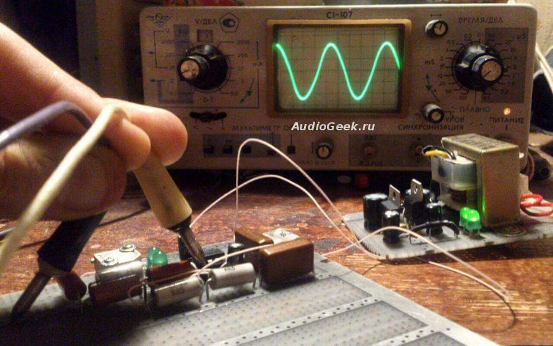

After building the circuit on a breadboard, it turned out that because of the spread in LED parameters, the edges of the output sine wave were not symmetrical. This is slightly visible even in the photo above. There was also some distortion of the sine shape, because the LEDs were too slow for a 100 kHz oscillation frequency.

## 1N4148 diodes instead of LEDs

I replaced the LEDs with the well-loved 1N4148. These are cheap, fast signal diodes with a switching time of under 4 ns. The circuit stayed fully functional, the problems above disappeared without a trace, and the sine wave became perfect.

In the next circuit the Wien bridge is calculated for 100 kHz. Variable resistor R5 has also been replaced with fixed ones, but more on that later.

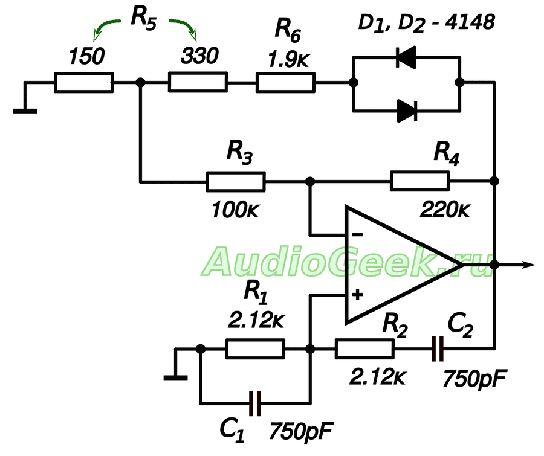

Unlike LEDs, the voltage drop across the p-n junction of an ordinary diode is 0.6–0.7 V, so the generator's output came out at about 2.5 V. To increase the output voltage you can connect several diodes in series instead of one, like this:

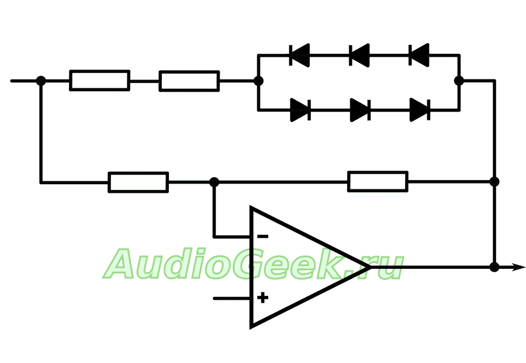

However, more nonlinear elements make the generator more dependent on ambient temperature. For that reason I decided against this approach and used a single diode each.

## Replacing the variable resistor with fixed ones

Now about the trimmer. Originally R5 was a 470 Ω multi-turn trimmer, which allowed precise adjustment of the output voltage.

A variable resistor is undesirable in circuits like this, for two main reasons:

- the wiper contact is unreliable
- multi-turn trimmers have parasitic inductance, which can hurt the quality of the output signal

> **When building any oscillator it is highly desirable to have an oscilloscope. Variable resistor R5 directly affects the oscillation, both its amplitude and its stability.**

In this circuit the oscillation is stable only over a small range of this resistor's values. If the resistance ratio is larger than required, clipping begins, that is, the top and bottom of the sine wave are cut off. If it is smaller, the sine shape starts to distort, and with a further decrease the oscillation dies out.

It also depends on the supply voltage. The circuit was originally built on an LM833 with a ±9 V supply. Then, with no change to the circuit, the op-amps were replaced with AD8616 and the supply with ±2.5 V (the maximum for these op-amps). As a result the sine wave was clipped. Selecting resistors gave 210 and 165 Ω instead of 150 and 330 Ω respectively.

## How to select the resistors by eye

You can of course keep the trimmer. It all depends on the accuracy you need and the frequency of the sine wave.

To select the values yourself, first install a trimmer of 200–500 Ω. Feed the generator output to an oscilloscope and turn the trimmer until clipping begins. Then reduce the amplitude until you find the position where the sine wave looks best. Now you can desolder the trimmer, measure the resulting resistances and solder in the closest fixed values.

If you need an audio-frequency sine generator, you can manage without an oscilloscope. Again, turn the trimmer until the signal starts to sound distorted from clipping, then back off. Keep backing off until the distortion disappears, and then a little more. This is necessary because by ear it is not always possible to hear distortion of even 10%.

## Additional gain

The sine generator was built on a dual op-amp, and half of the chip was left unused. So it makes sense to use it as an adjustable voltage amplifier. That allowed me to move the variable resistor out of the generator's additional feedback path and into the amplifier stage, to adjust the output voltage.

The extra gain stage also gives a better match between the generator output and the load. It is a classic non-inverting amplifier.

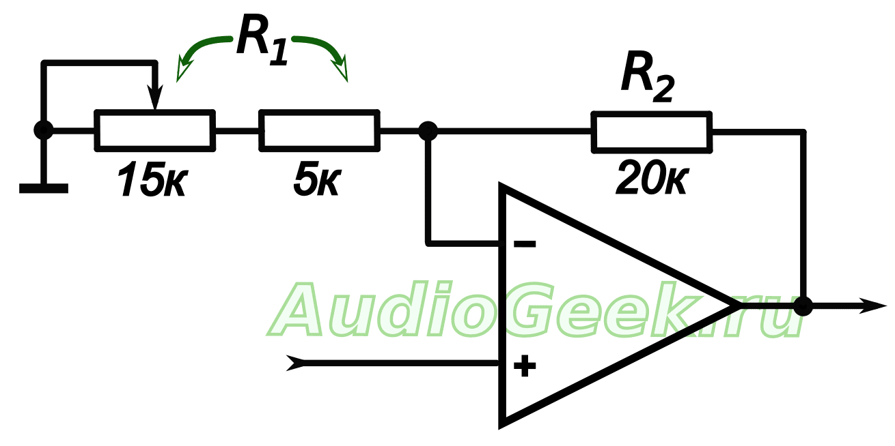

The values shown let you vary the gain from 2 to 5. If needed you can recalculate them for your own task. The gain of the stage is:

***K = 1 + R2/R1***

Resistor ***R1*** is the sum of a variable and a fixed resistor in series. The fixed resistor makes sure the gain does not go to infinity when the variable resistor is at its minimum.

## Boosting the output

The generator was meant to work into a low-impedance load of a few ohms. Of course no low-power op-amp can supply the current needed.

To boost the output I put a TDA2030 buffer after the generator. All the benefits of using this chip that way are described in [Voltage follower on an op-amp, a powerful follower on the TDA2030](../povtoritel-opamp/).

This is what the whole sine generator looks like, with the voltage amplifier and the buffer at the output:

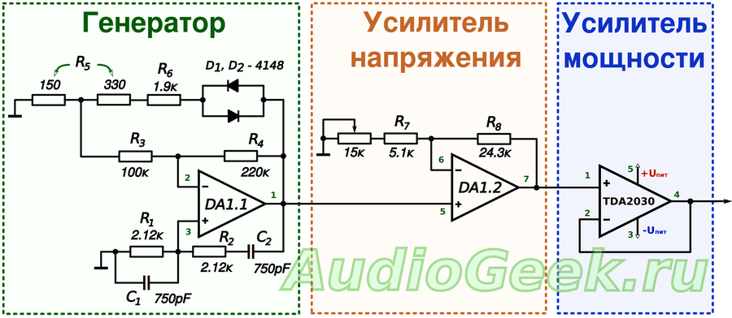

You can also build a Wien bridge oscillator on the TDA2030 itself as the op-amp. It all depends on the accuracy you need and the chosen frequency.

If you have no special requirements for oscillation quality, the frequency does not exceed 80–100 kHz, and you still need to drive a low-impedance load, this option is a perfect fit.

## Conclusion

A Wien bridge is not the only way to generate a sine wave. If you need highly accurate frequency stabilization, look at crystal oscillators.

But the circuit described here is suitable for the vast majority of cases where you need a sine wave that is stable in both frequency and amplitude.

Generating a signal is great, but how do you accurately measure the level of a high-frequency AC voltage? A circuit called the [active rectifier](../aktivniy-vipryamitel/) is excellent for that.

*Originally written for [AudioGeek.ru](https://github.com/SkyTrip-13/AudioGeek). Translated from Russian.*
