[English](./README.md) | **Русский**

# Генератор синусоидального сигнала на мосту Вина

**Рубрики:** Полезные схемы  
**Метки:** измерения, схема на ОУ  
**Оригинал:** https://audiogeek.ru/sinus-generator/

---

В радиолюбительской практике часто возникает необходимости использовать генератор синусоидальных колебаний. Применения ему можно найти самые разнообразные. Рассмотрим как создать генератор синусоидального сигнала на мосту Вина со стабильной амплитудой и частотой.
> В статье описывается разработка схемы генератора синусоидального сигнала. Сгенерировать нужную частоту можно и программно: [Программа Audacity как простой генератор звука и шума](../generaciya-signalov-audacity/)

Наиболее удобным, с точки зрения сборки и наладки, вариантом генератора синусоидального сигнала является генератор, построенный на мосту Вина, на современном Операционном Усилителе (ОУ).

## Мост Вина

Сам по себе мост Вина является полосовым фильтром, состоящим из двух [RC фильтров](../rc-circuit/). Он выделяет центральную частоту и подавляет остальные частоты.
Мост придумал, Макс Вин еще в 1891 году. На принципиальной схеме, сам мост Вина обычно изображается следующим образом:

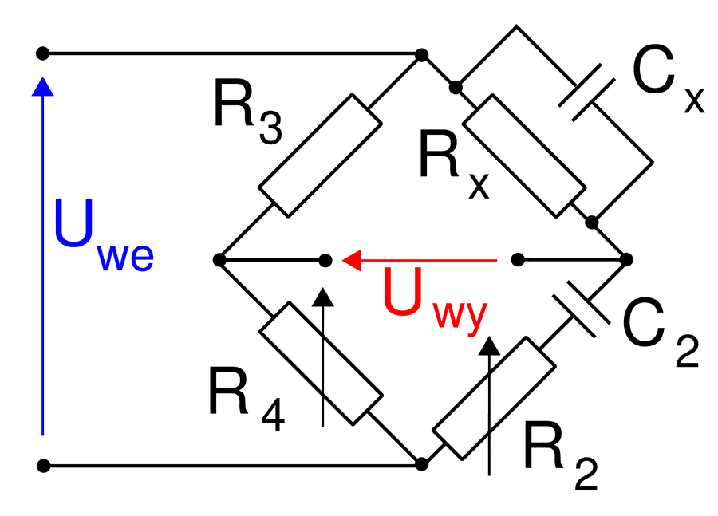

***Картинка позаимствована у [Википедии](https://ru.wikipedia.org/wiki/%D0%9C%D0%BE%D1%81%D1%82_%D0%92%D0%B8%D0%BD%D0%B0)***

Мост Вина обладает отношением выходного напряжения ко входному ***b=1/3*** . Это важный момент, потому что этот коэффициент определяет условия стабильной генерации. Но об этом чуть позже

## Как рассчитать частоту

На мосту Вина часто строят автогенераторы и измерители индуктивности. Чтобы не усложнять себе жизнь обычно используют ***R1=R2=R*** и ***C1=C2=C***. Благодаря этому можно упростить формулу. Основная частота моста рассчитывается из соотношения:

***f=1/2πRC***

Практически любой фильтр можно рассматривать как делитель напряжения, зависящий от частоты. Поэтому при выборе номиналов резистора и конденсатора желательно, чтобы на резонансной частоте комплексное сопротивление конденсатора (Z), было равно, или хотя бы одного порядка с сопротивлением резистора.

***Zc=1/ωC=1/2πνC***

где ***ω*** (омега) - циклическая частота, ***ν*** (ню) - линейная частота, ***ω=2πν***

## Мост Вина и операционный усилитель

Сам по себе мост Вина не является генератором сигнала. Для возникновения генерации его следует разместить в цепи положительной обратной связи операционного усилителя. Такой автогенератор можно построить и на транзисторе.  Но использование ОУ явно упростит жизнь и даст лучшие характеристики.
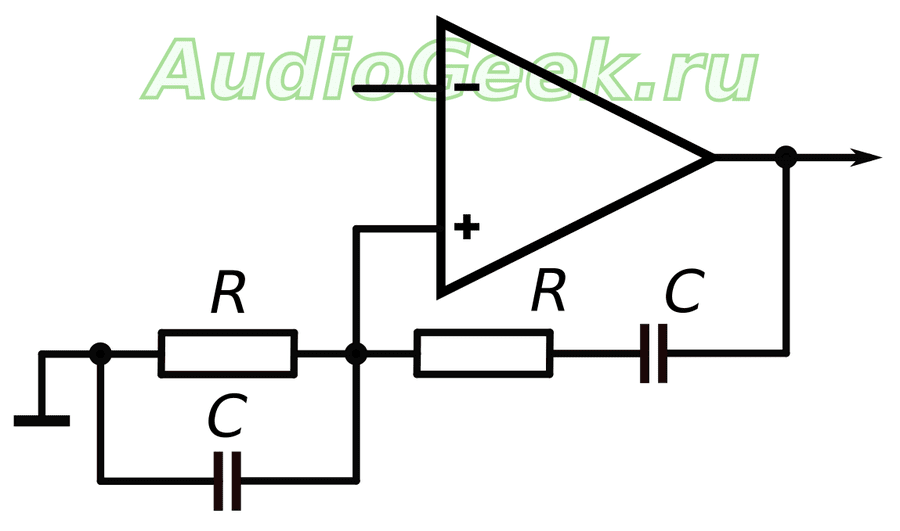

## Коэффициент усиления на троечку

Мост Вина имеет коэффициент пропускания ***b=1/3***. Поэтому условием генерации является то, что ОУ должен обеспечивать коэффициент усиления равный трем. В таком случает произведение коэффициентов пропускания моста Вина и усиления ОУ даст 1. И будет происходить стабильная генерация заданной частоты.
Если бы мир был идеальным, то задав резисторами в цепи отрицательной обратной связи, нужный коэфф усиления, мы бы получили готовый генератор.
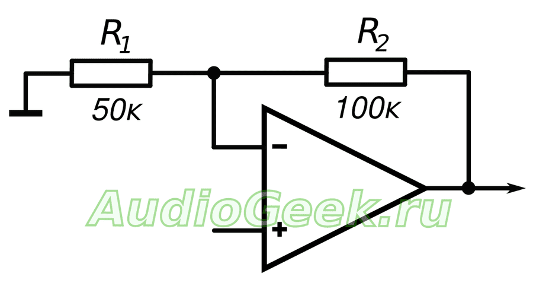
> **Это неинвертирующий усилитель и его коэффициент усиления определяется соотношением:** ***K=1+R2/R1***

***Но увы, мир не идеален.***... На практике оказывается, что для запуска генерации необходимо, чтобы в самый начальный момент коэфф. усиления был немного больше 3-х, а далее для стабильной генерации он поддерживался равным 3.
> **Если коэффициент усиления будет меньше 3, то генератор заглохнет, если больше - то сигнал, достигнув напряжения питания, начнет искажаться, и наступит насыщение.**

При насыщении, на выходе будет поддерживаться напряжение, близкое к одному из напряжений питания. И будут происходить случайные хаотичные переключения между напряжениями питания.
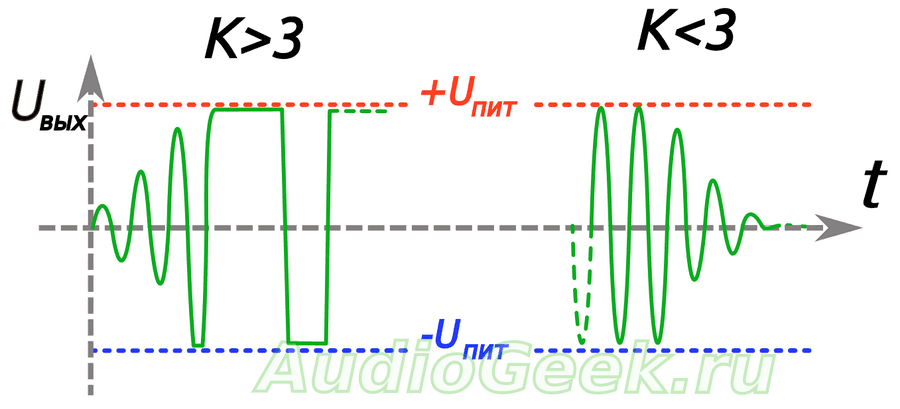
Поэтому, строя генератор на мосте Вина, прибегают к использованию нелинейного элемента в цепи отрицательной обратной связи, регулирующего коэффициент усиления. В таком случае генератор будет сам себя уравновешивать и поддерживать генерацию на одинаковом уровне.

## Стабилизация амплитуды на лампе накаливания

В самом классическом варианте генератора на мосте Вина на ОУ, применяется миниатюрная низковольтная лампа накаливания, которая устанавливается вместо резистора.
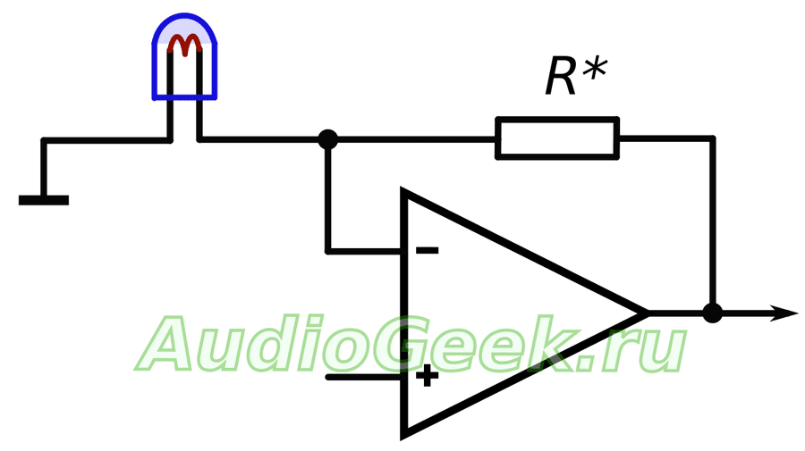
При включении такого генератора, в первый момент, спираль лампы холодная и ее сопротивление мало. Это способствует запуску генератора (K>3). Затем, по мере нагрева, сопротивление спирали увеличивается, а коэффициент усиления снижается, пока не дойдет до равновесия (K=3).
Цепь положительной обратной связи, в которую был помещен мост Вина, остается без изменений. Общая принципиальная схема генератора выглядит следующим образом:
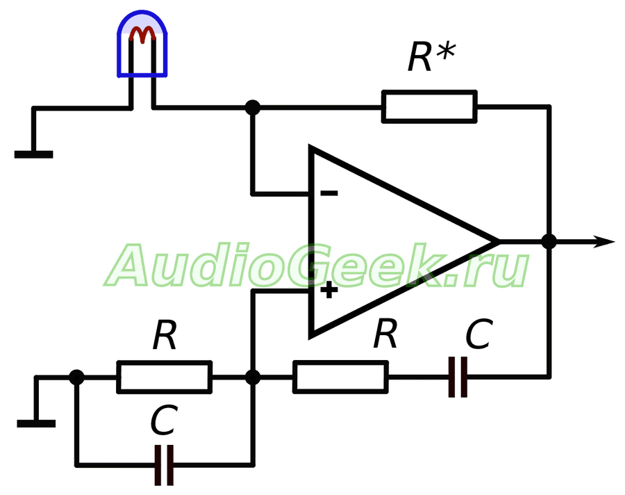
> **Элементы положительной обратной связи ОУ определяют частоту генерации. А элементы отрицательной обратной связи - усиление.**

Идея использования лампочки, в качестве управляющего элемента очень интересна и используется по сей день. Но у лампочки, увы, есть ряд недостатков:

- требуется подбор лампочки и токоограничивающего резистора R\*.
- при регулярном использовании генератора, срок жизни лампочки обычно ограничивается несколькими месяцами
- управляющие свойства лампочки зависят от температуры в комнате.

Другим интересным вариантом является применение терморезистора с прямым подогревом. По сути, идея та же, только вместо спирали лампочки используется терморезистор. Проблема в том, что его нужно для начала найти и опять таки подобрать его и токоограничиващие резисторы.

## Стабилизация амплитуды на светодиодах

Эффективным методом стабилизации амплитуды выходного напряжения генератора синусоидальных сигналов является применение в цепи отрицательной обратной связи ОУ светодиодов (***VD1*** и ***VD2***).
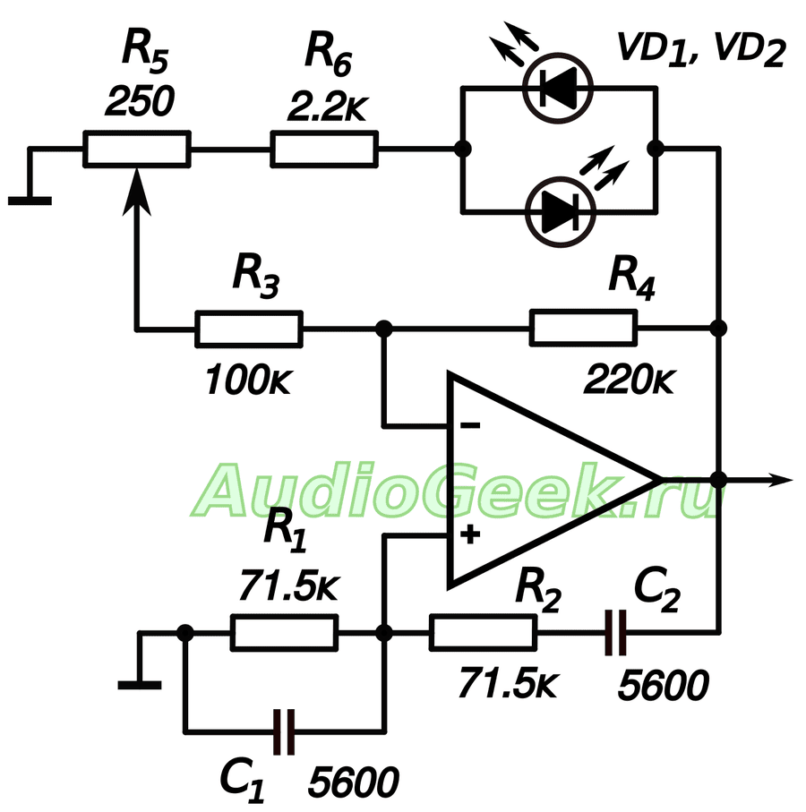
Основной коэффициент усиления задается резисторами ***R3*** и ***R4***. Остальные же элементы (***R5***, ***R6*** и светодиоды) регулируют коэффициент усиления в небольшом диапазоне, поддерживая генерацию стабильной. Резистором ***R5*** можно регулировать величину выходного напряжения в интервале примерное 5-10 вольт.
В дополнительной цепи ОС желательно использовать низкоомные резисторы (***R5*** и ***R6***). Это позволит пропускать значительный ток (до 5мА) через светодиоды и они будут находиться в оптимальном режиме. Даже будут немного светиться :-)
> **На показанной выше схеме, элементы моста Вина рассчитаны для генерации на частоте 400 Гц, однако они могут быть легко пересчитаны для любой другой частоты по формулам, представленным в начале статьи.**

## Качество генерации и применяемых элементов

Важно, чтобы операционный усилитель мог обеспечить необходимый для генерации ток и обладал достаточной полосой пропускания по частоте. Использование в качестве ОУ народных TL062 и TL072 дало очень печальные результаты на частоте генерации 100кГц. Форму сигнала было трудно назвать синусоидальной, скорее это был треугольный сигнал. Использование TDA 2320 дало еще более худший результат.
А вот NE5532 показа себя с отличной стороны, выдав на выходе сигнал очень похожий на синусоидальный. LM833 так же справилась с задачей на отлично. Так что именно NE5532 и LM833 рекомендуются к использованию как доступные и распространенные качественные ОУ. Хотя с понижением частоты гораздо лучше себя будут чувствовать и остальные ОУ.
Точность частоты генерации напрямую зависит от точности элементов частотозависимой цепи. И в данном случае важно не только соответствие номинала элемента надписи на нем. Более точные детали имеют лучшую стабильность величин при изменении температуры.
В авторском варианте были применены резистор типа С2-13 ±0.5% и слюдяные конденсаторы точностью ±2%. Применение резисторов указанного типа обусловлено малой зависимостью их сопротивления от температуры. Слюдяные конденсаторы так же мало зависят от температуры и имеют низкий ТКЕ.

## Минусы светодиодов

На светодиодах стоит остановиться отдельно. Их использование в схеме синус генератора вызвано величиной падения напряжения, которое обычно лежит в интервале 1.2-1.5 вольта. Это позволяет получать достаточно высокое значение выходного напряжения.
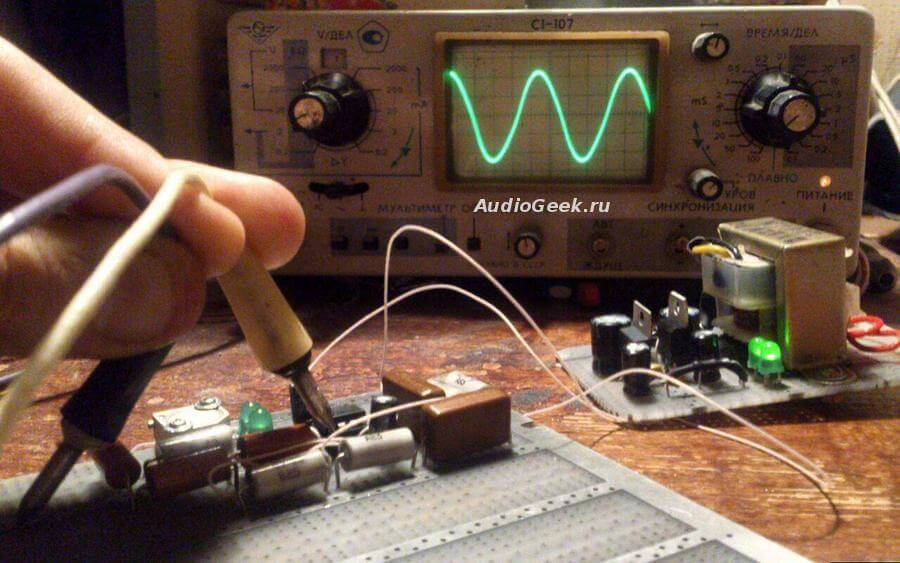
После реализации схемы, на макетной плате, выяснилось, что из-за разброса параметров светодиодов, фронты синусоиды на выходе генератора не симметричны. Это немного заметно даже на приведенной выше фотографии. Помимо этого присутствовали небольшие искажения формы генерируемого синуса, вызванные недостаточной скоростью работы светодиодов для частоты генерации 100 кГц.

## Диоды 4148 вместо светодиодов

Светодиоды были заменены на всеми любимые диоды 4148. Это доступные быстродействующие сигнальные диоды со скоростью переключения менее 4 нс. Схема при этом осталась полноценно работоспособной, от описанных выше проблем не осталось и следа, а синусоида приобрела идеальный вид.
На следующей схеме элементы моста вина рассчитаны на частоту генерации 100 кГц. Так же переменный резистор R5 был заменен на постоянные, но об этом позже.
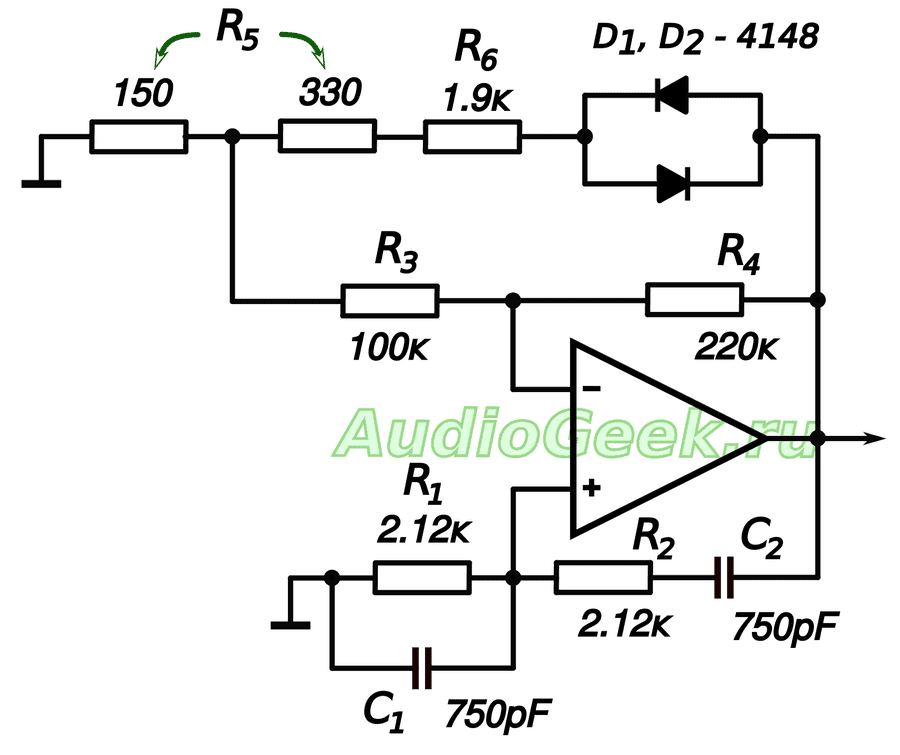
В отличие от светодиодов, падение напряжения на p-n переходе обычных диодов составляет 0.6÷0.7 В, поэтому величина выходного напряжения генератора составила около 2.5 В. Для увеличения выходного напряжения возможно включение нескольких диодов последовательно, вместо одного, например вот так:
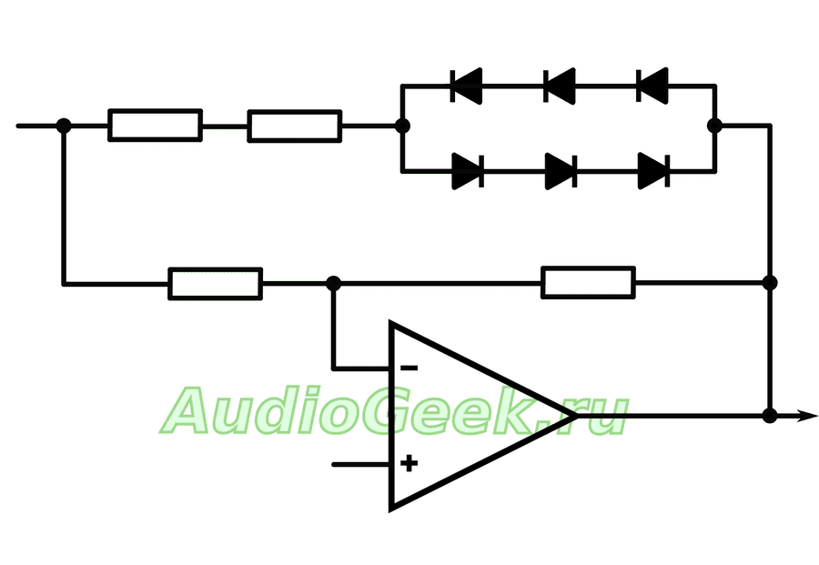
Однако увеличение количества нелинейных элементов сделает генератор более зависимым от внешней температуры. По этой причине было решено отказаться от такого подхода и использовать по одному диоду.

## Замена переменного резистора постоянными

Теперь о подстроечном резисторе. Изначально в качестве резистора R5 был применен многооборотный подстроечный резистор на 470 Ом. Он позволял точно регулировать величину выходного напряжения.
Использование переменного резистора в подобных цепях нежелательно по двум основным причинам:

- ненадежность подвижного контакта
- наличие у многооборотных подстроечных резисторов паразитной индуктивности, которая может отрицательно сказаться на качестве выходного сигнала

> **При построении любого генератора крайне желательно наличие осциллографа. Переменный резистор R5 напрямую влияет на генерацию - как на амлитуду так и на стабильность.**

Для представленной схемы генерация стабильна лишь в небольшом интервале сопротивлений этого резистора. Если соотношение сопротивлений больше требуемого - начинается клиппинг, т.е. синусоида будет подрезаться сверху и снизу. Если меньше - форма синусоиды начинает искажаться, а при дальнейшем уменьшении генерация глохнет.
Так же это зависит от используемого напряжения питания. Описываемая схема исходно была собрана на ОУ LM833 с питанием ±9В. Затем, без изменения схемы, ОУ были заменены на AD8616, а напряжение питания на ±2,5В (максимум для этих ОУ). В итоге такой замены синусоида на выходе подрезалась. Подбор резисторов дал значения 210 и 165 ом, вместо 150 и 330 соответственно.

## Как подобрать резисторы "на глаз"

В принципе можно оставить и подстроечный резистор. Все зависит от требуемой точности и генерируемой частоты синусоидального сигнала.
Для самостоятельного подбора следует, в первую очередь, установить подстроечный резистор номиналом 200-500 Ом. Подав выходной сигнал генератора на осциллограф и вращая подстроечный резистор дойти до момента когда начнется ограничение.
Затем понижая амплитуду найти положение, в котором форма синусоиды будет наилучшей.Теперь можно выпаять подстроечник, замерить получившиеся величины сопротивлений и впаять максимально близкие значения.
Если вам требуется генератор синусоидального сигнала звуковой частоты, то можно обойтись и без осциллографа. Для этого, опять таки, лучше дойти до момента когда сигнал, на слух, начнет искажаться из-за подрезания, а затем убавить амплитуду. Убавлять следует до тех пор пока искажения не пропадут, а затем еще немного. Это необходимо т.к. на слух не всегда можно уловить искажения и в 10%.

## Дополнительное усиление

Генератор синуса был собран на сдвоенном ОУ, и половина микросхемы осталась висеть в воздухе. Поэтому логично задействовать ее под регулируемый усилитель напряжения. Это позволило перенести переменный резистор из дополнительной цепи ОС генератора в каскад усилителя напряжения для регулировки выходного напряжения.
Применение дополнительного усилительного каскада гарантирует лучшее согласование выхода генератора с нагрузкой. Он был построен по классической схеме неинвертирующего усилителя.
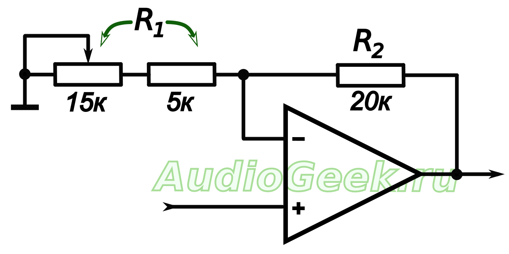
Указанные номиналы позволяют изменять коэффициент усиления от 2 до 5. При необходимости номиналы можно пересчитать под требуемую задачу. Коэффициент усиления каскада задается соотношением:

***K=1+R2/R1***

Резистор ***R1*** представляет из себя сумму последовательно включенных переменного и постоянного резисторов. Постоянный резистор нужен, чтобы при минимальном положении ручки переменного резистора коэффициент усиления не ушел в бесконечность.

## Как умощнить выход

Генератор предполагался для работы на низкоомную нагрузку в несколько Ом. Разумеется ни один маломощный ОУ не сможет выдать необходимый ток.
Для умощнения, на выходе генератора разместился повторитель на TDA2030. Все вкусности такого применения этой микросхемы описаны в статье [Схема повторителя напряжение на ОУ. Мощный повторитель напряжения на TDA2030](../povtoritel-opamp/).
А вот так собственно выглядит схема всего синусоидального генератора с усилителем напряжения и повторителем на выходе:
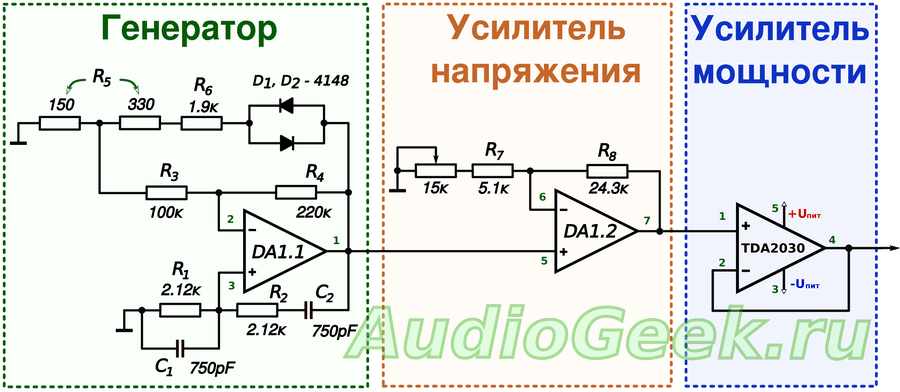
Генератор синуса на мосту Вина можно собрать и на самой TDA2030 в качестве ОУ. Все зависит от требуемой точности и выбранной частоты генерации.
Если нет особых требований к качеству генерации и требуемая частота не превышает 80-100 кГц, но при этом предполагается работа на низкоомную нагрузку, то этот вариант вам идеально подойдет.

## Заключение

Генератор на мосту Вина - это не единственный способ генерации синусоиды. Если вы нуждаетесь в высокоточной стабилизации частоты то лучше смотреть в сторону генераторов с кварцевым резонатором.
Однако, описанная схема, подойдет для подавляющего большинства случаев, когда требуется получение стабильного, как по частоте так и по амплитуде, синусоидального сигнала.
Генерация это хорошо, а как точно измерить величину переменного напряжения высокой частоты? Для это отлично подходит схема которая называется [Активный выпрямитель](../aktivniy-vipryamitel/).

***Материал подготовлен исключительно для сайта* [AudioGeek.ru](https://audiogeek.ru)**
