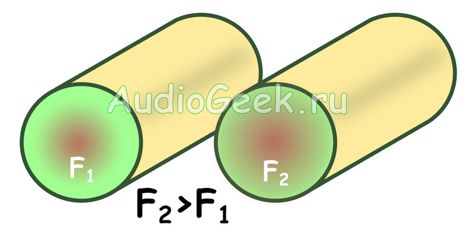
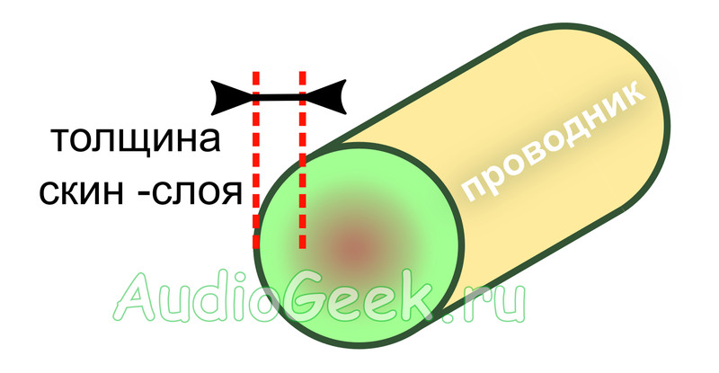
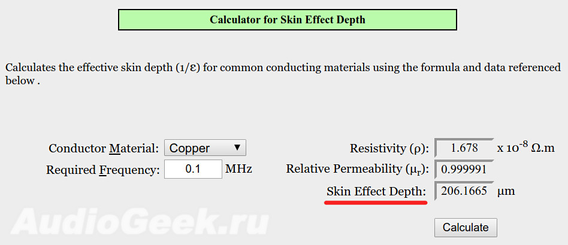

[Русский](./README.ru.md) | **English**

# The skin effect in audio conductors

**Category:** Audio circuit design  
**Tags:** sound quality  
**Original:** https://audiogeek.ru/skin-effect/

---

In pursuit of maximum sound fidelity, audiophiles have been fiercely trying to suppress the skin effect in audio cables. But what exactly is this much-discussed skin effect? Let us find out whether it is really a serious obstacle to good sound or just the magic of glossy magazines.

## What is the skin effect?

> In simple terms, the ***skin effect*** is that an alternating current flowing along a conductor is pushed toward the conductor's surface as frequency rises.

The higher the signal frequency **F**, the more strongly the current is pushed to the surface and the thinner the layer it flows in becomes. That layer is called the skin layer. The red area in the picture is the region where the signal does not flow.

This means the signal propagates differently at different frequencies. It happens because different frequencies use different cross-sectional areas of the conductor, and a different area means a different resistance. All this leads to phase distortion in the signal.

## Skin depth

> **Skin depth** is the depth below the surface at which the signal has fallen by a factor of ***e*** (about 2.71). Put simply, it is the useful cross-section of the conductor through which the signal passes unchanged.

***Just imagine: we spend colossal money on ICs and capacitors, and some piece of cheap wire ruins everything. Sad...***

## And what counts as a high frequency?

As already said, the skin effect shows up only on AC signals and only at high frequencies. Until now I deliberately avoided giving numbers. ***But what does high frequency mean?***

Note that "high frequencies" here means high by electronics standards, not by human hearing. People start to fight the skin effect at frequencies ***above 1 MHz***. There the conductors may even be made not solid but hollow, as tubes, because the center of the conductor becomes not just useless but harmful to the signal.

Of course the skin effect also shows up in the audible range. Not for nothing do all the high-end magazines go on about it. It is just that the clever marketers do not say how large the effect actually is.

## The skin effect at specific frequencies

There are plenty of online calculators that compute skin depth for a given frequency. I liked ***[this one](http://chemandy.com/calculators/skin-effect-calculator.htm)***, and we will use it.

Now let us find the skin depth at the maximum audible frequency. We are said to hear up to 20 kHz at best. *There are claims that the cochlea has special hairs immersed in lymph that sense frequencies up to 100 kHz, and that these frequencies, although we do not hear them, influence how we perceive the audible range...*

> **Never mind.** For **100 kHz** the skin depth is **0.2 mm**.

If you take a wire whose radius equals the skin depth, you can ignore the skin effect, because the skin depth is the whole wire.

You can see the thickness of headphone wires by cutting open an old pair, or for example in the article [how to fix headphones without a soldering iron](../remont-naushnikov-bez-payalnika/). Today it is practically standard to make such wires from Litz wire.

> ***Litz wire*** is multistrand wire in which each strand has its own enamel insulation.

So the thickness of each strand is far less than the result above. That is how the pages of glossy magazines neatly fool us.

## Maybe other effects?

Of course there is another surface effect. It boils down to the fact that all the charges flowing in the conductor, electrons, have the same sign. And as we know, like charges repel. As a result, the current, like the skin effect, is pressed toward the edge of the conductor.

But this effect shows up only at currents much larger than 10–20 amperes, and has nothing to do with interconnects or headphone cables...

## Conclusion

A wire really can affect sound. One way or another it has parasitic properties such as inductance, capacitance and resistance. But in any decent wire these parasitic values are so tiny that it is a sin to blame the cable if something sounds bad.

*Originally written for [AudioGeek.ru](https://audiogeek.ru). Translated from Russian.*
