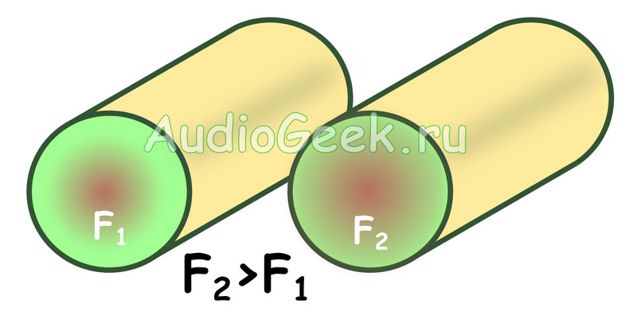
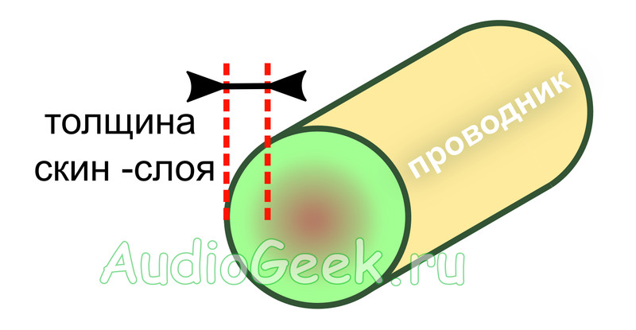
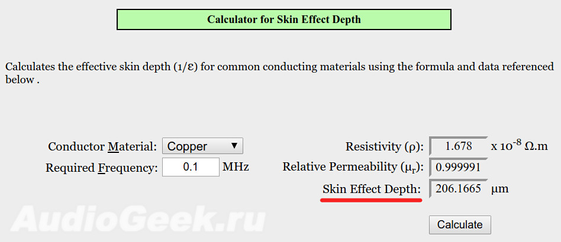

[English](./README.md) | **Русский**

# Скин эффект в проводнике звука

**Дата:** 2019-04-17  
**Рубрики:** Схемотехника аудиотракта  
**Метки:** качество звука  
**Оригинал:** https://audiogeek.ru/skin-effect/

---

В погоне за максимальной достоверностью звука, аудиофилы начали яро пытаться подавить скин эффект в звуковых проводах. Но что на самом деле такое этот пресловутый скин эффект? Давайте выясним действительно ли это серьезное препятствие на пути качественного звука или же магия глянцевых журналов.

## **Что такое скин эффект?**

Если вы не сильны в английском, то ***скин*** (*skin*) переводится как **кожа** или в данном случае скорее **слой**. В русскоязычной литературе, скин эффект называют поверхностным эффектом.
> Говоря простым языком, ***скин эффект*** заключается в том, что протекающий по проводнику переменный ток, вытесняется к поверхности проводника с ростом частоты.

Чем выше частота сигнала **F** тем сильнее он вытесняется к поверхности и тем тоньше становится слой по которому он протекает. Этот слой называется скин слой. Красная область на рисунке - область по которой сигнал не течет.

Это приводит к тому, что скорость протекания сигнала на разной частоте различна. Происходит это потому, что для разных частот используется разная площадь поперечного сечения проводника, а разная площадь это разное сопротивление. Все это приводит к появлению фазовых искажений в сигнале.

## **Толщина скин слоя**

> **Толщина скин слоя** - это толщина слоя поверхности, углубившись на которую сигнал ослабевает в ***2.71 раз*** (*константа е*). Говоря проще - это полезная площадь проводника, через которую сигнал проходит без изменений.

***Представьте только. мы тратим колоссальные деньги на микросхемы и конденсаторы, а какой-то кусочек дешевого провода портит весь эффект. Грусть. печаль...***

## **А какая частота считается высокой?**

Как уже было сказано, скин эффект проявляется только на переменном сигнале и только на высоких частотах. До этого я специально обходил числовые значения частоты стороной. ***Но что же означает высокая частота?***
Тут стоит заострить внимание на том, что под "высокими частотами" подразумеваются высокие по меркам электроники, а не человеческого слуха. Бороться с проявлением скин эффекта начинают на частотах ***выше 1МГц***. Там может доходить и до того, что проводники делаются не сплошными, а полыми в виде трубок. Т.к. в центральная часть проводника становится не просто ненужной, но еще и вредной для сигнала.
Конечно скин эффект проявляется и в слышимой области частот. Не зря же об этом пестрят все Хай-Энд издания. Но вот только хитрые маркетологи не говорит о том, насколько проявляется это влияние.

## **Скин эффект для конкретных частот**

Сегодня существует довольно много онлайн калькуляторов, считающих толщину скин слоя для конкретной частоты. Мне приглянулся ***[этот](http://chemandy.com/calculators/skin-effect-calculator.htm)***. На нем и будем считать.
А теперь давайте узнаем толщину скин слоя для максимальной слышимой частоты. Считается что мы слышим в лучшем случае до 20кГц. *Но есть данные, что в улитке слухового аппарата есть специальные волоски, погруженные в лимфу, которые чувствуют частоты до 100кГц. Эти частоты, хоть мы их и не слышим влияют на восприятие слышимого диапазона...*
> **Да не важно)** вообщем, для **100 кГц** толщина скин слоя составляет **0.2 мм**.

Если взять провод с радиусом равным толщине скин слоя, то на скин эффект можно наплевать. Ибо его толщина это весь провод.
Толщину проводков, применяемых в наушниках можно посмотреть зарезав одни из своих наушников или, например, в статье "как починить наушники без паяльника". Сегодня уже практически стандарт делать такие провода из литцендрата.
> ***Литцендрат*** это многожильный провод, каждая жилка которого имеет отдельную лаковую изоляцию.

Так что толщина каждого проводка много меньше полученного результата. Вот таким нехитрым образом страницы красивых журналов нас красиво разводят.

## **Может другие эффекты?**

Конечно есть еще один поверхностный эффект. Суть его сводится к тому, что все протекающие в проводнике заряды - электроны имеют одинаковый знак. А как известно, одинаковые заряды отталкиваются. В результате протекающий ток подобно скин эффекту прижимается к краю проводника.
Но этот эффект проявляется только при токах намного больших 10-20 ампер, и ни к межблочным ни к наушниковым кабелям никакого отношения не имеет...

## **Заключение**

Провод действительно может влиять на звук. Так или иначе он обладает такими паразитными характеристиками как индуктивность, емкость и сопротивление. Но у любого качественного провода эти паразитные величины настолько мизерны, что грешно косить на кабель, если что-то плохо звучит.

***Материал подготовлен исключительно для сайта** **[AudioGeek.ru](https://audiogeek.ru)***
