[Русский](./README.ru.md) | **English**

# An SO8 to DIP8 adapter for ICs

**Category:** Electronics  
**Tags:** AliExpress, op-amp circuit  
**Original:** https://audiogeek.ru/so8-to-dip8/

---

The miniaturization of electronics has led to many chips simply not being made in the universally loved DIP8 package. They are, however, readily available in SO8 (aka SOIC) packages. But we want the chip in a DIP. Nothing complicated: an SO8 to DIP8 adapter to the rescue.

In hobby electronics, and especially in audiophile practice, you often need to try different chips by plugging them into sockets. Of course there are sockets for SO8. But in most cases using DIP8 makes life simpler.

## **The SO8 to DIP8 adapter**

Today let us look at the SO8 to DIP8 adapter. Ready-made, this wonder looks like this:
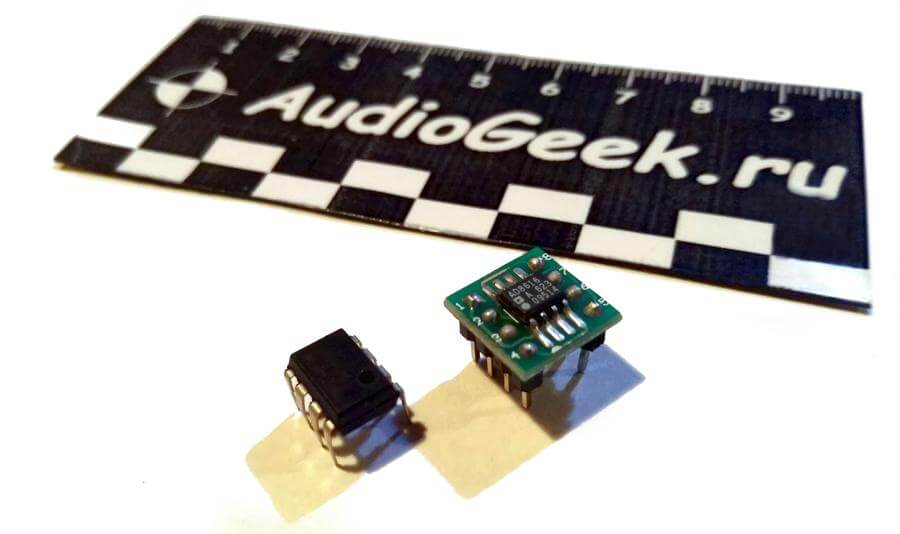
Essentially the SO8 to DIP8 adapter is a double-sided printed circuit board. The beauty of this solution is that the adapter can be used both for SO8 and for its even smaller sibling.
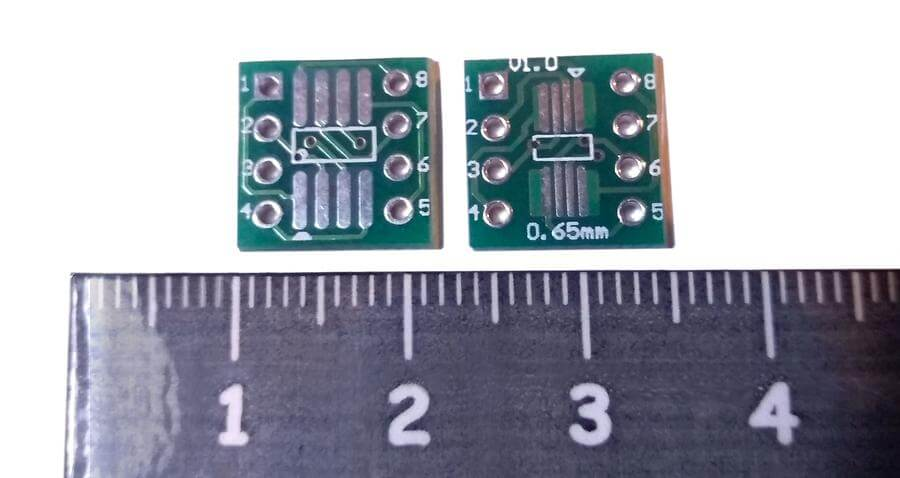
It makes no difference which package you use; both variants can be easily soldered and turned into a DIP8. For those who are interested in the exact dimensions:
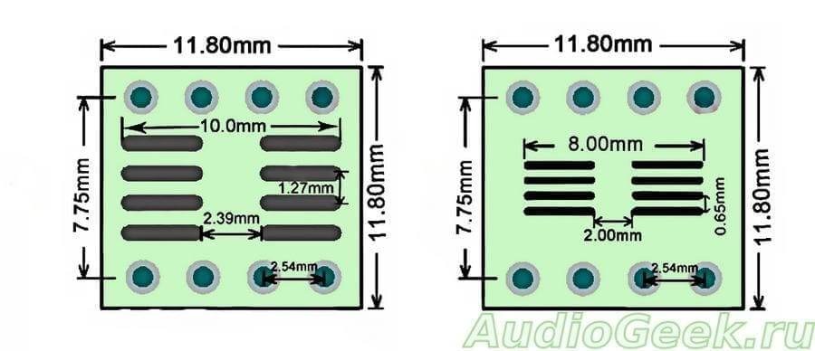
The pin numbering of the future DIP chip is marked on the board with white digits. And next to pin 1 of the small packages there is a mark to go by when soldering.
The cheapest way to buy these SO8 to DIP8 adapters is on AliExpress. Of course they are also sold in many electronic parts shops, but usually at a higher price, because they are shipped from China anyway.

## **How to solder it all**

Let us see how to quickly turn a chip from SO8 into DIP8 using the adapter. Besides the adapter boards themselves, you also need pins. Most often they come in the kit, but they are also sold separately..
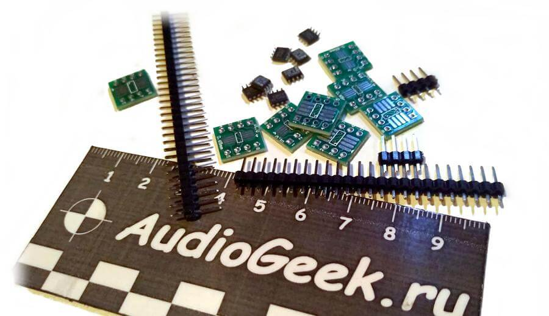
With pins, keep in mind that they come in different kinds, and before soldering you must make sure the pins will later fit where they need to go.
Pins are usually sold in rows of 40. Break the strip of pins into pieces of 4. Although the pins are held in plastic, nothing stops you from sliding the plastic holder along the pins as is convenient.
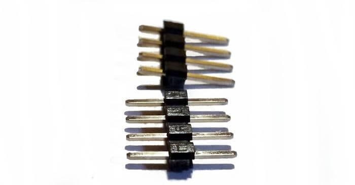
To avoid heating the chip unnecessarily, we solder the pins first. Take a DIP8 socket and push a row of pins into it from both sides, all the way in. Put on the adapter board and press down to move the plastic holder right up against the socket.
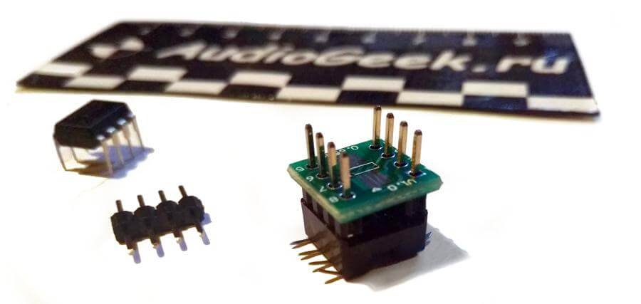
In my case the resulting chips were meant to be used in sockets, and long pins did not suit me. So I went by the socket. But even if the chips will be soldered into a board in the usual way, this pin length is optimal.
Now with solder and the iron, solder all the pins one by one. The holes are plated through, so you can flood everything well with tin.
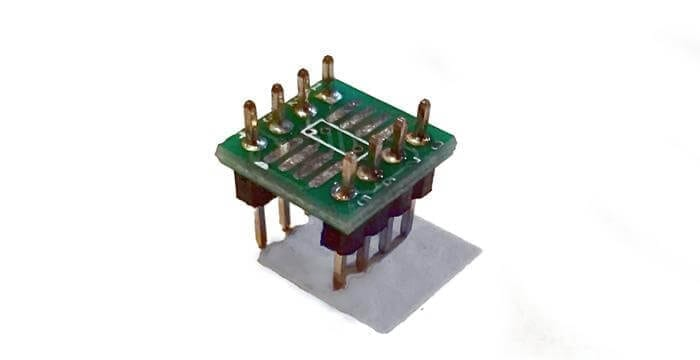
The pin ends sticking up will get in the way when soldering the chip, so we cut them off. To keep sharp ends from sticking up you can go over them with a file. After that you can solder the pins once more from above.
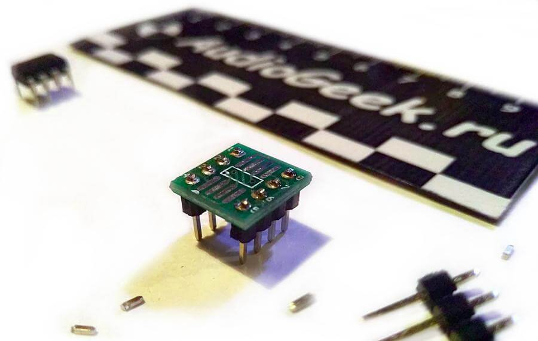
You can prepare a batch of such blanks in advance and use them as needed.

## How to solder a chip to the adapter

This is done just like soldering a chip to any other board. To make the process clearer, let us look at it on a separate adapter.
> ***Be careful in choosing solder. The shelves are full of cheap high-melting solder. It is better to prefer less, but more expensive, solder. Some solders sold in shops flatly refuse to stick to the iron's tip, and that is no longer soldering but real torture.***

All the contacts of the board are already tinned. Put a drop of tin on one of the corner pads. This is needed to tack the chip in place initially.
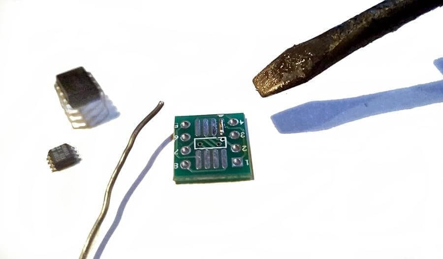
Now, heating the pad with the iron, place the chip with tweezers. Try to position it so that its pins land symmetrically on all the contact pads.
When the chip is sitting as required, remove the iron and blow. As it cools, the tin turns matte. When that has happened you can release the chip.
Now you can calmly solder the remaining pins. To solder them, touch the iron to the edge of the contact pad and touch the tin to the chip pin. As soon as a drop of tin has glued the pin to the pad, remove the iron.
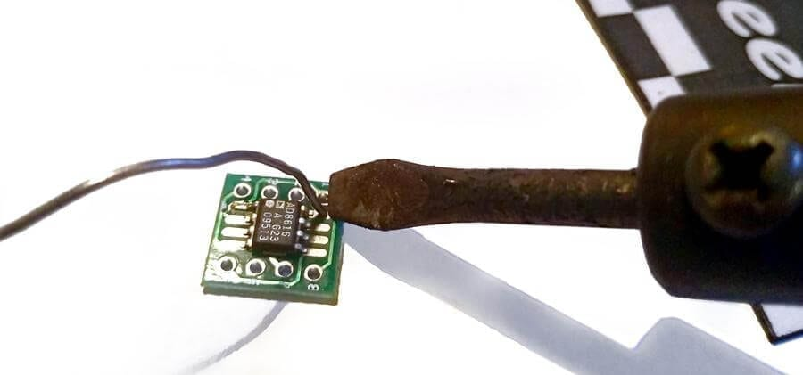
It is important to remember that you must not heat the chip for long. It is highly desirable to limit yourself to 3 seconds. Otherwise you can kill it. Touch it with a finger, and if it is already too hot, wait until the chip cools.
> ***For better soldering, use soldering paste or an alcohol rosin solution, which are simply applied to the spot before soldering. But you can do without them. Normal solder already contains something like rosin.***

I do not recommend acid fluxes. First, their fumes are toxic. And second, if not washed off well, they start to corrode the joints and contacts.

## Washing...

After everything is soldered, all that remains is to bring the appearance to perfection by removing traces of rosin and/or soldering paste. This is needed not only for the looks of the resulting chip but also to make sure there are no accidental shorts under the rosin.
Pour a little pure alcohol into a small airtight medicine jar and drop the resulting assembly into it.
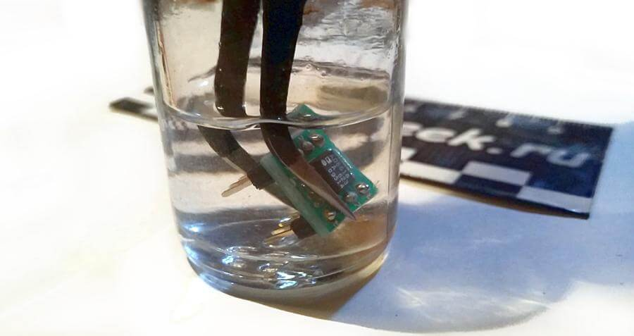
It is desirable that the chip with the adapter be fully submerged in alcohol. For more effective washing, close the jar tightly and shake it in all directions. You can also make the process more effective with a toothbrush.
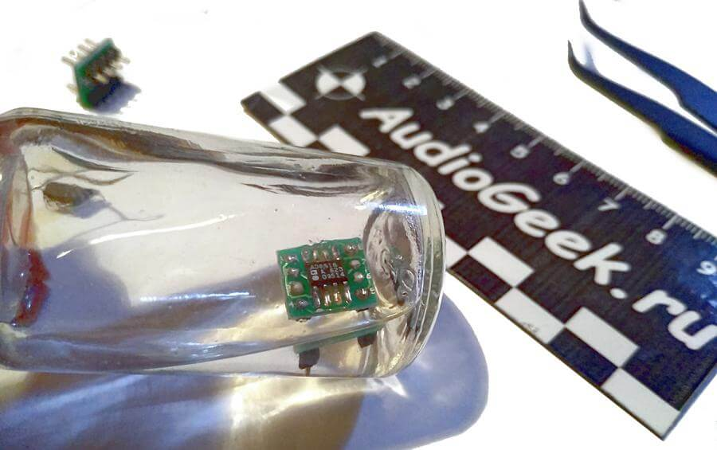

## Conclusion

So, with the help of clever adapters, you can quickly turn chips from SO8 packages into DIP8. These adapters are very handy in practice and will certainly come in useful, especially if you are building a ***[headphone amplifier](https://audiogeek.ru/volx/)***.
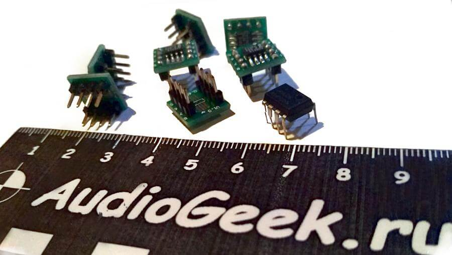

*Originally written for [AudioGeek.ru](https://audiogeek.ru). Translated from Russian.*
