[English](./README.md) | **Русский**

# Переходник для микросхем из SO8 в DIP8

**Рубрики:** Разная электроника  
**Метки:** AliExpress, схема на ОУ  
**Оригинал:** https://audiogeek.ru/so8-to-dip8/

---

Миниатюризация электроники привела к тому, что многие микросхемы просто не выпускаются во всеми любимом корпусе DIP8. Зато они легко доступны в корпусах SO8 (он же SOIC). А  мы вот хотим, чтобы микросхема была в ДИПе. Ничего сложного - переходник для микросхем из SO8 в DIP8 ф студию.

В радиолюбительской, а особенно меломанской. практике часто возникает необходимость пробовать разные микросхемы, вставляя их в сокеты. Конечно существуют сокеты для SO8. Но в большинстве случаев использование DIP8 упрощает жизнь.

## **Переходник для микросхем из SO8 в DIP8**

Рассмотрим сегодня переходник из SO8 в DIP8. В готовом виде это чудо выглядит следующим образом:
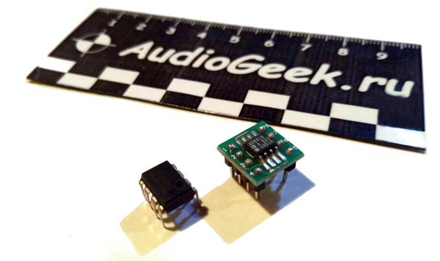
По сути переходник из SO8 в DIP8 представляет собой двустороннюю печатную плату. Прелесть такого решения заключается в том, что переходник можно использовать как для SO8 так и для его еще более мелкого собрата.
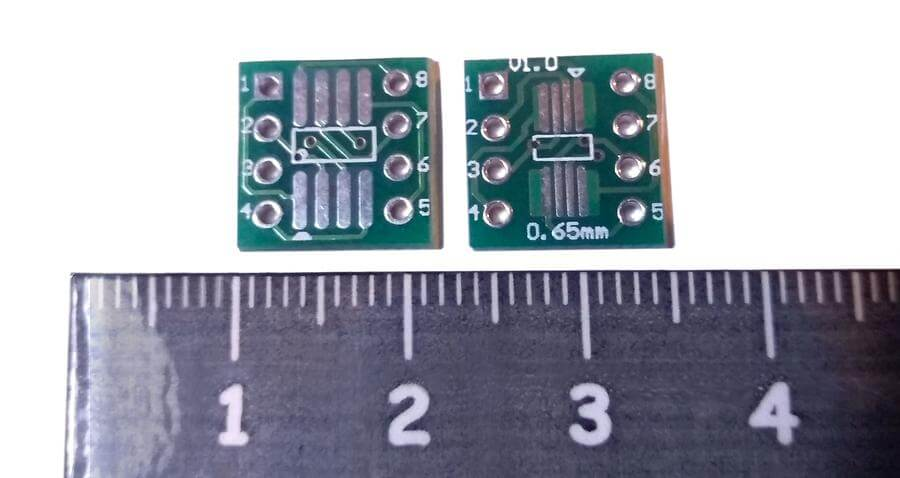
Разницы какой корпус использовать нет, оба варианта можно легко припаять и превратить в DIP8. Для тех кому интересны более точные размеры:
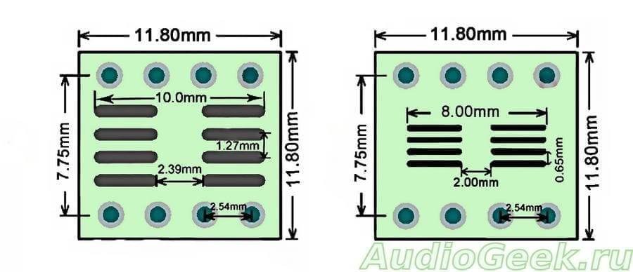
Нумерация ножек будущей ДИП микросхемы обозначена на плате белыми цифрами. А рядом с первой ножкой мелких корпусов стоит метка, по которой следует ориентироваться при пайке.
Дешевле всего купить такие переходники для микросхем из SO8 в DIP8 ***на АлиЭкспресс***. Конечно они продаются и во многих магазинах радиодеталей, но обычно продаются дороже, т.к. везутся они опять таки из Китая.

## **Как все припаять**

Давайте рассмотрим, как быстро переделать микросхему из SO8 в DIP8 имея переходник быстро переделать микросхему в корпус ДИП8 . Помимо самих плат переходников потребуются также ножки. Чаще всего они идут в комплекте. Но продаются и отдельно..
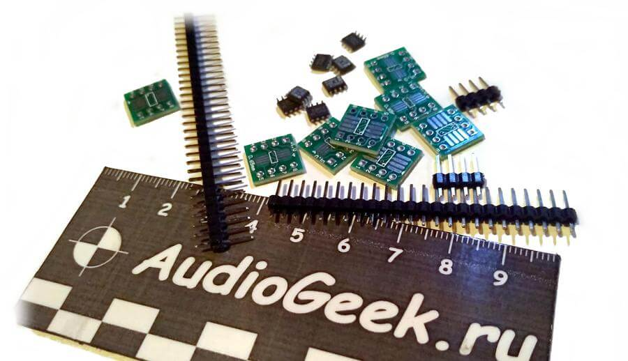
В случае ножек стоит учитывать, что они бывают разные и перед пайкой необходимо убедиться. Что потом эти ножки залезут туда, куда им требуется.
Ножки обычно продаются рядами по 40 штук. Разламываем батарею ножек на кусочки по 4 ножки. Ножки хоть и зафиксированы в пластике, но ничто не мешает сдвинуть пластиковый держатель по ножкам, как нам удобно.
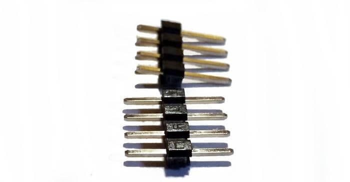
Чтобы не греть лишний раз микросхему первым делом припаивать будем именно ножки. Берем сокет на ДИП8 и втыкаем в него с обеих сторон по ряду ножек на всю глубину. Одеваем плату переходника и надавливаем, чтобы сместить пластиковый крепеж вплотную к сокету. 
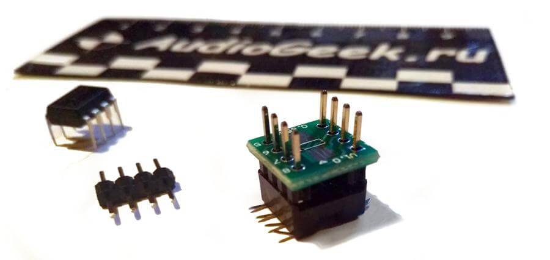
В моем случае предполагалось, что получившиеся микросхемы будут использоваться в сокетах и длинные ножки меня не устраивали. Поэтому по сокету я и ориентировался. Но даже в случае, если микросхемы будут припаиваться к плате, как положено, то такая длина ножек будет оптимальна.
Теперь используя припой и паяльник пропаиваем по очереди все ножки. Отверстия металлизированные. Поэтому можно хорошенько залить все оловом.
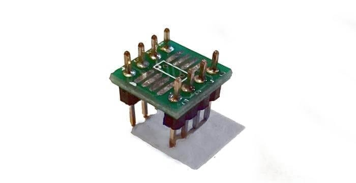
Торчащие вверх концы ножек будут мешать при пайке микросхемы. Поэтому откусываем их. Чтобы острые концы не торчали вверх можно пройтись напильником. После чего можно еще раз пропаять ножки сверху.
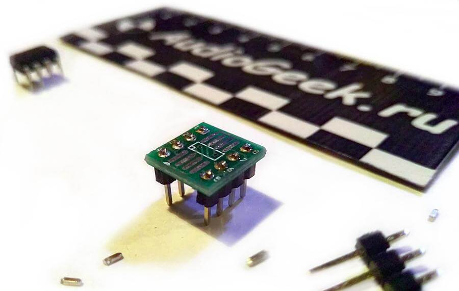
Можно наготовить таких заготовок впрок и использовать при необходимости.

## Как припаять микросхему к переходнику

Собственно это делается так же как и припайка микросхемы на любую другую плату. Чтобы этот процесс был нагляднее рассмотрим его на отдельном переходнике.
> ***Внимательно относитесь к выбору олова. На прилавках много дешевого тугоплавкого олова. Лучше предпочесть меньше, но более дорогого припоя. Некоторые продаваемые в магазинах припои вообще отказываются прилипать к жалу паяльника и это уже не пайка, а настоящая пытка.***

Все контакты платки уже залужены. Наносим капельку олова на одну из угловых площадок. Это потребуется для начальной фиксации микросхемы.
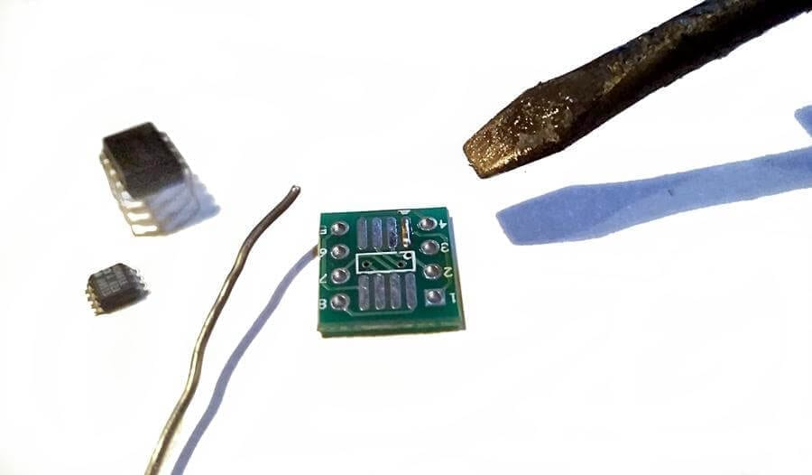
Теперь разогревая площадку паяльником устанавливаем пинцетом микросхему. Стараемся расположить ее так, чтобы она симметрично попадала своими ножками во все контактные площадки.
Когда микросхема встала как требуется - убираем паяльник и дуем. При остывании олово становится матовым. Когда это произошло можно отпустить микросхему.
Теперь можно спокойно пропаять остальные ножки. Для их пайки прикладываем паяльник к краю контактной площадки и тыкаемся оловом в ножку микросхемы. Как только капелька олова склеила ножку с площадкой, убираем паяльник.
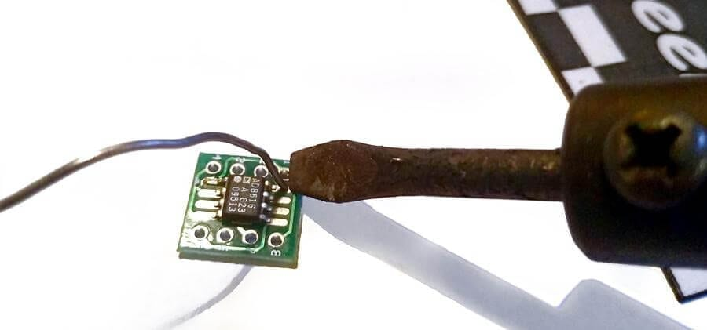
Важно помнить, что нельзя долго греть микросхему. Крайне желательно ограничиваться 3 секундами. Иначе ее можно убить. Потрогайте пальцем, если уже не терпит, дождитесь пока микросхема остынет.
> ***Для лучшей пайки следует использовать паяльный жир или спиртовой раствор канифоли, которые просто наносятся на нужное место перед пайкой. Но можно обойтись и без них. Нормальный припой уже содержит в себе что-то вроде канифоли.***

Не рекомендую использовать кислотные флюсы. Во первых их парЫ токсичны. А во вторых при плохом смывании, они начинают разъедать пайку и контакты.

## Промывка...

После того, как все припаяно, остается только довести внешний вид до идеального, удалив следы канифоли и/или паяльного жира. Это нужно не только для красивости получившейся микросхемы но и для того, чтобы убедиться, что под канифолью нет случайных замыканий.
Наливаем небольшое количество чистого спирта в небольшую герметичную баночку от лекарств и закидываем туда получившуюся конструкцию.
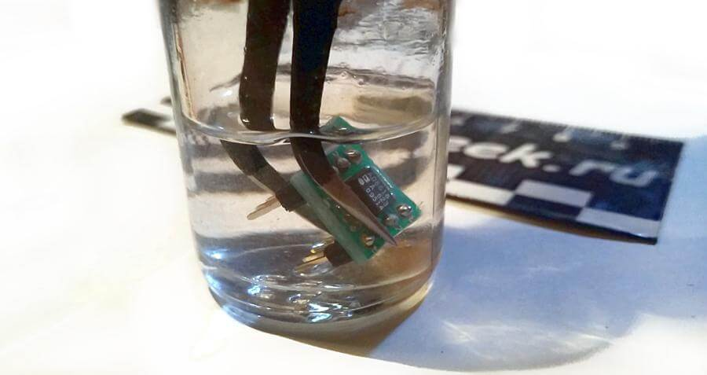
Желательно чтобы микросхема с переходником полностью погружалась в спирт. А для более эффективной промывки, плотно закрываем баночку и трясем ей во все стороны. Так же можно сделать процесс эффективнее при помощи зубной щетки.
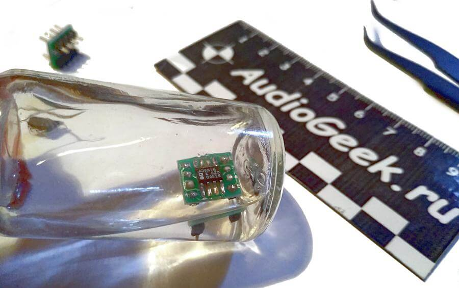

## Заключение

Вот так, при помощи хитрых переходников, можно быстро превратить микросхемы из корпусов SO8 в DIP8. ***Покупать их лучше тут***.
Такие переходники очень удобны в практике и точно пригодится, особенно если вы собираете ***[усилитель для наушников](https://audiogeek.ru/volx/)***.
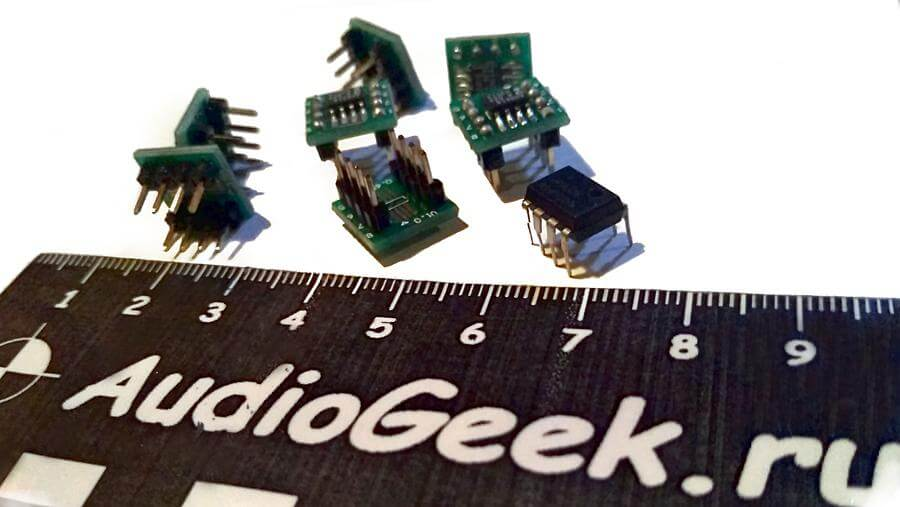

***Материал подготовлен исключительно для сайта* [AudioGeek.ru](https://github.com/SkyTrip-13/AudioGeek)**
